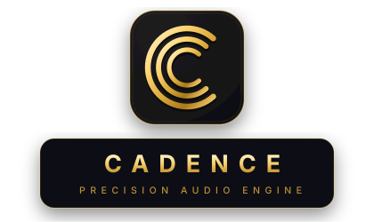
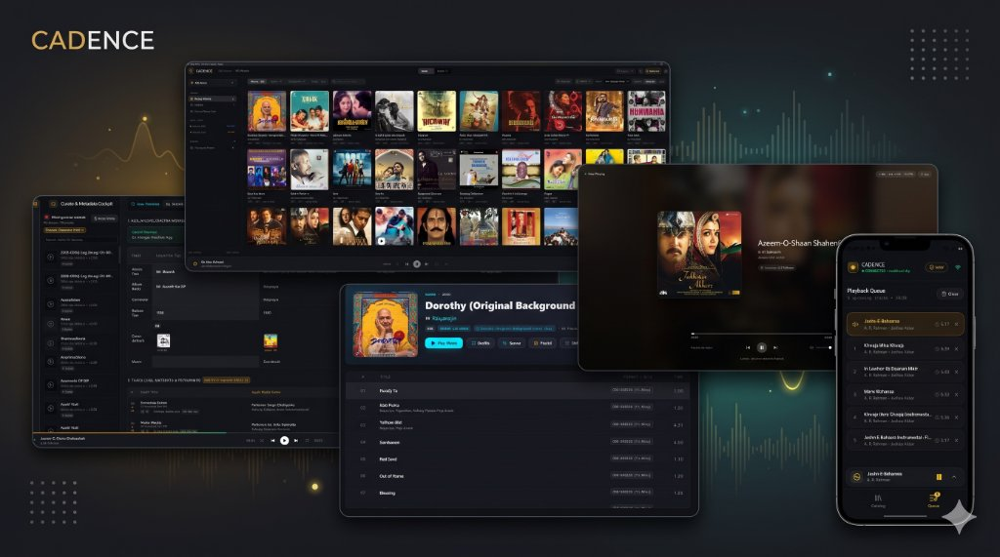

  

<h3 align="center">Precision UPnP audio transport and local music library curation</h3>

  Original audio bytes. RAM-backed playback. Deliberately paced delivery.

  <a href="https://matbhuvi-tech.github.io/Cadence/">Documentation</a> •
  <a href="https://github.com/matbhuvi-tech/Cadence/releases">Download</a> •
  <a href="https://matbhuvi-tech.github.io/Cadence/docs/usage/getting-started">Getting Started</a> •
  <a href="#development">Development</a>

Cadence runs a Playback Engine beside your music library on **Windows, Linux, or TrueNAS**, controlled by a Windows desktop app or Mobile Remote. Its recommended playback path sends original media bytes from RAM over adaptively paced **UPnP/DLNA** to your network renderer. **WASAPI Exclusive and ASIO** are supported alternatives for a Windows-connected DAC.

**Library → Playback Engine → paced UPnP stream → network renderer → DAC**

  

## Start Here

**[Visit the Cadence documentation →](https://matbhuvi-tech.github.io/Cadence/)**

This README introduces the project and its repository. The documentation site is the user guide for choosing a setup, installing, configuring, and using Cadence, with detailed architecture and transport measurements.

| I want to… | Go to |
| :--- | :--- |
| Choose an engine and controller setup | [Overview & setup selector](https://matbhuvi-tech.github.io/Cadence/docs/overview/) |
| Download and install Cadence | [GitHub Releases](https://github.com/matbhuvi-tech/Cadence/releases) · [Installation hub](https://matbhuvi-tech.github.io/Cadence/docs/installation/) |
| Connect my library and start playback | [Getting started](https://matbhuvi-tech.github.io/Cadence/docs/usage/getting-started) |
| Control playback from a phone or tablet | [Mobile Remote guide](https://matbhuvi-tech.github.io/Cadence/docs/installation/mobile) |
| Configure, back up, or troubleshoot | [Configuration](https://matbhuvi-tech.github.io/Cadence/docs/usage/configuration) · [Backup & restore](https://matbhuvi-tech.github.io/Cadence/docs/usage/backup-restore) · [Troubleshooting](https://matbhuvi-tech.github.io/Cadence/docs/usage/troubleshooting) |
| Understand the transport and its measured behavior | [Audio engine architecture & UPnP measurements](https://matbhuvi-tech.github.io/Cadence/docs/architecture/audio-engine) |

Published installers do **not** require Node.js, Rust, or a developer environment.

## What Cadence Offers

- **Paced network playback:** RAM-backed delivery and adaptive UPnP pacing, with native PCM and DSD media support. See the documentation for platform capabilities, memory-locking requirements, and measurement limits.
- **Engine-first control:** The engine owns the catalog, scanning, queue, artwork, metadata commits, and audio delivery. Desktop and Mobile Remote control it locally or over your LAN.
- **A library beyond artist and album:** Browse musical relationships including composers, lyricists, vocalists, soundtracks, release years, and languages.
- **Reviewable curation:** Inspect proposed metadata and artwork changes before approving writes to your files. File-writing work yields to playback.
- **Local ownership:** Music files and the catalog stay on your hardware. Online metadata enrichment is optional and user initiated.

## Development

Start with the **[Developer Guide](DEVELOPER.md)** for repository architecture, entry points, engineering invariants, build commands, and verification. For toolchain setup, see [Building from source](https://matbhuvi-tech.github.io/Cadence/docs/installation/build-from-source).

| Repository area | Purpose |
| :--- | :--- |
| [`src/`](src/) | React / TypeScript desktop interface |
| [`src-tauri/`](src-tauri/) | Rust native backend and Playback Engine |
| [`pwa/`](pwa/) | Mobile Remote PWA |
| [`website/`](website/) | VitePress source for the GitHub Pages documentation |
| [`deploy/`](deploy/) | Packaging and deployment tooling |

Contributor references: [audio playback implementation notes](docs/AUDIO_PLAYBACK_OPTIMIZATIONS.md), [cover art architecture](docs/COVER_ART_RESOLUTION_ARCHITECTURE.md), and [Linux engine deployment & recovery](deploy/playback-engine/README.md).

User-facing setup and usage guidance belongs in [`website/docs/`](website/docs/) so the published documentation remains the place to maintain it.
