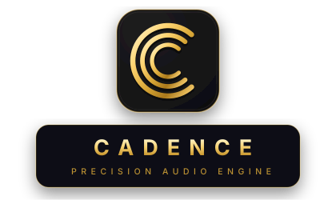
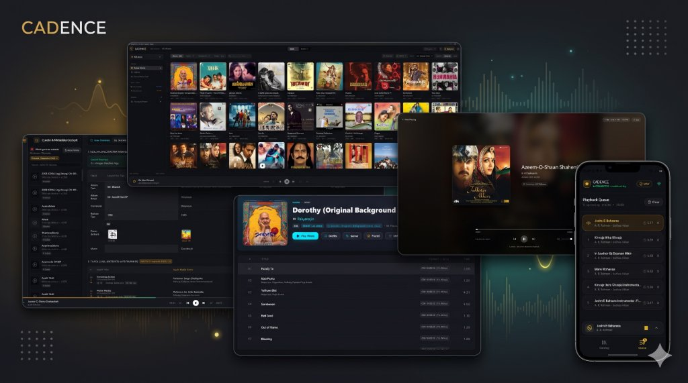
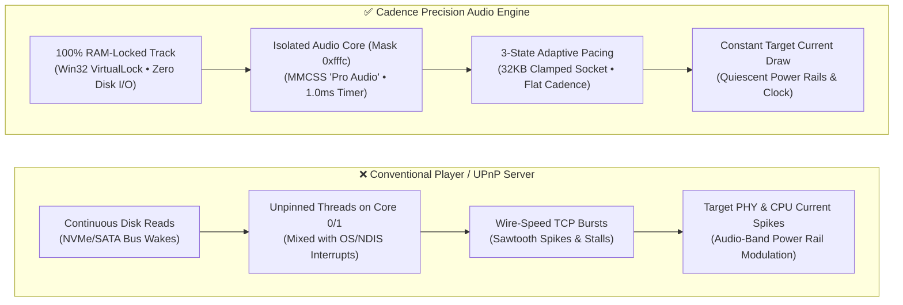
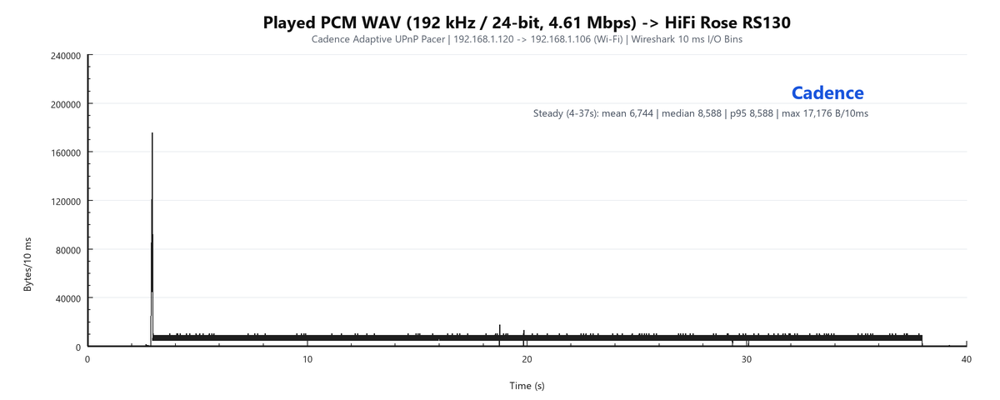
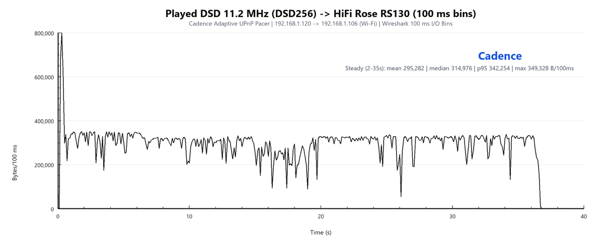
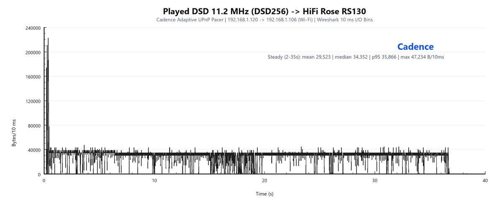
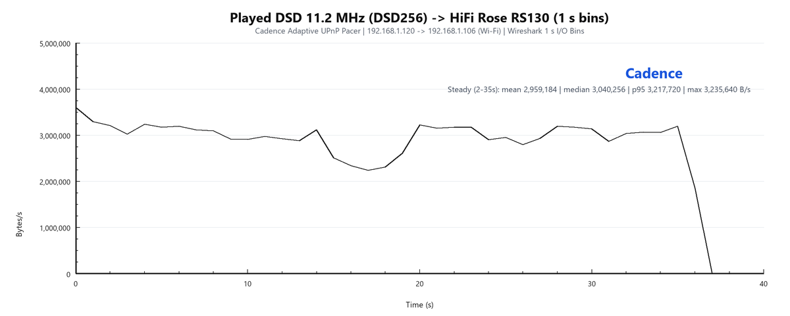

   
  
  
  
  
   
   

  

<h3 align="center">Uncompromising bit-perfect audiophile playback engine, low-noise network transport, and local library curator</h3>

  <b>Your music. Your DAC. Your library. Engineered for electrical and acoustic silence.</b>

  <a href="#the-problem-why-bit-perfect-alone-is-not-enough">The Problem</a> •
  <a href="#the-cadence-solution-deterministic-pacing--subsystem-silence">The Solution</a> •
  <a href="#measured-proof-pcm--dsd256-telemetry">Measured Proof</a> •
  <a href="#cadence-audio-engine-principles">Engine Principles</a> •
  <a href="#features">Features</a> •
  <a href="#download-and-install">Install</a>

 

  

 

---

## Why Cadence Exists

Most music players treat digital audio as a simple file-transfer problem: as long as the bits arrive before the buffer empties, the job is considered done.

**Cadence is built on a fundamentally different premise.** Even when audio data is 100% bit-perfect, the playback apparatus—your PC host, network interface, streamer, and DAC—is an **ultra-sensitive mixed-signal analog system**. How and when bits are read from storage, scheduled across CPU cores, and paced across the network directly governs the electrical noise floor of your system.

---

## The Problem: Why "Bit-Perfect" Alone Is Not Enough

A common misconception in digital audio is that network or host jitter only matters if packets arrive late. Because modern asynchronous USB DACs and network streamers (such as the **HiFi Rose RS130**) re-clock data from local FIFO buffers using internal femto oscillators, conventional software assumes bursty activity is harmless.

As pioneered by reference transport protocols like [Diretta](https://www.diretta.link/), the true degradation vector is **cyclical electrical current fluctuation, EMI/RFI radiation, and power-rail modulation**:

1. **Voltage Stabilization Cannot Stop Current Fluctuations:** High-end linear power supplies, inductors, and low-pass regulators are designed to stabilize *voltage* and filter out high-frequency switching spikes. However, low-frequency fluctuations in **electrical current** pass straight through low-pass filters. When a processor or network chip alternates between microsecond 1 Gbps load spikes and idle states, it draws current in jagged, periodic waves that ripple through the shared ground plane directly into the audible frequency band.
2. **The Network "Burst-and-Silence" Sawtooth:** Standard UPnP/DLNA servers blast audio data at wire speed until the streamer's TCP window fills up, go completely silent for several seconds, and then blast another multi-megabyte burst. Each burst forces the receiving streamer's Ethernet PHY/Wi-Fi controller and CPU to spike in current consumption, modulating the internal power rails adjacent to the master clock and analog DAC stage.
3. **Host Storage & OS Interrupt Hash:** On the PC host, conventional players read audio in continuous `4 KB–64 KB` chunks from NVMe/SATA drives while running playback threads alongside OS background indexing, metadata scraping, and Windows Core 0/1 driver interrupts—injecting continuous high-frequency electrical hash into the host chassis.

---

## The Cadence Solution: Deterministic Pacing & Subsystem Silence

Instead of attempting to filter electrical noise downstream after it has already been generated, Cadence eliminates current fluctuations and bus activity at the source through a **software-defined Host-to-Target stabilization architecture**:

- **Workload Averaging Over the Network:** Cadence's **3-State Adaptive Pacer** synchronizes transmission to the exact real-time consumption rate of the audio format, dispatching tightly timed chunks with a hard-clamped `32 KB` kernel send buffer (`SO_SNDBUF`) and `TCP_NODELAY`. The receiving streamer's network interface and CPU experience a flat, predictable workload—averaging out current consumption across the entire track.
- **Complete Storage & Background Quiescence:** Before the first sample plays, Cadence loads and locks the track into physical RAM (`VirtualLock`) and freezes all non-audio subsystems. Disk controllers go silent, database writes are blocked, and **library curation (`Curate`) is completely locked out while music is playing**.
- **Dedicated Real-Time Silicon Isolation:** Audio and packet-pacing loops are physically isolated away from Windows interrupt cores (`Core 0` and `Core 1`) and elevated to hardware-grade **MMCSS `"Pro Audio"`** real-time scheduling with a `1.0 ms` kernel clock.

---

## Measured Proof: PCM & DSD256 Telemetry

To verify that Cadence eliminates bursty network sawtooth patterns and stabilizes endpoint processing, we captured live Wireshark I/O telemetry while streaming high-resolution **24-bit / 192 kHz PCM WAV** and native **DSD256 (11.2 MHz)** over Wi-Fi to a **HiFi Rose RS130** flagship network transport.

### 1. High-Resolution PCM: 192 kHz / 24-bit WAV (`4.61 Mbps`) → HiFi Rose RS130

Evaluated at an ultra-fine **10 ms micro-bin resolution**, Cadence primes the RS130's hardware FIFO buffer with a controlled fast-start pre-roll and immediately locks into a razor-flat steady-state delivery envelope (`mean: 6,744 B/10ms` | `median: 8,588 B/10ms` | `p95: 8,588 B/10ms`).

  

- **Zero Sawtooth Bursting:** Instead of blasting megabytes at wire speed and stalling on `TCP ZeroWindow`, every `10 ms` window stays tightly bounded below `17.2 KB`.
- **Constant Endpoint Load:** The tightly regulated packet cadence keeps the streamer's network PHY and CPU power draw virtually constant from start to finish.

---

### 2. Native 1-Bit DSD256: 11.2 MHz (`22.58 Mbps`) → HiFi Rose RS130

Streaming uncompressed **DSD256 (`11,289,600 Hz`)** requires sustaining **`~3.00 MB/s`** continuously. Standard media servers either choke on 8-bit container clock miscalculations or flood the OS kernel buffer with `>500 KB` micro-bursts.

#### 100 ms & 10 ms Micro-Bin Telemetry

  

  

#### 1-Second Macro Envelope Telemetry

  

| Telemetry Metric (HiFi Rose RS130 Target) | PCM WAV (`192 kHz / 24-bit`) | Native DSD256 (`11.2 MHz 1-Bit`) | Audiophile Engineering Impact |
| :--- | :--- | :--- | :--- |
| **Native Stream Bitrate** | `4.61 Mbps` (`576 KB/s`) | `22.58 Mbps` (`2,822.4 KB/s`) | Direct ground-truth container header clock extraction |
| **10 ms Steady-State Median** | `8,588 B / 10 ms` | `34,352 B / 10 ms` | Smooth, predictable sub-10ms packet cadence |
| **10 ms 95th Percentile (`p95`)** | `8,588 B / 10 ms` | `35,866 B / 10 ms` | Hard-clamped `32 KB` `SO_SNDBUF` eliminates kernel micro-spikes |
| **100 ms Steady-State Median** | — | `314,976 B / 100 ms` (`max 349 KB`) | Zero multi-megabyte burst surges across Wi-Fi |
| **1 s Macro Throughput (`mean / med`)** | — | `2.96 MB/s` / `3.04 MB/s` | Matches `~3.00 MB/s` real-time DSD256 consumption (`0` stalls) |
| **Disk Reads During Playback** | **`0 Bytes`** | **`0 Bytes`** | 100% pre-loaded and pinned in physical RAM via `VirtualLock` |

---

## Cadence Audio Engine Principles

Cadence enforces **7 strict architectural invariants** across the Windows NT kernel, system memory manager, storage bus, network stack, and UI compositor. Every subsystem yields unconditionally to audio playback.

### 1. CPU Core Isolation (Never Pinned to Core 0 or Core 1)
On Windows, **Core 0 and Core 1** bear the heaviest operating-system interrupt load—handling hardware Interrupt Service Routines (ISRs), NVMe disk completion queues, and Network Driver Interface Specification (NDIS) Deferred Procedure Calls (DPCs).
- **Core Affinity Mask (`0xfffc`):** Cadence explicitly excludes Core 0 and Core 1 from the synchronous audio and UPnP streaming thread (`cadence-paced-stream`), isolating playback on quieter application cores.
- **MMCSS `"Pro Audio"` Elevation:** The streaming thread registers with the Windows Multimedia Class Scheduler Service (`AvSetMmThreadCharacteristicsW("Pro Audio")`), elevating it to real-time priority (**Priority 26+**) so desktop tasks cannot preempt packet delivery.
- **`1.0 ms` Kernel Timer Resolution:** Windows' default `~15.6 ms` timer is tightened to **`1.0 ms`** (`timeBeginPeriod(1)`) for sub-millisecond pacing accuracy, wrapped in a compile-time `!Send` RAII guard (`PlatformThreadGuard`) that deterministically releases kernel resources on stop or track skip.

### 2. Whole-Track RAM Caching & Physical Memory Pinning (`VirtualLock`)
Standard players read from disk every few milliseconds, waking storage controllers and risking OS page-file swaps under memory pressure.
- **Dynamic Physical RAM Budget:** Cadence inspects physical memory via `GlobalMemoryStatusEx` and reserves **25–30% of free RAM** (e.g., `8–16 GB` on modern desktops) for whole-track pre-loading.
- **Win32 `VirtualLock` Pinning:** Before playback starts, the process working set is expanded (`SetProcessWorkingSetSizeEx` with `64 MB` safety headroom) and the entire track buffer is locked into physical RAM chips via `VirtualLock`—guaranteeing **zero page faults** and **zero swap activity**.
- **Zero-Allocation Streaming Loop:** Once playback enters its active loop, Cadence performs **zero heap allocations** (`Box`, `Vec` resizing, `malloc`/`free`), eliminating allocator lock contention and memory bus churn.
- **Ping-Pong Windowed Buffering for Massive Files:** For multi-gigabyte files exceeding the RAM budget (e.g., `6 GB` DSD512 or full-length symphonies), Cadence switches to two page-locked `128–256 MB` Ping-Pong buffers prefetched on a demoted `THREAD_PRIORITY_BELOW_NORMAL` background thread—keeping drives silent for **98% of track duration**.

### 3. Storage Bus Silence & Curation Lockout During Playback
Protecting the audio thread is meaningless if background application workers thrash the disk or database while you listen.
- **Zero Disk I/O Guarantee:** While the engine is in `Playing`, `Paused`, or `Loading` states—and for a mandatory **30-second post-playback cooldown**—zero disk reads or writes occur on music library drives. NVMe and SATA controllers drop into deep quiescent states.
- **Curate Mode Locked Out During Playback:** Metadata curation (`Curate`), two-phase tag writing, library folder scanning, embedded artwork extraction, and AI metadata inference are **strictly blocked while music is playing**. Cadence enforces a hard separation between *Listening* and *Curating* so background workflows can never degrade playback purity.

### 4. 3-State Adaptive Network Pacing & Clamped Kernel Buffers
To achieve Diretta-grade current stability over standard UPnP/DLNA endpoints without custom hardware:
- **State 1 — Fast-Start & Ramp-Up (`1.25×`):** Playback opens with a bounded **`512 KB` pre-roll** (priming the DAC instantly while leaving ~90% of the hardware FIFO buffer free) followed by a gentle `1.25×` ramp.
- **State 2 — Anti-Windup Backpressure Stepdown (`1.02× → 1.002×`):** If socket write blocking exceeds `25 ms` (indicating receiver FIFO saturation), Cadence immediately re-anchors its pacing clock to prevent catch-up bursts and steps delivery down to `1.02×` (and `1.002×` on repeat backpressure).
- **State 3 — Stable Cruise (`1.002×–1.05×`):** After an 8-second stall-free window, the pacer settles into a low-noise steady cruise matching the DAC's exact consumption rate.
- **Hard-Clamped `32 KB` `SO_SNDBUF` & `TCP_NODELAY`:** By clamping the OS kernel send buffer to `16–32 KB` (two `16 KB` chunks) and disabling Nagle's algorithm, Cadence physically prevents the Windows TCP stack from hoarding data and firing `>500 KB` needle spikes when the streamer's window reopens.
- **Seek-Aware Continuation & Unpaced Cover Art:** Mid-track HTTP Range requests (`≥ 1 MB` on seek) skip pre-roll bursts entirely and enter State 3 directly, while embedded ID3v2 artwork at the tail end of `.dsf` files (`metadata_offset`) bypasses the audio pacer so album art loads at wire speed without stalling audio.

### 5. Bit-Perfect Purity Mode (`1.0` Unity Gain)
- **Direct Hardware & Native Payload Delivery:** Local endpoints use **WASAPI Exclusive** mode; UPnP endpoints receive untouched native binary streams (`FLAC`, `WAV`, `ALAC`, `DSF`, `DFF`, `AIFF`) with zero host-side decoding, transcoding, or sample-rate conversion.
- **Locked Unity Gain (`1.0`):** In Purity Mode, all software volume attenuators, equalizers, and dither DSP stages are bypassed. Every bit delivered to your DAC or network transport is mathematically identical to the studio master.

### 6. Ground-Truth Container Header Parsing
- **Direct Sony `.dsf` / `.dff` Clock Extraction:** Generic media engines often misinterpret DSD containers as 8-bit packed streams, causing `8×` pacing errors. Cadence parses native container headers at exact byte offsets (extracting the true 1-bit clock, e.g., `11,289,600 Hz` for DSD256, verified against `audio_payload_bytes / duration_secs`).

### 7. Application-Wide UI, GPU & WebSocket Hygiene
- **Isolated React Rendering:** High-frequency playback progress ticks are isolated to dedicated leaf components and never trigger application-wide React state re-renders.
- **GPU Compositor Silence:** Continuous decorative CSS/GPU animations are prohibited during active playback so WebView2 stays quiescent while you listen.
- **Event-Driven Remote Control:** The built-in Mobile Remote PWA communicates via event-driven WebSocket deltas with a slow `>= 5s` heartbeat—eliminating high-frequency polling noise on your Wi-Fi radio.

> 📄 **Deep Dive:** Read the complete engineering specification in [`docs/AUDIO_PLAYBACK_OPTIMIZATIONS.md`](docs/AUDIO_PLAYBACK_OPTIMIZATIONS.md).

---

## Features

| Capability | Desktop (`Listen`) | Desktop (`Curate Cockpit`) | Mobile Remote (`PWA`) |
| :--- | :---: | :---: | :---: |
| **WASAPI Exclusive & Bit-Perfect Purity Mode (`1.0` Unity Gain)** | ✅ | 🔒 *Locked during playback* | ✅ *(Control & Telemetry)* |
| **3-State Adaptive UPnP / DLNA Network Streaming (`PCM` & `DSD256+`)** | ✅ | 🔒 *Locked during playback* | ✅ *(Endpoint Selection)* |
| **Whole-Track Physical RAM Pinning (`VirtualLock`) & Zero Disk I/O** | ✅ | 🔒 *Locked during playback* | ✅ |
| **Real-Time Signal Path & Output Telemetry Verification** | ✅ | — | ✅ |
| **Instant Wi-Fi QR Code Pairing (Zero Cloud / Zero Account Setup)** | ✅ *(Host)* | — | ✅ *(iOS & Android)* |
| **Synchronized Playback Queue & Gapless Transport Control** | ✅ | — | ✅ |
| **Multi-Entity Relationship Graph (Composer, Lyricist, Vocalist, Film/Album)** | ✅ | ✅ | ✅ |
| **Language Shelves & Cross-Entity Catalog Filtering** | ✅ | ✅ | ✅ |
| **Federated Metadata Resolution (MusicBrainz, Apple Music, Gemini AI)** | — | ✅ *(Idle only)* | — |
| **Soundtrack & Compilation Original Provenance Engine (`ORIGINALALBUM` / `YEAR`)** | ✅ *(Browse)* | ✅ *(Idle only)* | ✅ *(Browse)* |
| **Two-Phase Dry-Run Metadata Diff & Explicit Approval Commit Queue** | — | ✅ *(Idle only)* | — |
| **High-Resolution Cover Art Inspection & Sidecar Management** | ✅ | ✅ *(Idle only)* | ✅ |

---

## Built for Rich Musical Relationships (When Idle)

When playback is stopped and the transport enters its idle state, Cadence unlocks its **Curate & Metadata Cockpit**:

- **Beyond Artist & Folder Strings:** Browse and organize your collection by **Composers, Lyricists, Vocalists, Directors, Original Soundtracks, Release Years, and Languages**—ideal for classical, jazz, world, and film soundtrack libraries where a single "Artist" tag falls short.
- **Compilation & Soundtrack Provenance:** Automatically resolves original motion-picture or album provenance (`ORIGINALALBUM`, `ORIGINALYEAR`) for multi-source compilation albums using federated lookups and local SQLite caching.
- **Two-Phase Commit Safety:** Cadence never silently alters your audio files. Every proposed tag or artwork change is staged as an inspectable sidecar diff (`Current` vs. `Proposed`) and written to disk only after your explicit approval—and only when audio playback is completely stopped.

---

## Download and Install

Cadence is a native Windows desktop application. **You do not need Node.js, Rust, a terminal, or a developer environment to use Cadence.**

1. Download the latest Windows installer (`.exe`) from the [**Releases**](../../releases) page.
2. Run the installer and launch **Cadence**.
3. Select your local or NAS music library folders when prompted.
4. Choose your local **WASAPI Exclusive** DAC or **UPnP/DLNA** network renderer, enable **Bit-Perfect Purity Mode**, and start listening.
5. *(Optional)* Click the **Remote** icon in the top bar and scan the QR code with your phone on the same Wi-Fi network to launch the **Cadence Mobile Remote PWA**.

---

## Your Library Stays Yours

- **100% Local Catalog & Playback:** Cadence stores its catalog database locally (`%APPDATA%/cadence.db`) and streams audio directly from your RAM to your hardware endpoint. Your music files are never uploaded to the cloud.
- **Opt-In Metadata Enrichment:** Online metadata providers (MusicBrainz, Apple Music catalog lookup, or optional Gemini AI provenance enrichment) are only queried when you actively use the **Curate** workbench while playback is stopped.

---

## Documentation & Links

- **[Audio Playback & Streaming Optimizations (`docs/AUDIO_PLAYBACK_OPTIMIZATIONS.md`)](docs/AUDIO_PLAYBACK_OPTIMIZATIONS.md):** Full 6-layer architectural breakdown of `VirtualLock` memory pinning, MMCSS core isolation, and the 3-state adaptive UPnP pacer.
- **[Cover Art Resolution Architecture (`docs/COVER_ART_RESOLUTION_ARCHITECTURE.md`)](docs/COVER_ART_RESOLUTION_ARCHITECTURE.md):** How Cadence resolves, caches, and serves high-resolution artwork without interrupting playback.
- **[Developer Guide (`DEVELOPER.md`)](DEVELOPER.md):** Repository structure, build commands, and global engineering invariants for contributors.
