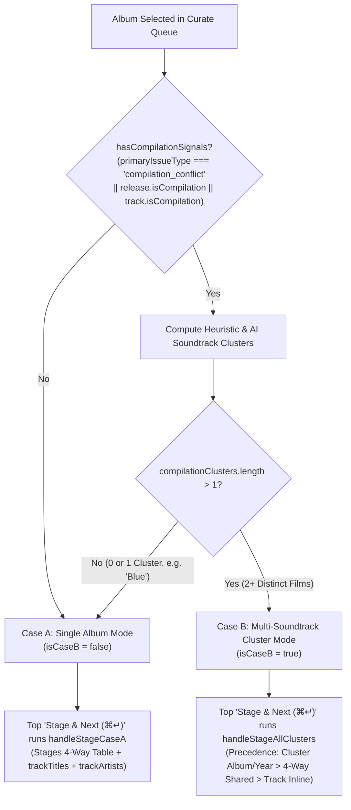

# Curate Experience & Layout Overhaul

*   **Author:** Mathan
*   **Status:** Draft
*   **Date:** 2026-10-30

--------------------------------------------------------------------------------

## Overview

The Curate workbench (`⌘2`) is Cadence's master-detail catalog inspection and metadata reconciliation view. It lets users resolve metadata defects across local audio files by comparing local container tags against Apple Music, MusicBrainz, and 2-of-3 AI consensus, inspecting high-resolution cover art candidates, and staging non-destructive sidecar edits (`track.pendingSidecarEdits`) before executing an atomic two-phase commit to disk.

This design overhauls the layout geometry, track-level editing capabilities, compilation clustering heuristics, and bottom player dock clearance in [`CurationReconciliationStage.tsx`](file:///e:/Mathan/Code/Music%20Agent/src/components/Curate/CurationReconciliationStage.tsx), [`CurationQueueRail.tsx`](file:///e:/Mathan/Code/Music%20Agent/src/components/Curate/CurationQueueRail.tsx), [`NowPlayingBar.tsx`](file:///e:/Mathan/Code/Music%20Agent/src/components/AudioPlayer/NowPlayingBar.tsx), and [`App.tsx`](file:///e:/Mathan/Code/Music%20Agent/src/App.tsx).

## The Problem

1.  **Vertical Stacking Pushes Tracks Below the Fold:** [`CurationReconciliationStage.tsx`](file:///e:/Mathan/Code/Music%20Agent/src/components/Curate/CurationReconciliationStage.tsx#L985-L1476) vertically stacks the High-Resolution Artwork Inspector (~210px height) above the 4-Way Metadata Provider Reconciliation Table (~340px height). Combined with the two top action bars, the Track List begins ~720px from the top of the viewport, forcing vertical scrolling on every album.
2.  **Jagged 4-Way Table Rows & Input Width Contention:** Inside the 4-Way table ([lines 1275-1439](file:///e:/Mathan/Code/Music%20Agent/src/components/Curate/CurationReconciliationStage.tsx#L1275-L1439)), each `Staged Output` cell stacks its provenance badge (`2-of-3 Consensus`, `Provider Match`, `Earliest Year Master`) vertically above the `<input>` (`flex-col gap-1.5`). This doubles row height from ~36px to ~68px and misaligns horizontal text baselines across columns. In addition, the table lacks `table-fixed` column proportions, and the `Release Year` input ([line 1435](file:///e:/Mathan/Code/Music%20Agent/src/components/Curate/CurationReconciliationStage.tsx#L1435)) is hardcoded to `w-24` (`96px`) while sibling inputs use `w-full`. Placing wide provenance pills inside the `Staged Output` column when the table sits in a 67% right-hand split pane would crowd out long album titles.
3.  **120px Truncated Multi-Artist Credits & Static Track Titles:** In Case B ([lines 1525-1538](file:///e:/Mathan/Code/Music%20Agent/src/components/Curate/CurationReconciliationStage.tsx#L1525-L1538)), tracks render in a 2-column sub-grid (`grid-cols-1 md:grid-cols-2`) where `t.artistCredit` is clamped to `truncate max-w-[120px]` and is read-only. Multi-vocalist soundtrack credits (such as `"Kylie Minogue, Sonu Nigam & Suzanne"`) are cut off and cannot be inspected or edited. In Case A ([lines 1580-1630](file:///e:/Mathan/Code/Music%20Agent/src/components/Curate/CurationReconciliationStage.tsx#L1580-L1630)), `t.title` is static read-only text (`truncate max-w-[200px] md:max-w-[280px]`) and cannot be edited inline.
4.  **Flawed Compilation Heuristic (`isCaseB`) & Silent Data Drop on Stage:** At [lines 250-257](file:///e:/Mathan/Code/Music%20Agent/src/components/Curate/CurationReconciliationStage.tsx#L250-L257), `isCaseB` evaluates to `true` whenever `albumItem.primaryIssueType === 'compilation_conflict'`, `release?.isCompilation` is truthy, or any track has `isCompilation` set. Because rippers and iTunes frequently set compilation flags on single-film soundtracks where the Album Artist is the composer (e.g., *A. R. Rahman*) and tracks feature multiple singers, single-film soundtracks like *Blue* resolve to `compilationClusters.length === 1` (`"Multi-Soundtrack Compilation Clusters (1 Film Soundtracks)"`). When `isCaseB` is active:
    *   The top `✓ Stage & Next →` button ([line 873](file:///e:/Mathan/Code/Music%20Agent/src/components/Curate/CurationReconciliationStage.tsx#L873)) and `⌘↵` shortcut ([line 765](file:///e:/Mathan/Code/Music%20Agent/src/components/Curate/CurationReconciliationStage.tsx#L765)) call `handleStageCluster(compilationClusters[0])` instead of `handleStageCaseA()`.
    *   `handleStageCluster` ([lines 674-697](file:///e:/Mathan/Code/Music%20Agent/src/components/Curate/CurationReconciliationStage.tsx#L674-L697)) completely ignores `selectedFields` from the 4-Way Reconciliation Table (`title`, `artistCredit`, `genre`) and ignores per-track edits, while dropping clusters `1..n` on genuine multi-film compilations.
5.  **Bottom Transport Bar Occlusion & Idle Clutter:** [`NowPlayingBar.tsx`](file:///e:/Mathan/Code/Music%20Agent/src/components/AudioPlayer/NowPlayingBar.tsx#L97) renders as a fixed overlay (`fixed bottom-3 ... h-[56px] z-50`, ~68px total bottom footprint), while [`CurationQueueRail.tsx`](file:///e:/Mathan/Code/Music%20Agent/src/components/Curate/CurationQueueRail.tsx#L133) has `p-2` (8px) and [`CurationReconciliationStage.tsx`](file:///e:/Mathan/Code/Music%20Agent/src/components/Curate/CurationReconciliationStage.tsx#L985) has `p-6` (24px), obscuring the bottom rows of both scrollable panes. Furthermore, when no track is loaded (`!currentTrack`) in `curate` or `maintain` mode, the floating bar remains visible showing `"No Track Selected"`, consuming vertical space with disabled controls.

## Goals

*   **Above-the-Fold Top Split Deck:** Restructure the top section of [`CurationReconciliationStage.tsx`](file:///e:/Mathan/Code/Music%20Agent/src/components/Curate/CurationReconciliationStage.tsx) into a responsive 12-column split (`xl:col-span-4` Artwork Inspector with a 2x2 candidate grid on the left, `xl:col-span-8` 4-Way Reconciliation Matrix on the right) so the Track List moves up into the primary viewport.
*   **Fixed 4-Way Table Proportions & Unobstructed Inputs:** Enforce `table-fixed` column widths (`Field` `18%`, `Local File Tag` `18%`, `Apple Music Master` `18%`, `MusicBrainz Archive` `18%`, `Staged Output` `28%`), relocate compact provenance badges (`2/3 Match`, `Provider`, `Master Yr`, `Local`) into the `Field` column so `Staged Output` inputs retain 100% unobstructed horizontal width, and make `Release Year` inputs `w-full`.
*   **Full-Width Single-Column Editable Track Table:** Replace the 2-column sub-grid with a unified single-column `table-fixed` track list (`#` `48px` | `Track Title` `42%` | `Track Vocalists / Artists` `44%` | `Actions` `112px`) across both Case A and Case B, with inline-editable `trackTitles` and `trackArtists`, `tabIndex={-1}` on row action buttons for smooth `Tab` traversal, and smart 2-state Reset cycling (`Manual Edit → Consensus → Local File Tag`).
*   **Strict Multi-Cluster Compilation Gate & Field Merge Precedence:** Separate `hasCompilationSignals` from `isCaseB = hasCompilationSignals && compilationClusters.length > 1` so single-film soundtracks use Case A. For multi-film compilations (`compilationClusters.length > 1`), enforce strict field precedence in `handleStageCluster` and `handleStageAllClusters`: cluster-specific provenance (`soundtrackTitle`, `year`) wins per cluster, 4-Way shared fields (`albumArtist`, `composerName`, `genre`, `coverArtUrl`) merge across clusters, and inline `trackTitles` / `trackArtists` always win per track.
*   **Zero Transport Bar Occlusion:** Add `pb-24` (`96px`) bottom scroll clearance to [`CurationReconciliationStage.tsx`](file:///e:/Mathan/Code/Music%20Agent/src/components/Curate/CurationReconciliationStage.tsx) and [`CurationQueueRail.tsx`](file:///e:/Mathan/Code/Music%20Agent/src/components/Curate/CurationQueueRail.tsx), and hide [`NowPlayingBar.tsx`](file:///e:/Mathan/Code/Music%20Agent/src/components/AudioPlayer/NowPlayingBar.tsx) when `!currentTrack && (topMode === 'curate' || topMode === 'maintain')`.

## Non-Goals

*   Modifying native Rust WASAPI audio engine threads, SQLite database schemas, or background two-phase commit worker file I/O logic.
*   Altering external metadata provider network protocols, rate limiters, or Audiophile Transport Purity quietness guards (`Audiophile Invariants 1–6`).

## Open Questions

*   None. All layout proportions, provenance badge placements, track table column widths, and compilation merge precedence rules have been locked in.

## Critical User Journeys (CUJs)

### CUJ 1: Curating a Single-Film Soundtrack with Multiple Playback Singers (Case A)

*   **Given**: An album like *Blue* (Album Artist / Composer: *A. R. Rahman*, with tracks sung by *Kylie Minogue, Sonu Nigam, Shreya Ghoshal, etc.*) is selected in the Curate queue and has compilation flags set in its local tags.
*   **When**: [`CurationReconciliationStage`](file:///e:/Mathan/Code/Music%20Agent/src/components/Curate/CurationReconciliationStage.tsx) resolves consensus and compilation clusters, finding all tracks belong to 1 film soundtrack (`compilationClusters.length === 1`).
*   **Then**:
    1.  `isCaseB` evaluates to `false`, rendering the standard Case A single-album track table above the fold below the 33%/67% split deck.
    2.  `Artist Scope Policy` defaults to `Set as Album Artist only (Preserve track singers)`.
    3.  Every track's title (`42%` column) and full multi-singer credit (`44%` column) are visible without 120px truncation and are inline-editable.
    4.  Clicking `✓ Stage & Next →` (`⌘↵`) executes `handleStageCaseA`, staging the 4-Way table's `Album Title`, `Album Artist`, `Composer`, `Release Year`, `Artwork`, and any modified `trackTitles` and `trackArtists` to `graphEngine`.

### CUJ 2: Curating a Multi-Film Compilation Box Set (Case B)

*   **Given**: A multi-film compilation release (e.g., *Hits Of A. R. Rahman*) containing tracks from 2 or more distinct motion picture soundtracks (`compilationClusters.length > 1`) is selected in the Curate queue.
*   **When**: The user edits the shared `Album Artist` or `Genre` in the 4-Way Reconciliation Table, tweaks a track title or vocalist inline inside Cluster 1, and clicks the top `✓ Stage & Next →` (`⌘↵`) button.
*   **Then**:
    1.  `handleStageAllClusters` stages edits across all clusters (`0..n`).
    2.  Each cluster's `originalAlbum` / `canonicalAlbumTitle` and `originalYear` are preserved per cluster (not overwritten by the parent compilation title in the 4-Way table).
    3.  Shared 4-Way table fields (`albumArtist`, fallback `composerName`, `genre`, `selectedArtwork`) and inline track edits (`trackTitles[t.id]`, `trackArtists[t.id]`) are merged into every staged track.

### CUJ 3: Unobstructed Bottom Scrolling & Idle Player Auto-Hide

*   **Given**: The user is in Curate (`⌘2`) or Maintain (`⌘3`) mode.
*   **When**: No audio track is loaded (`!currentTrack`), or a track is actively playing while the user scrolls to the bottom of the Curation Queue Rail or Track List.
*   **Then**:
    1.  When `!currentTrack`, [`NowPlayingBar`](file:///e:/Mathan/Code/Music%20Agent/src/components/AudioPlayer/NowPlayingBar.tsx) hides completely so 100% of the vertical viewport is dedicated to curation.
    2.  When a track is loaded/playing and [`NowPlayingBar`](file:///e:/Mathan/Code/Music%20Agent/src/components/AudioPlayer/NowPlayingBar.tsx) is visible, the `pb-24` (`96px`) bottom padding in both scroll containers allows the final queue item and final track row to scroll completely clear above the floating player bar.

--------------------------------------------------------------------------------

## Technical Plan (Architecture)

### 1. Top Split Deck & Fixed 4-Way Table Geometry (`CurationReconciliationStage.tsx`)

To bring the Track List above the fold on standard desktop screens (`1280px–1920px+`), the High-Resolution Artwork Inspector and the 4-Way Metadata Provider Reconciliation Matrix are placed side-by-side inside a 12-column CSS Grid (`grid grid-cols-1 xl:grid-cols-12 gap-4 items-stretch`):

```text
+---------------------------------------------------------------------------------------------------+
| Action Header (Sticky Top: Breadcrumb, Defect Badge, Stepper [1 of N], ✓ Stage & Next → [⌘↵])     |
+---------------------------------------------------------------------------------------------------+
| Unified Control Bar (Composer/Performer Authority | Strip Rip Flags / Folder Sync | Stack Edition)|
+---------------------------------+-----------------------------------------------------------------+
| Artwork Inspector (xl:col-4)    | 4-Way Metadata Provider Reconciliation (xl:col-8)               |
| +-------------+ +-------------+ | Field (18%)  | Local (18%) | Apple (18%) | MB (18%) | Staged(28%)|
| | Local File  | | Apple Music | | -------------+-------------+-------------+----------+----------- |
| |   80x80px   | |   80x80px   | | Album Title  | Blue        | Hits Of...  | Blue     | [Blue... ] |
| |  Embedded   | |  3000x3000  | | [2/3 Match]  |             |             |          |            |
| +-------------+ +-------------+ | -------------+-------------+-------------+----------+----------- |
| +-------------+ +-------------+ | Album Artist | A.R. Rahman | Kylie...    | Suzanne  | [A.R. ... ]|
| | MusicBrainz | | Master Scan | | [Provider]   |             |             |          |            |
| |   80x80px   | |   80x80px   | | -------------+-------------+-------------+----------+----------- |
| +-------------+ +-------------+ | Composer     | A.R. Rahman | Kylie...    | A.R. ... | [A.R. ... ]|
|                                 | [Provider]   |             |             |          |            |
|                                 | -------------+-------------+-------------+----------+----------- |
|                                 | Release Year | 2009        | 2009        | 2009     | [2009     ]|
|                                 | [Master Yr]  |             |             |          |            |
|                                 | ---------------------------------------------------------------- |
|                                 | Artist Scope Policy: [Set as Album Artist only] [Apply to all]   |
+---------------------------------+-----------------------------------------------------------------+
| Unified Single-Column Editable Track Table (Full Width - Above the Fold)                          |
| # (48px) | Track Title (42%)                   | Track Vocalists / Artists (44%)   | Actions(112px)|
| ---------+-------------------------------------+-----------------------------------+-------------- |
| [x] #1   | [Chiggy Wiggy                     ] | [Kylie Minogue, Sonu Nigam & Suz] | [Reset]       |
| [x] #2   | [Aaj Dil Gustakh Hai              ] | [Sukhwinder Singh, Shreya Ghosha] | [Reset]       |
+---------------------------------------------------------------------------------------------------+
| Bottom Scroll Clearance (pb-24 / 96px) + Auto-Hidden NowPlayingBar when !currentTrack             |
+---------------------------------------------------------------------------------------------------+
```

#### Artwork Inspector (`xl:col-span-4`)
*   Uses `flex flex-col justify-between` so its card border stretches to match the height of the 4-Way Reconciliation Table on `xl+` viewports.
*   Replaces `grid-cols-2 sm:grid-cols-4` with `grid-cols-2 gap-2.5` and `w-20 h-20` (`80px`) square preview thumbnails so up to 4 artwork candidates (`Local File`, `Apple Music`, `MusicBrainz / CAA`, `AI / Archive`) arrange cleanly in a 2x2 grid inside the 33% left column without horizontal overflow.

#### 4-Way Reconciliation Table (`xl:col-span-8`)
*   **Fixed Table Layout:** Changes `<table className="w-full text-left text-xs border-collapse">` to `<table className="w-full table-fixed text-left text-xs border-collapse">`.
*   **Column Proportions (`<colgroup>` / `<th>` widths):**
    *   Column 1 (`Field`): `w-[18%]`
    *   Column 2 (`Local File Tag`): `w-[18%]` (cells use `truncate` + `title` attribute tooltip so full values are inspectable on hover and click-to-copy into Staged Output remains intact)
    *   Column 3 (`Apple Music Master`): `w-[18%]` (`truncate` + `title` tooltip)
    *   Column 4 (`MusicBrainz Archive`): `w-[18%]` (`truncate` + `title` tooltip)
    *   Column 5 (`Staged Output`): `w-[28%]`
*   **Provenance Badge Relocation to Column 1 (`Field`):**
    *   `renderProvenanceBadge(source, confidence)` is updated to return compact, scannable pills (`2/3 Match`, `Provider`, `Master Yr`, `Local`) and is moved from Column 5 (`Staged Output`) into Column 1 (`Field`), rendered directly beneath/beside the field name (`Album Title`, `Album Artist`, `Composer`, `Release Year`).
    *   Column 5 (`Staged Output`) now contains solely the `<input type="text" className="w-full ..." />` across all 4 rows (including changing the `Release Year` input from `w-24` to `w-full`). This cuts row height from ~68px to ~38px, aligns text baselines horizontally across all 5 columns, and provides 100% unobstructed horizontal width inside Column 5 for long soundtrack titles.

---

### 2. Unified Single-Column Editable Track Table (`CurationReconciliationStage.tsx`)

Both Case A (Standard Album / Single-Film Soundtrack) and Case B (Multi-Film Compilation Clusters) share a unified, full-width single-column `table-fixed` track table component/render helper so track titles and multi-artist credits never clamp at `120px`.

#### Track-Level State Management
*   **`trackTitles: Record<string, string>`:** Added alongside `trackArtists: Record<string, string>`.
    *   On album selection (`useEffect` on `[albumItem?.albumId, release?.id, tracks]`), `trackTitles[t.id]` initializes to `t.title || ''`.
    *   When `consensus` resolves in `fetchCandidates`, `trackTitles` updates each track with `consensus?.trackConsensus?.[t.id]?.title?.value || prev[t.id] || t.title`.
*   **`resetTrackRow(track: Track)` (Two-State Smart Reset):**
    *   Let `localTitle = track.title || ''` and `consensusTitle = consensusResult?.trackConsensus?.[track.id]?.title?.value || localTitle`.
    *   Let `localArtist = track.artistCredit || ''` and `consensusArtist = consensusResult?.trackConsensus?.[track.id]?.artists?.value || (isDefectiveArtistTag(localArtist, albumItem?.albumTitle) && !isPlaceholderTag(selectedFields.artistCredit) ? selectedFields.artistCredit : localArtist)`.
    *   When the user clicks the row's Reset button:
        *   If `(trackTitles[track.id] !== consensusTitle && trackTitles[track.id] !== localTitle)` or `(trackArtists[track.id] !== consensusArtist && trackArtists[track.id] !== localArtist)` (i.e. user made a manual edit), revert both fields to `(consensusTitle, consensusArtist)`.
        *   Otherwise, revert both fields to the raw container tags `(localTitle, localArtist)` (or toggle back to `(consensusTitle, consensusArtist)` if already at local tags and consensus differs).

#### Column Proportions & Keyboard Ergonomics
*   Table uses `w-full table-fixed text-left text-xs border-collapse`:
    1.  **`#` (`w-12` / `48px`):** Checkbox (in Case A, or cluster-included indicator) + monospace track number (`#1`). Checkbox has `tabIndex={-1}` so `Tab` navigation stays focused on text inputs.
    2.  **`Track Title` (`w-[42%]`):** `<input type="text" className="w-full ..." />` bound to `trackTitles[t.id]`. Highlights with `border-emerald-500/50 text-emerald-300` when `trackTitles[t.id] !== t.title`.
    3.  **`Track Vocalists / Artists` (`w-[44%]`):** `<input type="text" className="w-full ..." />` bound to `artistPolicy === 'all_tracks' ? selectedFields.artistCredit : trackArtists[t.id]`. Highlights with `border-emerald-500/50 text-emerald-300` when modified relative to `t.artistCredit`.
    4.  **`Actions` (`w-28` / `112px`):** Right-aligned status badge (`Modified` / `Synced`) and the per-row `Reset` button (`<button type="button" tabIndex={-1}>`) with `RotateCcw` icon. Setting `tabIndex={-1}` on row buttons allows keyboard users to press `Tab` to move directly from `Track 1 Title → Track 1 Vocalists → Track 2 Title → Track 2 Vocalists`.

---

### 3. Compilation Heuristic (`isCaseB`) & Field Merge Precedence (`CurationReconciliationStage.tsx`)



#### Separating Signal Detection from Cluster Mode Activation
1.  **`hasCompilationSignals` (`useMemo`):**
    ```ts
    const hasCompilationSignals = useMemo(() => {
      if (!albumItem) return false
      return (
        albumItem.primaryIssueType === 'compilation_conflict' ||
        Boolean(release?.isCompilation) ||
        tracks.some((t) => t.isCompilation || /\(from\s+['"][^'"]+['"]\)/i.test(t.title))
      )
    }, [albumItem, release, tracks])
    ```
2.  **`isCaseB` (`useMemo`):**
    ```ts
    const isCaseB = useMemo(() => {
      return hasCompilationSignals && compilationClusters.length > 1
    }, [hasCompilationSignals, compilationClusters.length])
    ```
    *   Because the cluster computation `useEffect` now depends on `hasCompilationSignals` instead of `isCaseB`, single-film soundtracks with compilation flags (like *Blue*) still run cluster analysis, resolve to `compilationClusters.length === 1`, and remain in **Case A** (`isCaseB === false`).
    *   While `isLoadingClusters` is running in the background, if initial heuristic clustering yields `<= 1` cluster, Case A renders immediately without flashing an empty or single-item Case B box.

#### Field Merge Precedence in `buildClusterTrackEdits`, `handleStageCluster`, and `handleStageAllClusters`
When `isCaseB === true` (`compilationClusters.length > 1`), a helper `buildClusterTrackEdits(cluster)` constructs the `Partial<Track>` payload for each track `trk` in `cluster.tracks` following strict 3-tier precedence:
1.  **Tier 1 — Cluster-Specific Provenance Wins Over 4-Way Parent Compilation Title/Year:**
    *   `edits.originalAlbum = cluster.soundtrackTitle`
    *   `edits.canonicalAlbumTitle = cluster.soundtrackTitle`
    *   If `cluster.year`: `edits.originalYear = cluster.year` and `edits.year = cluster.year`. Else if `selectedFields.releaseYear`: `edits.year = Number(selectedFields.releaseYear)`.
2.  **Tier 2 — 4-Way Table Shared Fields Merge Across All Clusters:**
    *   `albumArtist`: If `selectedFields.artistCredit` is non-empty and differs from `trk.albumArtist || release?.artistCredit`, stage `edits.albumArtist = selectedFields.artistCredit`.
    *   `composerName`: Stage `cluster.composer || selectedFields.composerName` if non-empty and different from `trk.composerName`.
    *   `genre`: If `selectedFields.genre` is non-empty, stage `edits.genre = selectedFields.genre`.
    *   `coverArtUrl`: If `selectedArtwork?.coverArtUrl` is selected, stage `edits.coverArtUrl = selectedArtwork.coverArtUrl`.
3.  **Tier 3 — Track-Level Inline Edits Always Win Per Track:**
    *   `title`: Let `editedTitle = trackTitles[trk.id]?.trim()`. If `editedTitle && editedTitle !== trk.title`, stage `edits.title = editedTitle`.
    *   `artistCredit`: If `artistPolicy === 'all_tracks'` and `selectedFields.artistCredit !== trk.artistCredit`, stage `edits.artistCredit = selectedFields.artistCredit`. Otherwise (`artistPolicy === 'album_only'`), let `editedArtist = trackArtists[trk.id]?.trim()`; if `editedArtist && (editedArtist !== trk.artistCredit || isDefectiveArtistTag(trk.artistCredit, release?.title || albumItem?.albumTitle))`, stage `edits.artistCredit = editedArtist`.

*   **`handleStageCluster(cluster)`:** Stages `buildClusterTrackEdits(cluster)` for that single cluster's tracks.
*   **`handleStageAllClusters()`:** Iterates over all `compilationClusters`, populates a combined `editsMap` via `buildClusterTrackEdits(cluster)` for every cluster, and invokes `onStageAndNext(editsMap)`. Bound to the top `✓ Stage & Next →` button and `⌘↵` keyboard shortcut whenever `isCaseB` is true.

---

### 4. Transport Bar Clearance & Conditional Visibility (`NowPlayingBar.tsx`, `CurationQueueRail.tsx`, `App.tsx`)

1.  **Scroll Container Bottom Clearance (`pb-24` / `96px`):**
    *   In [`CurationQueueRail.tsx`](file:///e:/Mathan/Code/Music%20Agent/src/components/Curate/CurationQueueRail.tsx#L133), update the queue list container from `p-2 space-y-1.5` to `p-2 pb-24 space-y-1.5`.
    *   In [`CurationReconciliationStage.tsx`](file:///e:/Mathan/Code/Music%20Agent/src/components/Curate/CurationReconciliationStage.tsx#L985), update the main stage content wrapper from `p-6 space-y-6 flex-1` to `p-6 pb-24 space-y-5 flex-1`.
2.  **Conditional Auto-Hide When Idle in Utility Workbenches (`NowPlayingBar.tsx` & `App.tsx`):**
    *   Extend `NowPlayingBarProps` in [`NowPlayingBar.tsx`](file:///e:/Mathan/Code/Music%20Agent/src/components/AudioPlayer/NowPlayingBar.tsx#L30-L33) with `topMode?: 'library' | 'curate' | 'maintain'`.
    *   Pass `topMode={topMode}` from [`App.tsx`](file:///e:/Mathan/Code/Music%20Agent/src/App.tsx#L2410-L2413).
    *   In [`NowPlayingBar.tsx`](file:///e:/Mathan/Code/Music%20Agent/src/components/AudioPlayer/NowPlayingBar.tsx), compute `const shouldHideIdleUtilityBar = !currentTrack && (topMode === 'curate' || topMode === 'maintain') && !isDeviceModalOpen && !isSignalPopoverOpen`. When `shouldHideIdleUtilityBar` is `true`, return `null` so the floating dock does not render over the workbench until a track is loaded.

--------------------------------------------------------------------------------

## Alternatives Considered

### Alternative A: Keep Provenance Badges Inside the `Staged Output` Column (`Column 5`)
*   **Pros:** Places the provenance indicator (`2-of-3 Consensus`, `Provider Match`, `Earliest Year Master`) immediately adjacent to the staged `<input>` box on the right edge of the table.
*   **Cons:** When the 4-Way Reconciliation Table is placed inside `xl:col-span-8` (~67% of the main stage, or ~720px–800px total width on a 1440p monitor), Column 5 (`28%`) is only ~200px–224px wide. Placing a ~100px–115px badge inline beside or inside the right padding of the `<input>` leaves barely ~95px–110px for text, truncating soundtrack titles such as `"Blue (Original Motion Picture Soundtrack)"`.
*   **Reason for Rejection:** Relocating the compact provenance pill into Column 1 (`Field`, `18%`), which otherwise holds only short static labels (`Album Title`, `Composer`), eliminates vertical stacking while giving the `Staged Output` `<input>` in Column 5 100% unobstructed horizontal width.

### Alternative B: Multi-Line Text Wrapping in a 2-Column Track Sub-Grid
*   **Pros:** Retains the existing 2-column track grid in Case B while replacing `truncate max-w-[120px]` with multi-line text wrapping (`whitespace-normal break-words`).
*   **Cons:** Multi-singer credits on Indian and world soundtracks frequently contain 3 to 6 vocalists (`"Kylie Minogue, Sonu Nigam, Shreya Ghoshal & Suzanne D'Mello"`), causing uneven row heights across the 2 columns, jagged visual scanning, and cramped inline `<input>` boxes that cannot be comfortably edited or navigated with the `Tab` key.
*   **Reason for Rejection:** A full-width single-column `table-fixed` track list (`48px` `#` | `42%` `Track Title` | `44%` `Track Vocalists / Artists` | `112px` `Actions`) provides 350px–500px+ of horizontal width for every track's title and vocalist list, keeps every row at a uniform single-line height, and supports direct `Tab` key traversal across inline inputs.

### Alternative C: Remove Case B Compilation Clustering Entirely
*   **Pros:** Simplifies [`CurationReconciliationStage.tsx`](file:///e:/Mathan/Code/Music%20Agent/src/components/Curate/CurationReconciliationStage.tsx) to a single Case A code path for all albums.
*   **Cons:** Users importing genuine multi-film compilation box sets or greatest-hits folders (e.g., *Hits Of A. R. Rahman* containing tracks from *Roja*, *Bombay*, and *Dil Se*) rely on `compilationCanonicalizerService` to group tracks by their original motion picture soundtrack and stage per-cluster `originalAlbum` and `originalYear` provenance without overwriting sibling tracks.
*   **Reason for Rejection:** Retaining Case B strictly when `hasCompilationSignals && compilationClusters.length > 1` (while routing `compilationClusters.length <= 1` to Case A and enforcing the 3-tier merge precedence in `handleStageAllClusters`) preserves multi-film soundtrack canonicalization without misclassifying single-film soundtracks.

--------------------------------------------------------------------------------

## Non-Functional Requirements

*   **Audiophile Transport Purity (`Audiophile Invariants 1–6`):** All modifications are strictly confined to React component layout, local UI state (`trackTitles`, `trackArtists`, `isCaseB`), and in-memory sidecar staging (`graphEngine.updateTrackSidecar`). Zero disk I/O, thread priority changes, or network polling loops are introduced. The existing playback quietness guard (`isPlaybackQuietNotice` in [`CurationReconciliationStage.tsx`](file:///e:/Mathan/Code/Music%20Agent/src/components/Curate/CurationReconciliationStage.tsx#L332-L339)) remains untouched.
*   **Render Performance & Keyboard Responsiveness:** Inline edits to `trackTitles` and `trackArtists` update local component state synchronously in $O(1)$ per keystroke and only commit to `graphEngine` when the user triggers `Stage & Next` (`⌘↵`) or per-cluster staging.

--------------------------------------------------------------------------------

## Detailed Implementation Plan

### Target Files to Create/Modify

#### 1. [`src/components/Curate/CurationReconciliationStage.tsx`](file:///e:/Mathan/Code/Music%20Agent/src/components/Curate/CurationReconciliationStage.tsx) (Modify)

*   **Type / Scope**: React TypeScript Component (`Curate` Workbench Center-Right Stage)
*   **Rationale**: Restructures the top section into a 33%/67% side-by-side split layout, enforces `table-fixed` geometry with provenance badges relocated to Column 1 (`Field`) so `Staged Output` inputs have 100% unobstructed width, introduces `trackTitles` state and the unified single-column editable track table (`48px | 42% | 44% | 112px`), restricts `isCaseB` strictly to `hasCompilationSignals && compilationClusters.length > 1`, implements the 3-tier field merge precedence in `buildClusterTrackEdits` / `handleStageCluster` / `handleStageAllClusters`, and adds `pb-24` bottom scroll clearance.
*   **Proposed Changes**:
    1.  **Compact Provenance Badge Helper (`renderProvenanceBadge`, lines 167–203):**
        *   Update badge labels to compact microcopy so they fit cleanly inside the `18%` `Field` column:
            *   `source.startsWith('consensus_')` → `2/3 Match` (emerald pill with `ShieldCheck` icon)
            *   `source === 'earliest_year_rule'` → `Master Yr` (indigo pill)
            *   `source === 'single_provider_match'` → `Provider` (blue pill)
            *   `source === 'local_fallback'` → `Local` (zinc pill)
    2.  **Add `trackTitles` State Map & Initialize on Album Load / Consensus Fetch (lines 230–430):**
        *   Declare `const [trackTitles, setTrackTitles] = useState<Record<string, string>>({})` alongside `trackArtists`.
        *   In the album initialization `useEffect` ([lines 260–306](file:///e:/Mathan/Code/Music%20Agent/src/components/Curate/CurationReconciliationStage.tsx#L260-L306)), initialize `initialTrackTitles[t.id] = t.title || ''` for each track in `tracks` and call `setTrackTitles(initialTrackTitles)`.
        *   In `fetchCandidates` ([lines 402–429](file:///e:/Mathan/Code/Music%20Agent/src/components/Curate/CurationReconciliationStage.tsx#L402-L429)), when `consensus` resolves, update `trackTitles` for each track `t` with `consensus?.trackConsensus?.[t.id]?.title?.value || prev[t.id] || t.title`.
    3.  **Two-State Smart Per-Row Reset Helper (`handleResetTrackRow`):**
        *   Add `handleResetTrackRow(trk: Track)`:
            *   Compute `localTitle = trk.title || ''` and `consensusTitle = consensusResult?.trackConsensus?.[trk.id]?.title?.value || localTitle`.
            *   Compute `localArtist = trk.artistCredit || ''` and `consensusArtist = consensusResult?.trackConsensus?.[trk.id]?.artists?.value || (isDefectiveArtistTag(localArtist, albumItem?.albumTitle) && !isPlaceholderTag(selectedFields.artistCredit) ? selectedFields.artistCredit : localArtist)`.
            *   Let `currTitle = trackTitles[trk.id] ?? localTitle` and `currArtist = trackArtists[trk.id] ?? localArtist`.
            *   If `(currTitle !== consensusTitle && currTitle !== localTitle)` or `(currArtist !== consensusArtist && currArtist !== localArtist)` (manual user edit), set `trackTitles[trk.id] = consensusTitle` and `trackArtists[trk.id] = consensusArtist`.
            *   Otherwise, if `(currTitle !== localTitle || currArtist !== localArtist)`, set `trackTitles[trk.id] = localTitle` and `trackArtists[trk.id] = localArtist`; else set to `(consensusTitle, consensusArtist)`.
    4.  **Separate `hasCompilationSignals` from `isCaseB` (lines 250–257 & 482–555):**
        *   Define `hasCompilationSignals` with the existing heuristic (`albumItem.primaryIssueType === 'compilation_conflict' || Boolean(release?.isCompilation) || tracks.some(...)`).
        *   Define `const isCaseB = useMemo(() => hasCompilationSignals && compilationClusters.length > 1, [hasCompilationSignals, compilationClusters.length])`.
        *   Update the cluster computation `useEffect` ([line 482](file:///e:/Mathan/Code/Music%20Agent/src/components/Curate/CurationReconciliationStage.tsx#L482)) to check `if (!hasCompilationSignals || !release || tracks.length === 0)` and depend on `[hasCompilationSignals, release, tracks, allReleases]`.
    5.  **Update `handleStageCaseA`, `buildClusterTrackEdits`, `handleStageCluster`, and `handleStageAllClusters` (lines 613–697):**
        *   In `handleStageCaseA`: Stage `edits.title = editedTitle` whenever `trackTitles[trk.id]?.trim()` is non-empty and differs from `trk.title`.
        *   Create `buildClusterTrackEdits(cluster)` implementing the 3-tier merge precedence:
            *   Tier 1 (Cluster Provenance): `originalAlbum = cluster.soundtrackTitle`, `canonicalAlbumTitle = cluster.soundtrackTitle`, `originalYear = cluster.year`, `year = cluster.year || (Number(selectedFields.releaseYear) > 0 ? Number(selectedFields.releaseYear) : undefined)`.
            *   Tier 2 (4-Way Shared Fields): `albumArtist = selectedFields.artistCredit` (when different from `trk.albumArtist || release?.artistCredit`), `composerName = cluster.composer || selectedFields.composerName` (when different from `trk.composerName`), `genre = selectedFields.genre` (when non-empty), `coverArtUrl = selectedArtwork?.coverArtUrl` (when selected).
            *   Tier 3 (Track Inline States): `title = trackTitles[trk.id].trim()` (when modified from `trk.title`) and `artistCredit = artistPolicy === 'all_tracks' ? selectedFields.artistCredit : trackArtists[trk.id].trim()` (when modified or local tag was defective).
        *   Update `handleStageCluster(cluster)` to use `buildClusterTrackEdits(cluster)`.
        *   Add `handleStageAllClusters()` that aggregates `buildClusterTrackEdits(cluster)` across all clusters in `compilationClusters` and calls `onStageAndNext(editsMap)`.
        *   Wire the `⌘↵` keyboard listener ([line 765](file:///e:/Mathan/Code/Music%20Agent/src/components/Curate/CurationReconciliationStage.tsx#L765)) and top `✓ Stage & Next →` button ([line 873](file:///e:/Mathan/Code/Music%20Agent/src/components/Curate/CurationReconciliationStage.tsx#L873)) to call `isCaseB ? handleStageAllClusters() : handleStageCaseA()`.
    6.  **Top Split Deck Layout & Bottom Scroll Clearance (`pb-24`) (lines 985–1475):**
        *   Change the main stage content wrapper at line 985 from `<div className="p-6 space-y-6 flex-1">` to `<div className="p-6 pb-24 space-y-5 flex-1">`.
        *   Wrap the Artwork Inspector and 4-Way Reconciliation Table in `<div className="grid grid-cols-1 xl:grid-cols-12 gap-4 items-stretch">`.
        *   **Left Pane (`xl:col-span-4`):** Artwork Inspector card with `grid grid-cols-2 gap-2.5` and `w-20 h-20` artwork candidate thumbnails.
        *   **Right Pane (`xl:col-span-8`):** 4-Way Reconciliation Table card using `<table className="w-full table-fixed text-left text-xs border-collapse">` with column widths `w-[18%]` (`Field`), `w-[18%]` (`Local File Tag`), `w-[18%]` (`Apple Music Master`), `w-[18%]` (`MusicBrainz Archive`), and `w-[28%]` (`Staged Output`). Move `renderProvenanceBadge(...)` into Column 1 (`Field`) for all 4 rows, add `truncate` + `title` tooltips to Columns 2–4, and ensure all 4 inputs in Column 5 (`Staged Output`, including `Release Year`) use `w-full`.
    7.  **Unified Single-Column Editable Track Table (`renderTrackTable`, lines 1477–1633):**
        *   Replace both the Case B `grid-cols-2` track list and Case A `max-h-64` track list with a shared full-width single-column `table-fixed` table (`w-12` `#` | `w-[42%]` `Track Title` | `w-[44%]` `Track Vocalists / Artists` | `w-28` `Actions`).
        *   Set `tabIndex={-1}` on row checkboxes and per-row `Reset` buttons so `Tab` moves directly between `Track Title` and `Track Vocalists / Artists` inputs.

#### 2. [`src/components/Curate/CurationQueueRail.tsx`](file:///e:/Mathan/Code/Music%20Agent/src/components/Curate/CurationQueueRail.tsx) (Modify)

*   **Type / Scope**: React TypeScript Component (`Curate` Left Queue Rail)
*   **Rationale**: Adds `pb-24` (`96px`) bottom padding to the scrollable queue cards list so the bottom-most album cards can scroll clear above the floating `NowPlayingBar`.
*   **Proposed Changes**:
    *   At [line 133](file:///e:/Mathan/Code/Music%20Agent/src/components/Curate/CurationQueueRail.tsx#L133), change `<div className="flex-1 overflow-y-auto p-2 space-y-1.5">` to `<div className="flex-1 overflow-y-auto p-2 pb-24 space-y-1.5">`.

#### 3. [`src/components/AudioPlayer/NowPlayingBar.tsx`](file:///e:/Mathan/Code/Music%20Agent/src/components/AudioPlayer/NowPlayingBar.tsx) (Modify)

*   **Type / Scope**: React TypeScript Component (Floating Transport Bar Dock)
*   **Rationale**: Hides the floating transport bar when no track is loaded (`!currentTrack`) while the user is working inside the `curate` or `maintain` utility workbenches, eliminating idle visual clutter and bottom occlusion.
*   **Proposed Changes**:
    *   Add `topMode?: 'library' | 'curate' | 'maintain'` to `NowPlayingBarProps` ([lines 30–33](file:///e:/Mathan/Code/Music%20Agent/src/components/AudioPlayer/NowPlayingBar.tsx#L30-L33)).
    *   Before the `return` statement ([line 94](file:///e:/Mathan/Code/Music%20Agent/src/components/AudioPlayer/NowPlayingBar.tsx#L94)), check `if (!currentTrack && (topMode === 'curate' || topMode === 'maintain') && !isDeviceModalOpen && !isSignalPopoverOpen) return null`.

#### 4. [`src/App.tsx`](file:///e:/Mathan/Code/Music%20Agent/src/App.tsx) (Modify)

*   **Type / Scope**: Root React Application Container
*   **Rationale**: Passes the active `topMode` state (`'library' | 'curate' | 'maintain'`) down to `<NowPlayingBar />` so it knows when to auto-hide while idle in Curate or Maintain mode.
*   **Proposed Changes**:
    *   At [lines 2410–2413](file:///e:/Mathan/Code/Music%20Agent/src/App.tsx#L2410-L2413), update `<NowPlayingBar ... />` to pass `topMode={topMode}`.

#### 5. [`src/components/Curate/AGENTS.md`](file:///e:/Mathan/Code/Music%20Agent/src/components/Curate/AGENTS.md) & [`src/components/AudioPlayer/AGENTS.md`](file:///e:/Mathan/Code/Music%20Agent/src/components/AudioPlayer/AGENTS.md) (Modify)

*   **Type / Scope**: Directory Architecture Blueprint Documentation
*   **Rationale**: Keeps repository documentation synchronized with the updated Curate split layout, `compilationClusters.length > 1` multi-soundtrack clustering rule, inline-editable track table, and `NowPlayingBar` conditional visibility in utility modes.
*   **Proposed Changes**:
    *   Update `CurationReconciliationStage` contract in [`src/components/Curate/AGENTS.md`](file:///e:/Mathan/Code/Music%20Agent/src/components/Curate/AGENTS.md) to reflect the 33%/67% split deck, inline-editable track titles and artists, and `clusters.length > 1` compilation heuristic.
    *   Update `NowPlayingBar` contract in [`src/components/AudioPlayer/AGENTS.md`](file:///e:/Mathan/Code/Music%20Agent/src/components/AudioPlayer/AGENTS.md) to note its `topMode` prop and auto-hide behavior when `!currentTrack` in `curate`/`maintain` modes.

### Verification Plan

*   **Compilation & Type-Checking**: `npm run build` (`tsc -b && vite build` must pass with zero TypeScript or bundler errors).
*   **Static Analysis & Linting**: `npm run lint` (`oxlint`).
*   **Automated Regression Suites**:
    *   `npm run test:engine` (Verifies `graphEngine` sidecar staging and commit integrity).
    *   `npm run test:audit` (Verifies audit and hygiene queue bindings).
    *   `npm run test:commit` (Verifies two-phase commit architecture).
*   **Manual UI Verification**:
    1.  Open Curate (`⌘2`) on a single-film soundtrack with multiple track vocalists (e.g., *Blue* by *A. R. Rahman*) and verify:
        *   Artwork Inspector (`xl:col-span-4`) and 4-Way Reconciliation Table (`xl:col-span-8`) render side-by-side, with the Track List visible above the fold.
        *   Provenance badges (`2/3 Match`, `Provider`, `Master Yr`) appear in Column 1 (`Field`), all 4 `Staged Output` inputs span `w-full` with aligned edges, and long album titles are unobstructed.
        *   The album renders in Case A (not `Multi-Soundtrack Compilation Clusters (1 Film Soundtracks)`), and both Track Title (`42%`) and Track Vocalists (`44%`) are full-width and inline-editable with `Tab` moving directly between inputs.
        *   Clicking `✓ Stage & Next →` (`⌘↵`) stages both the 4-Way table fields and inline track edits.
    2.  Verify that when no track is playing (`!currentTrack`) in Curate (`⌘2`) or Maintain (`⌘3`), `NowPlayingBar` is hidden; when a track is playing, scrolling to the bottom of `CurationQueueRail` and `CurationReconciliationStage` clears the floating player bar (`pb-24`).

--------------------------------------------------------------------------------

*Drafted with EGM*
