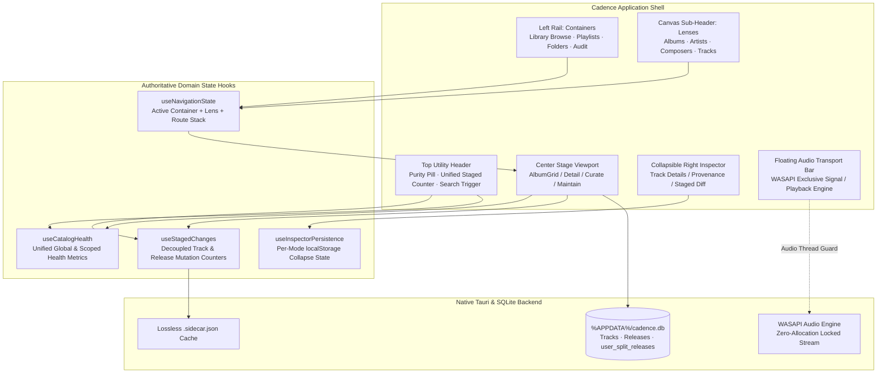

# Cadence UX & UI Architecture Refactor

*   **Author:** Mathan
*   **Status:** Proposed
*   **Date:** 2026-10-27

--------------------------------------------------------------------------------

## Overview

Cadence is a bit-perfect music player and curation engine for Windows Desktop. Over successive feature additions, the user interface has accumulated navigation redundancy, competing search interfaces, contradictory library health telemetry, internal engineering jargon leaks, and layout density friction across high-density workflows.

This project refactors the application shell and key operational screens into an orderly, predictable interface. The refactor establishes a container-based navigation rail with contextual sub-header lenses, decouples global spotlight search (`⌘K`) from in-memory folder tree filtering (`⌘F`), enforces deterministic multi-disc album grouping with SQLite-backed split overrides, introduces mode-aware inspector persistence, anchors a single canonical staged changes counter in the top utility header, and resolves several high-priority formatting and state bugs.

## The Problem

1. **Competing Navigation Pathways**: Navigation is fragmented between the left sidebar and the top canvas sub-header. `Albums` appears as both a sidebar item and a sub-header tab alongside `Artists` and `Composers`. When viewing an Album Detail page, the parent grid toolbar remains visible above breadcrumbs, presenting irrelevant sorting and filtering controls.
2. **Search Ambiguity & SMB Network Risks**: Three search inputs operate concurrently (`⌘K` Spotlight, `⌘F` canvas filter, and Physical Folder Tree search). Attempting to drive deep folder expansion over SMB network shares via global search creates interface latency and risks violating transport bus quietness.
3. **Multi-Disc Sprawl**: Multi-disc box sets (e.g., `Rahmania CD1–CD4`) render as discrete, scattered album cards across the Listen Grid, multiplying visual clutter.
4. **Telemetry Drift & False-Negative Strings**: The `Audit` view reports `80% Library Health` while displaying text stating all metadata conforms to bit-perfect standards (because scoped album counts collapse to zero), while `Copilot` simultaneously displays `93% Catalog Health` with `1286 anomalies detected`.
5. **Staged Changes Fragmentation & Tab Count Zero**: Pending mutations appear in four separate locations with conflicting units. In the `Review & Commit Changes` modal, the `Tag Edits` and `With Artwork Updates` tabs display count `(0)` when staged artwork exists solely on release entities, while row badges show `Sidecar Staged` even when the user selects `Embed Headers`.
6. **Leaked Engineering Terminology & State Bugs**: Internal protocol names ("Two-Phase Commit"), worker thread IDs (`AUDIO-IDLE WORKER: Album Covers (300x300)`), and AI model badges (`Gemini 3.7 AI`) pollute user-facing views. In the Curate view, all three artwork candidates evaluate to active yellow `Selected` buttons simultaneously. In `All Tracks`, durations display unrounded floating-point decimals (e.g., `4:21.21333333333333`).

## Goals

*   **G1: Container Rail & Contextual Lens Routing**: Reserve the left sidebar exclusively for operational containers (`Library Browse`, `Playlists`, `Physical Folder Tree`, `Audit & Hygiene`, and a staged changes shortcut). Restrict metadata dimensions (`Albums | Artists | Composers | Tracks`) to the canvas sub-header within `Library Browse`.
*   **G2: Contextual Toolbar Suppression**: Hide the parent grid filter/sort/density toolbar automatically when any Album Detail route is active.
*   **G3: Bounded Dual-Layer Search**: Restrict `⌘F` to in-memory view filtering (and virtual branch pruning in `Physical Folder Tree` without remote filesystem I/O), and configure `⌘K` spotlight to navigate directly to matching album or track entities.
*   **G4: Deterministic Multi-Disc Grouping with Split Overrides**: Automatically group multi-disc releases based strictly on MusicBrainz `MBID` or identical `album` title with sequential `disc_number`/`total_discs`. Provide an explicit `Split Multi-Disc Release` action in Album Detail that writes an override flag to local SQLite (`cadence.db`).
*   **G5: Unified Telemetry Service**: Extract catalog health and staged mutation calculations into shared reactive hooks (`useCatalogHealth`, `useStagedChanges`), ensuring synchronized scores and accurate subtext across `MaintainCockpit` and `CatalogPulseCard`.
*   **G6: Canonical Top Header Staged Entry**: Position a single persistent counter (`● 125 Albums · 811 Staged`) in the top utility header that opens the `Review & Commit Changes` modal directly.
*   **G7: Commit Modal & Formatting Integrity**: Ensure commit modal filter tabs compute counts across both track and release edits, dynamically update row badges to reflect the active target (`Sidecar Staged` vs. `Header Write`), fix float duration rounding via `Math.floor`, and bind artwork candidate radios to candidate IDs (`art.id`).
*   **G8: Microcopy Purge**: Replace all internal protocol terminology, thread IDs, and model badges with user-facing plain English descriptions.

## Non-Goals

*   **NG1: Audio Transport Modification**: No modifications to the native WASAPI Exclusive audio core, memory pinning via Win32 `VirtualLock`, MMCSS `Pro Audio` thread prioritization, or packet pacing.
*   **NG2: Physical Tag Mutation Engine Overhaul**: No changes to the underlying atomic tag writing engine or audio container parsers beyond correcting UI state bindings and SQLite override persistence.
*   **NG3: Speculative Route Implementation**: No backend feature implementation for placeholder routes (`Classical Works`, `Pressing Stacks`); these will be removed from active sidebar navigation until supported.
*   **NG4: Heuristic Regex Album Merging**: No automatic title-stripping regex heuristics for multi-disc merging that could accidentally conflate separate volume releases.

## Open Questions

*   **Question 1**: Should multi-disc releases split by the user display an indicator badge (e.g., `Disc 1 of 4 (Split)`) on the individual album cards in the Listen Grid, or render as standard independent albums?
*   **Question 2**: In `Physical Folder Tree`, should `⌘F` search matches automatically expand collapsed ancestor nodes down to the matching leaf, or highlight parent nodes while leaving expansion manual?

## Critical User Journeys (CUJs)

### CUJ 1: Navigating and Slicing the Library Catalog
*   **Given**: The user launches Cadence on Windows with their local music library loaded.
*   **When**: The user clicks `Library Browse` in the left sidebar and selects `Artists` or `Composers` in the canvas sub-header.
*   **Then**: The view switches cleanly to the selected dimension without altering left-rail container selection; selecting an album opens Album Detail, suppressing the parent grid sort/filter toolbar.

### CUJ 2: Inspecting and Committing Staged Metadata Changes
*   **Given**: 811 track tag edits and 12 high-resolution Apple Music cover art replacements are staged in memory.
*   **When**: The user clicks the staged counter in the top utility header (`● 125 Albums · 811 Staged`) and toggles between `Sidecar Files` and `Embed Headers`.
*   **Then**: The commit modal opens immediately, tab counts show accurate numbers for both metadata and artwork updates, and row badges dynamically update between `Sidecar Staged` and `Header Write`.

### CUJ 3: Resolving Multi-Disc Box Sets with Manual Override
*   **Given**: A 4-disc box set (`Rahmania CD1–CD4`) with matching MusicBrainz MBIDs or sequential disc numbers is loaded in the library.
*   **When**: The user views the Listen Grid, the discs appear consolidated into a single master album card with a `4 Discs` badge. The user opens Album Detail and selects `Split Multi-Disc Release` from the overflow menu.
*   **Then**: The album unpacks into four discrete album cards in the Listen Grid, and this split preference persists in SQLite across application restarts.

--------------------------------------------------------------------------------

## Technical Plan (Architecture)

### 1. System Architecture & Component Mapping



### 2. Global Shell & Navigation Topology

#### A. Left Rail: Functional Containers
The left navigation bar (`LeftRail.tsx`) is restructured to represent top-level functional containers rather than metadata slices:
*   `Library Browse` (`library_browse`): Primary entry point for browsing the audio catalog.
*   `Playlists` (`playlists`): User and smart playlists.
*   `Physical Folder Tree` (`folders`): Direct filesystem hierarchy traversal.
*   `Audit & Hygiene` (`audit`): Metadata compliance, normalization, and health triage cockpit.
*   Unimplemented routes (`Classical Works`, `Pressing Stacks`) are removed from navigation to eliminate non-functional dead ends.
*   The redundant `• Staged` count in the Left Rail is removed in favor of the canonical Top Header counter.

#### B. Canvas Sub-Header: Contextual Metadata Lenses
When `Library Browse` is active, `DataCanvas.tsx` displays the dimensional lens switcher:
*   Lenses: `Albums` | `Artists` | `Composers` | `Tracks`.
*   Grid Controls: Density toggle (`compact` / `standard` / `large`), sort menu (`Year`, `Artist`, `Title`, `Date Added`), and local `⌘F` filter bar.
*   **Contextual Toolbar Suppression**: When navigating into an individual Album Detail view (`selectedAlbumId !== null`), the parent grid filter/sort/density toolbar is unmounted or hidden (`display: none`), preserving clean vertical space above the `← Back to Albums` breadcrumb.

#### C. Viewport Spacing & Transport Clearance
*   All scrolling view containers (`main`, virtual tables, grids) enforce `pb-28` (112px bottom padding) to guarantee that content is never clipped or occluded by the floating transport bar.
*   The stray `gapless_playback` tooltip overlapping the bottom-right corner is anchored to the transport bar's internal signal cluster.
*   When no track is loaded (`currentTrack === null`), transport playback controls and the `PCM · WASAPI` signal pill render in a muted, disabled state (`opacity-40 pointer-events-none`).

---

### 3. Decoupled Dual-Layer Search Subsystem

#### A. Global Spotlight (`⌘K`)
*   Operates via `CommandBar`: indexes tracks, albums, artists, composers, and storage mount directories.
*   Selecting an album result navigates directly to that Album Detail view.
*   Selecting a track loads and queues the track.
*   Selecting a directory navigates to `Library Browse` filtered to that directory path, rather than executing imperative DOM tree expansion across remote filesystem mounts.

#### B. In-Place Folder Tree Filtering (`⌘F`)
*   Operates exclusively within `FolderTreeExplorer.tsx`.
*   The dedicated duplicate search input (`Search folders or tracks...`) is eliminated.
*   Pressing `⌘F` while in the `Physical Folder Tree` container activates an in-place filter input.
*   Filtering operates strictly against the in-memory array of loaded tree nodes: matching child branches are retained and expanded, while non-matching siblings are dimmed. No network queries or recursive filesystem disk traversals are performed over SMB shares.

---

### 4. Deterministic Multi-Disc Grouping Engine

#### A. Grouping Logic & Hierarchy
In `AlbumCoverGrid.tsx` and library preparation pipelines, individual album releases are grouped into unified master releases using a strict two-tier confidence chain:
1.  **Tier 1 (Deterministic MBID)**: Matching, non-empty MusicBrainz Release Group ID (`musicbrainzReleaseGroupId`).
2.  **Tier 2 (Structural Disc Index)**: Identical normalized `album` title, matching `artistCredit`, and valid, sequential `discNumber` (`1..totalDiscs`) where `totalDiscs > 1` or multiple disc numbers exist for the release.
3.  **Heuristic Regex Stripping Dropped**: Title stripping heuristics (e.g. removing `CD1`, `Disc 2`, `[Vol. 1]`) are explicitly excluded to prevent conflation of distinct volume releases.

#### B. User Split Overrides via SQLite
*   **Database Schema**: A lightweight user override table in `%APPDATA%/cadence.db`:
    ```sql
    CREATE TABLE IF NOT EXISTS user_split_releases (
        release_id TEXT PRIMARY KEY,
        created_at INTEGER NOT NULL
    );
    ```
*   **Album Detail Action**: The Album Detail header overflow menu (`•••`) exposes `Split Multi-Disc Release`.
*   **Execution**: Triggering `Split Multi-Disc Release` inserts the `release_id` into `user_split_releases`. The grouping engine skips releases present in this table, immediately unpacking the master card into individual disc cards in the grid.
*   **Re-merging**: For split releases, the overflow menu displays `Re-merge Multi-Disc Release`, which removes the entry from `user_split_releases`.

---

### 5. Unified Telemetry & State Hooks

#### A. Shared Catalog Health Hook (`useCatalogHealth`)
Centralizes catalog compliance calculations to eliminate contradictory scores:
*   Computes authoritative health score from `auditService.computeCatalogAudit(tracks, releases)`.
*   Exposes:
    *   `globalHealthScore: number`: Catalog-wide health percentage (0–100).
    *   `scopedHealthScore: number`: Health percentage within active scope (if scoped).
    *   `impactedAlbumsCount: number`: Total unique albums with actionable defects.
    *   `totalActionableTracks: number`: Total tracks requiring remediation.
    *   `isCatalogPristine: boolean`: True only when global actionable defects == 0.
*   **Copy Logic**:
    *   If `isCatalogPristine`: `"All albums and tracks conform to bit-perfect metadata standards."`
    *   If `!isCatalogPristine`: `"${totalActionableTracks} tracks across ${impactedAlbumsCount} albums require metadata or artwork triage."`
*   `MaintainCockpit.tsx` and `CatalogPulseCard.tsx` consume `useCatalogHealth` directly, guaranteeing identical telemetry numbers and aligned descriptive text.

#### B. Shared Staged Changes Hook (`useStagedChanges`)
*   Aggregates uncommitted modifications across:
    *   Track-level audio tag sidecars (`t.pendingSidecarEdits`).
    *   Release-level artwork updates (`release.artwork.frontCoverUrl`).
*   Exposes:
    *   `stagedAlbumsCount: number`: Unique albums affected by pending edits.
    *   `stagedTracksCount: number`: Total audio track files affected.
    *   `stagedTagEditsCount: number`: Total discrete field modifications.
    *   `stagedArtworkCount: number`: Total artwork replacements.
    *   `hasPendingCommits: boolean`: True if any mutation is staged.
*   **Top Utility Header Mount**: Renders a persistent indicator:
    ```tsx
    <button onClick={openCommitModal} className="...">
      <span className="w-2 h-2 rounded-full bg-emerald-400 animate-pulse" />
      <span>{stagedAlbumsCount} Albums · {stagedTracksCount} Staged</span>
    </button>
    ```
*   Redundant indicators (`• Staged` in Left Rail, sub-header badges) are removed.

---

### 6. Mode-Aware Panel State & Layout Polish

#### A. Curate Mode Inspector Auto-Collapse (`useInspectorPersistence`)
*   When navigating into `Curate (⌘2)`, Cadence evaluates viewport width (`window.innerWidth < 1600px`).
*   On initial entry, the right-hand `Details` inspector is automatically collapsed to allocate full horizontal width to the 5-column reconciliation table.
*   The collapse state is persisted in `localStorage` under `cadence_curate_inspector_collapsed`. If the user manually toggles the inspector open or closed while in `Curate`, their explicit choice is preserved across subsequent view transitions.

#### B. All Tracks Flat Table & Action Bar Cleanup
*   `VirtualDataTable.tsx` defaults to `Flat Table` view layout (`isFlatTable = true`) to provide clear functional differentiation from `Physical Folder Tree`.
*   Album group headers in `VirtualDataTable.tsx` collapse secondary operations (`Enrich Album`, `Format Backdrop`) into a `•••` overflow menu, preserving only `Playlist` and `Edit Album` as primary buttons.

---

### 7. State, Badge & Formatting Remediation

#### A. Duration Formatting (`VirtualDataTable.tsx`)
*   Replace `formatDuration` logic:
    ```typescript
    const formatDuration = (secs: number) => {
      const totalSecs = Math.floor(secs || 0)
      const m = Math.floor(totalSecs / 60)
      const s = totalSecs % 60
      return `${m}:${s.toString().padStart(2, '0')}`
    }
    ```
*   Eliminates raw floating-point decimals (`4:21.21333333333333`).

#### B. Artwork Candidate Selection (`FocusedWorkbench.tsx`)
*   Refactor `artworkCandidates` to supply distinct preview URLs and resolutions per source (`Local Embedded`, `Apple Music Master`, `Cover Art Archive`).
*   Bind selection state to candidate ID: `selectedArtworkId === art.id` instead of `selectedArtwork === art.url`. Only the active candidate displays the filled yellow `Selected` badge; alternatives display a ghost `Use Cover` action.

#### C. Commit Modal Synchronization (`TwoPhaseCommitModal.tsx`)
*   **Tab Counts**: Compute `artworkTracksCount` to include both `t.pendingSidecarEdits?.coverArtUrl` and `release.artwork?.frontCoverUrl` updates so staged artwork does not display `(0)`.
*   **Row Badges**: Bind row badges to `commitTarget`:
    *   If `commitTarget === 'embedded'`: display `Header Write Staged`.
    *   If `commitTarget === 'sidecar'`: display `Sidecar Staged`.
*   **Folder Name Suppression**: Conditionally render the cyan folder badge only when:
    ```typescript
    Boolean(folderName && folderName.trim().toLowerCase() !== albumTitle.trim().toLowerCase())
    ```
*   **Archival Inspector Preview Height**: Reduce preview card aspect ratio from fixed square to max height `h-48` (or 25% reduction) so the `STAGED MUTATIONS` field diff list renders above the fold without scrolling.

#### D. Microcopy Sanitization
*   Command Bar:
    *   `"Interactive Guided Tutorial & Headless Agent Protocol Tour"` → `"Cadence Quick Tour"`
    *   `"Review Staged Metadata & Write to Disk (Two-Phase Commit)"` → `"Review & Apply Staged Changes"`
    *   `"Canonical Soundtrack Resolver (Gemini AI for Compilation Albums)"` → `"Resolve Original Soundtracks"`
*   Maintenance Cockpit:
    *   `"AUDIO-IDLE WORKER: Album Covers (300x300)"` → `"Background Tasks: Indexing Artwork"`
*   Copilot Drawer:
    *   Remove `"Gemini 3.7 AI"` engine badge from header.
    *   Card copy: `"Open the Two-Phase Commit modal..."` → `"Review and apply your staged changes to disk."`
    *   Replace raw `&rarr;` strings in `MicroDiffCard.tsx` and `EmbeddedAgentDrawer.tsx` with Unicode `→`.
    *   Add pluralization helper in `EmbeddedAgentDrawer.tsx` line 686:
        ```typescript
        rec.affectedCount === 1 ? '1 track affected' : `${rec.affectedCount} tracks affected`
        ```
*   Provenance Pills:
    *   Convert cyan `From <Movie> (Year) >` pills in tracklists to muted slate/zinc pills (`bg-white/[0.05] text-zinc-400 border border-white/[0.08] hover:text-white hover:bg-white/[0.1]`).
*   AcoustID Hash:
    *   Truncate raw hash in `GranularCreditMatrix.tsx` into a single-line pill (`${hash.slice(0, 8)}...${hash.slice(-4)}`) with a dedicated `Copy` button.

--------------------------------------------------------------------------------

## Alternatives Considered

### Alternative A: Promoting Artists and Composers into the Left Rail
*   **Description**: Move `Artists` and `Composers` into the left sidebar directly below `Albums` as permanent primary navigation destinations, eliminating the canvas sub-header.
*   **Pros**: Flattens navigation into a single vertical list without requiring a sub-header lens switcher.
*   **Cons**: Elongates the sidebar and produces an uneven mental model where entity categories (`Albums`, `Artists`, `Composers`) compete as siblings alongside functional operational containers (`Physical Folder Tree`, `Playlists`, `Audit & Hygiene`).
*   **Reason for Rejection**: Retaining high-level operational containers in the left rail while exposing dimensional lenses in the canvas sub-header preserves Apple HIG progressive disclosure and keeps the primary sidebar focused on task containers.

### Alternative B: Speculative Regex Title Stripping for Multi-Disc Grouping
*   **Description**: Apply regex heuristics (`(Disc \d+)`, `CD\d+`, `[Vol. \d+]`) across albums sharing a common root folder and release year to automatically merge multi-disc releases lacking standard tags.
*   **Pros**: Consolidates untagged or non-standard local albums without requiring MusicBrainz metadata or sequential disc numbers.
*   **Cons**: High risk of false-positive grouping across distinct multi-volume releases (e.g., *Soundtrack Volume 1* and *Volume 2* issued in the same year), causing data corruption and unintended metadata merging.
*   **Reason for Rejection**: Bit-perfect audiophile curation demands deterministic data integrity. Automatic grouping is strictly limited to deterministic signals (`MBID` or matching title + sequential disc numbering), paired with an explicit user override in the UI.

### Alternative C: Imperative Deep-Tree Auto-Expansion via Global Spotlight (`⌘K`)
*   **Description**: When selecting a folder path from `⌘K`, imperatively expand the entire directory tree chain in `Physical Folder Tree` and scroll the DOM to focus that folder node.
*   **Pros**: Visually displays the folder's location within the overall nested directory structure.
*   **Cons**: Executing deep tree node traversal and expansion over SMB/NAS network shares introduces UI thread blocking, layout reflow thrashing, and risks waking storage disks during active playback.
*   **Reason for Rejection**: `⌘K` spotlight is kept strictly as a direct-navigation tool (jumping straight to the album or track view), while `⌘F` handles in-memory virtual tree branch pruning without remote filesystem roundtrips.

### Alternative D: Ephemeral Session-Only State for Inspector Panels
*   **Description**: Maintain the collapsed/expanded state of the right inspector solely in transient React component state without persistence.
*   **Pros**: Zero interaction with local browser storage.
*   **Cons**: Forces the user to repeatedly re-collapse the inspector every time they navigate away and return to Curate mode.
*   **Reason for Rejection**: Storing the preference in `localStorage` under `cadence_curate_inspector_collapsed` (matching `cadence_album_grid_density`) provides a predictable, persistent layout experience.

--------------------------------------------------------------------------------

## Non-Functional Requirements

### 1. Storage Bus Silence & Playback Integrity
*   Zero disk I/O may occur on music library storage drives while audio playback is active or within the 30-second cooldown window.
*   All UI actions (filter pruning, staged mutation counting, and multi-disc grouping) operate strictly against in-memory React state and cached SQLite rows without triggering filesystem stat calls or directory walking.

### 2. UI Thread Performance & Tree Virtualization
*   Folder tree filtering (`⌘F`) in `FolderTreeExplorer.tsx` must execute in `< 16ms` against in-memory node caches, avoiding DOM thrashing or UI freeze across deep directory trees (5,000+ folders).

### 3. Data Durability & Two-Phase Commit Safety
*   Multi-disc split preferences are persisted durably in SQLite (`%APPDATA%/cadence.db`) and survive application updates.
*   All metadata and artwork mutations remain non-destructive drafts in memory or `.sidecar.json` files until explicitly committed by the user.

--------------------------------------------------------------------------------

## Detailed Implementation Plan

### Target Files to Create/Modify

#### 1. `src/hooks/useCatalogHealth.ts` ([Create])
*   **Type / Scope**: TypeScript React Hook
*   **Proposed Changes**:
    *   Centralizes catalog audit calculation logic using `auditService.computeCatalogAudit(tracks, releases)`.
    *   Exposes `globalHealthScore`, `scopedHealthScore`, `impactedAlbumsCount`, `totalActionableTracks`, and dynamic status copy strings.
    *   Provides unified reactive updates for both `MaintainCockpit.tsx` and `CatalogPulseCard.tsx`.
*   **Rationale**: Eliminates the contradiction where `Audit` displays 80% health while claiming 100% compliance, and synchronizes scores with `Copilot`'s 93% calculation.

#### 2. `src/hooks/useStagedChanges.ts` ([Create])
*   **Type / Scope**: TypeScript React Hook
*   **Proposed Changes**:
    *   Aggregates pending mutations across both track-level sidecars (`t.pendingSidecarEdits`) and release-level artwork replacements (`release.artwork.frontCoverUrl`).
    *   Exposes `stagedAlbumsCount`, `stagedTracksCount`, `stagedTagEditsCount`, `stagedArtworkCount`, and `hasPendingCommits`.
*   **Rationale**: Resolves unitless, contradictory staged counts across four surfaces (`Curate 125`, `• Staged 249`, `811 Staged Changes`, `• 811 Staged`) and provides an accurate input to the Top Utility Header counter.

#### 3. `src/hooks/useInspectorPersistence.ts` ([Create])
*   **Type / Scope**: TypeScript React Hook
*   **Proposed Changes**:
    *   Reads and writes inspector collapse state to `localStorage` under `cadence_curate_inspector_collapsed`.
    *   Applies a default collapsed state upon initial entry into Curate mode if `window.innerWidth < 1600px`, while respecting subsequent manual user toggles.
*   **Rationale**: Prevents inspector panel sprawl from compressing the 5-column reconciliation table while honoring explicit user preferences across navigation transitions.

#### 4. `src/services/albumGroupingService.ts` ([Create])
*   **Type / Scope**: TypeScript Domain Service
*   **Proposed Changes**:
    *   Implements the two-tier grouping algorithm: Tier 1 (`MBID`) and Tier 2 (normalized title + sequential disc numbering).
    *   Queries `tauriBridge.dbGetSplitReleases()` to exclude manually split releases from automated aggregation.
    *   Returns grouped master release entities with aggregated track lists and multi-disc badge metadata.
*   **Rationale**: Eliminates multi-disc release fragmentation across rows in the Listen Grid while guaranteeing deterministic data integrity without speculative regex guessing.

#### 5. `src-tauri/src/db.rs` ([Modify])
*   **Type / Scope**: Rust SQLite Storage Core
*   **Proposed Changes**:
    *   Executes migration DDL creating table `user_split_releases (release_id TEXT PRIMARY KEY, created_at INTEGER NOT NULL)`.
    *   Adds queries: `insert_split_release`, `delete_split_release`, and `get_split_releases`.
*   **Rationale**: Provides durable persistence for manual multi-disc split overrides across application sessions.

#### 6. `src-tauri/src/lib.rs` ([Modify])
*   **Type / Scope**: Rust Tauri Command Registration
*   **Proposed Changes**:
    *   Registers Tauri commands: `db_set_release_split`, `db_remove_release_split`, and `db_get_split_releases`.
*   **Rationale**: Exposes split release persistence to the frontend IPC bridge.

#### 7. `src/services/tauriBridge.ts` ([Modify])
*   **Type / Scope**: TypeScript IPC Service
*   **Proposed Changes**:
    *   Exports asynchronous bridge wrappers: `dbSetReleaseSplit(releaseId: string): Promise<void>`, `dbRemoveReleaseSplit(releaseId: string): Promise<void>`, and `dbGetSplitReleases(): Promise<string[]>`.
*   **Rationale**: Type-safe IPC invocation for release split persistence.

#### 8. `src/App.tsx` ([Modify])
*   **Type / Scope**: Root React Shell Component
*   **Proposed Changes**:
    *   Mounts the canonical `useStagedChanges` counter button in the Top Utility Header next to the Purity pill (`● 125 Albums · 811 Staged`).
    *   Suppresses parent grid sorting and filtering toolbars when viewing Album Detail views.
    *   Purges internal engineering terminology from Spotlight commands ("Cadence Quick Tour", "Review & Apply Staged Changes", "Resolve Original Soundtracks").
    *   Dims transport bar controls and hides the `PCM · WASAPI` signal pill when `currentTrack === null`.
*   **Rationale**: Establishes a single entry point for staged commits, cleans up global microcopy, and fixes spatial hierarchy on detail routes.

#### 9. `src/components/LeftRail/LeftRail.tsx` ([Modify])
*   **Type / Scope**: Primary Navigation Component
*   **Proposed Changes**:
    *   Restructures navigation links into top-level containers: `Library Browse`, `Playlists`, `Physical Folder Tree`, and `Audit & Hygiene`.
    *   Removes unimplemented routes (`Classical Works`, `Pressing Stacks`).
    *   Removes the duplicate `• Staged` badge from the left rail.
*   **Rationale**: Enforces container rail architecture and eliminates navigation dead ends.

#### 10. `src/components/CenterStage/DataCanvas.tsx` ([Modify])
*   **Type / Scope**: Primary Content Canvas
*   **Proposed Changes**:
    *   Renders the dimensional sub-header lens switcher (`Albums | Artists | Composers | Tracks`) only when `Library Browse` is active.
    *   Conditionally suppresses the grid sorting, filtering, and view density toolbar whenever an Album Detail route is active.
    *   Enforces bottom padding `pb-28` on all canvas viewports to prevent transport clipping.
*   **Rationale**: Provides predictable sub-header lens slicing and eliminates toolbar spillover on detail routes.

#### 11. `src/components/CenterStage/AlbumCoverGrid.tsx` ([Modify])
*   **Type / Scope**: Album Grid Component
*   **Proposed Changes**:
    *   Integrates `albumGroupingService` to render multi-disc sets as single master album cards with a `4 Discs` badge.
    *   Removes duplicate album titles inside missing-artwork placeholder squares.
    *   Anchors the `gapless_playback` tooltip inside the transport signal cluster to eliminate corner overlap.
*   **Rationale**: Eliminates Listen Grid visual clutter from multi-disc sets and placeholder redundancy.

#### 12. `src/components/CenterStage/FolderTreeExplorer.tsx` ([Modify])
*   **Type / Scope**: Filesystem Tree Component
*   **Proposed Changes**:
    *   Removes the duplicate `Search folders or tracks...` text input.
    *   Wires `⌘F` to an in-memory branch pruning algorithm that filters virtual nodes without filesystem disk reads.
    *   Collapses linear single-child directory chains into a consolidated path label (e.g., `NAS: Master`).
*   **Rationale**: Eliminates search redundancy, prevents network thread stalls over SMB mounts, and saves 4 levels of horizontal indentation.

#### 13. `src/components/CenterStage/FocusedWorkbench.tsx` ([Modify])
*   **Type / Scope**: Album Detail & Curate Component
*   **Proposed Changes**:
    *   Refactors `artworkCandidates` to supply distinct preview URLs and resolutions per source.
    *   Binds candidate selection to `selectedArtworkId === art.id` instead of comparing identical URLs.
    *   Integrates `useInspectorPersistence` to auto-collapse the right inspector on initial entry.
    *   Softens track provenance pills (`From <Movie> (Year) >`) to muted slate badges.
    *   Adds `Split Multi-Disc Release` / `Re-merge Multi-Disc Release` to the header overflow menu.
*   **Rationale**: Resolves simultaneous `Selected` radio button activation, gives the reconciliation table full width, and supports release split overrides.

#### 14. `src/components/RightPanel/GranularCreditMatrix.tsx` ([Modify])
*   **Type / Scope**: Inspector Credit Component
*   **Proposed Changes**:
    *   Truncates the 5-line raw AcoustID hash into a compact single-line pill (`${hash.slice(0, 8)}...${hash.slice(-4)}`) with a dedicated `Copy` button.
*   **Rationale**: Enhances typographic hierarchy and saves vertical inspector space.

#### 15. `src/components/CenterStage/VirtualDataTable.tsx` ([Modify])
*   **Type / Scope**: All Tracks Table Component
*   **Proposed Changes**:
    *   Updates `formatDuration` with `Math.floor(secs % 60)` to eliminate floating-point duration strings (`4:21.21333333333333`).
    *   Defaults view mode to `Flat Table` (`isFlatTable = true`).
    *   Collapses secondary group actions (`Enrich Album`, `Format Backdrop`) into an overflow `•••` dropdown menu.
*   **Rationale**: Resolves duration float bugs, establishes distinct identity from Folder Tree, and cleans up banner clutter.

#### 16. `src/components/Maintain/MaintainCockpit.tsx` ([Modify])
*   **Type / Scope**: Maintenance Cockpit Component
*   **Proposed Changes**:
    *   Replaces inline health calculations with `useCatalogHealth`.
    *   Updates status copy to dynamically report accurate anomaly counts when health is under 100%.
    *   Auto-selects the first non-empty issue tab on scope change (or defaults to `All Issues`).
    *   Renames `AUDIO-IDLE WORKER: Album Covers` to `Background Tasks: Indexing Artwork`.
*   **Rationale**: Eliminates contradictory health copy, prevents false-negative zero-issue screens, and purges worker thread jargon.

#### 17. `src/components/Modals/TwoPhaseCommitModal.tsx` ([Modify])
*   **Type / Scope**: Commit Verification Modal Component
*   **Proposed Changes**:
    *   Updates tab count calculations to include release-level artwork updates alongside track edits.
    *   Binds row badges dynamically to `commitTarget` (`Sidecar Staged` vs. `Header Write Staged`).
    *   Suppresses the cyan folder badge when folder name matches the album title.
    *   Reduces artwork preview card height by 25% so staged track mutations appear above the fold.
*   **Rationale**: Fixes tab count zero bugs, aligns preview badges with execution mode, and optimizes modal screen space.

#### 18. `src/components/Agent/EmbeddedAgentDrawer.tsx` ([Modify])
*   **Type / Scope**: Copilot Drawer Component
*   **Proposed Changes**:
    *   Removes `Gemini 3.7 AI` header pill.
    *   Replaces raw `&rarr;` entities with Unicode `→`.
    *   Fixes pluralization in track recommendation copy (`1 track affected`).
    *   Simplifies commit card microcopy to `"Review and apply your staged changes to disk."`
*   **Rationale**: Purges AI version badges, resolves entity rendering bugs, and standardizes plain English microcopy.

#### 19. `src/components/Agent/MicroDiffCard.tsx` ([Modify])
*   **Type / Scope**: Agent Diff Card Component
*   **Proposed Changes**:
    *   Replaces raw `&rarr;` entities with Unicode `→`.
*   **Rationale**: Resolves HTML entity rendering glitches.

#### 20. `src/test/testUxArchitectureRefactor.ts` ([Create])
*   **Type / Scope**: TypeScript Automated Test Suite
*   **Proposed Changes**:
    *   Unit tests for `formatDuration` float rounding.
    *   Unit tests for `useCatalogHealth` global and scoped calculations.
    *   Unit tests for `albumGroupingService` two-tier grouping and split exclusion.
    *   Unit tests for `useStagedChanges` track and release count aggregation.
*   **Rationale**: Guarantees automated regression coverage for all resolved UX and telemetry issues.

---

### Verification Plan

*   **Compilation & Build Validation**:
    *   `npm run build`: Validate that all TypeScript compilation (`tsc -b`) and Vite production bundle packaging complete without errors.
    *   `cargo check --manifest-path src-tauri/Cargo.toml`: Validate that native Rust backend compiles cleanly with the new SQLite migration and IPC commands.
*   **Automated Unit & Regression Tests**:
    *   `npx tsx src/test/testUxArchitectureRefactor.ts`: Verify duration formatting, telemetry formulas, multi-disc grouping, and staged count calculations.
    *   `cargo test --manifest-path src-tauri/Cargo.toml`: Run native backend test suite verifying SQLite split overrides.
*   **Manual End-to-End Verification**:
    1.  *Navigation Hierarchy*: Navigate through `Library Browse`, `Playlists`, `Physical Folder Tree`, and `Audit & Hygiene`. Confirm that `Albums | Artists | Composers | Tracks` switch views cleanly and that the grid toolbar disappears inside Album Detail.
    2.  *Search Bounding*: Press `⌘K`, search for an album or directory, and verify direct navigation. In `Physical Folder Tree`, press `⌘F` and verify fast in-memory branch pruning without disk activity.
    3.  *Multi-Disc & Split Override*: Locate a multi-disc box set. Confirm it renders as a single card with a `X Discs` badge. Open Album Detail, click `Split Multi-Disc Release`, and verify the cards separate in the grid and remain split after restarting the application.
    4.  *Curate Inspector State*: Open Album Detail and switch to `Curate (⌘2)`. Verify the right inspector collapses automatically on initial entry. Toggle it open, switch to `Listen`, and return to `Curate`; verify the inspector remains open.
    5.  *Staged Commit Counter & Modal*: Stage an artwork update and a tag edit. Verify the Top Utility Header displays `● 1 Album · N Staged`. Open the modal and verify `Tag Edits` and `With Artwork Updates` tabs show non-zero counts, and row badges change when switching between `Sidecar Files` and `Embed Headers`.
    6.  *Formatting & Microcopy*: Verify track durations in `All Tracks` display clean `MM:SS` without floats, provenance pills render in muted slate, and raw model strings or worker thread names are absent.

--------------------------------------------------------------------------------

*Drafted with EGM*


