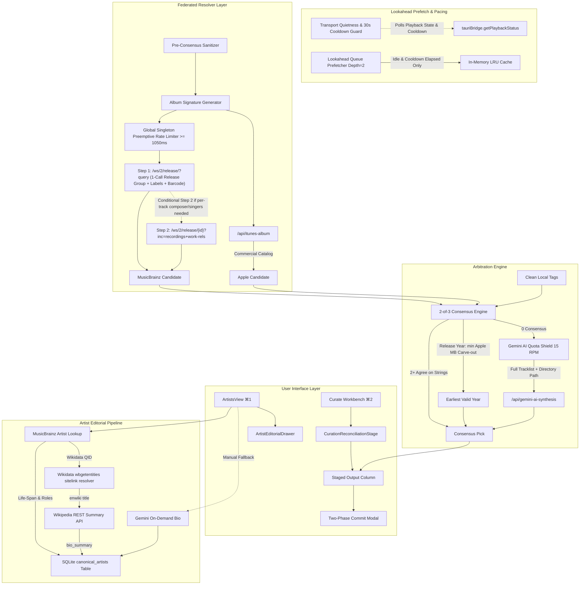

# Federated Album & Artist Metadata Recommendation Engine

*   **Author:** Mathan
*   **Status:** Draft
*   **Date:** 2026-10-28

--------------------------------------------------------------------------------

## Overview

Cadence delivers bit-perfect audiophile music playback alongside high-fidelity catalog curation. While single-track lookups and basic cover art fetching exist, the current architecture lacks a coherent, release-level and artist-level metadata recommendation pipeline. External provider lookups in the Curation Workbench are starved by single-track (`tracks[0]`) query calls, dirty local rip tags pollute comparison logic, digital remaster dates frequently overwrite true historical release years, and rich artist editorial profiles remain completely unpopulated in the local database.

This project delivers an end-to-end album and artist metadata recommendation engine built around:
1. **Pre-Sanitized 2-of-3 Consensus Arbitration**: Sanitizing rip noise and disqualifying placeholder tags so Apple Music, MusicBrainz, and Local tags reach clean agreement on canonical release titles, album artists, composers, genres, and earliest original release dates (`min(Apple.year, MB.firstReleaseDate.year)`).
2. **Multi-Movie & Custom Anthology Resolution**: Disambiguating 2-in-1 combo CD rips and multi-film custom anthologies with hyphen-splitting and full-tracklist Gemini AI synthesis.
3. **Lookahead Queue Prefetcher (Depth = 2)**: Masking MusicBrainz 1 req/sec pacing delays by pre-resolving candidate metadata for upcoming albums while respecting audiophile transport quietness.
4. **Separation of Concerns for Tag Staging vs SQLite Profiles**: Staging verified album/track tags via atomic two-phase commit, while hydrating rich artist profiles (biography from Wikipedia REST, active eras and roles from MusicBrainz, and portraits from Apple Music) strictly into the local SQLite `canonical_artists` table.

## The Problem

1. **The "Dirty Local Tag" Consensus Trap**: Local file tags in user libraries frequently append rip artifacts (`"Anjali CD RIP"`, `"[FLAC 24-96]"`) or contain generic placeholders (`"Unknown Artist"`, `"Various Artists"`, `"Track 01"`). Comparing raw strings prevents consensus from forming or, worse, allows a bad local tag year to collude with an Apple Music streaming reissue year (e.g., 2015) to outvote MusicBrainz's true historical master release year (e.g., 1990).
2. **Release-Level Data Starvation via Track-Zero Bias**: In `federatedResolvers.ts`, `resolveActiveItemCandidate` queries external providers using single-track queries (`tracks[0]?.title`) and hardcodes `ai: null`. It cannot query full release groups, catalog numbers, barcodes, total track counts, or multi-disc topologies.
3. **Multi-Movie Combo Pressings & Anthology Failures**: Physical CDs in South Asian and regional catalogs often press two complete film soundtracks onto a single physical disc (e.g., Pyramid/Lahari combo releases like *"Agni Natchathiram / Ninaivellam Nithya"*), or assemble 30+ track custom anthologies (e.g., *"A World Of Music"*). Standard 1-to-1 album queries fail completely with 0 matches or $>30\%$ track count divergence.
4. **MusicBrainz 1 Req/Sec Stepper Latency**: MusicBrainz strictly limits anonymous API traffic to 1 request per second. When a user steps through the Curation Queue (`Stage & Next → ⌘↵`), waiting synchronously for MusicBrainz introduces an unacceptable 1.2–1.5 second UI block on every album transition.
5. **Unpopulated SQLite Artist Editorial Profiles**: The SQLite database defines the `canonical_artists` table with columns for `bio_summary`, `era_active`, `primary_role`, `mbid`, and `apple_artist_id`. However, background maintenance only updates `portrait_url`. Users viewing `ArtistsView` receive no biographical context, historical active eras, or primary musical role classifications (e.g., Playback Singer vs Music Director / Composer).

## Goals

*   **G1: Pre-Consensus Sanitization & Placeholder Disqualification**: Strip digital rip noise (`CD RIP`, `[FLAC]`, `(Original Motion Picture Soundtrack)`, `- Single`) and disqualify placeholder strings (`"Unknown Artist"`, `"Various Artists"`, `"0000"`) before evaluating provider agreement.
*   **G2: 2-of-3 Consensus Arbitration Engine**: Implement field-level consensus across Local, Apple Music, and MusicBrainz. When Local is disqualified, require 2-of-2 external agreement or high-confidence ($\ge 80\%$) single-provider match.
*   **G3: Earliest Release Date Protection**: Calculate `ORIGINALYEAR` as `min(Apple.year, MB.firstReleaseDate.year)` across verified release-group candidates to guarantee digital reissues never overwrite historical release years.
*   **G4: Combo CD Disambiguation & Full-Tracklist AI Hand-Off**: Disambiguate multi-movie combo titles using delimiters (`/`, `-`, `;`). When 0-consensus occurs, pass full tracklists and directory paths to Gemini AI in a single prompt (~400 tokens) to resolve album-level composer and track-level singers in one pass.
*   **G5: Lookahead Queue Prefetcher (Depth = 2)**: Prefetch and cache metadata for Albums $N+1$ and $N+2$ while the user reviews Album $N$, active strictly when audio playback is idle or cooldown has elapsed.
*   **G6: Multi-Source `canonical_artists` Hydration**: Hydrate SQLite artist profiles using MusicBrainz (MBID, lifespan, primary role), Apple Music (IDs and high-res portraits), and Wikipedia REST Summary API (clean biographical summaries), with on-demand Gemini AI fallback.
*   **G7: Curate & ArtistsView UI Integration**: Surface consensus provenance badges (`[Local+MB]`, `[Apple+MB]`, `[AI]`) with single-click cell overrides in `CurationReconciliationStage`, and provide an editorial profile inspector in `ArtistsView`.

## Non-Goals

*   **NG1: Unattended Full-Library AI Batching**: No automated mass execution of Gemini AI across the entire catalog at once to protect the 15 RPM quota ceiling.
*   **NG2: Writing Biographies into Physical Audio Headers**: Encyclopedic prose summaries remain strictly in the SQLite database to avoid bloating audio file header padding.
*   **NG3: Synthetic Identifier Hallucination**: Gemini AI is strictly barred from inventing barcodes, catalog numbers, or MusicBrainz UUIDs without exact external verification.
*   **NG4: Automated Unreviewed File Writes**: No metadata changes write directly to physical files without user confirmation in the Two-Phase Commit modal.

## Critical User Journeys (CUJs)

### CUJ 1: Reconciling a Dirty Local Soundtrack Rip
*   **Given**: An album folder tagged `"Anjali CD RIP"` with Album Artist `"Unknown Artist"`, release year `2015`, and track files missing composer tags.
*   **When**: The user selects the album in Curate (`⌘2`).
*   **Then**: The pre-sanitizer strips `"CD RIP"`, disqualifies `"Unknown Artist"`, queries MusicBrainz and Apple Music, and achieves 2-of-2 external consensus on title `"Anjali"`, composer `"Ilaiyaraaja"`, and original year `1990` (`min(2015, 1990)` via Earliest Valid Year rule). `STAGED OUTPUT` is pre-populated with consensus values and tagged `[Apple + MB]`.

### CUJ 2: Resolving a 2-in-1 Combo CD Pressing (Virtual Split in Queue)
*   **Given**: A physical CD release titled `"Agni Natchathiram - Ninaivellam Nithya"` where a single folder contains 12 tracks from two distinct film releases (Tracks 1–6 from Movie A [1988] and Tracks 7–12 from Movie B [1982]).
*   **When**: The combo disambiguator or Gemini AI detects multiple sub-release groupings with distinct soundtrack discographies.
*   **Then**: `CurationReconciliationStage` surfaces an interactive `Split into 2 Virtual Albums` toggle. When engaged, the queue splits the physical folder into two virtual album staging entries: Virtual Album 1 stages Tracks 1–6 with `ALBUM = "Agni Natchathiram"` and `ORIGINALYEAR = 1988`, while Virtual Album 2 stages Tracks 7–12 with `ALBUM = "Ninaivellam Nithya"` and `ORIGINALYEAR = 1982` directly into `track.pendingSidecarEdits`, preventing cross-film metadata pollution.

### CUJ 3: Hydrating Artist Editorial Profiles
*   **Given**: An artist entry in `ArtistsView` (e.g., `"A. R. Rahman"`) with empty biographical summary and active era.
*   **When**: The user opens the artist detail view or clicks "Enrich Profile".
*   **Then**: The service queries MusicBrainz for MBID and lifespan (`1987–present`), extracts Wikidata `Q106817`, resolves English Wikipedia title via `wbgetentities`, queries Wikipedia REST API for a clean 2-paragraph biographical summary, and writes the data to the SQLite `canonical_artists` table with zero audio file tag modifications.

--------------------------------------------------------------------------------

## Technical Plan (Architecture)

### Architectural Overview & Data Flow



### Component & Module Specifications

#### 1. Pre-Consensus Sanitization & Disqualification (`src/core/taxonomyUtils.ts`)
*   **`cleanConsensusTitle(rawTitle: string): string`**:
    Extends `stripRipNoiseAndTags` to aggressively strip commercial single/soundtrack suffixes and rip markers:
    ```typescript
    export function cleanConsensusTitle(raw: string): string {
      return stripRipNoiseAndTags(raw)
        .replace(/\s*-\s*Single$/i, '')
        .replace(/\s*\((?:Original Motion Picture Soundtrack|Soundtrack|OST|Deluxe Version|Remastered)\)$/i, '')
        .trim();
    }
    ```
*   **`isPlaceholderTag(val?: string): boolean`**:
    Evaluates whether a tag value is an uninformative placeholder:
    Matches `"unknown artist"`, `"various artists"`, `"track \d+"`, `"0000"`, `"untitled"`, `"none"`, or empty strings.
*   **Earliest Valid Year Calculation**:
    Given candidate years $Y_{local}, Y_{apple}, Y_{mb}$:
    $Y_{effective} = \min(\{y \in [Y_{apple}, Y_{mb}] \mid y \ge 1900 \land y \le \text{CurrentYear}\})$
    If local is non-placeholder and $Y_{local} < Y_{effective}$, $Y_{local}$ is included in the minimum pool only if verified by folder name dates.

#### 2. Release-Group Provider Resolvers (`src/services/federatedResolvers.ts`)
*   **`AlbumSignature` Contract**:
    ```typescript
    export interface AlbumSignature {
      sanitizedTitle: string;
      sanitizedArtist: string;
      trackCount: number;
      totalDurationSecs?: number;
      firstTrackTitle?: string;
    }
    ```
*   **Global Preemptive FIFO Queue Rate Limiter (`GlobalMusicBrainzQueue`)**:
    Enforces $\ge 1050\text{ms}$ between consecutive outbound HTTP requests across all consumers.
    *   **Priority Preemption (`enqueueActive`)**: Active user-driven lookups bypass queued background prefetch tasks, executing immediately after any in-flight HTTP request finishes.
    *   **Unexecuted Prefetch Purging (`cancelPendingPrefetch`)**: When the user steps to a new album, pending background prefetch closures are purged from the queue array before network dispatch, consuming 0ms of the 1050ms rate-limit token budget.
*   **Transport-Level User-Agent Compliance**:
    In Chromium / WebView2, `User-Agent` is a browser-restricted header that cannot be set in `window.fetch()`. Outbound MusicBrainz and Wikimedia HTTP requests are routed through Cadence's backend Vite proxy (`/api/musicbrainz-release`) or native Rust client (`reqwest`), injecting:
    `User-Agent: Cadence/1.0.0 ( contact@cadence.audio; https://github.com/matbhuvi-tech/Cadence )`.
    For direct client-side Wikimedia requests, requests append `&Api-User-Agent=Cadence/1.0.0`.
*   **`fetchItunesAlbumCandidate(signature: AlbumSignature): Promise<ProviderResult | null>`**:
    Queries the iTunes search API with `entity=album` using sanitized title and album artist.
    Extracts canonical release title, copyright/label, primary genre, release date, and master artwork URL.
*   **`fetchMusicBrainzReleaseCandidate(signature: AlbumSignature): Promise<ProviderResult | null>`**:
    *   **Optimized Step 1 (Single-Request Resolution)**:
        Queries `/ws/2/release/?query=release:"{sanitizedTitle}" AND artist:"{sanitizedArtist}" AND tracks:{count}&fmt=json`.
        This single endpoint returns release-group (`first-release-date`), `label-info` (label + catalog number), `barcode`, and `artist-credit`. For standard albums, release-level consensus resolves in exactly 1 HTTP call ($1.05\text{s}$ total external time).
    *   **Conditional Step 2 (Deep Recording Lookup)**:
        Only if per-track composer/singer credits are required or local track titles are placeholders (e.g., `"Track 01"`), executes:
        `/ws/2/release/{id}?inc=recordings+work-rels+artist-credits`
        serialized through the global preemptive queue.

#### 3. 2-of-3 Consensus Arbitration Engine (`src/services/federatedResolvers.ts`)
*   **Contract Definition**:
    ```typescript
    export interface ConsensusFieldResult<T> {
      value: T;
      source: 'consensus_2_of_3' | 'consensus_2_of_2' | 'single_provider_high_confidence' | 'earliest_release_rule' | 'local_default' | 'ai_synthesis';
      contributingSources: ('local' | 'apple' | 'musicbrainz' | 'ai')[];
      confidence: number;
    }

    export interface ReleaseConsensusResult {
      title: ConsensusFieldResult<string>;
      albumArtist: ConsensusFieldResult<string>;
      composer: ConsensusFieldResult<string>;
      releaseYear: ConsensusFieldResult<number>;
      genre: ConsensusFieldResult<string>;
      label: ConsensusFieldResult<string>;
      catalogNumber: ConsensusFieldResult<string>;
      trackListMatches: Map<number, { title: string; artist: string; composer?: string }>;
      subReleaseGroupings?: { title: string; year: number; trackIndices: number[] }[];
      requiresAiFallback: boolean;
    }
    ```
*   **Arbitration Algorithm & Release Year Carve-Out**:
    1. **Release Year Carve-Out (Mandatory)**: `releaseYear` explicitly bypasses standard 2-of-3 string equality. Whenever at least one qualified external provider (Apple Music or MusicBrainz) returns a verified release-group candidate, `releaseYear` strictly resolves via the **Earliest Valid Year Calculation** ($Y_{effective} = \min(Y_{apple}, Y_{mb})$). This strictly prevents a dirty local rip year (e.g., 2015) and a streaming remaster reissue year (e.g., 2015) from forming a false 2-of-3 majority that outvotes a true historical master release year (e.g., 1990).
    2. For all text/tag fields (`title`, `albumArtist`, `composer`, `genre`, `label`, `catalogNumber`), collect normalized values $V_{local}, V_{apple}, V_{mb}$.
    3. If $V_{local}$ is flagged by `isPlaceholderTag`, disqualify it from the voting pool.
    4. If any two qualified values match (using case-insensitive, punctuation-insensitive string normalization), assign consensus value with confidence $0.95$.
    5. If no two sources agree, but an external provider matches $\ge 80\%$ of track count and duration signatures, assign that provider's value with confidence $0.85$.
    6. If all sources disagree and confidence $< 0.60$, set `requiresAiFallback = true`.
*   **Network Dispatch Timeout & Offline Degradation**:
    A 4000ms `AbortSignal.timeout(4000)` begins when the individual HTTP request is dequeued and dispatched over the network (excluding queue wait time). If external requests time out or internet connection is lost, candidate resolution cleanly falls back to local tags with `source: 'local_default'`, confidence `0.50`, and badge `[Local Fallback]`.

#### 4. Lookahead Queue Prefetcher (`src/services/curationQueueService.ts`)
*   **Cache Structure**:
    Maintains an in-memory `LRUCache<string, ReleaseConsensusResult>(capacity = 50)` keyed by `albumId` (strictly RAM-cached with zero disk/SQLite I/O).
*   **Audiophile Guard & Cooldown Invariant**:
    Zero disk reads, batch SQLite writes, or network prefetch queries may occur while audio playback is active or paused, or within a 30-second quietness cooldown window after playback stops.
*   **`lastPlaybackStoppedTime` Lifecycle**:
    Initialized to `0` upon application boot (ensuring prefetching functions immediately on cold start if no playback has occurred). `curationQueueService` subscribes to `tauriBridge.onPlaybackStateChanged` and updates `lastPlaybackStoppedTime = Date.now()` whenever `playbackState` transitions to `Stopped`.
*   **Prefetch Execution Loop**:
    Upon selection of Album Index $N$:
    1. Inspect indices $N+1$ and $N+2$ in the active curation queue.
    2. Query `tauriBridge.getPlaybackStatus()`. If `isPlaying || isPaused || playbackState === 'Loading' || (playbackState === 'Stopped' && (Date.now() - lastPlaybackStoppedTime) < 30000)`, immediately abort and postpone prefetching.
    3. If cache misses exist for $N+1$ or $N+2$, enqueue resolution tasks into `GlobalMusicBrainzQueue` via `enqueuePrefetch`.
    4. When user navigates to a new album, invoke `GlobalMusicBrainzQueue.cancelPendingPrefetch()` to purge stale prefetch closures before dispatching the active item.
    5. Store results in cache. When the user navigates via `Stage & Next (⌘↵)`, cache hit yields instant ($< 16\text{ms}$) UI presentation.

#### 5. Multi-Movie Combo Disambiguation & Virtual Album Split (`src/services/federatedResolvers.ts`)
*   **Combo Delimiter Parsing**:
    If album track count diverges by $> 30\%$ from external candidates or title contains delimiters (`/`, `-`, `;`), invoke `disambiguateComboTitle(release.title, release.folderPath)`.
*   **Virtual Split in Queue**:
    When distinct soundtrack groupings are resolved (via Gemini AI or MusicBrainz recording matches):
    - `CurationReconciliationStage` exposes a `Split into Virtual Albums` action.
    - Instead of forcing conflicting album titles into one physical folder header, the curation engine creates two virtual album entries in the staging queue.
    - Virtual Album 1 stages Tracks 1–6 with `ALBUM = Movie A` and `ORIGINALYEAR = 1988`.
    - Virtual Album 2 stages Tracks 7–12 with `ALBUM = Movie B` and `ORIGINALYEAR = 1982`.
    - Both virtual albums write their isolated metadata to `track.pendingSidecarEdits` for two-phase commit verification.
*   **Full-Tracklist Gemini Prompt Structure (0-Consensus Hand-Off)**:
    When `requiresAiFallback` is true or user clicks "Synthesize with AI":
    ```json
    {
      "directoryPath": "D:/Music/Tamil/Soundtracks/Agni Natchathiram - Ninaivellam Nithya [FLAC]",
      "albumTag": "Agni Natchathiram - Ninaivellam Nithya CD RIP",
      "folderName": "Agni Natchathiram - Ninaivellam Nithya",
      "trackCount": 12,
      "tracks": [
        { "trackNumber": 1, "title": "Ninnukori Varanam", "artist": "Chithra", "durationSecs": 278 },
        { "trackNumber": 2, "title": "Rojavapoo", "artist": "S.P.B", "durationSecs": 284 }
      ]
    }
    ```
    Prompt directs Gemini with `maxOutputTokens: 2048` (guaranteeing that 30+ track compilations are synthesized without JSON response truncation) to output structured JSON identifying:
    `canonicalAlbumTitle`, `albumArtist`, `primaryComposer`, `originalReleaseYear`, `isComboRelease`, `subReleaseGroupings`, and per-track `title`, `playbackSingers`, and `filmSoundtrack`.

#### 6. Artist Editorial Profile Hydration (`src/services/sqliteLibraryService.ts`)
*   **Pipeline Flow & Wikidata Resolution**:
    1. Query MusicBrainz Artist search `/ws/2/artist?query=artist:{name}` to retrieve canonical `mbid`, `life-span.begin`, `life-span.end`, `disambiguation`, `type`, and URL relations.
    2. **Wikidata & Wikipedia Link Resolution**:
       - If a direct `wikipedia.org` relation exists, extract the title directly.
       - If only a `wikidata.org/wiki/Qxxxx` relation exists (standard modern MusicBrainz schema), query the Wikidata sitelink API:
         `https://www.wikidata.org/w/api.php?action=wbgetentities&ids={QID}&props=sitelinks&sitefilter=enwiki&format=json`
         and extract the `enwiki` page title.
       - If neither relation is linked, execute a two-step fallback:
         1. Query Wikipedia search: `https://en.wikipedia.org/w/rest.php/v1/search/page?q={canonical_name}+{primary_role}&limit=1` to extract the article key.
         2. Call Wikipedia REST summary API using the resolved article key.
    3. Call Wikipedia REST API using the resolved title:
       `https://en.wikipedia.org/api/rest_v1/page/summary/{title}`
       Extract clean 2-3 paragraph plain-text `extract` string.
    4. Query Apple iTunes artist lookup for high-resolution 1000x1000 portrait image URL.
    5. Save directly to SQLite:
       ```sql
       UPDATE canonical_artists 
       SET bio_summary = ?1, era_active = ?2, primary_role = ?3, mbid = ?4, apple_artist_id = ?5, portrait_url = ?6
       WHERE id = ?7;
       ```
    6. Audio files on disk remain completely untouched.

#### 7. Curation Workbench UI Integration (`src/components/Curate/`)
*   **Visual Badging in `CurationReconciliationStage.tsx`**:
    The `STAGED OUTPUT` column header displays the resolution method:
    - `[Consensus: Local + MB]` (Emerald Badge)
    - `[Consensus: Apple + MB]` (Teal Badge)
    - `[AI Synthesized]` (Purple Badge with Sparkles)
    - `[Earliest Year Rule]` (Blue Badge)
    - `[Local Fallback]` (Neutral Badge)
*   **Cell Interaction**:
    Clicking any cell in the 4-way table (e.g., clicking MusicBrainz Year `1990` or Apple Label `Sony Music`) immediately overrides that specific field in `STAGED OUTPUT` and tags it as `[Manual Override]`.
*   **Subtle AI Action Button**:
    Header mounts a clean button labeled `✦ Synthesize with AI`. When the rate limiter is actively engaged, it displays a subtle disabled cooldown status (e.g., `Available in 4s`) rather than raw internal rate-limit metrics.

--------------------------------------------------------------------------------

## Alternatives Considered

### Alternative A: Eager Gemini AI Ingestion Across All Albums
*   **Description**: Run Gemini AI automatically on every album transition without waiting for consensus disagreement.
*   **Pros**: Provides deep semantic reasoning and film context across all catalog items out-of-the-box.
*   **Cons**: Instantly exhausts the Gemini 15 RPM free/standard quota during active queue stepping (`⌘↵`), introduces a 1.5–3.0s latency spinner on every item, and wastes API quota on mainstream Western releases where Apple and MusicBrainz already achieve 100% agreement.
*   **Reason for Rejection**: Violates rate-limit constraints and degrades interactive curation throughput. Replaced by the 2-of-3 consensus primary tier with on-demand and 0-consensus fallback.

### Alternative B: Strict Provider Hierarchy (e.g., MusicBrainz Always Wins)
*   **Description**: Hardcode a static preference order where MusicBrainz data always overrides Apple Music, which always overrides Local tags.
*   **Pros**: Simpler deterministic rules without voting or proximity heuristics.
*   **Cons**: MusicBrainz has extensive coverage gaps for South Asian, regional, and film soundtrack discographies, frequently leaving composers and labels empty. Conversely, Apple Music skews heavily toward digital reissue and remaster dates (e.g., listing a 1990 classic as 2018), which corrupts timeline sorting if preferred unconditionally.
*   **Reason for Rejection**: Static hierarchies fail when data quality varies across genres and regions. Replaced by field-specific domain authority (`min(year)` for release dates, MusicBrainz/Gemini for composers, Apple for artwork/commercial labels).

### Alternative C: Writing Encyclopedic Biographies into Audio File Headers
*   **Description**: Write artist biographies and active era descriptions directly into ID3v2 `COMM`/`TXXX` frames or FLAC Vorbis comments on disk.
*   **Pros**: Metadata remains portable if individual audio files are copied outside of Cadence.
*   **Cons**: Bloats audio file headers by 5–15 KB per track. When header padding is exhausted, physical tag writes require rewriting the entire multi-gigabyte audio container on disk, violating audiophile transport silence and causing buffer parsing stalls on DAP hardware and mobile remotes.
*   **Reason for Rejection**: Severe disk I/O penalties and container corruption risks. Replaced by SQLite-native storage in `canonical_artists`.

### Alternative D: Synchronous On-Demand MusicBrainz Lookups on Stepper Click
*   **Description**: Execute MusicBrainz HTTP lookups only when the user explicitly steps onto an album.
*   **Pros**: Simplest state machine; zero background worker threads or prefetching queues.
*   **Cons**: Forces the user to wait through a 1.2–1.5s UI spinner on every single `Stage & Next (⌘↵)` button click due to MusicBrainz's mandatory 1 req/sec rate limit.
*   **Reason for Rejection**: Breaks interactive curation momentum. Replaced by the Lookahead Queue Prefetcher (Depth = 2) gated by transport quietness.

--------------------------------------------------------------------------------

## Detailed Implementation Plan

### Implementation Phase Breakdown & File Manifest

The implementation is executed as a unified pipeline across native backend operations, core taxonomy utilities, federated provider resolvers, curation prefetching, and UI presentation surfaces.

#### 1. `src/core/taxonomyUtils.ts` ([Modify](file:///e:/Mathan/Code/Music%20Agent/src/core/taxonomyUtils.ts))
*   **Type / Scope**: Taxonomical Sanitization & Classification Utilities
*   **Proposed Changes**:
    *   Export `cleanConsensusTitle(rawTitle: string): string`: Aggressively strips rip artifacts (`[FLAC]`, `CD RIP`), single suffixes (`- Single`), and commercial soundtrack/remaster tags (`(Original Motion Picture Soundtrack)`, `(Deluxe Version)`).
    *   Export `isPlaceholderTag(val?: string): boolean`: Evaluates whether a string is an uninformative placeholder (`"unknown artist"`, `"various artists"`, `"track \d+"`, `"0000"`, `"untitled"`, `"none"`, or whitespace-only) to disqualify from voting pools.
    *   Export `calculateEarliestValidYear(localYear?: number, appleYear?: number, mbYear?: number, folderYear?: number): number | undefined`: Computes $Y_{effective} = \min(Y_{apple}, Y_{mb})$ bounded within $[1900, \text{CurrentYear}]$, incorporating local or folder year only if qualified and non-placeholder.
    *   Export `disambiguateComboTitle(rawTitle: string, folderPath?: string): { isCombo: boolean; parts: string[] }`: Detects delimiters (`/`, `-`, `;`) to segment combo releases into constituent film titles.
*   **Rationale**: Establishes deterministic input normalization and placeholder disqualification before candidate values enter consensus arbitration.

#### 2. `src/core/types.ts` ([Modify](file:///e:/Mathan/Code/Music%20Agent/src/core/types.ts))
*   **Type / Scope**: Core TypeScript Domain Types & Contracts
*   **Proposed Changes**:
    *   Define `AlbumSignature` interface:
        ```typescript
        export interface AlbumSignature {
          sanitizedTitle: string;
          sanitizedArtist: string;
          trackCount: number;
          totalDurationSecs?: number;
          firstTrackTitle?: string;
        }
        ```
    *   Define `UpdateArtistEditorialPayload` interface:
        ```typescript
        export interface UpdateArtistEditorialPayload {
          bioSummary?: string;
          eraActive?: string;
          primaryRole?: string;
          mbid?: string;
          appleArtistId?: string;
          portraitUrl?: string;
        }
        ```
    *   Define `ConsensusFieldResult<T>` and `ReleaseConsensusResult` interfaces with field-level provenance sources, confidence metrics, and `subReleaseGroupings`.
    *   Define `SubReleaseGrouping` representing segmented track clusters for combo CD pressings.
    *   Extend `ArtistDetail` and `ArtistSummary` interfaces with `bioSummary`, `eraActive`, and `portraitStatus`.
*   **Rationale**: Enforces type-safe data contracts for multi-source consensus fields, combo release disaggregation, and editorial profile hydration.

#### 3. `src-tauri/src/db/operations.rs` ([Modify](file:///e:/Mathan/Code/Music%20Agent/src-tauri/src/db/operations.rs))
*   **Type / Scope**: Native SQLite Database Operations
*   **Proposed Changes**:
    *   Define serde payload with camelCase deserialization:
        ```rust
        #[derive(serde::Deserialize)]
        #[serde(rename_all = "camelCase")]
        pub struct UpdateArtistEditorialPayload {
            pub bio_summary: Option<String>,
            pub era_active: Option<String>,
            pub primary_role: Option<String>,
            pub mbid: Option<String>,
            pub apple_artist_id: Option<String>,
            pub portrait_url: Option<String>,
        }
        ```
    *   Implement `pub fn update_artist_editorial(conn: &Connection, artist_id: &str, payload: &UpdateArtistEditorialPayload) -> Result<()>` executing a parameterized `UPDATE canonical_artists` query.
*   **Rationale**: Enables persisting rich biographical extracts, historical active eras, and external provider IDs directly into the SQLite database.

#### 4. `src-tauri/src/commands/library.rs` ([Modify](file:///e:/Mathan/Code/Music%20Agent/src-tauri/src/commands/library.rs))
*   **Type / Scope**: Tauri IPC Command Handler
*   **Proposed Changes**:
    *   Implement `db_update_canonical_artist_editorial` command accepting `artist_id: String` and `payload: UpdateArtistEditorialPayload`, dispatching to `DbOperations::update_artist_editorial`.
*   **Rationale**: Exposes native SQLite artist editorial profile updates to the Tauri IPC bridge with seamless camelCase deserialization from frontend calls.

#### 5. `src-tauri/src/lib.rs` ([Modify](file:///e:/Mathan/Code/Music%20Agent/src-tauri/src/lib.rs))
*   **Type / Scope**: Native Application Entry Point
*   **Proposed Changes**:
    *   Register `db_update_canonical_artist_editorial` in the `generate_handler!` registration list.
*   **Rationale**: Binds the IPC command handler into the Tauri v2 dispatcher.

#### 6. `src/services/tauriBridge.ts` ([Modify](file:///e:/Mathan/Code/Music%20Agent/src/services/tauriBridge.ts))
*   **Type / Scope**: Frontend Native IPC Bridge
*   **Proposed Changes**:
    *   Add `updateCanonicalArtistEditorial(artistId: string, payload: UpdateArtistEditorialPayload): Promise<void>` invoking `db_update_canonical_artist_editorial`.
*   **Rationale**: Provides a typed asynchronous client method for updating SQLite artist records from the React application layer.

#### 7. `src/services/federatedResolvers.ts` ([Modify](file:///e:/Mathan/Code/Music%20Agent/src/services/federatedResolvers.ts))
*   **Type / Scope**: Federated Metadata Resolvers & Consensus Engine
*   **Proposed Changes**:
    *   Implement `GlobalMusicBrainzQueue`:
        *   Application-wide singleton FIFO rate limiter enforcing $\ge 1050\text{ms}$ between consecutive outbound HTTP dispatches across all consumers.
        *   Support priority preemption: `enqueueActive()` places user lookups ahead of background prefetch tasks.
        *   Support cancellation: `cancelPendingPrefetch()` purges unexecuted prefetch tasks from the queue array, consuming 0ms rate limit token budget.
        *   Attach a 4000ms timeout (`AbortSignal.timeout(4000)`) initialized strictly when an item is dequeued and HTTP transmission begins (not during rate-limit queue waiting time).
    *   Implement WebView2 / Chromium User-Agent header handling:
        *   Chromium WebView2 restricts setting the `User-Agent` request header via `window.fetch()`. MusicBrainz queries route through Cadence's native Rust HTTP proxy or client, injecting `User-Agent: Cadence/1.0.0 ( contact@cadence.audio; https://github.com/matbhuvi-tech/Cadence )` at the native socket layer.
        *   Direct Wikimedia REST API queries append `&Api-User-Agent=Cadence/1.0.0` or custom query parameters.
    *   Implement `fetchItunesAlbumCandidate(signature: AlbumSignature)`: Queries iTunes search API by sanitized album title and artist, extracting release title, label, genre, release date, and artwork.
    *   Implement `fetchMusicBrainzReleaseCandidate(signature: AlbumSignature)`:
        *   Step 1 (Optimized Single Request): Queries `/ws/2/release/?query=release:"{sanitizedTitle}" AND artist:"{sanitizedArtist}" AND tracks:{count}&fmt=json` to retrieve release-group (`first-release-date`), label, catalog number, barcode, and artist credit in one HTTP call.
        *   Step 2 (Conditional Deep Lookup): Invokes `/ws/2/release/{id}?inc=recordings+work-rels+artist-credits` only when per-track composer/singer credits are needed or local track titles are placeholders.
    *   Implement `resolve2of3ReleaseConsensus(localRelease: Release, localTracks: Track[])`: Executes consensus arbitration with:
        *   Mandatory `releaseYear` carve-out resolving via `calculateEarliestValidYear` ($\min(Y_{apple}, Y_{mb})$).
        *   Garbage disqualification via `isPlaceholderTag`.
        *   Fallback to 2-of-2 external agreement when local tag is disqualified.
        *   Full-tracklist Gemini AI handoff on 0-consensus or confidence $< 0.60$ with `maxOutputTokens: 2048` ceiling to prevent JSON response truncation on large compilation tracklists.
    *   Implement `hydrateArtistEditorialProfile(artistName: string, canonicalId: string)`:
        *   Queries MusicBrainz artist search for MBID, lifespan, and Wikidata URL relation.
        *   Resolves Wikidata `Qxxxx` to English Wikipedia title via `wbgetentities` sitelinks API.
        *   If Wikidata Q-ID is missing, falls back to Wikipedia search: `https://en.wikipedia.org/w/rest.php/v1/search/page?q={name}+{role}&limit=1` to extract article key.
        *   Fetches clean 2-paragraph plain-text summary from Wikipedia REST API (`/api/rest_v1/page/summary/{title}`).
        *   Queries iTunes for 1000x1000 artist portrait URL.
        *   Persists enriched data via `tauriBridge.updateCanonicalArtistEditorial`.
*   **Rationale**: Implements core federated arbitration, preemptive rate-limited provider fetching, and artist editorial hydration.

#### 8. `src/services/curationQueueService.ts` ([Modify](file:///e:/Mathan/Code/Music%20Agent/src/services/curationQueueService.ts))
*   **Type / Scope**: Curation Queue Orchestration & Prefetching
*   **Proposed Changes**:
    *   Integrate `LookaheadQueuePrefetcher` maintaining an in-memory `LRUCache<string, ReleaseConsensusResult>(capacity = 50)`.
    *   Implement Audiophile Transport & Cooldown Guard:
        *   Initialize `lastPlaybackStoppedTime = 0` on application startup so lookahead prefetching operates immediately on cold boot if no playback has occurred.
        *   Subscribe to `tauriBridge.onPlaybackStateChanged` and set `lastPlaybackStoppedTime = Date.now()` on `Stopped` events.
        *   Checks `tauriBridge.getPlaybackStatus()`. If `isPlaying || isPaused || playbackState === 'Loading' || (playbackState === 'Stopped' && (Date.now() - lastPlaybackStoppedTime) < 30000)`, immediately aborts and suspends prefetching.
    *   Enqueues candidate resolution tasks for queue albums $N+1$ and $N+2$ serialized through `GlobalMusicBrainzQueue.enqueuePrefetch`.
    *   Invokes `GlobalMusicBrainzQueue.cancelPendingPrefetch()` upon user navigation to prevent stale prefetch tasks from consuming rate-limit tokens.
*   **Rationale**: Eliminates interactive stepper latency on album transitions while strictly preserving audiophile transport silence during playback and cooldown.

#### 9. `src/services/sqliteLibraryService.ts` ([Modify](file:///e:/Mathan/Code/Music%20Agent/src/services/sqliteLibraryService.ts))
*   **Type / Scope**: SQLite Library Management Service
*   **Proposed Changes**:
    *   Add `updateArtistEditorialProfile` calling `tauriBridge.updateCanonicalArtistEditorial` and updating runtime state in memory.
*   **Rationale**: Ensures consistent synchronization between SQLite disk storage and frontend artist state.

#### 10. `src/components/Curate/CurationReconciliationStage.tsx` ([Modify](file:///e:/Mathan/Code/Music%20Agent/src/components/Curate/CurationReconciliationStage.tsx))
*   **Type / Scope**: Curation Reconciliation Stage Component
*   **Proposed Changes**:
    *   Display provenance badges in the `STAGED OUTPUT` column (`[Consensus: Local + MB]`, `[Consensus: Apple + MB]`, `[AI Synthesized]`, `[Earliest Year Rule]`, `[Local Fallback]`).
    *   Implement interactive 4-way cell override: Clicking any provider candidate cell copies its value into `STAGED OUTPUT` and tags it as `[Manual Override]`.
    *   Implement `Split into Virtual Albums` action: When combo CD `subReleaseGroupings` are detected, allows the user to split the physical folder into two virtual album staging records with separate `ALBUM` and `ORIGINALYEAR` tags in `track.pendingSidecarEdits`.
    *   Style AI button as `✦ Synthesize with AI` with subtle disabled cooldown indicator (`Available in 4s`) when rate-limited.
*   **Rationale**: Delivers transparent visual consensus arbitration, instant manual overrides, and ergonomic combo CD disaggregation.

#### 11. `src/components/CenterStage/ArtistsView.tsx` ([Modify](file:///e:/Mathan/Code/Music%20Agent/src/components/CenterStage/ArtistsView.tsx))
*   **Type / Scope**: Catalog Artist Browsing & Editorial Inspector View
*   **Proposed Changes**:
    *   Display `bioSummary`, `eraActive`, and `primaryRole` in the artist header and inspection drawer.
    *   Mount an "Enrich Profile" button invoking `hydrateArtistEditorialProfile`.
    *   Mount an on-demand fallback "Synthesize Biography with AI" button when Wikipedia has no entry.
*   **Rationale**: Surfaces rich biographical, historical, and role classifications to users in the library browser.

#### 12. `src/test/testFederatedConsensus.ts` ([Create](file:///e:/Mathan/Code/Music%20Agent/src/test/testFederatedConsensus.ts))
*   **Type / Scope**: Automated TypeScript Unit & Integration Test Suite
*   **Proposed Changes**:
    *   Unit tests for `cleanConsensusTitle` and `isPlaceholderTag`.
    *   Unit tests for `calculateEarliestValidYear` ensuring $\min(Y_{apple}, Y_{mb})$ overrides false local/reissue majorities.
    *   Unit tests for 2-of-3 consensus arbitration with placeholder disqualification.
    *   Unit tests for `GlobalMusicBrainzQueue` rate limiting ($\ge 1050\text{ms}$ spacing) and priority preemption/cancellation.
    *   Unit tests for Wikidata Q-ID sitelink resolution, fallback Wikipedia search, and Wikipedia REST extract parsing.
    *   Unit tests for virtual album split track staging.
*   **Rationale**: Guarantees automated regression testing for consensus rules, rate limiting, and editorial hydration.

#### 13. `src/test/testCurationLifecycle.ts` ([Modify](file:///e:/Mathan/Code/Music%20Agent/src/test/testCurationLifecycle.ts))
*   **Type / Scope**: Curation Queue Lifecycle Test Suite
*   **Proposed Changes**:
    *   Add test verifying that `LookaheadQueuePrefetcher` remains completely dormant during active/paused audio playback and respects the 30-second quietness cooldown window.
*   **Rationale**: Verifies that background prefetching never violates audiophile transport invariants.

#### 14. `src/services/AGENTS.md` ([Modify](file:///e:/Mathan/Code/Music%20Agent/src/services/AGENTS.md))
*   **Type / Scope**: Subsystem Architecture Documentation
*   **Proposed Changes**: Document `GlobalMusicBrainzQueue`, `fetchMusicBrainzReleaseCandidate`, `fetchItunesAlbumCandidate`, `resolve2of3ReleaseConsensus`, and `LookaheadQueuePrefetcher` responsibilities and contracts.
*   **Rationale**: Preserves architectural documentation integrity for service layers.

#### 15. `src/core/AGENTS.md` ([Modify](file:///e:/Mathan/Code/Music%20Agent/src/core/AGENTS.md))
*   **Type / Scope**: Domain Core Architecture Documentation
*   **Proposed Changes**: Document consensus field types, taxonomy sanitization helpers, and virtual album grouping data models.
*   **Rationale**: Keeps core domain contracts documented and aligned.

#### 16. `src-tauri/AGENTS.md` ([Modify](file:///e:/Mathan/Code/Music%20Agent/src-tauri/AGENTS.md))
*   **Type / Scope**: Native Backend Architecture Documentation
*   **Proposed Changes**: Document `db_update_canonical_artist_editorial` Tauri IPC command and SQLite `canonical_artists` editorial columns.
*   **Rationale**: Preserves architectural documentation integrity for native backend contracts.

---

### Verification Plan

*   **Compilation & Static Type Checks**:
    *   `npm run build`: Validate that all TypeScript compilation (`tsc -b`) and Vite production bundling succeed with zero type errors.
    *   `cargo test --manifest-path src-tauri/Cargo.toml`: Validate native Rust database operations and command signatures.
*   **Automated Regression Suite**:
    *   `npx tsx src/test/testFederatedConsensus.ts`: Execute automated test suite validating title sanitization, placeholder disqualification, earliest year rule, 2-of-3 consensus arbitration, rate-limit FIFO serialization, and Wikidata sitelink parsing.
    *   `npx tsx src/test/testCurationLifecycle.ts`: Execute curation queue lifecycle suite validating that lookahead prefetching respects transport quietness and the 30-second cooldown period.
*   **Manual End-to-End Verification**:
    1.  *Dirty Local Rip Reconciliation*: Open Curate (`⌘2`), select an album tagged with rip artifacts (e.g., `"Anjali CD RIP"`). Verify `STAGED OUTPUT` is pre-populated with consensus values (`"Anjali"`, `"Ilaiyaraaja"`, original year `1990`) tagged `[Apple + MB]`.
    2.  *Combo CD Virtual Split*: Select a 2-in-1 combo release (e.g., `"Agni Natchathiram - Ninaivellam Nithya"`). Click `Split into Virtual Albums`. Verify two virtual album staging entries are created with distinct `ALBUM` titles and `ORIGINALYEAR` dates staged to `track.pendingSidecarEdits`.
    3.  *Stepper Latency Verification*: Step rapidly through 5 albums using `Stage & Next (⌘↵)`. Verify navigation is instantaneous ($< 16\text{ms}$) due to the Lookahead Queue Prefetcher (Depth = 2) without UI blocking spinners.
    4.  *Transport Quietness & Cooldown Gate*: Start audio playback. Verify in network telemetry that MusicBrainz and Apple prefetch lookups are completely dormant. Stop playback and verify prefetching remains suspended until the 30-second cooldown period elapses.
    5.  *Artist Editorial Profile Hydration*: Navigate to `ArtistsView` (`⌘1`), select an artist with an empty bio (e.g., `"A. R. Rahman"`), and click `Enrich Profile`. Verify the biographical extract, active era, and portrait are populated from MusicBrainz/Wikidata/Wikipedia/Apple into SQLite without touching audio file tags on disk.

--------------------------------------------------------------------------------

*Drafted with EGM*
