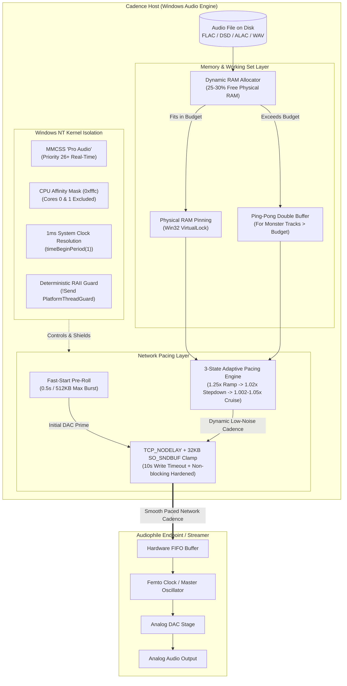

# Cadence Audio Playback & Streaming Optimizations
**Comprehensive Architectural Guide: Bit-Perfect Purity, Low-Noise Network Pacing, and Windows Kernel Isolation**

---

## 1. Executive Summary & Design Philosophy

In high-end digital audio playback (especially over UPnP/DLNA and local endpoint output), audio data itself is digital, but the playback apparatus is an **ultra-sensitive mixed-signal analog system**. 

A common misconception is that network streaming jitter directly causes DAC clock jitter. In reality, modern asynchronous DACs and UPnP streamers re-clock audio from local FIFOs using internal crystal oscillators. **The true degradation vectors are Electromagnetic Interference (EMI), Radio Frequency Interference (RFI), and Power Supply Modulation**:
1. **Host-Side Electrical Noise:** Continuous mechanical drive seek operations, NVMe bus contention, aggressive CPU frequency scaling, and erratic high-volume network bursts radiate RF noise and inject high-frequency ripple into the PC's ground plane and power supply.
2. **Receiver-Side Power Rail Noise:** When an audio streamer or networked DAC receives data in erratic bursts, its Ethernet PHY chip, Wi-Fi controller, and onboard CPU draw spiky electrical currents. This modulates the streamer’s internal power rails, introducing phase noise (jitter) into the adjacent master audio clock and DAC stage.

To eliminate these phenomena at their root, Cadence implements a **6-Layer Audiophile Optimization Engine** across both the local audio pipeline and the UPnP/DLNA streaming architecture.

---

## 2. Architecture Overview



---

## 3. Layer-by-Layer Technical Breakdown

### Layer 1: Bit-Perfect Passthrough & Purity Mode

#### What Was Done
* **Zero Transcoding:** Audio files (FLAC, ALAC, DSF, DFF, WAV, AIFF) are streamed in their exact native binary representation. Cadence never decodes or resamples host-side for UPnP streaming.
* **Bit-Perfect Purity Mode:** When enabled, the DSP pipeline locks volume strictly to **1.0 (Unity Gain)**. All software digital attenuators, equalizers, volume sliders, and dither algorithms are bypassed.
* **Exact MIME Delivery:** Media headers provide precise MIME types (`audio/flac`, `audio/x-dsd`, `audio/x-wav`) with accurate byte lengths and range support.

#### Why It Was Done
* Converting native DSD or 24-bit/192kHz PCM to float samples or applying digital volume attenuation alters the original bit sequence. Digital volume reduction without dithering introduces quantization distortion; volume reduction with dithering raises the noise floor.
* Unity gain guarantees mathematical 1:1 bit preservation from disk to DAC.

#### Expected Benefits
* **Bit-identity:** 100% bit-transparent transmission matching the studio master.
* **Maximum Dynamic Range:** Full DAC resolution without digital rounding artifacts or dynamic compression.

---

### Layer 2: Whole-Track Physical RAM Pinning (`VirtualLock`)

#### What Was Done
* **Dynamic Budget Calculation:** At startup or on query, Cadence samples system memory via `GlobalMemoryStatusEx`. It allocates **25% to 30% of available physical RAM** (e.g., 10 GB on a 32–64 GB PC) for zero-risk audio caching.
* **Physical Memory Locking:** Tracks within the budget are loaded entirely into RAM and pinned via the Win32 `VirtualLock` API.
* **Process Working Set Expansion:** Before locking, `SetProcessWorkingSetSize` expands the process's working set limits with a 64 MB safety headroom (`WS_HEADROOM`), enabling the Windows NT Virtual Memory Manager (VMM) to accommodate the locked pages without failure.
* **Safe Step-Down Deallocation:** When a track ends or is skipped, memory pages are unpinned via `VirtualUnlock` **before** the working set size is stepped down. This prevents Windows NT kernel errors (`ERROR_WORKING_SET_QUOTA`).

#### Why It Was Done
* Conventional players read audio continuously in small 4 KB – 64 KB chunks from disk during playback. This causes continuous mechanical drive head seeks or NVMe controller bus transactions.
* NVMe controllers and mechanical disks consume bursty power, generate high-frequency electrical hash, and radiate electromagnetic interference across the motherboard ground plane.
* Furthermore, if memory is unpinned, Windows may page audio buffers into the virtual memory swapfile on disk under memory pressure.

#### Expected Benefits
* **Complete Disk & Bus Silence:** Once the track is loaded into RAM, disk I/O drops to zero for the entire duration of the track.
* **Elimination of Page Faults:** Guaranteed zero page-fault interrupts during playback.
* **Reduced Host EMI:** Quiescent drive controllers and storage buses minimize motherboard RF radiation.

---

### Layer 3: Ping-Pong Windowed Buffering for Massive Files

#### What Was Done
* For massive audio files that exceed the dynamic RAM budget (e.g., 6 GB DSD512 multichannels, 2-hour symphonic live recordings), Cadence dynamically switches to a **Double-Buffered Ping-Pong Architecture**.
* Two contiguous memory windows (128 MB – 256 MB each) are allocated and page-locked in RAM.
* While the streaming thread reads continuously from Buffer A, a dedicated background thread (`cadence-disk-prefetch`) bursts the next section of the file into Buffer B, then sleeps.
* **Prefetch Thread Priority Demotion:** The prefetch thread is explicitly lowered to `THREAD_PRIORITY_BELOW_NORMAL` via `SetThreadPriority`.

#### Why It Was Done
* Falling back to unbuffered disk streaming on giant files would re-introduce continuous disk I/O.
* Ping-pong buffering compresses hours of playback into rare, brief reads occurring once every ~90 seconds, keeping the disk silent 98% of the time.
* Lowering background prefetch thread priority ensures the read burst never preempts or introduces micro-stutters into the network pacing loop.

#### Expected Benefits
* Enables bit-perfect playback of ultra-high-resolution files (DSD256, DSD512, DXD) without running out of system memory.
* Retains silent drive operation for 98% of track duration.

---

### Layer 4: 3-State Adaptive Packet Pacing & Dynamic Socket Buffering

#### What Was Done
* **3-State Adaptive Transmission Strategy:**
  1. **State 1: Fast-Start & Ramp-Up ($1.25\times$ Real-Time):** Initial audio playback begins with a modest pre-roll burst capped at $512\text{ KB}$ (leaving $\sim 90\%$ of the receiver's hardware FIFO buffer empty to prevent tripping high-water marks), followed by pacing at $1.25\times$ real-time bitrate. The streaming engine continuously measures per-chunk `write_all` blocking time and schedule lag.
  2. **State 2: Backpressure Detection & Anti-Windup Deceleration ($1.02\times$):** When kernel write blocks or schedule drift exceed $25\text{ ms}$ (indicating the receiver's FIFO buffer has filled and asserted `TCP ZeroWindow`), the engine instantly re-anchors the timeline baseline (`paced_start = Some(now)`) to suppress catch-up bursts, down-clamps `SO_SNDBUF` to its steady-state ceiling, and steps down delivery to $1.02\times$. If backpressure repeats within $2\text{ seconds}$, it steps down further to $1.002\times$ ($+0.2\%$ excess).
  3. **State 3: Stable Operation & Headroom Probing ($1.002\times \rightarrow 1.05\times$):** Once the connection runs continuously without stalls for an **$8\text{-second}$ clean window**, it enters Stable Operation. The engine gently probes for network headroom in $+0.005\times$ additive increments (capped at $1.05\times$). Any renewed stall $> 25\text{ ms}$ immediately steps back to State 2 and resets the stability window.
* **Steady-State Kernel Send Buffer Ceiling ($32\text{ KB}$ Hard Clamp):**
  - While high-rate DSD streams require room to transmit smoothly, allocating an unbounded $288\text{ KB}$ kernel buffer allows the OS TCP stack to hoard unacknowledged data during temporary receiver window pauses.
  - Steady-state `SO_SNDBUF` is hard-clamped between $16\text{ KB}$ and $32\text{ KB}$ (exactly two $16\text{ KB}$ delivery chunks). This physically prevents kernel-level micro-bursts ($>500\text{ KB}$ surges) when the streamer's TCP window reopens.
* **Sony DSF Header Sniffing & True 1-Bit Clock Extraction:**
  - Sony DSF container headers are sniffed directly at fixed offsets (bytes 56–60) to extract the true 1-bit audio clock (e.g. $11,289,600\text{ Hz}$ for DSD256), with ground-truth payload division (`file_size / duration_secs`) sanity checks, preventing 8× slowdowns caused by container-level 8-bit planar packing.
* **ID3v2 Cover Art Wire-Speed Bypass:**
  - In DSF files, high-resolution embedded album cover art located at `metadata_offset` (or requests near the tail end of the file) bypasses the audio pacer entirely (`SynchronousPacer::unpaced()`), transferring at wire speed so artwork displays instantaneously without stalling audio playback.
* **Mid-Track Range Continuation Optimization:**
  - When streaming range requests mid-track (`start >= 1 MB`, such as after user seeks or sequential HTTP range reconnects), the pacer bypasses the pre-roll burst completely (`preroll = 0`), initializes directly in `State 3: Stable Operation`, and pre-clamps `SO_SNDBUF` to its $32\text{ KB}$ steady-state ceiling. This prevents re-flooding the streamer's FIFO buffer during playback jumps.
* **Nagle Algorithm Disabled (`TCP_NODELAY = true`):** Packets are dispatched immediately upon cadence intervals rather than coalescing into unpredictable bursts.

#### Why It Was Done
* Standard HTTP servers (e.g., typical DLNA servers) blast audio files at wire speed (1 Gbps / 10 Gbps) until the TCP window blocks. This creates extreme burst currents in the receiving streamer’s network interface and trips high/low watermark hysteresis loops.
* An initial $1.25\times$ ramp-up primes the receiver's hardware buffer gently, while the $25\text{ ms}$ backpressure detector and baseline re-anchor prevent burst windup.
* An $8\text{-second}$ stability observation window allows the pacer to verify steady-state balance before testing available throughput headroom.
* Hard-clamping steady-state `SO_SNDBUF` to $32\text{ KB}$ prevents the kernel from hoarding data during ZeroWindow stalls and flushing needle spikes when the window reopens.
* Suppressing pre-roll on mid-track range requests guarantees that scrubbing or seeking does not disrupt the receiver's steady-state buffering.

#### Expected Benefits
* **Pristine, Continuous Transmission Profile:** Eliminates the classic sawtooth waveform (intermittent 6 MB/s blasts followed by 3-second silences), producing a completely flat transmission line in Wireshark.
* **Elimination of Kernel Micro-Bursts:** The $32\text{ KB}$ send buffer ceiling ensures no instantaneous spikes $>500\text{ KB}$ occur upon TCP window reopening.
* **Instant Start & Instant Cover Art:** 512 KB pre-roll primes the DAC instantly, and unpaced metadata serving delivers album art without delay.
* **Stabilized Streamer Power & Minimized EMI:** Eliminates current surge modulation in the streamer's Ethernet PHY and Wi-Fi chip, minimizing RF radiation into the master audio clock and analog DAC stages.
* **Drop-Free Scrubbing:** Mid-track seeking seamlessly maintains steady-state pacing without bufferbloat stalls.

---

### Layer 5: Windows NT Kernel & OS-Level Thread Isolation

#### What Was Done
* **Multimedia Class Scheduler Service (MMCSS) Elevation:** The active streaming thread calls `AvSetMmThreadCharacteristicsW("Pro Audio")`. Windows elevates the thread to real-time priority (Priority 26+), exempting it from normal desktop CPU scheduling preemption.
* **CPU Core Pinning (Affinity Mask `0xfffc`):** The streaming thread is pinned away from Core 0 and Core 1 (`affinity mask = 0xfffc` on 16-core systems).
* **1 ms System Timer Resolution:** System clock resolution is raised from Windows default ~15.6 ms to **1.0 ms** via `timeBeginPeriod(1)`.
* **Deterministic RAII Cleanup (`StreamingThreadGuard`):** A custom RAII guard guarantees that `AvRevertMmThreadCharacteristics` and `timeEndPeriod(1)` are called deterministically when a connection closes or skips. The struct is marked `!Send` via `PhantomData<*const ()>` to guarantee compile-time thread-local enforcement.

#### Why It Was Done
* On Windows, Core 0 and Core 1 are heavily loaded with hardware interrupt handlers (ISRs), NVMe disk completion routines, and Network Driver Interface Specification (NDIS) Deferred Procedure Calls (DPCs).
* Running audio network loops on Cores 0 or 1 risks thread interruption and micro-jitter from incoming OS background tasks.
* MMCSS registration ensures the Windows scheduler prioritizes audio packet dispatch over file indexing, virus scans, or background updates.
* A 1.0 ms timer resolution is essential for sub-millisecond precision during packet pacing.

#### Expected Benefits
* **Jitter-Free Scheduling:** Zero interference from Windows network DPCs and driver interrupts.
* **Deterministic Timing:** Audio frames dispatched with sub-millisecond precision.
* **Guaranteed Resource Health:** Safe, automatic reversion of OS timers and MMCSS profiles on every track transition.

---

### Layer 6: Win32 & Network Edge Case Hardening

#### What Was Done
* **Tokio `into_std()` Non-Blocking Fix:** When converting Tokio TCP streams to synchronous threads, `std_stream.set_nonblocking(false)` is explicitly invoked. This eliminates `WSAEWOULDBLOCK` (`io::ErrorKind::WouldBlock`) failures during socket writes.
* **Silent Disconnect Timeout:** A 10-second write timeout (`set_write_timeout(Some(10s))`) is configured on the socket.
* **Win32 Working Set Quota Guarding:** In `unlock_memory`, `VirtualUnlock` unpins physical memory pages **before** calling `SetProcessWorkingSetSize` to reduce the working set. This prevents the kernel from rejecting working set adjustments with `ERROR_WORKING_SET_QUOTA` (0x5B3).

#### Why It Was Done
* Converting a non-blocking Tokio socket to standard I/O leaves the socket in non-blocking mode under Windows NT, which would abruptly crash high-speed bursts.
* Network renderers that drop power or disconnect silently never send TCP FIN or RST packets. Without an explicit write timeout, synchronous threads would block forever, causing memory buffers, timer locks, and MMCSS registrations to leak indefinitely.
* Decreasing the working set limit while pages remain locked causes the Windows memory manager to fail.

#### Expected Benefits
* **Crash & Drop Resilience:** Immune to renderer disconnections, Wi-Fi drops, and abrupt power-offs.
* **Zero Resource Leaks:** Memory, handles, and timers release cleanly under all operating conditions.

---

## 4. Expected Benefits Matrix

| Domain | Before Optimization | With Cadence Audio Engine | Audiophile / Engineering Impact |
| :--- | :--- | :--- | :--- |
| **Bit Accuracy** | Digital volume controls & dither DSP | Bit-Perfect Purity Mode (1.0 Unity Gain) | **100% Bit-Identical to Master File**; zero quantization noise. |
| **Storage Subsystem** | Continuous disk reads every few ms | Full track locked in RAM via `VirtualLock` | **Zero Disk I/O during playback**; drive enters quiescent low-noise state. |
| **Host System EMI** | NVMe / SATA bus traffic & memory paging | Contiguous page-locked memory | **Eliminated Storage Controller Noise** & zero page fault interrupts. |
| **Network Traffic** | Erratic wire-speed bursts (1Gbps spikes) | 512KB Pre-Roll + 3-State Adaptive Pacing (1.25x Ramp / 1.002x–1.05x Cruise @ 32KB SO_SNDBUF) | **Minimized Streamer Power Modulation**; eliminated bufferbloat & RF surges. |
| **CPU Scheduling** | Unconstrained thread on random cores | Pinned away from Core 0/1 (`0xfffc`) + MMCSS | **Shielded from NDIS Network DPCs** & hardware driver interrupts. |
| **Timer Precision** | Default Windows timer (~15.6 ms) | Locked 1.0 ms timer (`timeBeginPeriod(1)`) | **Sub-millisecond pacing accuracy**; smooth packet departure. |
| **OS Stability** | Risk of memory leaks & socket hangs | RAII `!Send` Guard, 10s timeout, safe quota step-down | **Deterministic Resource Lifecycle** across track skips, pauses, and power cycles. |

---

## 5. Live Verification Signatures

During active playback, the Cadence debug console logs verify these systems in real time:

```text
[Cadence AudioEngine] Bit-Perfect Purity Mode ENABLED. Volume locked to 1.0 (Unity Gain).
[Cadence UPnP Streamer] Whole-track buffer: 70.4 MB in RAM (page-locked: true, budget 10024 MB).
[Cadence UPnP Streamer] Streaming thread pinned away from Core 0/1 (mask 0xfffc).
[Cadence UPnP Streamer] Streaming thread registered with MMCSS 'Pro Audio'.
[Cadence UPnP Streamer] Format: DSD | Audio Bitrate: 2822.4 KB/s (22.58 Mbps) | State 1 Ramp-Up: 3528.0 KB/s (1.25x) | State 2 Step-Down: 2878.8 KB/s (1.02x) | Fast-Start: 512 KB | SO_SNDBUF: 32 KB
[Cadence UPnP Streamer] Serving audio bytes 0-70560000 of 70560000 (Range continuation: false)
[Cadence UPnP Pacer] State 1 (Ramp-Up 1.25x) -> State 2 (Backpressure Detected, stall 32ms). Stepping down to 1.02x.
[Cadence UPnP Pacer] State 2 -> State 3 (Stable Operation). Progress recovered, cruising at 1.020x.
[Cadence UPnP Pacer] State 3: Sustained stability for 8.0s. Probing headroom: 1.020x -> 1.025x.
[Cadence UPnP Streamer] Serving metadata / cover art bytes 70560000-71560000 of 71560000 (unpaced wire-speed)
...
[Cadence UPnP Streamer] MMCSS 'Pro Audio' reverted cleanly.
```

1. **`Volume locked to 1.0 (Unity Gain)`** $\rightarrow$ Software attenuation bypassed; native bitstream output.
2. **`page-locked: true`** $\rightarrow$ `VirtualLock` engaged; memory pages will not swap; zero disk reads.
3. **`mask 0xfffc`** $\rightarrow$ Cores 0 and 1 (NDIS/DPC interrupts) excluded from audio streaming.
4. **`registered with MMCSS 'Pro Audio'`** $\rightarrow$ Real-time priority 26+ active.
5. **`Fast-Start: 512 KB | SO_SNDBUF: 32 KB`** $\rightarrow$ Dynamic send buffer primed for initial burst, hard-clamped to 32 KB for steady state.
6. **`Backpressure Detected ... Stepping down to 1.02x`** $\rightarrow$ Hardware FIFO saturation detected; timeline baseline instantly re-anchored to suppress catch-up spikes.
7. **`Progress recovered, cruising at ...x`** $\rightarrow$ Smooth, low-noise cruise established matching receiver DAC consumption.
8. **`Probing headroom: ...x -> ...x`** $\rightarrow$ Safe, gentle throughput probing after an 8-second clean window.
9. **`metadata / cover art ... unpaced wire-speed`** $\rightarrow$ Embedded artwork served instantaneously without stalling playback cadence.
10. **`reverted cleanly`** $\rightarrow$ RAII `PlatformThreadGuard` cleanly restored OS timers and scheduling on track completion/skip.
