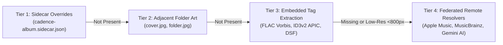
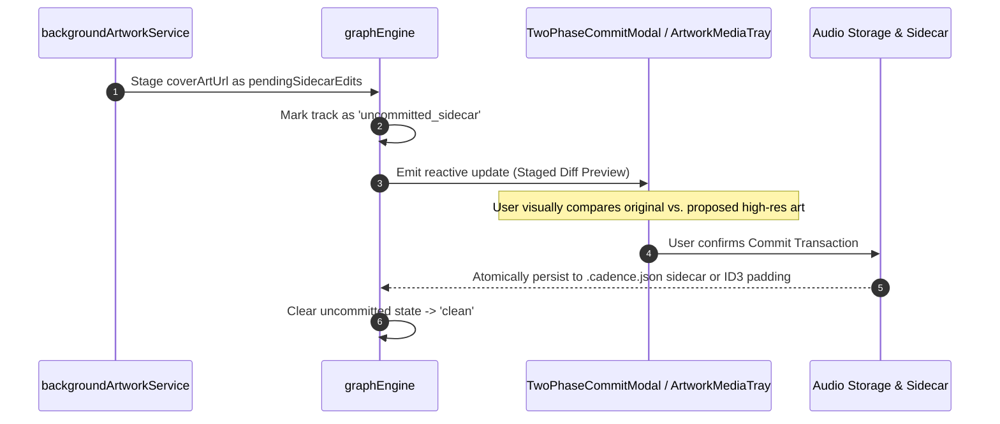

# Cadence Cover Art Resolution Architecture
**Comprehensive Architectural Guide: Multi-Tiered Resolution, Audiophile Transport Purity, Fast-Path Caching, and Two-Phase Staging**

---

## 1. Executive Summary & Design Philosophy

In an uncompromising, bit-perfect audiophile player and curation system, album cover art serves two vital, yet potentially conflicting, roles:
1. **Archival Visual Fidelity:** Presenting stunning, uncompressed front cover art (up to 3000×3000px master scans, 300 DPI, full color depth) and atmospheric ambient visualizations that honor the physical release packaging.
2. **Deterministic Hardware Transport Silence:** Ensuring that background artwork fetching, container tag extraction, and image thumbnail caching **never** induce storage bus wakeups, CPU power transients, or network interface (NIC) EMI/RFI bursts during active audio playback.

In traditional media players, scanning and artwork fetching run unthrottled in the background—thrashing the storage bus with multi-gigabyte container reads and generating high-frequency network spikes. 

To solve this, Cadence implements a **4-Tier Retrieval Pipeline** coordinated with an **Audiophile Idle-Guard State Machine**, **Release-Level Deduplication**, an isolated **NVMe AppData Cache**, and a non-destructive **Two-Phase Commit Staging Engine**.

---

## 2. Architecture Overview

```mermaid
flowchart TD
    subgraph UI ["Frontend Presentation (React 19 / TypeScript)"]
        Grid["AlbumCoverGrid / VirtualDataTable<br/>(Cached 300x300 Thumbnails & Badges)"]
        Tray["ArtworkMediaTray<br/>(Inspect Dimensions, DPI, Color Profile)"]
        Hover["ArtworkHoverPreview / AtmosphericBackdrop<br/>(Floating Tooltip & Ambient Palette Extraction)"]
    end

    subgraph Memory ["In-Memory Graph Layer (graphEngine)"]
        GE["graphEngine (Release & Track In-Memory Cache)"]
        Staged["Uncommitted Sidecars (Two-Phase Commit Preview)"]
    end

    subgraph Service ["Frontend Enrichment Services"]
        BG["backgroundArtworkService.ts<br/>• Playback Idle Guard<br/>• 30s Cooldown State Machine<br/>• 500ms Pacing Floor<br/>• Checkpoint Debouncer"]
        Fed["federatedResolvers.ts<br/>• Apple Music Master Scan (3000x3000bb.jpg)<br/>• MusicBrainz / Cover Art Archive (CAA)<br/>• Gemini AI Curated Master Discography"]
    end

    subgraph Tauri ["Native Rust Backend (src-tauri)"]
        Worker["MaintenanceWorker (worker.rs)<br/>• THREAD_MODE_BACKGROUND_BEGIN (IoPriorityVeryLow)<br/>• CPU Pinning Mask (!0b11: off Core 0/1)"]
        Scanner["ScannerController & engine.rs<br/>• Directory Walker & Sidecar Reader"]
        Cache["ArtworkCache (artwork_cache.rs)<br/>• Fast NVMe AppData Server"]
        DSF["extract_dsf_artwork<br/>• Direct Metadata Offset Tail Seek"]
    end

    subgraph Storage ["Physical Storage Separation"]
        NVMe[("%APPDATA%/cadence/cache/artwork/<id>.jpg<br/>Fast NVMe System Disk (Zero Audio Bus Noise)")]
        AudioDrive[("Music Library Storage (E:\, NAS, External USB)<br/>• Audio Containers (FLAC, DSF, ALAC, MP3)<br/>• Folder Master Art (cover.jpg, folder.jpg)<br/>• Sidecars (cadence-album.sidecar.json)")]
    end

    UI --> Memory
    Memory --> Staged
    BG -->|Query Remote Candidates| Fed
    BG -->|Stage Proposed Cover Art| Memory
    Scanner -->|Index Local Art & Sidecars| Memory
    
    Worker -->|Extract & Resize to 300x300| NVMe
    Worker -->|Extract DSF Header Tail| DSF
    DSF -->|Read APIC Frame (Bytes 20..28)| AudioDrive
    Scanner -->|Probe Folder Art| AudioDrive
    
    Cache -->|Serve Fast Thumbnail| NVMe
    Cache -->|Fallback Local Extract (Only when Idle)| AudioDrive
```

---

## 3. The 4-Tier Resolution Hierarchy & Precedence

When a release or track is indexed, imported, or selected in Cadence, artwork resolution proceeds strictly through four ordered tiers:



### Tier 1: Sidecar File Overrides
- **Evaluated In:** [`read_album_sidecar()`](file:///e:/Mathan/Code/Music%20Agent/src-tauri/src/scanner/engine.rs#L83-L109)
- **Files Checked:** `cadence-album.sidecar.json` and `<audio_filename>.sidecar.json`.
- **Role:** Explicit user overrides, staged transactions, or custom remote URLs (`coverArtUrl` / `artworkUrl`) take precedence over all physical files and tags on disk without altering original audio bits.

### Tier 2: Adjacent High-Resolution Folder Master Images
- **Evaluated In:** [`find_local_cover_art()`](file:///e:/Mathan/Code/Music%20Agent/src-tauri/src/scanner/engine.rs#L111-L124) and [`MaintenanceWorker::process_release_artwork()`](file:///e:/Mathan/Code/Music%20Agent/src-tauri/src/maintenance/worker.rs#L567-L588)
- **Candidate List (in order of priority):**
  1. `cover.jpg`, `cover.png`
  2. `folder.jpg`, `folder.png`
  3. `front.jpg`, `front.png`
  4. `album.jpg`, `album.png`
  5. `Cover.jpg`, `Folder.jpg`, `Front.jpg`
  6. `cover.jpeg`, `front.jpeg`
- **Role:** Audiophile releases frequently bundle 1000px–3000px uncompressed scans in the album folder. These are prioritized over embedded tags to maximize resolution and eliminate container file seeking.

### Tier 3: Native Embedded Container Extraction (Ground-Truth Parsing)
If no folder image is found, Cadence inspects the audio file container directly:
- **PCM & Lossless Formats (FLAC, ALAC, WAV, AIFF, MP3, M4A):** Parsed using Lofty's [`Probe::open()`](file:///e:/Mathan/Code/Music%20Agent/src-tauri/src/remote/artwork_cache.rs#L81-L87) to read `primary_tag().pictures()`.
- **Sony DSD (`.dsf`):** Traditional audio parsers read sequential audio chunks, forcing gigabytes of 1-bit DSD audio samples into memory. Cadence bypasses this via [`extract_dsf_artwork()`](file:///e:/Mathan/Code/Music%20Agent/src-tauri/src/maintenance/worker.rs#L873-L920):
  1. Reads the 80-byte DSF header.
  2. Verifies the `DSD ` magic signature.
  3. Extracts the 64-bit little-endian `metadata_offset` at bytes `20..28`.
  4. Performs a single `SeekFrom::Start(metadata_offset)` directly to the file tail.
  5. Parses the trailing ID3v2 header and attached `APIC` picture frame in isolation.

### Tier 4: Federated Remote Resolvers (Archival Enrichment)
When a release contains no artwork, or is flagged as low-resolution (`artwork.isLowRes` or `width < 800`), [`backgroundArtworkService.ts`](file:///e:/Mathan/Code/Music%20Agent/src/services/backgroundArtworkService.ts#L454-L483) queries [`federatedResolvers.ts`](file:///e:/Mathan/Code/Music%20Agent/src/services/federatedResolvers.ts) across external archival authorities:
1. **Apple Music HD (`provider: 'apple'`):**
   - Queries the Apple iTunes Search API or local dev proxy for the canonical release.
   - Extracts master scans and rewrites standard thumbnails to native 3000×3000 uncompressed masters:
     ```typescript
     const highRes = matched.artworkUrl100.replace('100x100bb.jpg', '3000x3000bb.jpg');
     ```
   - Default confidence: `0.96`.
2. **MusicBrainz & Cover Art Archive (`provider: 'musicbrainz'`):**
   - Resolves release MBIDs with 1.1s rate limiting.
   - Targets verified Cover Art Archive (CAA) front scans:
     `https://coverartarchive.org/release/{mbid}/front-500`
   - Default confidence: `0.93`.
3. **Gemini AI & Curated Discography (`provider: 'ai'`):**
   - First checks [`getCuratedAlbumArtwork()`](file:///e:/Mathan/Code/Music%20Agent/src/core/taxonomyUtils.ts) for instant zero-latency match against Cadence's curated classical and jazz discography ledger.
   - Falls back to Gemini AI discography resolvers for rare, multi-composer, or complex classical releases.
   - Default confidence: `0.98`.

---

## 4. Audiophile Transport Purity & Hardware Silence

Cadence's core design philosophy requires that the audio playback pipeline remains completely isolated from electrical, mechanical, and bus contention noise. Artwork resolution implements five layers of deterministic protection:

### 1. Storage Bus Silence (`AudioEngine` Guard)
- **Invariant:** While `AudioEngine` is in `Playing`, `Paused`, or `Loading` states, **ZERO disk reads/writes may occur on music library storage drives**.
- **Implementation:** Both [`ArtworkCache::get_or_create_thumbnail()`](file:///e:/Mathan/Code/Music%20Agent/src-tauri/src/remote/artwork_cache.rs#L54-L57) and [`MaintenanceWorker::process_release_artwork()`](file:///e:/Mathan/Code/Music%20Agent/src-tauri/src/maintenance/worker.rs#L530-L532) evaluate:
  ```rust
  if (self.is_playing_fn)() {
      return None; // Absolute refusal to access library disk
  }
  ```
- If audio starts while an operation is in progress, frontend `AbortController` handles immediately abort network sockets and filesystem handles.

### 2. 30-Second Playback Cease Cooldown
- **Invariant:** When playback transitions to `Stopped` or `Paused`, the host system must allow DAC master clock circuits and power rails to stabilize.
- **Implementation:** [`backgroundArtworkService.ts`](file:///e:/Mathan/Code/Music%20Agent/src/services/backgroundArtworkService.ts#L211-L233) initiates an active 30-second countdown (`status = 'cooldown'`). No background remote queries or local tag reads are executed until the cooldown reaches `0`.

### 3. Network PHY Quietness (500ms Pacing Floor)
- **Invariant:** Network interface controllers (NICs) drawing sudden bursts of current radiate RF noise and modulate host ground planes.
- **Implementation:** The background enrichment loop enforces a minimum `500ms` pacing delay between sequential album lookups:
  ```typescript
  await new Promise((resolve) => setTimeout(resolve, this.pacingDelayMs));
  ```

### 4. Windows NT Kernel & I/O Isolation
- **Invariant:** Maintenance work must never contend with real-time WASAPI MMCSS audio threads.
- **Implementation:** [`MaintenanceWorker::start()`](file:///e:/Mathan/Code/Music%20Agent/src-tauri/src/maintenance/worker.rs#L96-L121) applies native Win32 thread parameters on startup:
  1. **I/O Priority:** Calls `SetThreadPriority(GetCurrentThread(), THREAD_MODE_BACKGROUND_BEGIN)`. Windows drops thread and page I/O priority to `IoPriorityVeryLow`, ensuring audio engine playback reads preempt artwork operations at the SATA/NVMe controller level.
  2. **CPU Affinity:** Calculates available cores and sets `SetThreadAffinityMask(GetCurrentThread(), mask & !0b11)`, strictly isolating the worker away from Core 0 and Core 1 (NDIS/DPC audio pacing cores).

---

## 5. Fast-Path Caching & Release-Level Deduplication

To provide a 60 FPS browsing experience without polling multi-terabyte library storage drives, Cadence decouples catalog presentation from source files:

### Dedicated NVMe AppData Cache
- Rendered thumbnails are decoupled from audio media drives and stored on the fast OS system drive:
  `%APPDATA%/cadence/cache/artwork/<safe_id>.jpg`
- Images are scaled to 300×300 JPEG thumbnails (~15–25 KB) using a fast triangle filter.
- UI components load cached images via `get_cached_only()`, ensuring **zero audio storage drive wakeups during catalog navigation**.

### Release-Level Deduplication
- In multi-track releases (e.g. 24 tracks on a 2-disc album), inspecting every file for embedded tags wastes CPU and disk cycles.
- In [`MaintenanceWorker::process_track_artwork()`](file:///e:/Mathan/Code/Music%20Agent/src-tauri/src/maintenance/worker.rs#L711-L751), when a track requires artwork, the worker first queries SQLite to see if the parent `release_id` already has a cached thumbnail.
- If found, the track **inherits the release thumbnail instantly** with zero file system reads.

---

## 6. Two-Phase Commit & Staging Lifecycle

Cadence protects user library integrity by ensuring automated artwork updates never modify audio files or sidecars destructively without user review:



1. **Staging:** Resolved high-res URLs are written to `pendingSidecarEdits.coverArtUrl` in [`graphEngine`](file:///e:/Mathan/Code/Music%20Agent/src/services/backgroundArtworkService.ts#L520-L529).
2. **Review:** The user reviews side-by-side thumbnail comparisons, image dimensions, DPI, and provider source tags in [`ArtworkMediaTray.tsx`](file:///e:/Mathan/Code/Music%20Agent/src/components/RightPanel/ArtworkMediaTray.tsx).
3. **Commit:** Upon confirmation in [`TwoPhaseCommitModal.tsx`](file:///e:/Mathan/Code/Music%20Agent/src/components/Modals/TwoPhaseCommitModal.tsx), the write strategy is chosen:
   - **Sidecar write:** Writes cleanly to `.cadence.json`.
   - **Embedded tag write:** Evaluated by [`HeaderPaddingAnalysis`](file:///e:/Mathan/Code/Music%20Agent/src/types/commit.ts#L27-L35). If new artwork fits within existing container padding (ID3v2/Vorbis padding blocks), it writes in-place. If growth exceeds padding, it stages a full file rewrite with backup protection.

---

## 7. Frontend Presentation & Ambient Backdrops

The frontend presentation layer leverages resolved artwork to produce an immersive, hardware-accelerated aesthetic:

- **[`AlbumCoverGrid.tsx`](file:///e:/Mathan/Code/Music%20Agent/src/components/CenterStage/AlbumCoverGrid.tsx):** High-density virtualized grid rendering release cards with quality badges (`3000x3000px`, `Low-Res`, `No Embedded Art`).
- **[`ArtworkHoverPreview.tsx`](file:///e:/Mathan/Code/Music%20Agent/src/components/common/ArtworkHoverPreview.tsx):** Floating cursor-anchored high-resolution preview appearing on hover over table rows.
- **[`PanoramicAtmosphericBackdrop.tsx`](file:///e:/Mathan/Code/Music%20Agent/src/components/common/PanoramicAtmosphericBackdrop.tsx) & [`backdropAnalyzer.ts`](file:///e:/Mathan/Code/Music%20Agent/src/services/backdropAnalyzer.ts):**
  - Quantizes the top 3 dominant color accents from the cover art.
  - Dynamically synthesizes an atmospheric ambient background canvas.
  - Paces GPU draw calls via `requestAnimationFrame` to ensure backdrop rendering never causes audio buffer underruns.

---

## 8. Source Code Mapping & Key References

| Subsystem | Primary Source File | Key Responsibilities |
| :--- | :--- | :--- |
| **Enrichment Service** | [`backgroundArtworkService.ts`](file:///e:/Mathan/Code/Music%20Agent/src/services/backgroundArtworkService.ts) | Paced resolution loop, audio playback guard, 30s cooldown timer, checkpointing |
| **Federated Resolvers** | [`federatedResolvers.ts`](file:///e:/Mathan/Code/Music%20Agent/src/services/federatedResolvers.ts) | Apple Music 3000px URL rewriting, MusicBrainz CAA query, Gemini AI discography |
| **Native Worker** | [`maintenance/worker.rs`](file:///e:/Mathan/Code/Music%20Agent/src-tauri/src/maintenance/worker.rs) | Background thread priority (`IoPriorityVeryLow`), CPU affinity mask, DSF tail seek |
| **Native Cache Server** | [`remote/artwork_cache.rs`](file:///e:/Mathan/Code/Music%20Agent/src-tauri/src/remote/artwork_cache.rs) | Fast NVMe thumbnail serving, Lofty picture extraction, playback idle verification |
| **Filesystem Scanner** | [`scanner/engine.rs`](file:///e:/Mathan/Code/Music%20Agent/src-tauri/src/scanner/engine.rs) | Folder master scan (`cover.jpg`, `folder.jpg`), sidecar JSON parsing |
| **Taxonomy Ledger** | [`taxonomyUtils.ts`](file:///e:/Mathan/Code/Music%20Agent/src/core/taxonomyUtils.ts) | Curated master discography artwork mappings for classical and jazz |
| **Two-Phase Commit** | [`TwoPhaseCommitModal.tsx`](file:///e:/Mathan/Code/Music%20Agent/src/components/Modals/TwoPhaseCommitModal.tsx) | Atomic verification gate before writing artwork to sidecars or physical files |
