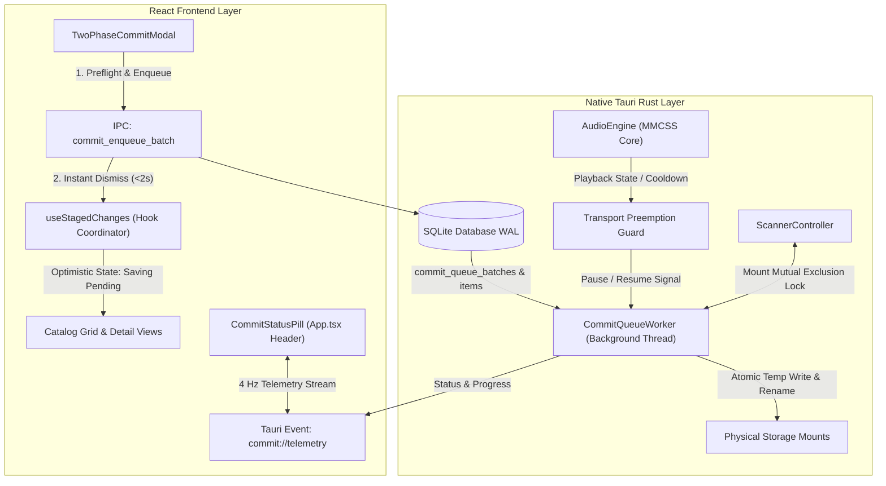

# Asynchronous Background Commit Queue with Playback Preemption

*   **Author:** Cadence Core Engineering
*   **Status:** Approved
*   **Date:** 2026-10-30

--------------------------------------------------------------------------------

## Overview

Cadence is an audiophile music player and catalog curation engine for Windows Desktop. It combines bit-perfect audio streaming with tag management and library inspection. 

When users apply metadata edits to extensive music collections (such as boxed sets containing hundreds of audio files), the existing interface locks the user into a full-screen modal (`TwoPhaseCommitModal.tsx`) for the entire duration of the disk write—often exceeding 50 minutes. During this period, the application is completely blocked: the user cannot browse their library, organize playlists, inspect lyrics, or listen to music without aborting the transaction. Furthermore, Cadence strictly enforces **Storage Bus Silence** (zero disk I/O on music library drives while audio playback is active, paused, or within a 30-second cooldown period), creating a direct conflict between listening to music and committing curated tags to storage.

This design decouples user review and approval from physical disk writes. The commit modal handles fast preflight checks (<1 second) and immediately dispatches the batch to an asynchronous, SQLite-persisted native background queue. Disk writes execute exclusively when audio playback has been stopped and silent for at least 30 seconds. When playback is initiated or paused, background writes yield at clean atomic track boundaries. All approved metadata updates reflect immediately across the catalog through an optimistic UI with Apple HIG-compliant status feedback.

## The Problem

1. **Hostile Modal Lock-in on Large Batches**: Writing ID3v2.4 frames, FLAC Vorbis comments, and embedded artwork across 400+ tracks over high-capacity audio streams (PCM 24-bit/192kHz, DSD) requires multi-gigabyte file rewrites. Holding an application-modal dialog over the viewport for nearly an hour prevents users from performing core music management and listening tasks.
2. **Renderer Thread Fragility**: Currently, commit batching is driven sequentially by a JavaScript loop inside the React frontend (`transactionEngine.ts`). If the user minimizes the app, navigates routes, or reloads the webview, the in-flight transaction is severed, risking orphaned metadata files or interrupted operations.
3. **Playback Collision & Storage Bus Contention**: Disk writes executing during active audio streaming or paused sessions violate audiophile bit-perfect transport guarantees by triggering PCIe/SATA bus contention, cache invalidations, and DPC latency spikes. Furthermore, concurrent file access while an audio track is open in WASAPI Exclusive or rodio causes Win32 sharing violations (`ERROR_SHARING_VIOLATION`).
4. **State Desynchronization & Mental Model Ambiguity**: The current user interface only differentiates between "Staged" (uncommitted draft) and "Committed" (written to disk). Without a distinct queue state, users cannot discern whether their approved edits have been securely scheduled, and re-editing items waiting in queue can trigger write collisions.

## Goals

*   **G1: Non-Blocking User Handoff**: Reduce commit modal dwell time from up to 60 minutes to under 2 seconds. The modal validates file mounts, stream hashes, and permissions, enqueues the batch, and dismisses immediately.
*   **G2: Deterministic Playback Preemption**: Guarantee zero disk I/O on audio storage while playback is active, paused, or within a 30-second silent cooldown. Ensure the commit worker yields cleanly at atomic file boundaries upon playback start.
*   **G3: Persistent Native Queue**: Move queue orchestration and disk writing entirely into native Rust, backed by SQLite WAL persistence to survive window closures, application restarts, and system crashes.
*   **G4: Purity Mode Transport Interlock**: Enforce an automatic lock preventing force-commit overrides while WASAPI Exclusive Purity Mode is active, ensuring electrical and bus silence during audiophile listening.
*   **G5: Optimistic Metadata & In-Place Edit Replacement**: Display newly approved metadata immediately throughout the catalog with consolidated badges. Update queued items in-place if re-edited prior to physical write, coalescing rapid edits via partial unique indexes and JSON merge patching while preserving original backup states.
*   **G6: Apple HIG System Status Integration**: Provide a compact, accessible status pill in the global top header (`src/App.tsx`) displaying live progress, transport pause states, countdown timers, hover/click diagnostics with robust focus management, and safe background persistence on window close.

## Non-Goals

*   **NG1: In-Memory Audio File Pinning for Metadata Writes**: The queue worker does not load multi-gigabyte audio tracks into RAM via `VirtualLock`. RAM pinning is reserved exclusively for the real-time audio playback engine. Tag writes stream through temporary files on disk.
*   **NG2: Optical or Read-Only Media Queueing**: Optical discs (CD-DA/SACD) and hardware write-locked mounts fail preflight immediately and cannot be placed into the commit queue.
*   **NG3: Concurrent Parallel Disk Writers per Physical Mount**: To prevent mechanical head thrashing on rotational hard drives and bus saturation on USB/NAS connections, writes are executed sequentially per physical mount.

## Resolved Architectural Decisions

*   **Decision 1: Handling Unmounted USB/NAS Drives & Device Bridge**: The commit worker will not retry indefinitely. After 3 failed attempts (with exponential backoff of 1s, 2s, 4s), the affected mount's items transition to `paused_mount_offline`. Other physical mounts with queued items continue processing without head-of-line blocking. The top status pill surfaces an alert (`Drive Disconnected · Reconnect to Resume`) with a manual Retry button. A Win32 `WM_DEVICECHANGE` window message hook in `src-tauri/src/lib.rs` bridges volume arrival events to the worker loop over a channel to trigger automatic resumption.
*   **Decision 2: Oversized Embedded Artwork Advisory**: During preflight, if embedded artwork rewrites exceed 10 MB across more than 20 tracks (e.g., 20 MB TIFFs across 50 tracks = 1.0 GB rewrite), an inline optimization banner is displayed in `TwoPhaseCommitModal`: *"Large artwork detected (1.0 GB total rewrite). Save cover.jpg to album folder instead, or compress embedded art to 1500px PNG to reduce write time by 85%."* An option to "Keep Original" remains available for archival fidelity.

## Critical User Journeys (CUJs)

### CUJ 1: Batch Approval with Non-Blocking Handoff
*   **Given**: The user has reviewed 489 staged tracks across 15 albums in the `Review & Commit Changes` modal with audio playback stopped.
*   **When**: The user clicks "Apply Changes".
*   **Then**: The preflight verification runs in <1 second, the batch is written to SQLite, the modal dismisses with a smooth transition, the catalog immediately displays the new metadata with subtle clock badges, and the top header status pill activates showing queue progress.

### CUJ 2: Audio Playback Preemption & Resume
*   **Given**: The commit worker is actively writing track 42 of 489 during a period of playback silence.
*   **When**: The user clicks "Play" (or "Pause") on an album.
*   **Then**: The worker completes writing track 42, validates its CRC, performs the atomic rename, and immediately pauses the queue. The status pill transitions to an amber indicator (`● Paused for Playback`). Thirty seconds after playback stops completely, the status pill shows a live countdown (`● Resuming in 24s...`), after which the worker resumes writing track 43.

### CUJ 3: Re-editing an Album in Queue & In-Flight Contention
*   **Given**: Album "Kind of Blue" has 6 tracks queued for write at queue position 10.
*   **When**: The user navigates to Curate, alters the Year tag from `1959` to `1959 (Remastered)`, and clicks "Update".
*   **Then**: If the item status is `pending`, the SQLite partial unique index allows an atomic upsert that merges tags via `json_patch` while retaining the original `backup_json`. If the track is currently `in_flight`, the engine inserts a subsequent `pending` row for that track (carrying forward the original pre-batch `backup_json`), so the new edit executes cleanly immediately after the in-flight atomic swap completes.

### CUJ 4: Window Exit Protection
*   **Given**: The application has 250 tracks waiting in the background commit queue.
*   **When**: The user clicks the window close button (`X`).
*   **Then**: The window closes cleanly without disruptive blocking dialogs; SQLite WAL durability guarantees that all remaining queued items resume automatically upon next launch, accompanied by a subtle resume toast.

--------------------------------------------------------------------------------

## Technical Plan (Architecture)

### 1. System Placement & Threading Topology

The physical disk execution loop is completely extracted from the React frontend (`transactionEngine.ts`) and placed inside a dedicated background worker thread in native Rust: `CommitQueueWorker` (`src-tauri/src/maintenance/commit_worker.rs`).



#### Thread Isolation, Priority & Adaptive Affinity
*   The worker thread runs with `THREAD_PRIORITY_BELOW_NORMAL` and `THREAD_MODE_BACKGROUND_BEGIN` (low I/O priority).
*   **Adaptive Core Affinity**: On systems with $>2$ logical cores, the worker is affinity-masked away from Core 0 and Core 1 (Windows NDIS/DPC network cores) and away from the real-time audio thread (`cadence-paced-stream`). On systems with $\le 2$ logical cores, default affinity is preserved to prevent empty mask crashes.
*   Zero heap allocations or vector resizes occur across the IPC telemetry broadcast loop.

---

### 2. SQLite Persistence Schema

Two tables in the local SQLite database (`%APPDATA%/cadence.db`) manage batch transactions and track-level operations:

```sql
-- Batch-level transaction envelope
CREATE TABLE commit_queue_batches (
    id TEXT PRIMARY KEY,
    description TEXT NOT NULL,
    total_tracks INTEGER NOT NULL,
    destination TEXT NOT NULL CHECK(destination IN ('embedded', 'sidecar')),
    force_override INTEGER NOT NULL DEFAULT 0,
    status TEXT NOT NULL CHECK(status IN ('pending', 'processing', 'paused_playback', 'paused_mount_offline', 'completed', 'failed', 'cancelled')),
    created_at DATETIME DEFAULT CURRENT_TIMESTAMP,
    completed_at DATETIME
);

-- Individual track operation ledger
CREATE TABLE commit_queue_items (
    id TEXT PRIMARY KEY,
    batch_id TEXT NOT NULL REFERENCES commit_queue_batches(id) ON DELETE CASCADE,
    track_id TEXT NOT NULL,
    file_path TEXT NOT NULL,
    mount_id TEXT NOT NULL,
    payload_json TEXT NOT NULL,
    backup_json TEXT NOT NULL,
    expected_crc TEXT,
    status TEXT NOT NULL CHECK(status IN ('pending', 'in_flight', 'completed', 'failed', 'cancelled')),
    retry_count INTEGER NOT NULL DEFAULT 0,
    error_message TEXT,
    written_bytes INTEGER DEFAULT 0,
    started_at DATETIME,
    completed_at DATETIME
);

CREATE INDEX idx_commit_queue_status ON commit_queue_items(status, batch_id);
CREATE INDEX idx_commit_queue_mount ON commit_queue_items(mount_id, status);
CREATE INDEX idx_commit_queue_track ON commit_queue_items(track_id);

-- Partial unique index allowing in_flight to coexist with pending while coalescing rapid re-edits
CREATE UNIQUE INDEX idx_commit_queue_unique_pending 
ON commit_queue_items(track_id) 
WHERE status = 'pending';
```

#### Coalescing Re-Edits via JSON Patch & Backup Preservation
When enqueueing re-edits, `commit_enqueue_batch` executes an atomic upsert targeting the partial unique index:
```sql
INSERT INTO commit_queue_items (
    id, batch_id, track_id, file_path, mount_id, payload_json, backup_json, expected_crc, status
) VALUES (?, ?, ?, ?, ?, ?, ?, ?, 'pending')
ON CONFLICT(track_id) WHERE status = 'pending'
DO UPDATE SET 
    payload_json = json_patch(commit_queue_items.payload_json, excluded.payload_json),
    batch_id = excluded.batch_id;
```
*   **Original `backup_json` Invariant**: `DO UPDATE SET` explicitly leaves `backup_json` untouched. Whether a track is re-edited once or twenty times while waiting in queue (or queued behind an active `in_flight` write), `backup_json` strictly retains the pristine pre-batch on-disk metadata snapshot, ensuring that an "Undo Batch" action restores the file completely to its original state.
*   **Batch Count Synchronization**: When an upsert associates a pending item with a new batch, the previous batch envelope's `total_tracks` count is decremented within the same transaction to maintain accurate progress denominators.

---

### 3. Transport Preemption, In-Flight Contention & Recovery Loop

The `CommitQueueWorker` executes an event-driven loop with startup crash recovery, mount filtering, sidecar merging, and atomic swapping:

```text
Startup Sweep:
  1. Find items WHERE status = 'in_flight'.
  2. For each, scan directory for matching "[filePath].cadence-tmp-*" files and delete them.
  3. Increment retry_count, reset status = 'pending'.

Processing Loop:
  1. Select next item WHERE status = 'pending' AND mount_id NOT IN (offline_or_locked_mounts) ORDER BY rowid ASC.
  2. If none, transition active batch to 'completed' if all items done, sleep until notified.
  3. Inspect AudioEngine state:
     a. If AudioEngine::is_playing() == true OR AudioEngine::is_paused() == true:
        - If Purity Mode is active OR force_override == 0:
            Set batch.status = 'paused_playback'.
            Sleep 500ms, repeat step 3.
        - Else (Shared Mode AND force_override == 1):
            Proceed with write (warning acknowledged).
     b. If AudioEngine::is_playing() == false AND AudioEngine::is_paused() == false:
        - Calculate transport silence elapsed since last complete stop: t_silent = now() - last_playback_stop_time.
        - If t_silent < 30 seconds:
            Emit telemetry: status = 'paused_playback', silenceCooldownRemainingSec = (30 - t_silent).
            Sleep 1s, repeat step 3.
  4. Acquire Mount Mutual Exclusion Lock (ScannerController yields on this mount; scanner explicitly ignores *.cadence-tmp-*).
  5. Verify source file mtime and size have not drifted since preflight. If drifted, abort track with error.
  6. Transition item status = 'in_flight'.
  7. Execute Write Pipeline:
     - IF destination == 'embedded':
         * Stream tag payload to temporary file: [filePath].cadence-tmp-[uuid].
         * Verify audio stream CRC matches expected_crc.
         * Execute atomic Win32 replacement: MoveFileExW(temp, target, MOVEFILE_REPLACE_EXISTING).
     - IF destination == 'sidecar':
         * Locate target album directory and read existing cadence-album.sidecar.json (or initialize empty ledger).
         * Deep-merge payload_json edits for this track into the sidecar JSON structure.
         * Write merged JSON to cadence-album.sidecar.json.tmp-[uuid].
         * Execute atomic Win32 replacement: MoveFileExW(temp, sidecar, MOVEFILE_REPLACE_EXISTING).
  8. Transition item status = 'completed'. Release Mount Lock.
  9. Repeat loop.
```

---

### 4. IPC Commands and Telemetry Contract

#### Tauri IPC Commands
1. `commit_enqueue_batch(payload: EnqueueBatchPayload) -> Result<String, String>`:
   * Validates target mounts are online and writable.
   * Inserts the batch and all track items inside an atomic SQLite transaction using the partial unique index conflict target.
   * If a re-edited track is already `in_flight`, inserts a subsequent `pending` row (retaining original pre-batch `backup_json`) to execute after the current write finishes.
   * Signals the worker loop to wake. Returns the generated `batch_id` in <100ms.
2. `commit_get_queue_summary() -> Result<CommitQueueSummary, String>`:
   * Returns active batch counts, total pending tracks, current throughput (tracks/sec, MB/s), and active transport state.
3. `commit_set_override(batch_id: String, allow_during_playback: bool) -> Result<(), String>`:
   * Toggles the force-override flag if Purity Mode is inactive. Returns error if Purity Mode is engaged.
4. `commit_cancel_batch(batch_id: String) -> Result<(), String>`:
   * Marks remaining `pending` items as `cancelled`. Leaves already `completed` files untouched.
5. `commit_undo_batch(batch_id: String) -> Result<String, String>`:
   * Uses pristine `backup_json` to enqueue a compensating restore batch for all `completed` items in the specified batch.

#### Telemetry Event Stream (`commit://telemetry`)
Emitted at a maximum frequency of 4 Hz ($\ge 250\text{ms}$ interval) to prevent React render thrashing:
```typescript
interface CommitTelemetryPayload {
  batchId: string;
  totalTracks: number;
  completedTracks: number;
  failedTracks: number;
  status: 'processing' | 'paused_playback' | 'paused_mount_offline' | 'idle' | 'failed';
  currentTrack?: {
    id: string;
    title: string;
    album: string;
    filePath: string;
  };
  throughputTracksPerSec: number;
  estimatedRemainingSec: number;
  silenceCooldownRemainingSec: number;
  purityModeLocked: boolean;
}
```

---

### 5. Optimistic UI and Apple HIG Surfaces

#### Consolidated 2-State Catalog Badging
To eliminate grid clutter, catalog items avoid vibrating animation states:
*   **Staged (Draft)**: Amber dot / badge on uncommitted drafts requiring user review.
*   **Saving Pending**: Upon batch approval, optimistic metadata displays immediately with a subtle clock glyph badge and muted slate/cyan border (`Saving Pending`) at the album or row level, avoiding color collision with Electric Cyan (`#00F5FF`) search highlights.
*   **Committed**: Once disk write completes, the clock badge clears seamlessly.

#### Header Status Pill & Popover Accessibility (`CommitStatusPill.tsx`)
Mounted directly in `src/App.tsx` global header (lines 1665-1670) beside `ActivityPill` with full keyboard (`Tab`, `Enter`, `Space`, `Esc`) and click focus:
*   **Active State**: Compact glassmorphic pill displaying a cyan progress ring, counter (`Writing 59 of 489`), and countdown (`~12m remaining`).
*   **Paused State**: Amber dot with label: `● Paused for Playback` (tooltip: *"Disk writes pause during playback to preserve bit-perfect audio"*).
*   **Cooldown State**: Amber dot with dynamic countdown: `● Resuming in 24s...`.
*   **Offline Mount State**: Rose dot with label: `Drive Disconnected · Reconnect to Resume`.
*   **Accessible Popover**: Triggered by click or keyboard, displaying current track, mount health, and action buttons (`Cancel Pending`, `Undo Batch`, `Retry Mount`).
*   **Focus Management on Auto-Transition**: If the queue finishes and the final track transitions to `completed` while the user has the popover open, the popover remains mounted displaying an "All changes saved" summary card rather than unmounting abruptly and dropping keyboard focus to `document.body`. When dismissed via `Esc` or clicking away, keyboard focus is explicitly restored to the `CommitStatusPill` trigger button.

#### Streamlined Window Exit Lifecycle
Tauri's `on_window_event` listener allows the window to close immediately without modal friction. SQLite WAL durability guarantees that all queued writes persist across restarts. Upon next application launch, Cadence surfaces a non-intrusive toast notification: *"Resuming background commit (X tracks remaining)"*.

--------------------------------------------------------------------------------

## Alternatives Considered

### Alternative A: Frontend Web Worker or Background React Context
*   **Pros**: Rapid UI prototype; requires zero native Rust schema or worker threading code.
*   **Cons**: Fragile process boundary. OS backgrounding or Webview crashes terminate in-flight writes mid-stream, risking corrupted file headers. Cannot configure Win32 background I/O priorities or CPU core affinity masks.
*   **Reason for Rejection**: Unacceptable reliability risk for destructive audio file tag writes on a desktop application.

### Alternative B: In-Memory Audio File Pinning (`VirtualLock`) for Batch Writes
*   **Pros**: Guarantees zero disk read latency during tag encoding.
*   **Cons**: Pinned RAM is limited. Loading 489 high-resolution audio files (often 100MB to 1GB each) into locked RAM would trigger memory starvation, destabilize the audio engine's working set, and offer zero transport benefit since data must eventually write to disk.
*   **Reason for Rejection**: RAM pinning is reserved exclusively for real-time audio playback streams; tag writes must stream through temporary disk files.

### Alternative C: Unconstrained Background Commit During Active Playback
*   **Pros**: Fastest completion time; never pauses for playback.
*   **Cons**: Direct violation of Cadence Global Invariant 1 (Storage Bus Silence During Playback). Causes storage bus contention, cache invalidations, and DPC latency spikes on WASAPI Exclusive streams. Causes Win32 `ERROR_SHARING_VIOLATION` if the user plays a file currently being written.
*   **Reason for Rejection**: Destroys the bit-perfect audiophile transport guarantees of Cadence.

### Alternative D: Retaining Modal Execution with a "Minimize to Tray" UI Wrapper
*   **Pros**: Keeps the existing `transactionEngine.ts` code path with cosmetic UI updates.
*   **Cons**: Does not solve the fundamental playback contention issue, does not survive application closure or navigation crashes, and leaves the frontend thread burdened with file I/O coordination.
*   **Reason for Rejection**: Superficial cosmetic change that ignores underlying process boundary and storage silence invariants.

--------------------------------------------------------------------------------

## Non-Functional Requirements

### 1. Performance & Latency
*   **Preflight Validation Latency**: Less than 1,000 ms to validate file locks, mounts, and hashes across batches up to 1,000 tracks.
*   **UI Telemetry Budget**: Broadcast frequency capped at 4 Hz ($\ge 250\text{ms}$ interval) to prevent React DOM re-renders from degrading user interactions.
*   **Storage Bus Quietness**: Zero disk reads or writes on library mounts while audio playback is active, paused, or within 30 seconds of stopping (unless manually overridden in shared audio mode).

### 2. Reliability & Data Integrity
*   **Crash Safety**: Atomic write-and-replace (`.cadence-tmp-[uuid]` -> `MoveFileExW`) ensures no audio file is corrupted by sudden power loss or process termination.
*   **Queue Durability**: SQLite WAL persistence guarantees that queued edits survive application termination and automatically resume upon next launch.

### 3. Thread & Process Safety
*   **Audio Core Isolation**: Background commit thread runs at `THREAD_PRIORITY_BELOW_NORMAL` and `THREAD_MODE_BACKGROUND_BEGIN`, with CPU affinity locked away from Core 0/1 (when logical cores $>2$) and away from the audio streaming core.

--------------------------------------------------------------------------------

## Detailed Implementation Plan

### Target Files to Create/Modify

#### 1. `src-tauri/src/db/schema.rs` (Modify)
*   **Type / Scope**: Native Database Schema (Rust / SQLite)
*   **Proposed Changes**: Add DDL definitions and migration logic for `commit_queue_batches` and `commit_queue_items` tables with `expected_crc TEXT` column, indexes on `(status, batch_id)`, `(mount_id, status)`, `track_id`, and the partial unique index:
    ```sql
    CREATE UNIQUE INDEX idx_commit_queue_unique_pending 
    ON commit_queue_items(track_id) 
    WHERE status = 'pending';
    ```

#### 2. `src-tauri/src/db/operations.rs` (Modify)
*   **Type / Scope**: Database Access Layer (Rust)
*   **Proposed Changes**: Implement transactional helper methods:
    *   `insert_commit_batch(batch, items)`: Executes batch insert with `ON CONFLICT(track_id) WHERE status = 'pending' DO UPDATE SET payload_json = json_patch(commit_queue_items.payload_json, excluded.payload_json)`, preserving original `backup_json` and adjusting parent batch `total_tracks`.
    *   `fetch_next_pending_item(excluded_mounts)`: Retrieves the next item for available mounts.
    *   `update_commit_item_status(id, status, error, written_bytes)`: Updates item progress.
    *   `requeue_inflight_items_sweep()`: Startup cleanup finding `in_flight` items to reset.
    *   `cancel_batch_pending_items(batch_id)`: Marks unwritten items cancelled.
    *   `fetch_completed_items_for_undo(batch_id)`: Reads preserved `backup_json` snapshots to construct compensating undo batches.

#### 3. `src-tauri/src/maintenance/commit_worker.rs` (Create)
*   **Type / Scope**: Native Background Service Thread (Rust)
*   **Proposed Changes**: Implement `CommitQueueWorker`:
    *   Thread initialization with `THREAD_PRIORITY_BELOW_NORMAL`, `THREAD_MODE_BACKGROUND_BEGIN`, and adaptive CPU affinity mask (away from Core 0/1 if `num_cpus::get() > 2`).
    *   Startup sweep deleting orphaned `*.cadence-tmp-*` files and resetting in-flight items.
    *   Preemption loop checking `AudioEngine::is_playing() || AudioEngine::is_paused()` and calculating the 30-second silent cooldown from full playback stop.
    *   Dual destination pipeline: embedded tag streaming + CRC verification (`expected_crc`) vs `cadence-album.sidecar.json` JSON merging.
    *   Mount-level failure tracking (3 retries with backoff -> `paused_mount_offline`).
    *   Throttled 4 Hz telemetry emitter emitting `commit://telemetry`.

#### 4. `src-tauri/src/maintenance/mod.rs` (Modify)
*   **Type / Scope**: Module Registration (Rust)
*   **Proposed Changes**: Export `commit_worker` module and register worker handle in `TauriAppState`.

#### 5. `src-tauri/src/commands/maintenance.rs` (Modify)
*   **Type / Scope**: IPC Command Handlers (Rust / Tauri)
*   **Proposed Changes**: Implement and expose commands:
    *   `commit_enqueue_batch`
    *   `commit_get_queue_summary`
    *   `commit_set_override`
    *   `commit_cancel_batch`
    *   `commit_undo_batch`

#### 6. `src-tauri/src/scanner/engine.rs` (Modify)
*   **Type / Scope**: Library Scanner Coordination (Rust)
*   **Proposed Changes**: Add mount locking coordination and explicitly add `*.cadence-tmp-*` to the scanner's global ignore pattern list to prevent directory watcher re-scan storms during active writes.

#### 7. `src-tauri/src/lib.rs` (Modify)
*   **Type / Scope**: Tauri Runtime Entry & Window Event Handler (Rust)
*   **Proposed Changes**:
    *   Register the new maintenance commands in `tauri::generate_handler!`.
    *   Initialize and launch `CommitQueueWorker` during application setup.
    *   Implement Win32 `WM_DEVICECHANGE` message bridge forwarding drive arrival/removal events to the worker loop over a crossbeam/mpsc channel.

#### 8. `src/types/commit.ts` (Modify)
*   **Type / Scope**: Domain Type Contracts (TypeScript)
*   **Proposed Changes**: Define TypeScript contracts for `EnqueueBatchPayload`, `CommitQueueSummary`, `CommitTelemetryPayload`, and the consolidated `Saving Pending` entity state.

#### 9. `src/core/transactionEngine.ts` (Modify)
*   **Type / Scope**: Transaction Orchestration (TypeScript)
*   **Proposed Changes**: Refactor `executeTwoPhaseCommit` into a fast preflight coordinator:
    *   Validates mounts, checks corruption hashes (`expected_crc`), and generates pre-commit backups in <1 second.
    *   Dispatches payload to `invoke('commit_enqueue_batch', ...)` and returns immediate success with batch ID.
    *   Removes in-renderer batch execution loop.

#### 10. `src/components/Modals/TwoPhaseCommitModal.tsx` (Modify)
*   **Type / Scope**: Review & Approval Dialog (React / TypeScript)
*   **Proposed Changes**:
    *   Change primary action button to "Apply Changes" (or "Commit X Tracks").
    *   Add oversized artwork advisory banner offering folder `cover.jpg` extraction or 1500px compression.
    *   Upon approval, trigger preflight and dismiss modal immediately (<2s handoff) with smooth exit animation.

#### 11. `src/hooks/useStagedChanges.ts` (Modify)
*   **Type / Scope**: Staging & Curation State Coordinator (React Hook / `useMemo`)
*   **Proposed Changes**:
    *   Support optimistic UI state for queued tracks/albums.
    *   On re-editing an album in Curate, detect queued state and call IPC to update the pending queue payload in-place.
    *   Map catalog item badges to consolidated 2-state visual markers (`Staged` amber dot vs `Saving Pending` clock glyph).

#### 12. `src/components/CommandBar/CommitStatusPill.tsx` (Create)
*   **Type / Scope**: Top Header Telemetry & Controls (React / Tailwind)
*   **Proposed Changes**: Build accessible status pill:
    *   Displays active progress, `● Paused for Playback`, `● Resuming in 24s...`, and offline mount alerts.
    *   Click and keyboard-focusable popover (`aria-expanded`, `Enter`/`Space`) displaying in-flight file details, throughput, and actions (`Cancel Pending`, `Undo Batch`, `Retry Mount`).
    *   Focus management: when batch completes while popover is open, retain an "All changes saved" summary card; when dismissed, return keyboard focus cleanly to the pill trigger button.

#### 13. `src/App.tsx` (Modify)
*   **Type / Scope**: Main Application Shell (React)
*   **Proposed Changes**: Mount `CommitStatusPill` directly inside the global top utility header (lines 1665-1670) alongside `ActivityPill`.

#### 14. `src/test/testCommitArchitecture.ts` (Modify)
*   **Type / Scope**: Test Suite (TypeScript / Vitest)
*   **Proposed Changes**: Add unit and integration test assertions:
    *   Validate preflight handoff executes in <1 second.
    *   Verify `commit_enqueue_batch` dispatches correctly to native mock with partial unique upsert and JSON patch.
    *   Assert re-edit updates pending queue items in-place, preserves original `backup_json`, and handles in-flight contention.
    *   Verify startup recovery resets in-flight items and cleans orphaned temp files.
    *   Verify transport preemption pauses during both active and paused playback states.

---

### Verification Plan

*   **Compilation & Build**:
    *   Frontend: `npm run build`
    *   Native Backend: `cargo check --manifest-path src-tauri/Cargo.toml`
*   **Unit & Integration Tests**:
    *   Frontend: `npm run test`
    *   Native Backend: `cargo test --manifest-path src-tauri/Cargo.toml`
*   **Static Analysis & Type Checking**:
    *   TypeScript: `npx tsc -b`
    *   Rust: `cargo clippy --manifest-path src-tauri/Cargo.toml`
*   **Manual End-to-End Verification**:
    1. Stage 400+ tracks in Curate.
    2. Open `TwoPhaseCommitModal` and click "Apply Changes". Verify modal dismisses in <2 seconds.
    3. Verify `CommitStatusPill` appears in `src/App.tsx` header and starts counting down.
    4. Click "Play" or "Pause" on an audio track. Verify status pill transitions to `● Paused for Playback` and disk writes halt immediately after current track.
    5. Click "Stop" on audio. Verify pill transitions to `● Resuming in 30s...` countdown and resumes writes after 30 seconds.
    6. Close application window with pending writes. Verify app closes immediately and background queue resumes on relaunch with toast notification.

--------------------------------------------------------------------------------

*Drafted with EGM*
