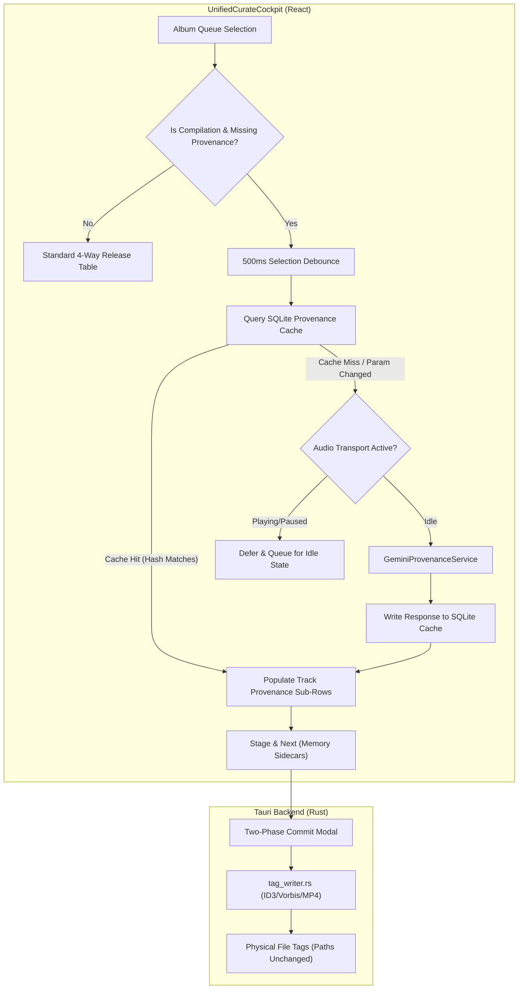

# Compilation Soundtrack Provenance & Parameter-Hashed Caching Architecture

* **Author:** Cadence Agentic Swarm & Mathan
* **Status:** Approved
* **Date:** 2026-11-02

---

## Overview

Cadence's Curation Cockpit (`UnifiedCurateCockpit`) unifies metadata review across local files, Apple Music, MusicBrainz, and Gemini AI. When curating compilation albums (e.g., *Best of Ilaiyaraaja*, *90s Romance Hits*, *World of Rahmania*), tracks originate from multiple independent films or master releases produced across different years.

This feature enables Cadence to automatically resolve the canonical soundtrack provenance (original source film/score title and original release year) for each track on a compilation album using a single-pass Gemini structured inference call. The resolved data is displayed within compact, progressive-disclosure sub-rows beneath each track, and staged for two-phase commit into standard `ORIGINALALBUM` and `ORIGINALYEAR` container tags without moving or altering physical file paths on disk.

## The Problem

1. **Album-Level Mismatch:** The 4-way reconciliation matrix assumes a single release title and release year for the whole collection. In a compilation, assigning the compilation album year (e.g. a 2018 reissue) to classic tracks from 1982 or 1991 corrupts library chronological queries.
2. **Missing In-Flow Provenance:** The cockpit only reconciles `Track Number`, `Title`, and `Vocalists/Performers`. It lacks fields for `Original Movie / Soundtrack` and `Original Year`.
3. **External Store Gaps:** Apple Music and MusicBrainz rarely populate source motion picture tags in standard compilation track metadata, creating an absence of consensus that requires AI-assisted disambiguation.

## Goals

1. **Automatic Debounced Disentanglement:** Automatically trigger single-pass Gemini structured inference 500ms after a compilation album without consensus is selected in the review queue.
2. **Parameter-Hashed Persistent Cache:** Cache LLM prompt input parameters and responses in SQLite (`compilation_provenance_cache`) keyed by SHA-256 hash. Invalidate the cache automatically if album or track parameters change.
3. **Progressive Disclosure UI:** Render compilation provenance as a compact secondary baseline beneath track titles (`↳ Film: Roja (1992)` with an amber `✦ AI` pill) that expands to an inline input on click or `Tab`.
4. **Metadata Container Tag Framing:** Write `ORIGINALALBUM` and `ORIGINALYEAR` (ID3v2 `TOAL`/`TORY`/`TDOR`, FLAC/Vorbis `ORIGINALALBUM`/`ORIGINALYEAR`, MP4 `----:com.apple.iTunes:ORIGINAL ALBUM`) into in-memory sidecars, committing to physical files strictly via the user-confirmed Two-Phase Commit modal.
5. **Audiophile Transport & Playback Silence:** Defer external network calls during active audio playback or within the 30-second post-playback cooldown window.

## Non-Goals

1. **Physical File Restructuring:** Never move, rename, or split compilation audio files into separate movie directories on disk. Physical disk paths remain untouched.
2. **Standard Album AI Over-invocation:** Never trigger compilation AI inference for single-movie soundtrack albums or standard studio albums where store consensus already exists.
3. **Direct Disk I/O During Inference:** Never write tags directly to disk during the curation review session before the user clicks Commit.

## Open Questions

* **Question 1:** When a compilation track already has an embedded `ORIGINALALBUM` tag from a previous rip (e.g. `Thalapathi`) and Gemini infers `Thalapathi (1991)`, should the table highlight this as a verified match or require explicit re-confirmation?
* **Question 2:** For non-Indian or Western classical compilations (e.g., *Greatest Hits* of an artist), should the sub-row label adapt dynamically from `Film / Score:` to `Original Album:`?

## Critical User Journeys (CUJs)

### CUJ 1: Reviewing a Multi-Film Soundtrack Compilation
* **Given**: The user opens Curate (⌘2) and selects a compilation album (e.g., *Hits of 80s Tamil Cinema* containing 12 tracks from 8 movies).
* **When**: The album loads and store providers lack source film tags, the top bar displays `✦ Resolving film provenance via Gemini...` after 500ms debounce.
* **Then**: Provenance sub-rows populate beneath each track title showing the identified original film and year (e.g., `↳ Film: Mouna Ragam (1986)`). The user can click any sub-row to manually edit the film or year, and clicks "Stage & Next" to stage the tags in memory.

### CUJ 2: Parameter Modification and Cache Invalidation
* **Given**: A compilation album was previously resolved and cached in `compilation_provenance_cache`.
* **When**: The user opens the Re-Query bar and edits the search title from `Hits of 80s` to `Hits of 80s Ilaiyaraaja`.
* **Then**: The parameter hash changes, invalidating the previous cache entry and re-triggering the Gemini inference call with updated parameters.

---

## Technical Plan (Architecture)

### 1. Architectural Overview & Component Responsibilities



### 2. Service Contracts & Data Flow

#### A. Parameter-Hashed Provenance Cache (`provenanceCacheService.ts`)
The cache is backed by Cadence's existing local SQLite library database to prevent redundant external API calls during library navigation:

```sql
CREATE TABLE IF NOT EXISTS compilation_provenance_cache (
    hash_key TEXT PRIMARY KEY,
    album_id TEXT NOT NULL,
    album_title TEXT NOT NULL,
    input_params_json TEXT NOT NULL,
    response_json TEXT NOT NULL,
    model_version TEXT NOT NULL,
    created_at INTEGER NOT NULL
);
```

* **Cache Key Derivation:**
  ```typescript
  const rawSignature = [
    albumTitle.trim().toLowerCase(),
    artistCredit.trim().toLowerCase(),
    composerName.trim().toLowerCase(),
    tracks.map(t => `${t.trackNumber || 0}:${t.title.trim().toLowerCase()}:${Math.round(t.duration || 0)}`).join('|')
  ].join(':::')
  const hashKey = await sha256(rawSignature)
  ```
* **Invalidation Heuristic:** Any change to steered titles, track order, or track names generates a distinct SHA-256 hash, causing a cache miss that automatically re-triggers Gemini with the fresh inputs.

#### B. Single-Pass Inference Engine (`geminiProvenanceService.ts`)
A dedicated decoupled service orchestrates the Gemini LLM inference pass:
* **Lifecycle & Cancellation:** Every album selection instantiates an `AbortController`. If the user navigates away before the 500ms debounce or before inference completes, `abort()` is triggered immediately, freeing network bandwidth and preventing state clobbering.
* **Concurrency Semaphore:** Enforces a concurrency limit of 1 active inference call.
* **Structured Response Schema:** Uses Gemini's native `response_schema` parameter to return guaranteed JSON:
  ```typescript
  export interface CompilationTrackProvenance {
    trackIndex: number;
    title: string;
    originalAlbum: string; // Source Motion Picture / Score Title
    originalYear?: number; // Release Year (YYYY)
    confidence: number;    // 0.0 - 1.0
    reasoning?: string;
  }

  export interface CompilationProvenanceResult {
    albumTitle: string;
    isCompilation: boolean;
    tracks: CompilationTrackProvenance[];
    cached: boolean;
  }
  ```

#### C. Progressive Disclosure UI in `UnifiedCurateCockpit.tsx`
* **Visual Baseline:** In the tracklist table, when compilation provenance is present (from cache, local tags, or Gemini), each track cell renders a compact secondary line beneath the title:
  ```tsx
  <div className="flex items-center gap-1.5 mt-0.5 text-[11px] text-white/50">
    <span className="text-[#D4AF37]/80">↳ Film:</span>
    <span className="text-white/80 font-medium">{track.originalAlbum || 'Unassigned'}</span>
    {track.originalYear && <span className="text-white/40">({track.originalYear})</span>}
    {track.provenanceSource === 'gemini_ai' && (
      <span className="px-1 py-0.2 rounded text-[9px] bg-purple-500/20 text-purple-300 font-mono">✦ AI</span>
    )}
  </div>
  ```
* **Inline Editable State:** Clicking the baseline or pressing `Tab` transforms the pill into an inline text input, allowing direct manual correction without navigating away from the table.
* **Top Status Affordance:** While inference runs in the background, a non-blocking indicator is displayed in the toolbar: `✦ Identifying Source Soundtracks... [Cancel]`.

#### D. Standardized Native Tag Writer Framing (`tag_writer.rs`)
Upon Two-Phase Commit (`Commit Album`), the native Rust tag writer maps `originalAlbum` and `originalYear` to codec-specific tag frames:
* **FLAC / Vorbis Comments:** `ORIGINALALBUM`, `ORIGINALYEAR`, `ORIGINALDATE`
* **ID3v2.4 (MP3 / AIFF):** `TOAL` (Original album/movie/show title), `TDOR` (Original release time)
* **ID3v2.3 (Legacy MP3):** `TOAL`, `TORY` (Original release year)
* **MP4 / M4A (ALAC / AAC):** `----:com.apple.iTunes:ORIGINAL ALBUM`, `----:com.apple.iTunes:ORIGINAL YEAR`
* **Folder & Path Invariant:** Physical file paths and directory structures remain strictly unchanged.

---

## Alternatives Considered

### Alternative A: Physical Folder Disentanglement (Splitting Files into Movie Directories)
* **Description:** Physically moving and renaming audio files from the compilation folder into separate directories matching their original motion picture titles (e.g. moving `01 - Rakkamma.flac` to `/Music/Thalapathi (1991)/`).
* **Pros:** Standardizes directory tree on disk so folder browsing mirrors master album hierarchies.
* **Cons:** Violates core project invariant (Zero Disk File Path Mutation). Disrupts existing directory organization, breaks relative playlist references (`.m3u8`), and risks file collision when compilations contain generic track filenames.
* **Reason for Rejection:** Explicitly rejected by user requirement: *"We should never update anything in disc except the metadata."*

### Alternative B: Standalone Disentanglement Modal (`CompilationProvenanceModal`)
* **Description:** Retaining the separate pop-up modal and triggering it via a secondary button or command bar shortcut.
* **Pros:** Isolates compilation logic from the main curation matrix.
* **Cons:** Fragments the curation experience into disconnected tools with separate staging states, conflicting review tables, and redundant commit buttons.
* **Reason for Rejection:** Degrades user ergonomics. Embedding provenance directly into the primary tracklist maintains a unified, predictable curation flow.

### Alternative C: Multi-Call Per-Track LLM Inference
* **Description:** Issuing individual Gemini calls for each track sequentially or in parallel chunks.
* **Pros:** Simpler per-call prompt payload.
* **Cons:** Multiplies network overhead by $N$ tracks, rapidly exhausts API rate limits (429 errors), increases total latency, and prevents Gemini from using shared album context to recognize multi-track clusters from the same film.
* **Reason for Rejection:** Single-pass batching resolves the entire album in 1 roundtrip with full relational context, controlled by an atomic parameter hash cache.

### Alternative D: Dedicated 7th Column in the 4-Way Table
* **Description:** Adding a distinct column titled `Original Film & Year` alongside `#`, `Local File`, `Apple Music Track`, `MusicBrainz Track`, `Gemini AI Track`, and `Selected Track & Singers`.
* **Pros:** Clear, dedicated table header.
* **Cons:** Causes severe horizontal compression on standard 1080p displays, forcing horizontal scrollbars or aggressive title truncation.
* **Reason for Rejection:** Progressive disclosure beneath the track title (`↳ Film: Roja (1992)`) delivers immediate readability while preserving comfortable column widths.

---

## Detailed Implementation Plan

### Target Files to Create/Modify

#### 1. `src/services/geminiProvenanceService.ts` (Create)
* **Type / Scope:** TypeScript Singleton Service
* **Proposed Changes:**
  - Implement `GeminiProvenanceService` with public method `resolveCompilationTracks(albumTitle, artistCredit, composerName, tracks, abortSignal)`.
  - Enforce strict 1-slot concurrency semaphore to prevent overlapping inference calls.
  - Call Gemini API using `interactions` or `generate-content` modern API with structured `response_schema` enforcing `CompilationProvenanceResponse` (no raw Markdown regex parsing).
  - Implement request cancellation via `AbortController.signal`.
  - Integrate with `provenanceCacheService` for pre-flight cache lookup and post-flight cache writes.

#### 2. `src/services/provenanceCacheService.ts` (Create)
* **Type / Scope:** TypeScript SQLite Storage Service
* **Proposed Changes:**
  - Create table `compilation_provenance_cache` if not exists via `tauriBridge` / SQLite helper.
  - Implement SHA-256 parameter hashing across `[albumTitle, artistCredit, composerName, trackSignatures]`.
  - Implement `getCachedProvenance(hashKey)` returning cached response or null.
  - Implement `setCachedProvenance(hashKey, albumId, albumTitle, inputParams, response, modelVersion)`.
  - Automatic cache invalidation: any parameter edit yields a different hash key, making previous entries inert without manual deletion.

#### 3. `src/core/types.ts` (Modify)
* **Type / Scope:** Core Data Model & Type Definitions
* **Proposed Changes:**
  - Add `originalAlbum?: string` and `originalYear?: number` to `TrackCandidateState`.
  - Extend `TrackEdits` and `Track` interfaces with `originalAlbum?: string` and `originalYear?: number`.
  - Add `compilation_provenance` defect classification to `AuditCategory` if not present.

#### 4. `src/components/Curate/UnifiedCurateCockpit.tsx` (Modify)
* **Type / Scope:** React UI Cockpit Component
* **Proposed Changes:**
  - Add compilation detection logic: checks `release.isCompilation`, `genre === 'Compilation'`, or presence of multi-film keywords (`Hits of`, `Best of`).
  - Add 500ms debounce hook upon album selection that triggers `geminiProvenanceService.resolveCompilationTracks`.
  - Cancel previous in-flight requests on album change using an active `AbortController` ref.
  - Render compact progressive-disclosure sub-row beneath track titles in `Selected Track & Singers` column:
    - Display `↳ Film: [Original Movie] ([Year])` with an amber `✦ AI` pill.
    - Click or `Tab` toggles inline text input for instant manual overrides.
  - Display non-blocking top bar status indicator during active inference with `Cancel` and `Reject Inferences` actions.
  - Update `handleStage` to persist `originalAlbum` and `originalYear` into staged track edits.

#### 5. `src-tauri/src/tag_writer.rs` (Modify)
* **Type / Scope:** Native Rust Audio Tag Engine
* **Proposed Changes:**
  - Map `original_album` and `original_year` fields to container-specific tag frames:
    - FLAC / Vorbis comments: `ORIGINALALBUM`, `ORIGINALYEAR`, `ORIGINALDATE`.
    - ID3v2: `TOAL` (Original album/movie title), `TDOR` (v2.4) or `TORY` (v2.3).
    - MP4: `----:com.apple.iTunes:ORIGINAL ALBUM`, `----:com.apple.iTunes:ORIGINAL YEAR`.
  - Preserve physical directory structure: ensure tag writes do not alter parent folders or rename filenames.
  - Respect `!is_playing && !is_paused && cooldown_elapsed` idle guard.

#### 6. `src/test/testCompilationProvenance.ts` (Create)
* **Type / Scope:** Automated TypeScript Test Suite
* **Proposed Changes:**
  - Test parameter hash generation and verify that changing track title or artist generates a distinct cache key.
  - Test SQLite cache storage, cache hit return, and cache miss behavior.
  - Test structured JSON response validation against invalid/malformed LLM mock payloads.
  - Test progressive disclosure state transitions and user manual override persistence.

#### 7. `DEVELOPER.md` (Modify)
* **Type / Scope:** Architecture Documentation
* **Proposed Changes:**
  - Document the compilation provenance subsystem, `compilation_provenance_cache` schema, and container tag frame mappings (`TOAL`/`TORY`/`ORIGINALALBUM`).

---

## Verification Plan

### Automated Checks
* **Syntax & Type Validation:**
  - Transpile modified TypeScript files via `npx esbuild` to guarantee zero syntax or bundling errors.
* **Unit & Integration Suite:**
  - Execute `npx tsx src/test/testCompilationProvenance.ts` to verify deterministic hashing, caching, and state transitions.
* **Rust Native Check:**
  - Run `cargo check` in `src-tauri` to verify tag writer frame mapping compilation.

### Manual Verification Flow
1. Load a compilation album (e.g. *World of Rahmania* or *Hits of 80s*) in Curate (⌘2).
2. Confirm that after a 500ms debounce, the top bar indicates background resolution and track sub-rows populate with original movie titles (e.g. `↳ Film: Roja (1992)`).
3. Click a sub-row to manually edit the movie title, confirming the inline input functions smoothly.
4. Open the Re-Query bar and modify the search title. Verify that the parameter hash changes, triggering a fresh inference.
5. Click **Stage & Next**, verify the album receives the staged badge, and confirm physical files remain untouched on disk.

---
