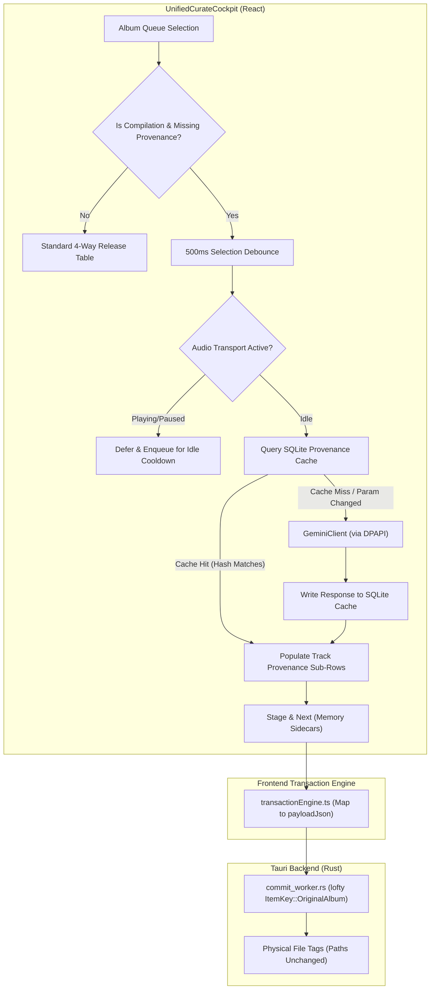

# Compilation Soundtrack Provenance & Parameter-Hashed Caching Architecture

* **Author:** Cadence Agentic Swarm & Mathan
* **Status:** Approved (Post-EGM Review Remediation)
* **Date:** 2026-11-02

---

## Overview

Cadence's Curation Cockpit (`UnifiedCurateCockpit`) unifies metadata review across local files, Apple Music, MusicBrainz, and Gemini AI. When curating compilation albums (e.g., *Best of Ilaiyaraaja*, *90s Romance Hits*, *World of Rahmania*), tracks originate from multiple independent films or master releases produced across different years.

This feature enables Cadence to automatically resolve the canonical soundtrack provenance (original source film/score title and original release year) for each track on a compilation album using a single-pass Gemini structured inference call routed through Cadence's DPAPI-secured backend. The resolved data is displayed within compact, progressive-disclosure sub-rows beneath each track, and staged for two-phase commit into standard `ORIGINALALBUM` and `ORIGINALYEAR` container tags without moving or altering physical file paths on disk.

## The Problem

1. **Album-Level Mismatch:** The 4-way reconciliation matrix assumes a single release title and release year for the whole collection. In a compilation, assigning the compilation album year (e.g. a 2018 reissue) to classic tracks from 1982 or 1991 corrupts library chronological queries.
2. **Missing In-Flow Provenance:** The cockpit only reconciles `Track Number`, `Title`, and `Vocalists/Performers`. It lacks fields for `Original Movie / Soundtrack` and `Original Year`.
3. **External Store Gaps:** Apple Music and MusicBrainz rarely populate source motion picture tags in standard compilation track metadata, creating an absence of consensus that requires AI-assisted disambiguation.

## Goals

1. **Automatic Debounced Disentanglement with Playback Guard:** Automatically trigger single-pass Gemini inference 500ms after a compilation album without consensus is selected in the review queue, strictly gated behind the audiophile transport idle guard (`!isPlaying && !isPaused && cooldownElapsed`).
2. **Parameter-Hashed Persistent Cache:** Cache LLM prompt input parameters and responses in SQLite (`compilation_provenance_cache`) keyed by SHA-256 hash. Invalidate the cache automatically if album or track parameters change.
3. **Progressive Disclosure UI:** Render compilation provenance as a compact secondary baseline beneath track titles (`↳ Film: Roja (1992)` with an amber `✦ AI` pill) that expands to an inline input on `Enter` or click.
4. **Metadata Container Tag Framing:** Write `ORIGINALALBUM` and `ORIGINALYEAR` (ID3v2 `TOAL`/`TORY`/`TDOR`, FLAC/Vorbis `ORIGINALALBUM`/`ORIGINALYEAR`, MP4 `----:com.apple.iTunes:ORIGINAL ALBUM`) into in-memory sidecars and bridge via `TransactionEngine.commit()`, committing to physical files strictly via `lofty` in `commit_worker.rs` during the user-confirmed Two-Phase Commit modal.
5. **Audiophile Transport & Playback Silence:** Defer external network calls during active audio playback or within the 30-second post-playback cooldown window.

## Non-Goals

1. **Physical File Restructuring:** Never move, rename, or split compilation audio files into separate movie directories on disk. Physical disk paths remain untouched.
2. **Standard Album AI Over-invocation:** Never trigger compilation AI inference for single-movie soundtrack albums or standard studio albums where store consensus already exists.
3. **Direct Disk I/O During Inference:** Never write tags directly to disk during the curation review session before the user clicks Commit.

## Resolved Design Decisions

* **Decision 1 (Embedded Tag Precedence):** When a local file already contains an embedded `ORIGINALALBUM` tag and Gemini infers a matching title ($\ge 90\%$ phonetic similarity), the track is marked as verified consensus (`source: 'consensus'`, subtle green pill). If they conflict, the row flags for human review (`requiresHumanReview: true`, amber pill) with both options selectable in the 4-way matrix.
* **Decision 2 (Dynamic Provenance Labeling):** The sub-row label adapts dynamically based on release genre and catalog metadata: if `release.genre === 'Soundtrack'` or catalog language is Indian (`Tamil`, `Telugu`, `Hindi`, `Malayalam`, `Kannada`), the label renders `↳ Film:`; otherwise it renders `↳ Original Album:`.

## Critical User Journeys (CUJs)

### CUJ 1: Reviewing a Multi-Film Soundtrack Compilation
* **Given**: The user opens Curate (⌘2) and selects a compilation album (e.g., *Hits of 80s Tamil Cinema* containing 12 tracks from 8 movies).
* **When**: The album loads and store providers lack source film tags, the top bar displays `✦ Resolving film provenance via Gemini...` after a 500ms debounce (idle guard verified).
* **Then**: Provenance sub-rows populate beneath each track title showing the identified original film and year (e.g., `↳ Film: Mouna Ragam (1986)`). The user can press `Enter` to manually edit the film or year, and clicks "Stage & Next" to stage the tags in memory.

### CUJ 2: Parameter Modification and Cache Invalidation
* **Given**: A compilation album was previously resolved and cached in `compilation_provenance_cache`.
* **When**: The user opens the Re-Query bar and edits the search title from `Hits of 80s` to `Hits of 80s Ilaiyaraaja`.
* **Then**: The parameter hash changes, invalidating the previous cache entry and re-triggering the Gemini inference call with updated parameters.

---

## Technical Plan (Architecture)

### 1. Architectural Overview & Component Responsibilities



### 2. Service Contracts & Data Flow

#### A. Parameter-Hashed Provenance Cache (`src-tauri/src/db/schema.rs` & `provenanceCacheService.ts`)
The cache table is created in native SQLite during Cadence database initialization to prevent frontend schema race conditions:

```sql
CREATE TABLE IF NOT EXISTS compilation_provenance_cache (
    hash_key TEXT PRIMARY KEY,
    album_id TEXT NOT NULL,
    album_title TEXT NOT NULL,
    input_params_json TEXT NOT NULL,
    response_json TEXT NOT NULL,
    model_version TEXT NOT NULL,
    created_at INTEGER NOT NULL
);
CREATE INDEX IF NOT EXISTS idx_compilation_cache_created_at ON compilation_provenance_cache(created_at);
```

* **Cache Key Derivation:**
  ```typescript
  const cleanTitle = cleanConsensusTitle(albumTitle).trim().toLowerCase()
  const rawSignature = [
    cleanTitle,
    artistCredit.trim().toLowerCase(),
    composerName.trim().toLowerCase(),
    tracks.map(t => `${t.id}:${t.trackNumber || 0}:${cleanConsensusTitle(t.title).trim().toLowerCase()}:${Math.round(t.duration || 0)}`).join('|')
  ].join(':::')
  const hashKey = await sha256(rawSignature)
  ```
* **LRU Eviction & Browser Fallback:**
  - When writing new entries, an automatic cleanup trims entries beyond 1,000 rows (`DELETE FROM compilation_provenance_cache WHERE hash_key NOT IN (SELECT hash_key FROM compilation_provenance_cache ORDER BY created_at DESC LIMIT 1000)`).
  - In web browser / Vite mock mode (`!tauriBridge.isTauri()`), `provenanceCacheService` falls back gracefully to an in-memory `Map<string, CompilationProvenanceResult>`.

#### B. Backend DPAPI-Secured Gemini Invocation (`geminiClient.ts`)
Instead of embedding direct Google GenAI SDK calls in the frontend with exposed credentials:
* Frontend calls `geminiClient.resolveGemini('compilation', payload, abortSignal)`.
* Rust backend decrypts the user's Gemini API key from Windows DPAPI (`gemini_config.rs`) and issues the structured query with response validation.
* **Lifecycle & Cancellation:** Every album selection instantiates an `AbortController`. If the user navigates away before debounce or inference completion, `abort()` cancels the in-flight HTTP request immediately.
* **Structured Response Schema:**
  ```typescript
  export interface CompilationTrackProvenance {
    trackId: string;
    trackNumber: number;
    title: string;
    originalAlbum: string; // Source Motion Picture / Score Title
    originalYear?: number; // Release Year (YYYY)
    confidence: number;    // 0.0 - 1.0
    reasoning?: string;
  }

  export interface CompilationProvenanceResult {
    albumTitle: string;
    isCompilation: boolean;
    tracks: CompilationTrackProvenance[];
    cached: boolean;
  }
  ```

#### C. Progressive Disclosure UI in `UnifiedCurateCockpit.tsx`
* **Visual Baseline:** When compilation provenance is present, each track cell in the `Selected Track & Singers` column renders an ergonomic sub-line beneath the title:
  ```tsx
  <div className="flex items-center gap-1.5 mt-0.5 text-[11px] text-white/50">
    <span className="text-[#D4AF37]/80">{isSoundtrack ? '↳ Film:' : '↳ Original Album:'}</span>
    <span className="text-white/80 font-medium">{track.originalAlbum || 'Unassigned'}</span>
    {track.originalYear && <span className="text-white/40">({track.originalYear})</span>}
    {track.provenanceSource === 'gemini_ai' && (
      <span className="px-1.5 py-0.2 rounded text-[9px] bg-amber-500/15 text-amber-300 border border-amber-500/30 font-mono">✦ AI</span>
    )}
  </div>
  ```
* **Keyboard & Click Interaction:**
  - Pressing `Enter` when the row is selected or clicking the sub-line opens an inline text field.
  - `Enter` commits the manual edit; `Escape` reverts to the AI/consensus value without triggering focus traps.
* **Top Status Affordance:** During active inference, a non-blocking indicator is displayed in the toolbar: `✦ Identifying Source Soundtracks... [Cancel]`.

#### D. Two-Phase Commit Bridge & Native Tag Framing
1. **Frontend Serialization (`src/core/transactionEngine.ts`):**
   `TransactionEngine.commit()` includes the provenance fields in `payloadJson`:
   ```typescript
   payloadJson: JSON.stringify({
     title: p.title,
     artist: p.artistCredit,
     album: p.albumTitle,
     originalAlbum: p.originalAlbum,
     originalYear: p.originalYear,
     ...
   })
   ```
2. **Native Worker Tag Writing (`src-tauri/src/maintenance/commit_worker.rs`):**
   Inside `commit_worker.rs`, `lofty` applies `ItemKey::OriginalAlbum` and `ItemKey::OriginalDate`:
   ```rust
   if let Some(orig_album) = payload.get("originalAlbum").and_then(|s| s.as_str()) {
       tag.insert(TagItem::new(ItemKey::OriginalAlbum, ItemValue::Text(orig_album.to_string())));
   }
   if let Some(orig_year) = payload.get("originalYear").and_then(|v| v.as_i64()) {
       tag.insert(TagItem::new(ItemKey::OriginalDate, ItemValue::Text(orig_year.to_string())));
   }
   ```
   Lofty automatically handles codec-specific framing:
   - **FLAC / Vorbis Comments:** `ORIGINALALBUM`, `ORIGINALYEAR`, `ORIGINALDATE`
   - **ID3v2.4 (MP3 / AIFF):** `TOAL` (Original album/movie/show title), `TDOR` (Original release time)
   - **ID3v2.3 (Legacy MP3):** `TOAL`, `TORY` (Original release year)
   - **MP4 / M4A (ALAC / AAC):** `----:mean:com.apple.iTunes:name:ORIGINAL ALBUM`, `----:mean:com.apple.iTunes:name:ORIGINAL YEAR`
3. **Folder & Path Invariant:** Physical file paths and directory structures remain strictly unchanged.

---

## Alternatives Considered

### Alternative A: Physical Folder Disentanglement (Splitting Files into Movie Directories)
* **Description:** Physically moving and renaming audio files from the compilation folder into separate directories matching their original motion picture titles (e.g. moving `01 - Rakkamma.flac` to `/Music/Thalapathi (1991)/`).
* **Pros:** Standardizes directory tree on disk so folder browsing mirrors master album hierarchies.
* **Cons:** Violates core project invariant (Zero Disk File Path Mutation). Disrupts existing directory organization, breaks relative playlist references (`.m3u8`), and risks file collision when compilations contain generic track filenames.
* **Reason for Rejection:** Explicitly rejected by user requirement: *"We should never update anything in disc except the metadata."*

### Alternative B: Standalone Disentanglement Modal (`CompilationProvenanceModal`)
* **Description:** Retaining the separate pop-up modal and triggering it via a secondary button or command bar shortcut.
* **Pros:** Isolates compilation logic from the main curation matrix.
* **Cons:** Fragments the curation experience into disconnected tools with separate staging states, conflicting review tables, and redundant commit buttons.
* **Reason for Rejection:** Degrades user ergonomics. Embedding provenance directly into the primary tracklist maintains a unified, predictable curation flow.

### Alternative C: Multi-Call Per-Track LLM Inference
* **Description:** Issuing individual Gemini calls for each track sequentially or in parallel chunks.
* **Pros:** Simpler per-call prompt payload.
* **Cons:** Multiplies network overhead by $N$ tracks, rapidly exhausts API rate limits (429 errors), increases total latency, and prevents Gemini from using shared album context to recognize multi-track clusters from the same film.
* **Reason for Rejection:** Single-pass batching resolves the entire album in 1 roundtrip with full relational context, controlled by an atomic parameter hash cache.

### Alternative D: Dedicated 7th Column in the 4-Way Table
* **Description:** Adding a distinct column titled `Original Film & Year` alongside `#`, `Local File`, `Apple Music Track`, `MusicBrainz Track`, `Gemini AI Track`, and `Selected Track & Singers`.
* **Pros:** Clear, dedicated table header.
* **Cons:** Causes severe horizontal compression on standard 1080p displays, forcing horizontal scrollbars or aggressive title truncation.
* **Reason for Rejection:** Progressive disclosure beneath the track title (`↳ Film: Roja (1992)`) delivers immediate readability while preserving comfortable column widths.

---

## Detailed Implementation Plan

### Target Files to Create/Modify

#### 1. `src-tauri/src/db/schema.rs` (Modify)
* **Type / Scope:** Native Rust SQLite Schema Migration
* **Proposed Changes:**
  - Add `compilation_provenance_cache` DDL with `idx_compilation_cache_created_at` in database bootstrap.
  - Implement Tauri IPC commands `db_get_provenance_cache(hash_key)` and `db_set_provenance_cache(hash_key, album_id, album_title, input_params, response, model_version)`.

#### 2. `src/services/provenanceCacheService.ts` (Create)
* **Type / Scope:** TypeScript SQLite Storage & Hashing Service
* **Proposed Changes:**
  - Compute SHA-256 parameter hashes over normalized signatures via `cleanConsensusTitle()`.
  - Implement `getCachedProvenance(hashKey)` and `setCachedProvenance(...)`.
  - Add in-memory Map fallback for browser mock mode (`!tauriBridge.isTauri()`).
  - Enforce 1,000-row LRU prune during cache insertion.

#### 3. `src/services/geminiClient.ts` (Modify)
* **Type / Scope:** Frontend Gemini IPC Bridge
* **Proposed Changes:**
  - Extend `resolveGemini` compilation response typing with structured `CompilationProvenanceResult`.
  - Pass `AbortSignal` to cancel in-flight Rust IPC calls when users switch albums.

#### 4. `src/core/types.ts` (Modify)
* **Type / Scope:** Core Data Model & Type Definitions
* **Proposed Changes:**
  - Add `originalAlbum?: string` and `originalYear?: number` to `TrackCandidateState`.
  - Extend `TrackEdits` and `Track` interfaces with `originalAlbum?: string` and `originalYear?: number`.

#### 5. `src/components/Curate/UnifiedCurateCockpit.tsx` (Modify)
* **Type / Scope:** React UI Cockpit Component
* **Proposed Changes:**
  - Add compilation detection logic: checks `release.isCompilation`, `genre === 'Compilation'`, or presence of multi-film keywords (`Hits of`, `Best of`).
  - Add 500ms debounce hook upon album selection, guarded by `!isPlaying && !isPaused && cooldownElapsed`.
  - Cancel previous in-flight requests on album change using an active `AbortController` ref.
  - Render compact progressive-disclosure sub-row beneath track titles in `Selected Track & Singers` column with amber `✦ AI` pill.
  - Implement `Enter` to edit and `Escape` to revert inline manual overrides.
  - Display non-blocking top bar status indicator during active inference with `Cancel` and `Reject Inferences` actions.
  - Update `handleStage` to persist `originalAlbum` and `originalYear` into staged track edits.

#### 6. `src/core/transactionEngine.ts` (Modify)
* **Type / Scope:** Two-Phase Commit Transaction Orchestrator
* **Proposed Changes:**
  - Update `TransactionEngine.commit()` to map `originalAlbum` and `originalYear` from staged sidecar edits into `payloadJson`.

#### 7. `src-tauri/src/maintenance/commit_worker.rs` (Modify)
* **Type / Scope:** Native Rust Audio Tag Engine (`lofty`)
* **Proposed Changes:**
  - Map `originalAlbum` and `originalYear` from `payloadJson` to Lofty's `ItemKey::OriginalAlbum` and `ItemKey::OriginalDate`.
  - Verify Lofty writes FLAC (`ORIGINALALBUM`), ID3v2 (`TOAL`/`TORY`), and MP4 (`----:com.apple.iTunes:ORIGINAL ALBUM`).
  - Preserve physical directory structure: ensure tag writes do not alter parent folders or rename filenames.
  - Respect `!is_playing && !is_paused && cooldown_elapsed` idle guard.

#### 8. `src/test/testCompilationProvenance.ts` (Create)
* **Type / Scope:** Automated TypeScript Test Suite
* **Proposed Changes:**
  - Test parameter hash generation and verify that changing track title or artist generates a distinct cache key.
  - Test SQLite cache storage, cache hit return, and cache miss behavior.
  - Test structured JSON response validation against invalid/malformed LLM mock payloads.
  - Test progressive disclosure state transitions and user manual override persistence.

#### 9. `DEVELOPER.md` (Modify)
* **Type / Scope:** Architecture Documentation
* **Proposed Changes:**
  - Document the compilation provenance subsystem, `compilation_provenance_cache` schema, and container tag frame mappings (`TOAL`/`TORY`/`ORIGINALALBUM`).

---

## Verification Plan

### Automated Checks
* **Syntax & Type Validation:**
  - Transpile modified TypeScript files via `npx esbuild` to guarantee zero syntax or bundling errors.
* **Unit & Integration Suite:**
  - Execute `npx tsx src/test/testCompilationProvenance.ts` to verify deterministic hashing, caching, and state transitions.
* **Rust Native Check:**
  - Run `cargo check` in `src-tauri` to verify commit worker frame mapping compilation.

### Manual Verification Flow
1. Load a compilation album (e.g. *World of Rahmania* or *Hits of 80s*) in Curate (⌘2).
2. Confirm that after a 500ms debounce (with playback idle), the top bar indicates background resolution and track sub-rows populate with original movie titles (e.g. `↳ Film: Roja (1992)`).
3. Press `Enter` on a sub-row to manually edit the movie title, confirming the inline input functions smoothly and commits on `Enter`.
4. Open the Re-Query bar and modify the search title. Verify that the parameter hash changes, triggering a fresh inference.
5. Click **Stage & Next**, verify the album receives the staged badge, and confirm physical files remain untouched on disk.

---
