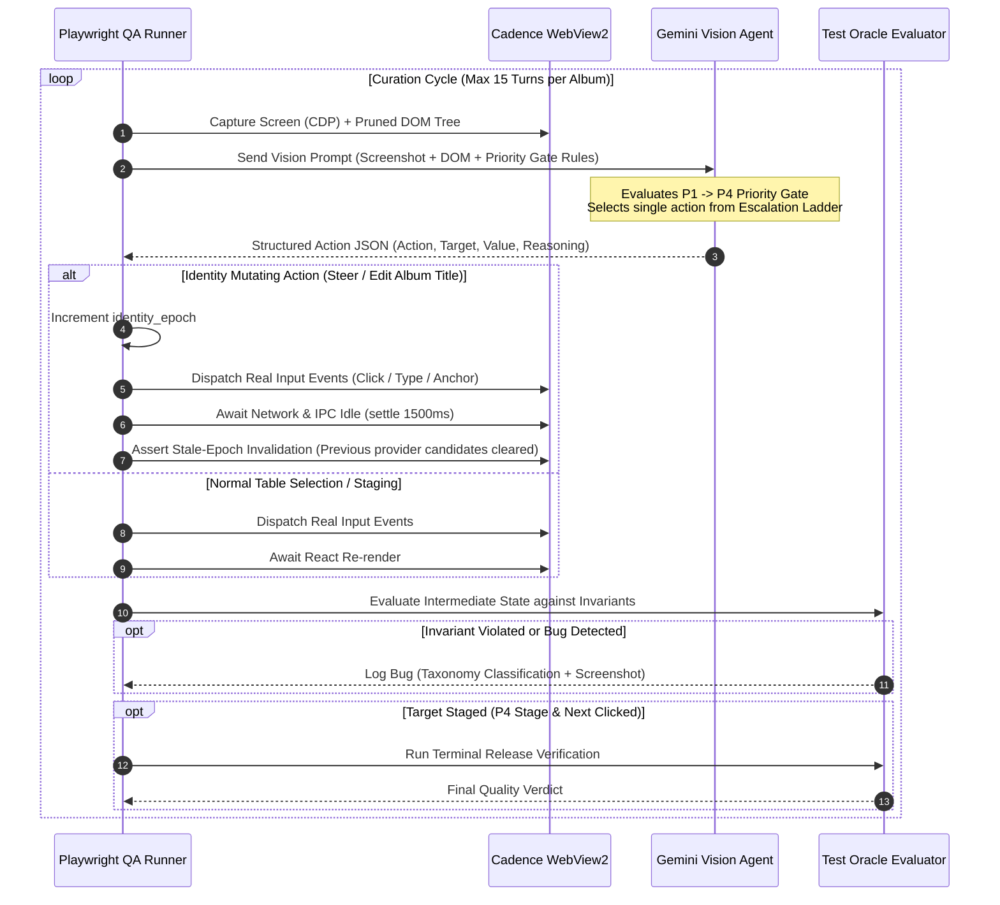
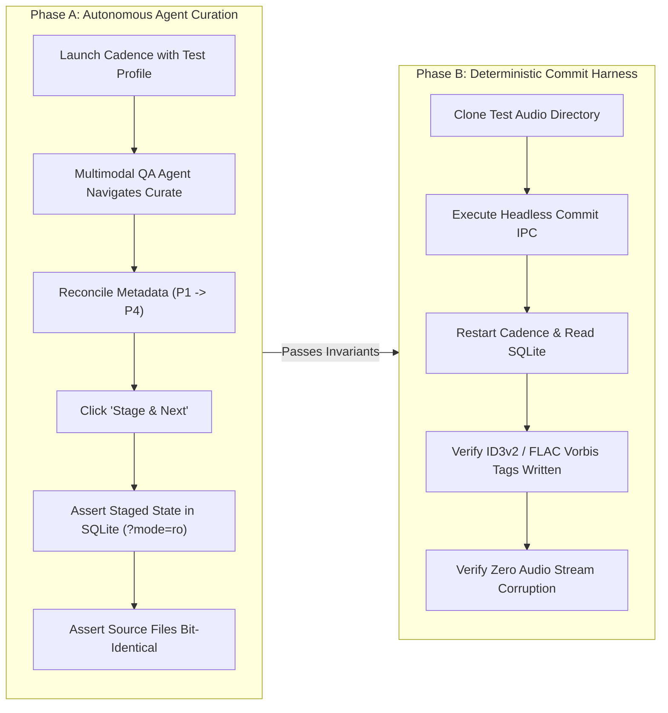

# Design Document: Curate Cockpit Data Fidelity Fixes & External Multimodal QA Agent

## 1. Overview & Problem Statement

### 1.1. Context & The Problem
Cadence is an audiophile music playback and library management engine. Its Curate Cockpit is the primary interface where users review and reconcile audio metadata across local file tags, Apple Music, MusicBrainz, and Gemini AI. 

During recent curation sessions across authentic user releases (*En Bommukutti Amavuku*, *Signature Collection*, *Ranga*), three data-fidelity and visual defects emerged:
1. **Local Cover Art Disconnect**: While the left sidebar renders album art through custom asset resolution, Table 1's "Local File Tag" row reports `None`. Embedded audio container pictures and directory-adjacent `cover.jpg` files fail to register as local candidates.
2. **Track Singer Conflation with Composer**: On film soundtracks, the Gemini AI engine frequently attributes all songs to the maestro composer (e.g. *Ilaiyaraaja* or *A. R. Rahman*), erasing the historical playback singers (*K. S. Chithra*, *K. J. Yesudas*, *S. P. Balasubrahmanyam*) documented on Wikipedia and sleeve inserts.
3. **Physical File and Folder Provenance Obscurity**: Table 2 conceals actual file names and folder structures, preventing users from validating whether sequence offsets, numbering gaps, or split votes stem from physical file system naming.

Furthermore, manual regression testing through the multi-step curation journey is slow, subjective, and difficult to reproduce. Cadence requires an automated **Quality Testing Agent** capable of driving the live desktop application externally, inspecting the graphical interface through multimodal vision, evaluating metadata decisions against verified ground truth, and systematically finding bugs across authentic library releases.

---

### 1.2. Goals
1. **Local Cover Tag Fidelity**: Ensure local embedded pictures and directory images appear as authentic candidates in Table 1's Local File Tag cell with resolution and format metadata.
2. **Authoritative Playback Singer Grounding**: Disambiguate soundtrack composers from vocalists by updating Gemini prompts with Wikipedia discography tables and binding track performers strictly to singers.
3. **Physical Disk Transparency**: Expose physical file names, relative folder paths, and audio container parameters directly beneath track titles in Table 2 without vertical layout shifts.
4. **Isolated External QA Runner**: Implement an external Playwright/CDP testing harness (`scripts/qa/curateQaAgent.ts`) connecting to Tauri's WebView2 debug port, ensuring zero production binary bloat and complete audio transport silence.
5. **Decoupled Ground Truth Oracle**: Verify agent and cockpit performance against a static release manifest (`oracle.json`) without leaking answers into the agent's action-planning prompt.
6. **Hierarchical Human-Mimicking State Machine**: Drive curation actions using a deterministic P1 → P4 Priority Gate (Container Identity → File Alignment → Credits → Staging) and an Escalation Ladder (Auto-Consensus → Provider Adoption → Steer Providers → Inline Edit).
7. **Release-Aware Structural Invariant Verification**: Enforce 100% local file coverage, sequence/duration integrity, and filename sanitization.
8. **Decoupled Lifecycle Verification**: Split curation testing into an agent-driven Staging phase and a deterministic, post-stage Commit phase in an isolated test clone.
9. **Standardized Defect Classification**: Automatically categorize findings into an unambiguous bug taxonomy (Identity Resolution, Provider Retrieval, Consensus Selection, Steering, Reconciliation, UI Interaction, Lifecycle, and Oracle Gap).

---

### 1.3. Non-Goals
1. **Autonomous Commit on Production Library**: The autonomous QA agent will never commit metadata writes to the user's live `%APPDATA%/cadence.db` or source audio files. Commit testing is strictly isolated to temporary clones.
2. **Replacing Fast Unit & Component Tests**: The multimodal agent is an exploratory visual auditor; it does not replace fast, deterministic TypeScript unit tests or Rust compiler checks.
3. **Universal Web Scraping**: The agent will not crawl arbitrary unstructured websites; external grounding is restricted to verified store providers, Wikipedia discography structures, and the static Test Oracle manifest.
4. **Arbitrary Capability Wishlists**: The QA agent's mandate is strictly to find functional, data, and visual bugs in existing workflows, not to propose speculative product features.

---

## 2. Technical Plan

### 2.1. Immediate Cockpit Data Fidelity Fixes

#### 2.1.1. Local Cover Artwork Resolution Fallback
- **Problem**: In `src/components/Curate/UnifiedCurateCockpit.tsx`, Table 1 renders `selectedAlbum.coverArt.local`. In cases where `releases.cover_art_url` has not been cached, this field is an empty string, causing the cell to render `[None]` despite the audio container possessing embedded ID3v2/Vorbis APIC frames or folder-adjacent `cover.jpg` (which the sidebar renders successfully via `cadence:cover://`).
- **Solution**:
  - In `UnifiedCurateCockpit.tsx`, enhance the Table 1 Cover Artwork renderer:
    ```tsx
    const resolvedLocalCover = selectedAlbum.coverArt.local || 
      (selectedAlbum.leadTrackId ? `cadence:cover://${selectedAlbum.leadTrackId}` : null);
    ```
  - If `resolvedLocalCover` is available, render an authenticated 48x48 thumbnail preview badge `[🖼️ Local Art]` with an expandable hover preview and resolution indicator (`600×600 JPEG`), allowing direct cell adoption into `Selected Output`.

#### 2.1.2. Disambiguating Soundtrack Composers from Playback Singers
- **Problem**: In `src-tauri/src/commands/gemini_config.rs`, soundtrack prompts treat `artist` as a generic string, causing Gemini to hallucinate the film composer (e.g., *Ilaiyaraaja* or *A. R. Rahman*) as the track-level singer across all tracks. In `UnifiedCurateCockpit.tsx`, Table 2 defaults to displaying `selectedAlbum.albumArtist.ai` when track-level `trk.aiArtists` is missing.
- **Solution**:
  - **Native Rust Prompt Update (`gemini_config.rs`)**: Update the system prompt for film soundtrack metadata resolution:
    ```text
    CRITICAL RULE FOR FILM SOUNDTRACKS:
    - Set 'album_artist' and 'composer' to the Music Director/Composer (e.g. Ilaiyaraaja, A. R. Rahman).
    - NEVER set individual track artists to the composer unless that track is purely instrumental or the composer personally sang on that track.
    - Track-level 'artists' MUST be extracted from the Wikipedia/discography Track Listing table corresponding to the authentic Playback Singers (e.g., K. S. Chithra, K. J. Yesudas, S. P. Balasubrahmanyam).
    - If multiple vocalists perform on a track, separate them with commas or an array.
    ```
  - **Frontend Display Update (`UnifiedCurateCockpit.tsx`)**:
    In Table 2, under the Gemini AI column, bind track performers strictly to `{trk.aiArtists || trk.matchedArtists || trk.localArtists}` instead of falling back to the album composer `selectedAlbum.albumArtist.ai`. If only the composer is known, explicitly tag it as `(Composer)` rather than displaying it as a vocal performer.

#### 2.1.3. Physical Disk File & Folder Provenance
- **Problem**: Table 2 hides the physical storage path, preventing human curators from verifying whether track alignment mismatches or title anomalies originate from physical directory naming (e.g., `CD1/01 - Song.flac` vs `01. Song.mp3`).
- **Solution**:
  - In `UnifiedCurateCockpit.tsx` Table 2, under the "Local File" track cell, add a secondary sub-line:
    ```tsx
    <div className="flex items-center gap-1.5 text-xs text-neutral-400 font-mono mt-0.5" title={trk.filePath}>
      <FolderIcon className="w-3.5 h-3.5 text-neutral-500 shrink-0" />
      <span className="truncate max-w-[280px]">
        {getRelativeDisplayPath(trk.filePath)}
      </span>
      <span className="text-[10px] text-neutral-400 border border-neutral-700 rounded px-1 shrink-0">
        {trk.format?.toUpperCase()} {trk.bitDepth ? `${trk.bitDepth}b/` : ''}{trk.sampleRate ? `${Math.round(trk.sampleRate/1000)}k` : ''}
      </span>
    </div>
    ```
  - Implements middle-truncation for long folder paths to prevent vertical table layout shifts while preserving full path tooltips.

---

### 2.2. External Multimodal QA Testing Architecture

```mermaid
flowchart TD
    subgraph Host["Host Environment (Node.js Test Runner)"]
        Launcher["Debug Launcher\n(scripts/launch-debug-cadence.ps1)"]
        Harness["Playwright / CDP Harness\n(scripts/qa/curateQaAgent.ts)"]
        Oracle["Test Oracle Manifest\n(tests/fixtures/curate/oracle.json)"]
        Evaluator["Invariant & Oracle Evaluator"]
        Report["Markdown Defect Logger\n(reports/curate-qa-report.md)"]
    end

    subgraph App["Cadence Desktop Runtime"]
        Tauri["Tauri Process\n(--remote-debugging-port=9222)"]
        WV2["WebView2 DOM & Compositor"]
        Engine["Audiophile AudioEngine\n(VirtualLock / MMCSS)"]
        DB[(cadence.db\nSQLite WAL)]
    end

    subgraph Cloud["External Multimodal Intelligence"]
        Vision["Gemini 2.5 Flash Vision API\n(Structured Action Plan)"]
    end

    Launcher -->|Spawns with Debug Port| Tauri
    Harness -->|CDP Session / 9222| WV2
    WV2 -->|Page.captureScreenshot + Pruned DOM| Harness
    Harness -->|Visual Frame + Pruned DOM (Isolated from Oracle)| Vision
    Vision -->|Structured Action JSON| Harness
    Harness -->|Real CDP Mouse/Key Events| WV2
    WV2 -->|Staging & Staged Mutations| DB
    Harness -->|Read-Only SQLite Check (?mode=ro)| DB
    Oracle -->|Ground Truth Invariants| Evaluator
    Evaluator -->|Assert State & Epoch Invariants| Report
```

#### 2.2.1. Isolated External Runner
- **Runner**: Node.js script using Playwright (`@playwright/test` or `playwright-core`) attaching to the active Tauri WebView2 instance via `--remote-debugging-port=9222`.
- **Zero Binary Bloat**: Does not import test libraries into Tauri's Rust dependencies or React bundle.
- **Audiophile Guard**: When Cadence is playing or paused, audio transport threads (MMCSS Pro Audio, `cadence-paced-stream`) remain completely untouched. SQLite queries by the test harness use URI read-only mode (`file:...cadence.db?mode=ro`) to prevent database lock contention.

---

### 2.3. Test Oracle Manifest Schema (`oracle.json`)

```typescript
export interface TrackOracle {
  track_number: number;
  title: string;
  artists: string[];
  composer?: string;
  duration_seconds: number;
  expected_file_pattern: string; // Regex matching raw file name
}

export interface AlbumOracleManifest {
  album_id: string;
  album_type: 'soundtrack' | 'compilation' | 'studio';
  canonical_title: string;
  canonical_artist: string;
  canonical_composer?: string;
  release_year: number;
  genre: string;
  expected_track_count: number;
  tracks: TrackOracle[];
}

export interface CurateOracleDatabase {
  version: string;
  albums: Record<string, AlbumOracleManifest>;
}
```

#### Ground Truth Isolation Rule
The Test Oracle is strictly quarantined in the `Invariant & Oracle Evaluator`. The agent's prompt receives ONLY:
1. High-resolution screenshot of the WebView2 window (`Page.captureScreenshot`).
2. Pruned DOM accessibility tree (visible buttons, inputs, tables, rows).
3. Active `identity_epoch` and execution turn counter.

The agent never sees the expected title, year, or singers in its decision prompt, guaranteeing authentic human-like visual inference.

---

### 2.4. Deterministic State Machine & Cognitive Agent Loop



#### 2.4.1. The P1 → P4 Priority Gate
The agent is prompted to reason strictly following human common sense:
- **P1: Container Identity**: Validate Album Title, Album Artist, Composer, Release Year, and Cover Artwork. If the album title or artist is wrong, resolve this before touching individual tracks.
- **P2: File-to-Track Alignment**: Ensure every local audio file is mapped to a distinct track slot. Check for missing tracks, duplicate indexes, or split multi-disc folders.
- **P3: Granular Credits**: Verify song titles, authentic playback singers (disambiguated from composer), and track numbers.
- **P4: Staging**: Click "Stage & Next" once container and track tables satisfy release coherence.

#### 2.4.2. Escalation Ladder
When resolving discrepancies:
- **Level 0 (Auto-Consensus)**: Accept consensus when Apple Music, MusicBrainz, and Gemini agree.
- **Level 1 (Cell Adoption)**: Click a provider cell if one provider has the exact canonical value.
- **Level 2 (Steer Providers)**: If all providers retrieved the wrong edition, enter the canonical title/URL into the Steer Providers bar and click "Fetch & Anchor".
- **Level 3 (Inline Override)**: If upstream providers lack the release, click the cell edit control and input the correction directly.

---

### 2.5. Release-Aware Structural Invariants & Bug Taxonomy

#### 2.5.1. Invariants
1. **100% Local File Coverage**: All physical files in the folder must map to a unique track row (`unmapped_files == 0`). No files may be dropped or double-bound.
2. **Sequence & Duration Integrity**: Staged tracks must match canonical sequence order. Duration variance between local file and selected provider track must not exceed ±8 seconds (allowing for pre-gap/lead-out differences).
3. **Filename Sanitization Invariant**: Selected Output song titles must not contain file system debris (e.g. `01 - `, `Track 01`, `.flac`, `320kbps`, `[MP3]`).
4. **Stale Epoch Invalidation**: Upon changing album identity or executing "Fetch & Anchor", all previous provider candidates must immediately clear to prevent phantom data leaks.

#### 2.5.2. Mandatory Bug Classification Taxonomy
| Bug Class | Definition & Trigger |
| :--- | :--- |
| **Identity Resolution Bug** | Initial folder/file tag ingestion resolved to the wrong album identity or release group. |
| **Provider Retrieval Bug** | Upstream provider (Apple Music, MusicBrainz, Discogs) returned 404/Empty or failed to parse an authentic release. |
| **Consensus/Selection Bug** | Correct metadata existed in the 4-way table, but Cadence's auto-resolver selected a spurious or degraded candidate. |
| **Steering Bug** | Supplying explicit hints or verified URLs in Steer Providers failed to recover the target release. |
| **Reconciliation Bug** | Field-level merge, track alignment, or stale-epoch clearing failed after selection or steering. |
| **UI Interaction Bug** | DOM controls, focus traps, hover popovers, or scroll containers failed to accept real input events. |
| **Lifecycle Bug** | Stage or Commit failed to persist SQLite/sidecar state or mutated source audio files during review. |
| **Test Oracle Gap** | Fixture ground truth in `oracle.json` is ambiguous or incomplete; cannot compute pass/fail. |

---

### 2.6. Decoupled Lifecycle: Staging vs. Commit Verification



- **Phase A (Agent-Driven)**: Evaluates the interactive user experience up to Staging. Source audio files are verified to remain 100% bit-identical and untouched.
- **Phase B (Deterministic)**: Runs on a sacrificial temporary clone of the audio files, testing native TagWriter persistence and SQLite commit transactions in complete isolation from the user's primary library.

---

### 2.7. Implementation Batches

Following the **Quota Model Router** protocol:
- **Batch 1 [Tier 1 — Gemini 3.8 Low]**: Frontend Layout & Data Fidelity
  - `src/components/Curate/UnifiedCurateCockpit.tsx`: Table 1 `cadence:cover://` fallback with thumbnail badge; Table 2 track singer rendering; Table 2 physical folder/file sub-line with middle-truncation.
- **Batch 2 [Tier 2 — Gemini 3.8 Medium]**: Native Rust Prompts & Test Oracle Manifest
  - `src-tauri/src/commands/gemini_config.rs`: Soundtrack metadata prompt instructing Wikipedia playback singer extraction.
  - `tests/fixtures/curate/oracle.json`: Ground truth manifests for 3 archetype albums (*En Bommukutti Amavuku*, *Signature Collection 2*, *Ranga*).
- **Batch 3 [Tier 3 — Gemini 3.8 High / Pro]**: External Playwright Testing Harness
  - `scripts/launch-debug-cadence.ps1`: Automated launcher enabling WebView2 remote debugging port 9222.
  - `scripts/qa/curateQaAgent.ts`: Cognitive loop with CDP screenshot capture, Gemini Vision reasoning, invariant assertions, and markdown defect logging.

---

## 3. Alternatives Considered

### 3.1. External Playwright CDP Runner vs. Internal In-App Test Loop
- **Alternative**: Embed an in-app testing agent inside the React frontend using `html2canvas` for visual screenshots and synthetic `element.click()` / React state dispatches for actions.
- **Why Rejected**:
  - *Audiophile Transport Purity & Binary Bloat*: An in-app agent bundles heavy DOM-traversal, screenshotting, and test runner libraries directly into the Tauri production bundle. Even under `#[cfg(debug_assertions)]`, it risks impacting timing and CPU core scheduling.
  - *Visual Fidelity Failure*: `html2canvas` re-implements rendering in a `<canvas>` element and notoriously misrenders modern CSS (`backdrop-filter: blur()`, CSS Grid fractional tracks, SVG clip paths, and custom dark scrollbars). CDP's `Page.captureScreenshot` extracts the exact GPU-composited frame directly from WebView2's rendering engine.
  - *Input Realism*: Synthetic `element.click()` ignores CSS `pointer-events: none`, modal backdrop intercepts, and z-index occlusion. External Playwright CDP dispatches genuine Win32/WebView2 mouse and keyboard events through the OS message pump.
  - *Crash Isolation*: If a malformed audio file or native panic crashes the Tauri process, an in-app runner crashes along with it, losing all diagnostic state. An external runner captures the process exit code, logs the terminal screenshot, and pinpoints the exact failure frame.

---

### 3.2. Single-Turn Vision State Machine vs. Autonomous Multi-Turn Agent Loop
- **Alternative**: Hand complete autonomy to a multi-turn ReAct agent that loops freely and executes arbitrary shell/DOM commands until it decides it has finished.
- **Why Rejected**:
  - *Token Burn & Non-Determinism*: Autonomous multi-turn loops frequently wander off-track, loop endlessly on minor visual nuances, or burn tens of thousands of tokens per album.
  - *Execution Determinism*: In Cadence, the curation workflow follows a strict human priority structure. By embedding the P1 → P4 Priority Gate into a deterministic state machine, the harness handles screenshot capture, input dispatch, network wait, and invariant validation deterministically. The multimodal LLM is called strictly once per cycle to perform human-level classification and action selection.

---

### 3.3. Ground Truth Oracle Manifest vs. Live Web Grounding during Tests
- **Alternative**: Instruct the QA agent to perform real-time web searches or scrape Wikipedia live during test execution to check if metadata is correct.
- **Why Rejected**:
  - *Flakiness & Flaky Network Barriers*: Live search queries are subject to rate limiting, CAPTCHAs, and changing search engine SERP formats, causing test runs to fail for reasons unrelated to Cadence code quality.
  - *Oracle Contamination*: Live search results can be nondeterministic or incomplete. A static, human-verified `oracle.json` fixture provides an unshakeable ground truth against which Cadence's resolution accuracy can be mathematically scored.

---

### 3.4. Local Artwork Preview: In-Memory Base64 Data URL vs. `cadence:cover://` Protocol
- **Alternative**: Read the entire embedded cover art image into memory, convert it to a base64 string, and store it in React component state.
- **Why Rejected**:
  - *Memory Invariant Violation*: High-resolution 3000×3000 FLAC embedded artwork can be 5–15 MB per file. Injecting multi-megabyte base64 strings into React state triggers massive garbage collector churn and heap spikes.
  - *Architectural Consistency*: Cadence already possesses an optimized Win32 streaming protocol (`cadence:cover://[trackId]`) that streams image bytes directly from native container caches on demand. Using this protocol in Table 1 guarantees sub-millisecond thumbnail rendering with zero React state overhead.

---

## 4. Verification Plan

### 4.1. Automated Verification

#### 4.1.1. External QA Agent Test Suite Execution
- **Command**:
  ```powershell
  # 1. Launch Cadence in debug mode
  .\scripts\launch-debug-cadence.ps1

  # 2. Run the external multimodal test harness
  npx tsx scripts/qa/curateQaAgent.ts --all-archetypes
  ```
- **Assertions**:
  - The harness connects to `http://127.0.0.1:9222` and establishes a CDP session with Cadence's WebView2 instance.
  - Across the 3 archetypes (*En Bommukutti Amavuku*, *Signature Collection 2*, *Ranga*), the agent traverses the P1 → P4 Priority Gate and reaches the Staging phase without hanging.
  - Invariant evaluator checks:
    - `unmapped_files == 0` (100% local file coverage).
    - Track sequence offsets == 0.
    - Zero filename debris (`Track 01`, `.flac`, `320kbps`) in Selected Output.
    - Output report generated at `reports/curate-qa-report.md` detailing step counts, actions taken, and zero unclassified bugs.

#### 4.1.2. Decoupled Lifecycle Commit Verification
- **Command**:
  ```powershell
  npx tsx scripts/qa/curateQaAgent.ts --verify-commit-isolation
  ```
- **Assertions**:
  - Validates that source audio files in the original library directory are bit-for-bit identical before and after agent curation.
  - In an isolated temporary clone directory, executes the commit step and verifies that `cadence.db` records the reconciled metadata and native FLAC/Vorbis/ID3 tags are persisted.

---

### 4.2. Manual User Verification Walkthrough

Follow these steps to manually verify the data fidelity fixes in the Curate Cockpit:

#### Test 1: Local Cover Artwork Resolution in Table 1
1. Navigate to the **Curate** view and select **En Bommukutti Amavuku** or **Signature Collection 2**.
2. Examine **Table 1: Album-Level Master Metadata**, row **Cover Artwork**, column **Local File Tag**.
3. **Expected Behavior**: Instead of displaying `None`, the cell renders an authentic thumbnail badge (`[🖼️ Local Art]`) showing the album art loaded via `cadence:cover://`. Clicking the cell adopts it into `Selected Output`.

#### Test 2: Playback Singer Disambiguation in Table 2
1. In the **Curate** cockpit for **En Bommukutti Amavuku**, trigger or review the **Gemini AI Master / Track** column.
2. Inspect the artists listed for tracks:
   - *Chitra Chittugal*: Credited to *K. S. Chithra* (not *Ilaiyaraaja*).
   - *Uyire Uyirin*: Credited to *K. J. Yesudas, K. S. Chithra*.
   - *Kuyile Kuyile*: Credited to *K. J. Yesudas, K. S. Chithra*.
   - *En Patharamathu*: Credited to *S. P. Balasubrahmanyam, Malaysia Vasudevan*.
   - *Kanne Navamaniye*: Credited to *Ilaiyaraaja* (as he was both composer and playback singer on this track).
3. **Expected Behavior**: Individual tracks credit the authentic playback singers, with the composer clearly indicated in Table 1 as *Ilaiyaraaja*.

#### Test 3: Physical File & Folder Transparency in Table 2
1. In **Table 2: Track-Level Metadata & Alignment**, look at the **Local File** column.
2. **Expected Behavior**: Below each local track title, a secondary monospace line displays `📁 [parentFolder]/[fileName] • [format] [bitDepth/sampleRate]` (e.g., `📁 En Bommukutti Amavuku/01 - Kuyile Kuyile.flac • FLAC 16b/44k`). Hovering over the text displays the full absolute file path in a native tooltip.

#### Test 4: Genre Standardization Banner Coherence
1. Select **Signature Collection** (Hindi compilation).
2. **Expected Behavior**: The genre rule banner does NOT suggest "Standardize Genre as Tamil Film Soundtrack?". The genre correctly resolves as Hindi Film Soundtrack / Pop.

---

### 4.3. Audiophile Transport Purity Verification
- Confirm that during the entire test suite and manual verification, no background audio I/O occurs on music storage drives, and SQLite access from external scripts strictly uses URI read-only mode (`?mode=ro`).

