# Cadence Curation Decision Trace & Fetch Feedback

* **Author:** Mathan
* **Status:** Approved
* **Date:** 2026-11-04

--------------------------------------------------------------------------------

## Overview

Cadence's curation workbench reconciles local audio file metadata against multiple remote catalog providers (Local tags, MusicBrainz, Apple Music, and Gemini AI grounding). When a user executes a manual steer via **Fetch & Anchor**, candidate discovery and metadata resolution can take several seconds.

Today, this operation runs as an opaque "black box." The user interface displays a generic loading state without indicating which provider is being queried or whether network rate-limiting backoff is active. If the resolution completes without altering the tracklist, the user cannot discern whether the operation failed, timed out, or deliberately decided that the local tags were already superior. Furthermore, when metadata fields are modified, the curation rationale and underlying evidence are lost immediately.

The **Curation Decision Trace** capability establishes a transparent, three-layer feedback architecture:
1. **Execution Feedback:** Real-time, single-line progress displayed beside **Fetch & Anchor** that reflects actual backend execution stages without UI layout shifts.
2. **Decision Explanation:** Plain-English explanations detailing why Cadence applied, rejected, or retained metadata fields, generated directly by the consensus engine during candidate evaluation.
3. **Engineering Telemetry:** Comprehensive diagnostic intelligence (candidate release IDs, fuzzy string match percentages, track count differentials, provider latencies, and HTTP response statuses) accessible via a non-modal trailing slide-over inspector.

This subsystem provides users with immediate operational clarity, respects Cadence's audiophile playback and thread-isolation invariants, and gives developers the structured telemetry needed to diagnose intelligence gaps and drive the upcoming Curate QA Agent.

### Acronyms & Terminology Glossary
| Term / Acronym | Definition & Scope within Cadence |
| :--- | :--- |
| **MBID** | MusicBrainz Identifier (canonical UUID identifying artists, release groups, and releases). |
| **AST** | Pure evaluation logic / Abstract Syntax Tree representing deterministic scoring rules without network calls. |
| **WAL** | Write-Ahead Logging mode in SQLite (`cadence.db`) on the OS drive, enabling concurrent readers with zero locking. |
| **PHY** | Network Physical Layer hardware (Wi-Fi/Ethernet transceiver). Transport quietness prevents RF bursts during playback. |
| **DSD / DAC** | Direct Stream Digital 1-bit audio / Digital-to-Analog Converter (requires bit-perfect transport isolation). |
| **MMCSS** | Windows Multimedia Class Scheduler Service ("Pro Audio" scheduling pinned away from Core 0/1). |
| **Two-Phase Commit** | Cadence's staging (`Ctrl+Enter`) and explicit batch commit (`Ctrl+4`) workflow; physical audio files on disk are never altered without user confirmation. |

---

## The Problem

1. **Uncommunicative Latency:** Remote metadata resolution spans multiple asynchronous HTTP requests, rate-limited public APIs, and LLM queries. Delays with zero state progression cause user anxiety, often leading to repeated clicks or assumptions that the desktop application has frozen.
2. **Silent No-Op Ambiguity:** When an album's local metadata matches existing records or when remote candidates are rejected due to low confidence, the curation stage updates silently with no visible changes. The user has no feedback indicating that candidates were inspected and rejected for cause.
3. **Black-Box Intelligence Gaps:** When Cadence makes an unexpected choice—such as rejecting a 14-track Deluxe Reissue in favor of an original 10-track album—users and developers cannot see the evaluation criteria (e.g., track count mismatch vs. fuzzy title divergence) that drove the decision.
4. **Lack of Diagnostic Persistence:** Curation evaluations are ephemeral and disappear once the view unmounts or another album is selected. There is no persistent audit record in SQLite explaining why an album's metadata is in its current state.

---

## Goals

* **Goal 1: Granular Real-Time Execution Feedback:** Stream real-time execution milestones (e.g., querying MusicBrainz, normalizing candidates, evaluating track counts) directly adjacent to the **Fetch & Anchor** button without artificial timers or layout shifts.
* **Goal 2: Explicit Outcome Communication:** Clearly distinguish between **Matched & Applied**, **Evaluated, Unchanged**, **Evaluation Incomplete**, and **Failed** across all curation passes.
* **Goal 3: Plain-English Rationale with Progressive Disclosure:** Provide an on-demand, non-modal trailing slide-over inspector (`Ctrl+I`) featuring readable explanations following a standard grammar (`[ACTION] [FIELD] because [EVIDENCE]`).
* **Goal 4: Deep Engineering Telemetry:** Provide an expandable technical telemetry accordion exposing candidate release IDs, fuzzy match percentages, barcodes, catalog numbers, and HTTP latency without layout displacement.
* **Goal 5: Unified Consensus Authority:** Enforce that decision scoring, candidate acceptance/rejection, and explanation generation originate from a single unified consensus engine in `federatedResolvers.ts`, eliminating split-brain risks.
* **Goal 6: Field-Level Granular UPSERT Persistence:** Persist decision traces in SQLite (`cadence.db`) keyed strictly by local `album_id` (foreign key to `releases.id`), merging field-level traces so that steering one field (e.g., Artist) does not overwrite prior trace diagnostics for others (e.g., Title).
* **Goal 7: Strict Transport Purity Invariant Protection:** Immediately abort active network fetches via `AbortController` and prevent SQLite writes if audio playback begins (`!is_playing && !is_paused && !is_loading && cooldown_elapsed >= 30s`), surfacing a clear explanation (*"Curation paused to preserve bit-perfect playback"*) and a one-click `[Resume Fetch]` action.
* **Goal 8: Deterministic QA Harness:** Validate the engine across 10 automated test scenarios covering rate limiting, partial provider outages, track count mismatches, and playback interruptions.

---

## Non-Goals

* **Non-Goal 1: Automatic Audio Tag Writing:** Decision traces only stage metadata in UI memory and persist audit records in SQLite. Direct physical tag writes to audio files on disk remain strictly gated behind Two-Phase Commit (`Ctrl+Enter` to stage, `Ctrl+4` to commit).
* **Non-Goal 2: Migration of TypeScript Network Scrapers to Rust:** HTTP fetching and provider parsing will remain in TypeScript (`federatedResolvers.ts`) for this phase to avoid regressions in provider-specific scraping quirks.
* **Non-Goal 3: Unbounded Historical Ledgers:** Retaining dozens of historical curation passes per album is out of scope; the system enforces a strict 1-trace-per-album record with field-level merging.
* **Non-Goal 4: Autonomous Background Batch Curation:** Running unprompted background web fetches for the entire music library is out of scope. Curation remains an explicit, user-initiated or stage-focused workflow.

---

## Critical User Journeys (CUJs)

### CUJ 1: High-Confidence Consensus Match
* **Given:** A local album rip missing the release year and possessing minor typographical inconsistencies in track titles.
* **When:** The user clicks **Fetch & Anchor** in the Steer Providers bar.
* **Then:** 
  1. The inline progress indicator displays real-time milestones (`Querying MusicBrainz...` → `Resolving Apple Music...` → `Evaluating candidates...`).
  2. The outcome displays an Emerald badge: **Matched & Applied**.
  3. The Rationale drawer explains: *"Applied Release Year 1973: MusicBrainz and Apple Music reached 2-of-3 consensus."*
  4. Expanded telemetry displays candidate MBIDs, catalog numbers, and 98% title similarity scores.

### CUJ 2: No-Change Local Tag Retention
* **Given:** An audiophile vinyl rip possessing accurate custom track titles, Roman numeral movements, and custom catalog tags.
* **When:** The user executes **Fetch & Anchor**.
* **Then:** 
  1. The engine queries providers and discovers remote digital editions.
  2. The scoring engine determines remote titles are inferior or over-simplified compared to pristine local tags.
  3. The outcome displays a Neutral Slate badge: **Evaluated, Unchanged**.
  4. The Rationale drawer explains: *"Evaluation complete — 3 candidates examined. Existing metadata retained; no better match found."*
  5. The reconciliation grid remains untouched without false diff noise.

### CUJ 3: Bit-Perfect Playback Interruption
* **Given:** The user initiates **Fetch & Anchor** on a complex multi-disc album (estimated 8s fetch).
* **When:** 2.5 seconds into the fetch, the user hits Play to start a high-res DSD album playback.
* **Then:** 
  1. Cadence's playback listener immediately triggers `AbortController.abort()` on all in-flight HTTP requests.
  2. Pending SQLite trace transactions are dropped to ensure zero disk I/O on music drives.
  3. The outcome displays an Amber indicator: **Paused for Playback**.
  4. The Rationale drawer displays: *"Curation paused to preserve bit-perfect playback."*
  5. A prominent `[Resume Fetch]` button appears, which becomes active once playback stops and cooldown passes.

### CUJ 4: Field-Level Manual Steer Isolation
* **Given:** An album whose decision trace records that *Album Title* was matched and applied from MusicBrainz 2 days ago.
* **When:** The user enters an explicit manual override in the Steer bar for *Album Artist* only and clicks **Fetch & Anchor**.
* **Then:** 
  1. The new fetch evaluates only the steered artist candidates.
  2. The Rust engine performs a field-level UPSERT in SQLite, updating the trace for *Album Artist*.
  3. The prior decision trace and telemetry for *Album Title* are preserved completely intact.

---

## Technical Plan (Architecture)

### Architectural Overview & Data Flow

```mermaid
sequenceDiagram
    autonumber
    actor User
    participant SteerBar as SteerBar (React)
    participant Hook as useCurationTrace (React Hook)
    participant Resolvers as federatedResolvers (TS Consensus Engine)
    participant Bridge as TauriAppBridge (IPC)
    participant Storage as Rust StorageService (SQLite WAL)
    participant AudioEngine as AudioEngine (Rust Paced Transport)

    User->>SteerBar: Click [Fetch & Anchor] (Album A)
    SteerBar->>Hook: executeFetch(albumId, overrides)
    Hook->>Resolvers: initiateSteerFetch(overrides, abortSignal, onProgress)
    
    rect rgb(20, 25, 35)
        Note over Resolvers,SteerBar: Layer 1: Real-Time Execution Feedback
        Resolvers-->>Hook: onProgress("Querying MusicBrainz...")
        Resolvers-->>Hook: onProgress("Resolving Apple Music...")
        Resolvers-->>Hook: onProgress("Evaluating candidates...")
    end

    alt Playback Starts Mid-Fetch (Invariant Protection)
        AudioEngine-->>Bridge: emit('cadence-playback-state', { state: 'Playing' })
        Bridge-->>Hook: onPlaybackStateChanged('Playing')
        Hook->>Hook: abortController.abort("PausedForPlayback")
        Hook-->>SteerBar: Status: PausedForPlayback
    else Normal Fetch Progression
        Resolvers->>Resolvers: evaluateConsensus() & generateDecisionTrace()
        Resolvers-->>Hook: Return { consensusResult, decisionTrace }
        Hook->>Bridge: invoke('curation_save_trace', { albumId, trace })
        Bridge->>Storage: upsertDecisionTrace(albumId, trace)
        Storage-->>Bridge: Ok(())
        Hook-->>SteerBar: Render Tri-State Outcome Badge
        User->>SteerBar: Click [Rationale] (Ctrl+I)
        SteerBar->>SteerBar: Open Trailing Slide-Over Inspector (Tier 1 + Tier 2)
    end
```



---

### Mathematical Scoring & Consensus Rules

Candidate evaluation and consensus follow strict mathematical gates:

1. **Composite Candidate Similarity:**
   $$\text{Score}_{\text{composite}} = w_{\text{title}} \cdot \text{Sim}(T_{\text{local}}, T_{\text{cand}}) + w_{\text{artist}} \cdot \text{Sim}(A_{\text{local}}, A_{\text{cand}})$$
   where $w_{\text{title}} = 0.7$, $w_{\text{artist}} = 0.3$, and $\text{Sim}$ is Levenshtein/Jaro-Winkler distance clamped at 0.85 threshold.

2. **Track Count Compatibility Gate:**
   $$\text{Gate}_{\text{tracks}} = \begin{cases} 1 & \text{if } N_{\text{local}} = N_{\text{cand}} \lor \text{MultiDiscMapped}(N_{\text{local}}, N_{\text{cand}}) \\ 0 & \text{otherwise} \end{cases}$$
   If $\text{Gate}_{\text{tracks}} = 0$, candidate is rejected immediately with `TrackCountMismatch`.

3. **Field Consensus Resolution:**
   $$\text{Consensus}(f) = \begin{cases} \text{Adopted}(v_f) & \text{if } \frac{1}{|P|} \sum_{p \in P} \mathbb{I}(v_{p, f} = v_f) \ge \frac{2}{3} \\ \text{RetainedLocal} & \text{otherwise} \end{cases}$$

---

### Standardized Plain-English Grammar Specification

| Action | Target Field | Evidence Format | Example Output |
| :--- | :--- | :--- | :--- |
| `Applied` | `Release Year` | `because {ProviderA} and {ProviderB} reached consensus ({Ratio})` | `Applied Release Year because MusicBrainz and Apple Music reached 2-of-3 consensus (1973)` |
| `Retained` | `Track {N} Title` | `because local tags match master recording ({Confidence}%)` | `Retained Track 4 Title because local tags match master recording (100%)` |
| `Rejected` | `Candidate [{Name}]` | `because remote track count ({Remote}) != local track count ({Local})` | `Rejected Candidate [Japan Remaster] because remote track count (14) does not match local track count (10)` |

---

### Detailed Component Design

#### 1. TypeScript Consensus & Trace Models (`src/core/types.ts`)
```typescript
export type OutcomeStatus = 
  | 'matched_applied' 
  | 'evaluated_unchanged' 
  | 'incomplete' 
  | 'paused_playback' 
  | 'failed';

export type DecisionAction = 'Applied' | 'Retained' | 'Rejected';

export interface FieldDecision {
  action: DecisionAction;
  chosenValue: string;
  localValue?: string;
  consensusRatio: string;
  plainExplanation: string;
  confidenceScore: number;
}

export interface CandidateTelemetry {
  provider: string;
  releaseId: string;
  latencyMs: number;
  httpStatus: number;
  confidenceScore: number;
  rejectionReason?: string;
}

export interface CurationDecisionTrace {
  albumId: string;
  albumHash: string;
  matchedReleaseId?: string;
  outcomeStatus: OutcomeStatus;
  headlineSummary: string;
  fieldTraces: Record<string, FieldDecision>;
  candidateTelemetry: CandidateTelemetry[];
  durationMs: number;
  engineVersion: string;
  updatedAt: string;
}
```

#### 2. Native Rust Storage Service (`src-tauri/src/curation/storage.rs`)
```sql
CREATE TABLE IF NOT EXISTS curation_decision_traces (
    album_id TEXT PRIMARY KEY,
    album_hash TEXT NOT NULL,
    matched_release_id TEXT,
    outcome_status TEXT NOT NULL CHECK(outcome_status IN ('matched_applied', 'evaluated_unchanged', 'incomplete', 'paused_playback', 'failed')),
    headline_summary TEXT NOT NULL,
    field_traces_json TEXT NOT NULL,   -- JSON map of field_name -> FieldDecision
    telemetry_json TEXT NOT NULL,      -- Array of CandidateTelemetry
    duration_ms INTEGER NOT NULL,
    engine_version TEXT NOT NULL,
    updated_at TEXT NOT NULL
);
CREATE INDEX IF NOT EXISTS idx_curation_traces_updated_at ON curation_decision_traces(updated_at);
```

* **Granular Field Merging Logic:** When `curation_save_trace` is invoked, if a record for `album_id` already exists, Rust loads `field_traces_json`, parses it into a map, overlays only the fields evaluated in the current pass (e.g., `artist`), and writes back the merged record.
* **Strict Audiophile Idle Guard:**
  ```rust
  pub fn can_write_trace(audio_state: &AudioEngineState) -> bool {
      !audio_state.is_playing 
          && !audio_state.is_paused 
          && !audio_state.is_loading 
          && audio_state.cooldown_elapsed_seconds >= 30
  }
  ```

#### 3. Trailing Slide-Over Inspector (`src/components/Curate/CurationDecisionTraceDrawer.tsx`)
* Positioned as a non-modal trailing drawer docked to the right edge of the window.
* Toggled via `Ctrl+I` or clicking the Outcome Badge in the Steer Bar.
* Completely eliminates layout shifts and vertical displacement of the 10–50 track reconciliation grid.

---

## Detailed Implementation Plan

### Target Files to Create/Modify

1. `src/core/types.ts` (Modify): Add `CurationDecisionTrace`, `FieldDecision`, `OutcomeStatus`, `CandidateTelemetry`, `ExecutionProgressEvent`.
2. `src-tauri/src/curation/models.rs` (Create): Rust structs corresponding to the TypeScript models for JSON serialization.
3. `src-tauri/src/curation/storage.rs` (Create): SQLite persistence service with field-level JSON merging and Audiophile Idle Guard gating.
4. `src-tauri/src/curation/mod.rs` (Create): Module export root.
5. `src-tauri/src/commands/curation.rs` (Create): IPC command handlers (`curation_save_trace`, `curation_get_trace`, `curation_clear_trace`).
6. `src-tauri/src/db/schema.rs` (Modify): SQLite table migration adding `curation_decision_traces` and index.
7. `src-tauri/src/lib.rs` (Modify): Register curation commands in Tauri invoke handler.
8. `src/services/tauriBridge.ts` (Modify): Add `saveCurationTrace`, `getCurationTrace`, `clearCurationTrace`.
9. `src/services/federatedResolvers.ts` (Modify): Emit progress events via callback; generate `CurationDecisionTrace` alongside consensus result.
10. `src/hooks/useCurationTrace.ts` (Create): State machine hook with `AbortController` cancellation and playback state integration.
11. `src/components/Curate/SteerProgressBar.tsx` (Create): Fixed-width monospace progress indicator beside **Fetch & Anchor**.
12. `src/components/Curate/CurationDecisionTraceDrawer.tsx` (Create): Trailing slide-over inspector drawer with Tier 1 English explanations and Tier 2 telemetry.
13. `src/components/Curate/CurationReconciliationStage.tsx` (Modify): Mount progress indicator, trailing drawer, and bind `Ctrl+I` shortcut.
14. `tests/curation/decisionTrace.test.ts` (Create): Automated test suite covering all 10 QA validation scenarios.

---

## Verification Plan

### 1. Automated Toolchain Checks
* **TypeScript Compilation:** `npm run tsc -b` (Must pass cleanly).
* **Rust Backend Check:** `cargo check` (Must pass without warnings).
* **Rust Unit Tests:** `cargo test --bin cadence curation` (Tests field-level JSON merge and idle-guard).
* **Frontend Test Suite:** `npm test tests/curation/decisionTrace.test.ts` (Tests hook transitions and abort triggers).

### 2. The 10 QA Validation Scenarios
* **QA-01 (Consensus Perfection - CUJ 1):** Verify Emerald badge `Matched & Applied` and 2-of-3 consensus rationale for 10-track album.
* **QA-02 (Track Count Mismatch - CUJ 2):** Verify Amber badge `Incomplete` and rejection explanation when remote candidate has 14 tracks vs 12 local tracks.
* **QA-03 (Provider Rate Limiting):** Verify progress bar displays `Rate limit reached; cooling down (2.0s)...` and finishes after backoff.
* **QA-04 (Partial Provider Outage):** Verify single-provider fallback when Apple Music returns HTTP 500 while MusicBrainz succeeds.
* **QA-05 (Zero Match / Obscure Rip - CUJ 2):** Verify Neutral Slate badge `Evaluated, Unchanged` and confirmation that local tags were evaluated and retained.
* **QA-06 (Ambiguous Multi-Release):** Verify engine refuses to guess when 8 conflicting releases are returned, prompting user steering.
* **QA-07 (Playback Interruption - CUJ 3):** Verify `AbortController` triggers within 50ms of hitting Play, setting `PausedForPlayback` and enabling `[Resume Fetch]`.
* **QA-08 (Rapid Navigation):** Verify switching albums mid-fetch cancels the active fetch cleanly without unmounted React errors.
* **QA-09 (Field-Level Steer Isolation - CUJ 4):** Verify manual steer on *Album Artist* preserves existing decision trace for *Album Title* in SQLite.
* **QA-10 (High-Track Multi-Disc Box Set):** Verify 50-track classical box set evaluates in under 20ms without memory spikes.

--------------------------------------------------------------------------------

*Drafted and Audited with EGM*
