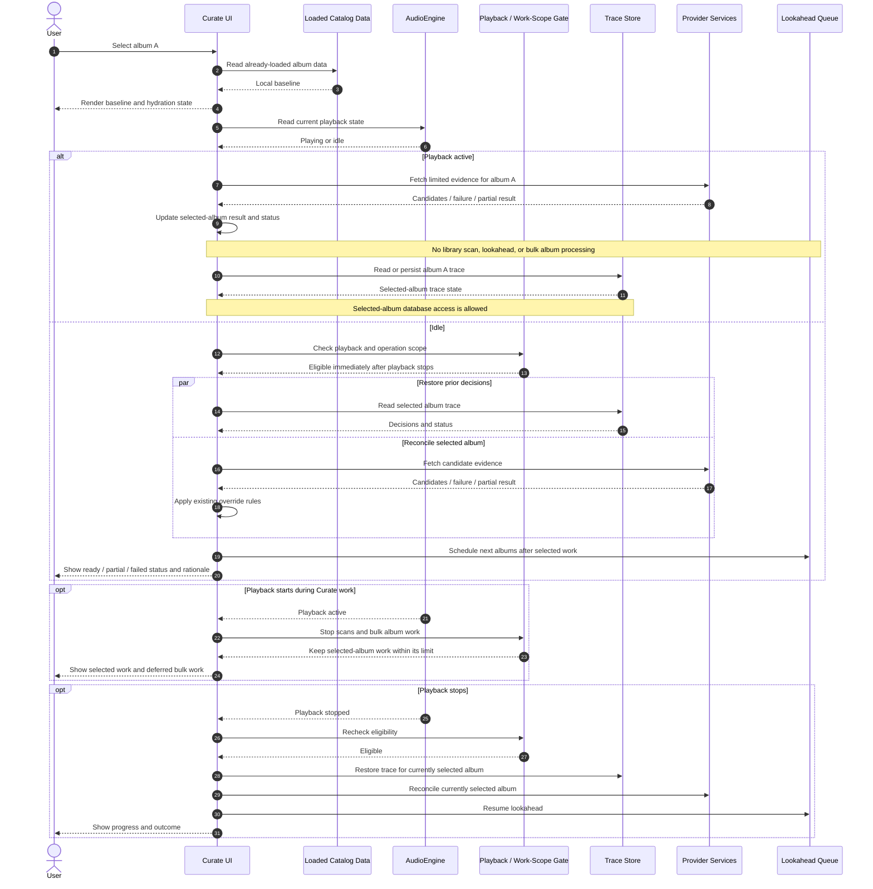

# Cadence Curate Architecture Review

## Purpose and review status

This document is the working record for reviewing the existing Curate design against the current implementation. It separates verified behavior from proposed changes so a proposal does not become an accepted requirement by appearing in a diagram.

Review status: **in progress**  
Last completed: **Phase 3 — Curate page load and lazy hydration; Raw Candidate Provenance; Decision Trace history scope; Selected Output persistence; Commit queue authority/projection; Commit replacement/cancellation semantics; Outcome reconciliation/restart behavior**
Current review: **Playback-policy convergence**
Decision status: **Phase 3, Raw Candidate Provenance, decision-history scope, durable Selected Output drafts, durable commit intent, queue-authoritative UI projection, replacement/cancellation semantics, and outcome/restart behavior accepted; playback-policy implementation remains to review**

### Agreed invariants

These are review constraints and must remain true in every accepted design:

1. **Coherent, transparent user experience.** Curate should show what it is doing, what information it received, what it decided and why, what remains pending, and what happens next. Decisions and failures must not be silent or unexplained.
2. **Audio hygiene has priority, with focused single-album work allowed.** While `AudioEngine` is `Playing`, Curate must not run library scans or bulk processing across albums (including lookahead prefetch). Work focused on the currently selected album is allowed, including a small number of relevant API calls. Work that is not necessary for that album should wait until playback stops.

This refines the earlier strict-quiescence interpretation. Selected-album trace/database access is allowed during playback. Curate does not require a 30-second post-playback cooldown; eligible work may resume as soon as playback stops. This review does not imply that every implementation path already follows the policy.

### Decision register

| Decision | Status | Notes |
| --- | --- | --- |
| Transparent curation journey | Accepted invariant | User must understand state, evidence, rationale, and next action. |
| Playback isolation (no scans or bulk album work; selected-album work allowed) | Accepted invariant | Relevant API calls and trace/database access for the selected album are allowed during playback. |
| Post-playback cooldown | Rejected | No 30-second wait; eligible Curate work can resume when playback stops. |
| Phase 3 selection and hydration policy | Accepted | Selected-album work may continue during playback, limited to at most four provider calls for that album; bulk album work waits until playback stops. |
| Raw candidate provenance | Accepted — implementation layout delegated | Separate permanent evidence history, candidate fields, full response bodies, failure records, timestamps, and the UI presentation below are accepted alongside the current per-album trace. SQL layout is delegated to the implementation design. |
| Decision trace history scope | Accepted — implementation layout delegated | Keep one current album trace and retain each evidence set's release- and track-level decision snapshot with it. |
| Selected Output persistence | Accepted | Persist the uncommitted Selected Output, including unstaged user edits, across navigation and app restart, separately from provider evidence and committed tags. |
| Commit queue authority and UI projection | Approved for implementation — layout delegated | Once the user confirms commit, the durable queue is authoritative across restarts, writes when playback permits, and its payload overrides the album's older on-disk tags shown to the user until the file reflects it. Pending, in-flight, and failed intents remain visible; cancellation removes an intent from the effective projection. |
| Commit replacement and cancellation semantics | Accepted | A newer edit replaces same-track work that has not started; if prior work is in flight, it remains immutable and the newer edit queues behind it. Cancellation stops work not yet started; in-flight work is not claimed cancelled unless safely stopped. Failed intent remains visible/retryable until replaced or explicitly cancelled. |
| Commit outcome reconciliation | Accepted | Confirmed commit freezes a durable revision immediately; physical completion is tracked per file. Partial outcomes remain explicit, successful items stay successful, failed intents remain retryable/authoritative, and restart restores queue/draft/effective values. Keep completed queue payload effective until the loaded catalog baseline reflects it. |

## Phase 3 — Curate page load and lazy hydration

### What the current code does

The following reflects the inspected code paths, not the intended architecture. Paths are repository-relative.

| Responsibility | Current behavior | Evidence |
| --- | --- | --- |
| Local baseline | `UnifiedCurateCockpit` constructs the curation queue from the `tracks` and `releases` props, then derives the selected album from in-memory queue items. | `src/components/Curate/UnifiedCurateCockpit.tsx` |
| Trace restoration | On selected album ID changes, `useCurationTrace` calls `curationGetTrace`; the Rust command reads the RAM trace buffer first and then queries SQLite on a miss. This database access is allowed for the selected album during playback under the agreed policy. | `src/hooks/useCurationTrace.ts`; `src-tauri/src/commands/curation.rs`; `src-tauri/src/curation/storage.rs` |
| Automatic consensus | On selection, `UnifiedCurateCockpit` starts `resolve2of3ReleaseConsensus` for the selected album. That resolver starts Apple Music and MusicBrainz lookups and has no playback guard at its entry point. | `src/components/Curate/UnifiedCurateCockpit.tsx`; `src/services/federatedResolvers.ts` |
| Reconciliation-stage candidate fetch | `CurationReconciliationStage.fetchCandidates` checks playback unless explicitly called with `forceEvenIfPlaying=true`. Some UI actions use that force option. This is consistent with the selected-album allowance, though the provider-call scope still needs a limit. | `src/components/Curate/CurationReconciliationStage.tsx` |
| Lookahead | `LookaheadQueuePrefetcher.prefetchLookahead` checks playback and a 30-second cooldown before scheduling the next two album lookups. The cooldown conflicts with the accepted no-cooldown policy; lookahead also remains bulk album work and must wait until playback stops. | `src/services/curationQueueService.ts` |
| Playback starts during work | `useCurationTrace` listens for playback changes and aborts its own trace fetch, but this does not cover the separate automatic-consensus request. The reconciliation fetch uses an abort controller for navigation cleanup; its playback check is performed at fetch start. | `src/hooks/useCurationTrace.ts`; `src/components/Curate/CurationReconciliationStage.tsx`; `src/components/Curate/UnifiedCurateCockpit.tsx` |
| User-visible deferred status | The reconciliation stage has a playback quietness notice. The automatic-consensus path catches and logs errors, but the inspected effect does not expose a consistent Phase 3 status for deferred hydration. | `src/components/Curate/CurationReconciliationStage.tsx`; `src/components/Curate/UnifiedCurateCockpit.tsx` |

**Finding:** selected-album consensus and trace restoration during playback are allowed by the accepted policy. Lookahead processes other albums, so it must remain blocked during playback. Its current 30-second post-playback cooldown conflicts with the accepted policy and should be removed when implementation work is authorized.

### Accepted Phase 3 behavior

When the user selects an album:

1. Render the selected album immediately from already-loaded catalog data.
2. Never run a library scan during playback.
3. While playback is active, allow focused work for the currently selected album, including provider calls for Apple Music, MusicBrainz, and AI. The total must remain fewer than five provider calls (at most four) for that album.
4. Do not process other albums in bulk or run lookahead prefetch during playback.
5. When playback is idle, restore trace state and run selected-album reconciliation. Schedule lookahead only when the bulk-work policy permits it.
6. Keep the user informed about what is running for the selected album, what is deferred, and any partial result or failure.
7. If playback changes while work is running, ensure no library scan or bulk task starts; selected-album work may continue within the agreed scope.

This policy permits single-album reconciliation and trace/database access during playback, while deferring bulk work such as lookahead until playback stops. No post-playback cooldown applies. Provider-call limits are scoped to the same album; at most four calls are allowed for that album during playback.

### Proposed Phase 3 sequence

### Phase 3 review outcome

**Complete.** The playback policy, selected-album database access, cooldown behavior, and provider-call bound are agreed. The next review phase can address retrieval details such as retries, deduplication, cancellation, and whether the under-five-call limit is per album-selection session or cumulative while that album remains selected.

## Next review — Raw Candidate Provenance

### Current behavior

- Provider adapters return parsed and normalized `ProviderResult` objects. The original HTTP response body and a stable reference to it are not retained by the Curate decision flow (`src/services/federatedResolvers.ts`).
- The decision trace stores field decisions plus `CandidateTelemetry`: provider, release ID, track count, latency, HTTP status, confidence, and rejection reason (`src/core/types.ts`; `src-tauri/src/curation/models.rs`).
- The telemetry created by `resolve2of3ReleaseConsensus` currently uses fixed latency and status values for Apple and MusicBrainz rather than measuring the actual request (`src/services/federatedResolvers.ts`). It does not preserve the extracted candidate fields that led to each decision.
- The trace is persisted in SQLite by local album ID (`src-tauri/src/curation/storage.rs`). There is no dedicated Raw Candidate Store in the inspected implementation.

### Comparison with the existing schema and approved trace design

The repository already has a useful decision-trace foundation; the proposal should extend it rather than replace it:

| Existing structure | What it already provides | Provenance gap |
| --- | --- | --- |
| `curation_decision_traces` (`album_id` primary key) | One current trace row per album, with summary, decision fields, telemetry, engine version, and update time. | It is not a history of provider retrievals. |
| `field_traces_json` | Field decisions are merged with earlier decisions when new traces are saved. | The decision does not durably identify all provider field values that were evaluated. |
| `candidate_telemetry_json` | A per-trace telemetry array with provider, release ID, track count, latency, status, confidence, and rejection reason. | The save upsert replaces this array with the latest trace's array; candidate snapshots and prior fetch telemetry are not retained. Some current latency/status values are placeholders. |
| `ReleaseConsensusResult` / `TrackCandidateState` | In-memory release- and track-level candidate values are available during arbitration. | These candidate values are not stored as permanent retrieval evidence by the current trace schema. |

The approved [`CURATION_DECISION_TRACE_AND_FETCH_FEEDBACK.md`](CURATION_DECISION_TRACE_AND_FETCH_FEEDBACK.md) explicitly limits the decision trace to one record per album and says unbounded historical curation passes are out of scope. Permanent raw candidate history would conflict if it were added by turning that row into an ever-growing trace ledger. **Accepted:** keep the existing row as the current decision projection and store immutable retrieval evidence in a separate, append-only history.

The existing `updated_at` timestamp marks the latest trace-row update only; the album-keyed upsert replaces it on subsequent saves. It does not preserve the time of each Curate fetch/refresh. The accepted evidence history will record an initiation timestamp per action and timing per provider attempt.

No library rescan or reimport is needed for this proposal. Evidence is captured from provider results when a user fetches or refreshes the selected album. Existing local tags and track identities already loaded by Cadence are the input context; a library scan is a separate operation and remains prohibited during playback.

### Narrow proposal for review

Add an append-only evidence record per selected-album retrieval (or refresh), linked to the existing album trace by `album_id` and a retrieval/run ID. Store candidate-level compact snapshots, including the release- and track-level provider values actually considered, plus source identifiers, request outcome/timing, and parser version. The current trace continues to hold the latest decisions and telemetry; it references the retrieval that produced those decisions. A refresh appends a new evidence set, then updates the current trace and Selected Output using the fresh result while preserving manual overrides.

This adds persistence at the point of retrieval. It does not rebuild the library catalog, re-read every audio file, or rerun import. It also avoids changing the existing one-current-trace-per-album contract. A schema migration would add the evidence history structure and linkage; existing trace rows remain usable without backfilling historical candidate data that was never saved.

### Proposed evidence fields for review

These fields build on the existing `ProviderResult`, `ReleaseConsensusResult`, `TrackCandidateState`, and `CandidateTelemetry` types. They describe what to persist, not an approved SQL layout.

| Record | Proposed fields | Why retain them |
| --- | --- | --- |
| Retrieval/evidence set | `retrieval_id`, `album_id`, trigger (`initial` or `user_refresh`), action timestamp (`requested_at`), started/completed timestamps, and the local album/track snapshot used for matching. | Groups all provider attempts for one fetch/refresh, records when the user initiated the Curate action, and preserves the exact target context. Snapshot only relevant metadata and local track IDs/numbers/title/artist/duration; exclude file paths and audio contents. |
| Provider attempt | Provider, request identity/query, outcome (`success`, `empty`, `http_error`, `timeout`, `cancelled`, `parse_error`), HTTP status when received, request start/completion timestamps and measured duration, error details, parser/normalizer version, full response body when received, and body hash. | Makes failures and partial refreshes auditable as well as successful responses; identifies when each request ran and how its response was interpreted. |
| Normalized candidate | External release ID, album title, artist credit, composer, year, genre, label, catalog number, barcode, artwork reference, and other fields actually consumed by arbitration. | Preserves the extracted candidate values in a useful form without requiring the raw body to be reparsed for ordinary inspection. |
| Candidate tracks | Provider track number, title, artist, composer if present, plus local track ID/number mapping and match confidence/offset when computed. | Makes track-level selection and mismatch decisions explainable against the exact local track inventory. |
| Current evidence pointer | `current_evidence_set_id` on the existing per-album decision trace. | Lets the UI show which permanent evidence set produced the current decisions while older sets remain available. |

Full response bodies and normalized candidates belong to the same provider-attempt record. A provider attempt that fails before returning a body still gets an outcome/error record, with the body absent. Failed and empty attempts do not create fabricated candidate values.

### UI changes to review

**Current UI:** Curate already has Fetch & Anchor, editable Selected Output fields, and a Curation Rationale drawer. The drawer shows the latest saved outcome, field explanations, a compact candidate telemetry table, and the trace row's latest `updated_at`. It does not show prior retrievals, full provider responses, or a per-provider failure/empty-result history.

**Accepted UI:**

1. Add an explicit **Refresh Evidence** action for the selected album. Show progress and the action's initiation/completion time. On completion, rerun Cadence's decision logic and update Selected Output while preserving manual overrides. Highlight changed fields and show the reason/source next to them. Do not write audio tags until the user commits.
2. In the Rationale drawer, show the latest evidence set as **Current**, with its timestamp and a compact status row per provider (success, empty, failed, timed out, or cancelled; include duration/status where available).
3. Add a **Previous evidence** history list, ordered by action timestamp. Selecting an older set opens it for inspection and comparison; it does not roll Selected Output back or change the current decision.
4. Within a provider attempt, show normalized release/track candidates and matching outcomes first. Put the complete response body behind an explicit **View raw response** disclosure so routine review stays readable while the preserved data remains accessible.
5. Keep the existing plain-language rationale and diagnostic telemetry, connecting each current field decision to the evidence set/provider values that informed it.

This reuses the existing Selected Output and rationale drawer rather than introducing a separate Curate screen. **Accepted:** this display, including historical-set inspection and raw-response disclosure.

### What to review next

1. **History boundary — accepted:** Keep one current decision trace per album and add a separate permanent evidence history. This aligns with the approved trace design.
2. **Evidence granularity — accepted:** Retain the proposed release, track, and local matching-context fields above, preferring values actually consumed by arbitration over duplicating every provider response field. Record the action initiation timestamp and provider request timing.
3. **Retrieval linkage — accepted:** Group each provider response, empty result, or error under one user refresh/run ID so partial failures and successes are distinguishable.
4. **Raw payloads and failures — accepted:** Permanently retain full response bodies and failure/partial-result records, with the compact normalized snapshot linked to the same retrieval. Verify provider-specific retention constraints during implementation.
5. **Current-set presentation — accepted:** Current marker, timestamp, provider outcomes, previous-evidence inspection, and collapsed raw-response view. Refresh updates decisions and Selected Output as already agreed.

The main benefit is auditability of refreshes and decisions without forcing a library reimport. The main cost is a small additive schema and capture path, plus permanent evidence growth. A full schema redesign or import replay is not justified by the gap identified so far.

### Proposed change (partially accepted)

Keep an auditable, immutable evidence record for each provider response used in an album decision. Store a compact normalized candidate snapshot and retrieval metadata, linked from the decision trace by an evidence ID. Include the source/provider and external release ID where available, retrieval time, actual request outcome and measured latency, parser/normalizer version, payload hash, and the field-level values used by arbitration.

Retain stored candidate evidence permanently, with no time-based expiry or automatic cleanup. Preserve the compact candidate snapshot, complete provider response body, and payload hash for audit. Record provider failures and partial outcomes alongside successful responses. When a request fails before receiving a body, retain the provider, request/run identity, timestamp, status if available, and error/timeout outcome; do not fabricate a response body. Any provider-specific retention constraints must be checked during implementation.

Evidence can become stale as provider catalogs change. Let the user explicitly refresh candidate evidence for the selected album. Refresh creates a new immutable evidence set with a new retrieval timestamp and keeps the previous set for comparison and audit; it does not overwrite or erase historical evidence. The current evidence set should be clearly identified so the UI can distinguish the latest retrieval from older records.

Refresh also reruns Cadence's decision logic against the fresh evidence and updates **Selected Output**. Selected Output is Cadence's current intelligent proposal: the user may edit it or commit it with one click. Existing user overrides remain protected by the agreed override-preservation rule. The UI should make changed fields and the evidence/reason behind each change visible, so refreshed intelligence does not become a black-box mutation.

This proposal keeps the Phase 3 limit intact: selected-album retrieval during playback remains scoped to that album and at most four provider calls. Capturing provenance must not trigger additional fetches.

### Why consider it

It would let a user or future QA tooling trace an incorrect value back through arbitration to the exact candidate fields and parser version, instead of seeing only the final decision and a coarse telemetry row. It would also make provider/parser regressions easier to compare over time.

### Trade-offs and impact

- Adds a durable evidence record and schema/lifecycle work; permanent retention means database usage grows over time and requires backup/migration consideration, but no automatic expiry policy.
- User refresh creates additional permanent records, so repeated refreshes increase storage usage; this is an accepted cost, with refresh remaining an explicit user action.
- Recalculates Selected Output using fresh provider data and existing decision rules; provider data remains evidence rather than an automatic authority.
- Can change proposed metadata after an explicit user refresh, so changed fields and their rationale must be visible. Physical audio-file changes still require the existing explicit commit action.
- Improves auditability, but a payload hash alone cannot reconstruct the provider response; the compact snapshot must contain enough fields to explain the decision.
- Actual measured request outcomes replace the current placeholder telemetry values, which may change diagnostics but not the metadata arbitration policy.

### Recommendation

Adopt immutable candidate evidence linked to decisions and retain it permanently, including compact normalized snapshots, full response bodies, and provider failure/partial-result records. Allow the user to refresh evidence explicitly; each refresh creates a new version while preserving prior evidence, reruns Cadence's decision logic, and updates Selected Output. Preserve manual overrides and show changed fields with their evidence and rationale. The user can edit the refreshed proposal or commit it with one click. Before implementation, agree the schema and how the UI identifies the current evidence set.

### Review decision

Status: **accepted for implementation.** A separate, append-only evidence history is accepted alongside the existing current trace row. The release/track candidate and local matching-context fields are accepted. Permanently retain candidate snapshots, full response bodies, and failure/partial-result records. Record each Curate fetch/refresh initiation timestamp and provider request timing. Explicit refresh preserves prior evidence, creates a new current set, reruns decisions, and updates Selected Output while preserving user overrides. The user can edit or one-click commit the proposal. The SQL layout is delegated to implementation design.

## Next review — Decision Trace schema

### Current behavior

- `curation_decision_traces` keeps one current record per album. Its `field_traces_json` stores a map keyed by field name, with action, chosen/local value, consensus source text, rationale, and confidence (`src/core/types.ts`; `src-tauri/src/curation/models.rs`).
- Rust merges incoming field decisions into that map, so untouched album fields survive later saves. The same upsert replaces the summary and candidate telemetry; it does not preserve prior decision versions (`src-tauri/src/curation/storage.rs`).
- `ReleaseConsensusResult` contains `trackStates` with provider-specific track values and matching information, but `CurationDecisionTrace` has no track decision collection. Track candidates are therefore not stored as per-track Applied/Retained/Rejected decisions with field rationale.

### Accepted decision-history scope

Keep the existing one-current-trace-per-album record as the current decision projection. For each retrieval/evidence set, also retain the decision snapshot produced by that run, so a historical evidence set can show both the candidates and what Cadence decided from them at that time. Include release-level decisions and track-level decisions keyed by local `track_id` and field, with action, selected value, evidence/source reference, confidence, and user-readable rationale. Record the arbitration policy/engine version used.

This would let the accepted Previous Evidence UI explain old decisions after a refresh changes the current Selected Output. It would also make track-level outcomes auditable. It adds small decision snapshots to the permanent evidence history; it does not require a library rescan or a replacement for the existing current trace row.

This is a meaningful extension of the older approved trace document's “no unbounded historical curation passes” non-goal. The new user-approved permanent evidence history already changes that boundary; the question is whether each evidence set should preserve its corresponding decision result too, or whether history should contain provider evidence alone and only the latest decision stays available.

### Review decision

**Accepted.** Keep the existing one-current-trace-per-album record as the current decision projection. Preserve each retrieval's release- and track-level decision snapshot with its evidence set, including the decisions' rationale, values, evidence references, and policy/engine version. The SQL layout and exact entity/field representation are delegated to implementation design.

## Next review — Selected Output persistence

### Current behavior

- `UnifiedCurateCockpit` keeps each album's `AlbumWorkItem` in a component-local `Map`. It seeds the item from the loaded local release/track data and preserves it across library-prop refreshes only while that component remains mounted. It is not itself durable storage (`src/components/Curate/UnifiedCurateCockpit.tsx`).
- The reconciliation stage keeps editable Selected Output fields, per-track title/artist edits, override flags, selected tracks, and artwork choice in component-local React state. When the selected album changes, an effect initializes those fields from local tags and the current album item. The reconciliation-stage state is not separately saved as a draft (`src/components/Curate/CurationReconciliationStage.tsx`).
- Provider consensus can populate the editable fields. Refresh/re-fetch behavior can therefore change the proposal in the current mounted stage; a user's direct edits are represented in local state and override flags, not a standalone durable draft.
- **Stage** translates the chosen output into `track.pendingSidecarEdits` through `graphEngine.updateTrackSidecar`; it does not write music tags. The Curate workbench then calls `onRefreshLibrary`, which reloads from SQLite. The library persistence layer knows how to serialize pending sidecar edits, but the inspected Curate staging path does not first call `persistLibraryToDb`; therefore staging is not a reliable durable-draft guarantee and may be discarded by that reload/restart path (`src/components/Curate/CurationWorkbench.tsx`; `src/App.tsx`; `src/services/sqliteLibraryService.ts`).
- The album-level **Stage** action in `UnifiedCurateCockpit` similarly updates in-memory sidecars and advances. **Commit** is the operation that flushes staged sidecars to files and refreshes the library; playback blocks that disk-write path. A commit queue/transaction journal is not the same thing as an uncommitted Selected Output draft.

### Proposed behavior for review

Treat Selected Output as Cadence's current proposal, not as a synonym for either provider evidence or committed file tags. On album selection, reconstruct the proposal from the latest evidence-set decision snapshot plus the current local baseline and any explicit user edits. Persist user edits/overrides as an album-scoped draft, including track-level edits and the evidence-set/revision they were based on. A later refresh should update Cadence-generated fields from fresh evidence while preserving explicit user edits, and visibly mark fields whose proposal changed. Staging may create the normal pending sidecar projection, but should not write audio tags. One-click commit or further editing remains available.

On return to Curate or app restart, restore the latest uncommitted proposal/draft. If underlying local tags or evidence have changed since the draft was made, show that it is based on an older baseline and require a clear resolution rather than silently overwriting either version. After successful commit, mark the draft resolved/committed; do not treat an attempted or failed commit as success. Historical evidence and decision snapshots remain inspect-only, as already accepted.

The draft is distinct from the permanent evidence history: evidence records what providers returned and what Cadence decided at that time; the draft records the user's currently editable, potentially overridden proposal. SQL entity/layout remains delegated as previously agreed.

### Benefits and costs

- Prevents loss of an edited proposal when navigating away, remounting Curate, refreshing the library, or restarting the app.
- Makes the accepted edit/one-click-commit workflow coherent with the separately accepted permanent evidence and decision history.
- Adds draft lifecycle and conflict/rebase rules. It also requires care to keep proposal persistence separate from physical file writes and from the current per-album decision projection.
- Reusing only `pendingSidecarEdits` is smaller but insufficient for un-staged Selected Output edits, override intent, provenance to the evidence snapshot, and safe conflict handling. The current Curate refresh path also does not establish that staged sidecars are persisted before it reloads the library.

### Recommendation

Persist the latest Selected Output as a recoverable album-scoped draft, separately from evidence/decision history and from committed tags. Include explicit user overrides and track-level edits; associate the draft with the evidence snapshot and local baseline used to form it. Refresh recomputes Cadence-owned values while preserving manual overrides. Keep one-click commit as the explicit physical-write boundary.

### Review decision

**Accepted.** An uncommitted Selected Output, including user edits that have not yet been staged, must survive leaving Curate and restarting Cadence. Persist it as an album-scoped draft distinct from permanent provider evidence and committed tags. Restore it on return; refresh updates Cadence-generated values while preserving explicit user edits. SQL layout remains delegated.

## Next review — Commit recovery

### Current behavior

- Curate's direct **Commit Album** path stages edits in `graphEngine`, awaits `commitStagedSidecars`, but the bridge catches and only logs native invocation failures. The caller then marks the album `committed`, refreshes, and shows a success toast regardless of whether the flush succeeded (`src/components/Curate/UnifiedCurateCockpit.tsx`; `src/services/tauriBridge.ts`).
- The shared Two-Phase Commit flow has a stronger user-facing preflight and exposes failed tracks/retry. However, its Tauri path hands a batch to a persistent SQLite commit queue; the worker records per-item `pending`, `in_flight`, `completed`, `failed`, and `cancelled` states. UI “success” at enqueue time is not necessarily proof that every background write has completed (`src/components/Modals/TwoPhaseCommitModal.tsx`; `src/core/transactionEngine.ts`; `src-tauri/src/db/schema.rs`; `src-tauri/src/maintenance/commit_worker.rs`).
- The transaction engine optimistically clears pending sidecar edits and records a committed history snapshot after queue handoff, before the background worker's final outcomes are known. The database queue has durable item outcomes, but the Selected Output draft does not yet exist to correlate with those outcomes.
- Playback, offline mounts, read-only mounts, checksum failures, and write failures can prevent or interrupt completion. Existing queue retry/status facilities help at track level; Curate's album work-item status is only `staged`, `committing`, or `committed` in component memory and is not a durable per-album commit state.

### Accepted intent and current-code comparison

**Accepted:** once the user confirms commit, the selected payload enters the durable commit queue and represents the user's committed intent. The queue survives app restarts and retries/interruption recovery. Its queued metadata is authoritative for the user's library view and must overlay the album's older on-disk tags while queued or being written. The worker's responsibility is to write that payload when playback policy permits; the UI must not revert to stale on-disk metadata just because a write is pending. After successful writes, the file/library baseline catches up to the queued values. A later edit/commit creates a newer queued intent without mutating a payload already being processed.

**Verified current behavior is partial, not full:**

- The queue is stored in SQLite with each item's file path, payload, backup, status, retry count, and timestamps. The worker runs startup recovery that resets `in_flight` items to `pending`, so queued work is designed to survive app restart (`src-tauri/src/db/schema.rs`; `src-tauri/src/db/operations.rs`; `src-tauri/src/maintenance/commit_worker.rs`).
- The worker pauses while playback is active, but the current code also imposes a 30-second cooldown after playback and treats both playing and paused as active. It also has a force-override path when Purity Mode is off. These differ from the reviewed policy of no cooldown and selected behavior scoped to playback state (`src-tauri/src/maintenance/commit_worker.rs`).
- The queue exposes queued track IDs, but the frontend bridge method is not used by the inspected app code. Library loading overlays `sidecarEditsJson` from the library track table; queue insertion stores its payload in separate queue tables and does not update that library projection. Thus queued metadata is not currently guaranteed to override the album/track tags shown after navigation or restart (`src/services/tauriBridge.ts`; `src/services/sqliteLibraryService.ts`; `src-tauri/src/commands/maintenance.rs`).
- The generic two-phase commit flow submits a durable batch, but the transaction engine optimistically clears in-memory pending edits after queue handoff rather than waiting for worker completion. The Curate direct-commit path marks its album committed after a bridge call whose errors are caught and swallowed. Neither path currently establishes the accepted queue-as-authoritative display contract (`src/core/transactionEngine.ts`; `src/components/Curate/UnifiedCurateCockpit.tsx`; `src/services/tauriBridge.ts`).

The implementation review should determine how to project the latest queue payload over loaded library values, what happens to that overlay after partial completion/failure/cancellation, and how successful completion reconciles it with fresh on-disk tags. It should preserve queued payload immutability and use durable queue status rather than the modal's enqueue result as the source of truth.

### Narrow projection proposal

Expose a durable effective-metadata projection for each track from the newest unresolved commit intent. The projection should retain the original catalog/tag baseline separately and overlay the queued payload only for display and subsequent Curate decisions; it must not mutate audio files or pretend the physical write already finished. Album-level fields should be composed consistently from the per-track payloads for the album.

Treat `pending`, `in_flight`, and `failed` queue items as unresolved intent; failed work remains authoritative and visibly retryable until the user explicitly cancels/replaces it. Exclude cancelled items. For a completed item, continue showing its queued values until the loaded library baseline is known to reflect that write; then the regular catalog values become the same effective values and the overlay can be retired from the active projection while the queue record remains available as history. If another commit is queued for the same track, the newest confirmed intent is the displayed value; do not alter an older in-flight payload.

The UI should label values as **Queued**, **Writing**, or **Write failed / retry needed** as appropriate. A playback pause is not a rejection of commit intent: it leaves the queue payload and effective display unchanged while the worker waits. Refresh/restart must restore both the effective values and their queue status before showing a stale catalog projection as current.

**Accepted.** Use the newest unresolved queue payload as the effective metadata shown for that track/album. Keep pending, in-flight, and failed intent visible and authoritative; label queue state. Exclude explicitly cancelled intent. When writes complete, retain the queue record as history and stop overlaying it once the loaded local baseline reflects the written values. Do not mutate payloads already in flight. The queue remains durable across restarts. Exact SQL/API/UI representation remains delegated to implementation design.

## Commit replacement and cancellation semantics

### Current behavior

- Enqueuing a second edit for a track updates an existing `pending` item in place, replacing its payload and moving it to the newer batch. It does not replace an `in_flight` or `failed` item; those can coexist with a new pending item for the same track (`src-tauri/src/db/operations.rs`).
- Batch cancellation changes only `pending` items to `cancelled`. It cannot stop an `in_flight` file write. It may mark the batch `cancelled` once no pending/in-flight items remain even if failed items remain in that batch (`src-tauri/src/db/operations.rs`).
- The queued-track-ID query returns only `pending` and `in_flight`; it omits failed items, even though the agreed display policy says failed intent remains authoritative until cancellation or replacement (`src-tauri/src/db/operations.rs`).

### Accepted rule

Treat each confirmed commit as an immutable intent once a worker has marked an item `in_flight`. A newer commit can replace a still-pending item; when the older item is already in flight, keep it immutable and queue the newer payload behind it. For display, the newest unresolved intent wins, including failed work. Explicit cancellation removes pending intent from the effective projection; in-flight work cannot be called cancelled unless the write path can guarantee it stopped before changing the file. A newer confirmed commit supersedes a failed intent in the effective projection, while the failed attempt remains in queue history for diagnosis.

**Accepted.** A newer confirmed edit replaces same-track queued work that has not started. If an older write is already in flight, keep its payload immutable and queue the newer intent behind it; show the newest unresolved intent as effective metadata. Cancellation stops pending work only and must not claim to cancel a write already underway. Failed intent stays authoritative and retryable until the user explicitly cancels or replaces it. The UI and queue status must make these transitions visible.

For a multi-track batch, cancellation may stop not-yet-started items while already completed items stay completed and in-flight items finish. The batch must report the resulting mixed state rather than imply an all-or-nothing rollback.

## Next review — Commit queue implementation gaps / next phase proposals

### Verified implementation gaps

| Accepted behavior | Current implementation gap | Evidence |
| --- | --- | --- |
| No 30-second cooldown; focused selected-album work stays under four provider calls during playback | Frontend lookahead and native commit worker still apply a 30-second cooldown. Playback checks often classify paused as active. Consensus can be triggered from both `UnifiedCurateCockpit` and `CurationReconciliationStage`; no shared per-album call counter/budget is evident. | `src/services/curationQueueService.ts`; `src-tauri/src/maintenance/commit_worker.rs`; Curate component effects |
| Permanent evidence and per-evidence release/track decisions | Current trace remains one current row per album; no evidence-set history or provider-body capture was found in the schema/services. | `src-tauri/src/db/schema.rs`; `src-tauri/src/curation/storage.rs`; `src/services/federatedResolvers.ts` |
| Uncommitted Selected Output survives navigation and restart | Album and reconciliation choices are component-local state. No album-scoped draft persistence is present. The library DB can serialize pending sidecar edits, but that is not a saved un-staged Selected Output draft. | `src/components/Curate/UnifiedCurateCockpit.tsx`; `src/components/Curate/CurationReconciliationStage.tsx`; `src/services/sqliteLibraryService.ts` |
| Confirmed Curate commit intent enters the persistent queue | The generic Two-Phase Commit path inserts SQLite queue batches. The direct Curate path calls `commit_staged_sidecars`; repository search found no matching native command implementation/registration, and the bridge catches the invocation error. This path does not demonstrably enqueue the Selected Output payload. | `src/core/transactionEngine.ts`; `src/components/Curate/UnifiedCurateCockpit.tsx`; `src/services/tauriBridge.ts`; `src-tauri/src` |
| Newest unresolved queue payload overrides older tags in the UI | Queue lookup exposes only pending/in-flight track IDs (not payloads/status), is unused by the frontend, and omits failed items. Library hydration applies `sidecarEditsJson` from the track table, not queue payloads. | `src-tauri/src/db/operations.rs`; `src/services/tauriBridge.ts`; `src/services/sqliteLibraryService.ts` |
| Replace pending; preserve immutable in-flight work; cancel only not-started work; keep failures visible | Existing queue behavior partly aligns: pending items can be upserted, in-flight items coexist, and cancellation affects pending only. But failed items are omitted from the effective-ID query, batch cancellation can leave failed item rows, and startup recovery needs to be checked for same-track pending plus in-flight uniqueness conflicts. | `src-tauri/src/db/operations.rs`; `src-tauri/src/db/schema.rs`; `src-tauri/src/maintenance/commit_worker.rs` |
| UI state reflects actual per-track write outcome | The transaction engine optimistically clears graph pending edits after queue handoff; Curate's direct path marks an album committed after the bridge call even though errors are swallowed. Neither is tied to all durable queue-item outcomes. | `src/core/transactionEngine.ts`; `src/components/Curate/UnifiedCurateCockpit.tsx`; `src/services/tauriBridge.ts` |

### Proposed implementation order (for review, not authorization to code)

1. **Durable curation state:** add the accepted append-only evidence/decision history and album-scoped Selected Output draft. Keep evidence, user-editable draft, and physical tags as distinct records. A refresh adds evidence and recomputes Cadence-owned values while preserving explicit user edits.
2. **Commit intent and queue projection:** make the Curate commit action create a durable batch from a frozen Selected Output revision. Add a queue projection API that returns effective payload, track, batch, and item status. Hydrate this projection before the library is presented, overlay it without mutating the raw tag baseline, and expose queued/writing/failed status. Pending replacement, immutable in-flight items, failed retry/replacement, and pending-only cancellation follow the accepted rules.
3. **Outcome reconciliation and restart behavior:** derive draft/album status from durable per-item queue outcomes; keep partial batches explicit, preserve newer drafts separately from in-flight payloads, recover in-flight items on restart, and retire the effective overlay only when the loaded baseline reflects a completed write.
4. **Playback-policy convergence:** remove the commit/lookahead cooldown, ensure the worker waits only while playback is active per the agreed definition, prevent bulk lookahead during playback, deduplicate selected-album provider work across Curate components, and enforce the at-most-four-call album budget. Update stale architecture invariants in `DEVELOPER.md` and subdirectory guidance when behavior is implemented.

This order establishes data truth before polishing UI state. It avoids another library import: the evidence is captured from provider responses and already-loaded local album context, and queue projection reads the existing commit queue. No code changes are part of this review step.

### Review decision

Status: **partially approved for implementation**. The queue-to-library overlay and effective-value display are approved for fixing. The remaining implementation breakdown and order are still proposals; outcome reconciliation and playback-policy convergence remain to review.

## Outcome reconciliation and restart behavior

The approved overlay makes queued values visible. This review should settle how the album/draft status tracks per-item completion, failure, cancellation, retry, and restart recovery—especially when only some tracks in a multi-track album have finished writing.

### Current behavior

- Queue items already have durable per-track `pending`, `in_flight`, `completed`, `failed`, and `cancelled` states, retry counts, error text, and timestamps. On app startup, the worker attempts to return `in_flight` items to `pending` (`src-tauri/src/db/schema.rs`; `src-tauri/src/maintenance/commit_worker.rs`; `src-tauri/src/db/operations.rs`).
- The commit summary aggregates item counts, and worker telemetry reports writing/paused/failure states. The database therefore contains most of the facts needed for recovery, but the Curate album work item and Selected Output draft are not linked to a durable batch/revision.
- The transaction engine clears pending graph edits optimistically after the batch enqueue call and labels its local transaction snapshot committed at handoff. The modal then closes on enqueue success; the asynchronous worker may still have pending or failed items. That UI state can misrepresent completion (`src/core/transactionEngine.ts`; `src/components/Modals/TwoPhaseCommitModal.tsx`).
- Library rows are not updated from the worker's successful queue payload in the paths inspected. Thus even after a file write completes, the catalog database may still hold the old tag baseline; removing the queue overlay solely because item status became `completed` could show stale values.

### Accepted behavior

Use explicit stages to distinguish user intent from physical completion: **Draft → Queued → Writing → Complete**, with **Partially complete / Needs attention** for mixed outcomes and **Cancelled** only for work that was actually stopped before writing. Confirming commit makes the frozen revision a durable queue intent immediately; it is not called a completed file write until every included item reaches `completed`.

For a multi-track album, derive album status from its per-track queue items. Show completed, waiting, writing, failed, and cancelled tracks separately; do not roll back successful tracks because another track failed. Failed items remain in the effective metadata projection and retry uses the same intended payload unless the user creates a newer revision. On restart, restore the draft revision, queue/batch relationship, per-track state, and effective metadata before presenting the album as settled. An in-flight item recovered to pending remains the same intent and should show that it resumed.

Retain the effective queue payload after worker completion until the app's loaded catalog baseline is confirmed to reflect those values. This avoids a new library import and prevents the display from reverting merely because the worker completed. Completion history stays linked to the evidence set and draft revision. Edits made after queueing create a distinct newer draft and do not mutate the frozen batch payload.

**Accepted.** Confirming commit freezes a durable revision and queue intent immediately; it does not claim the file write has completed. Derive album state from per-track outcomes and show partial completion explicitly. Completed tracks remain complete when others fail; failed items remain retryable and authoritative. Restore the draft/revision, batch linkage, per-track outcomes, and effective metadata after restart. Keep a completed queue value in the effective projection until the loaded catalog baseline reflects it. Post-queue edits become a separate revision and never mutate the frozen batch payload.

## Next review — Playback-policy convergence

Review the remaining mismatch between accepted playback rules and current gates: no library scans or bulk album work during playback; focused selected-album work is allowed with at most four total provider calls for that album; no 30-second cooldown after playback stops. Confirm that worker/lookahead behavior and duplicate selected-album fetch paths should be brought under that single policy.

## Later phases

Phases 1, 2, 4, and 5 are intentionally not restated as approved target architecture in this review record. Their current behavior and proposed changes should be documented only when that phase is under review, using the same distinction between observed code, proposal, and accepted decision.
