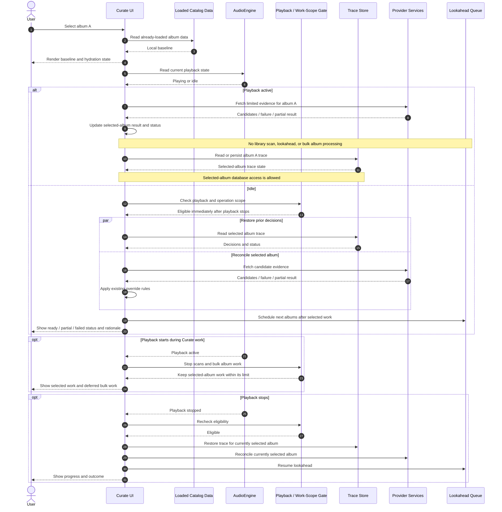

# Cadence Curate Architecture Review

## Purpose and review status

This document is the working record for reviewing the existing Curate design against the current implementation. It separates verified behavior from proposed changes so a proposal does not become an accepted requirement by appearing in a diagram.

Review status: **in progress**  
Current focus: **Phase 3 — Curate page load and lazy hydration**  
Decision status: **open**

### Agreed invariants

These are review constraints and must remain true in every accepted design:

1. **Coherent, transparent user experience.** Curate should show what it is doing, what information it received, what it decided and why, what remains pending, and what happens next. Decisions and failures must not be silent or unexplained.
2. **Audio hygiene has priority, with focused single-album work allowed.** While `AudioEngine` is `Playing`, Curate must not run library scans or bulk processing across albums (including lookahead prefetch). Work focused on the currently selected album is allowed, including a small number of relevant API calls. Work that is not necessary for that album should wait until playback stops.

This refines the earlier strict-quiescence interpretation. Selected-album trace/database access is allowed during playback. Curate does not require a 30-second post-playback cooldown; eligible work may resume as soon as playback stops. This review does not imply that every implementation path already follows the policy.

### Decision register

| Decision | Status | Notes |
| --- | --- | --- |
| Transparent curation journey | Accepted invariant | User must understand state, evidence, rationale, and next action. |
| Playback isolation (no scans or bulk album work; selected-album work allowed) | Accepted invariant | Relevant API calls and trace/database access for the selected album are allowed during playback. |
| Post-playback cooldown | Rejected | No 30-second wait; eligible Curate work can resume when playback stops. |
| Phase 3 selection and hydration policy | Accepted with bounded provider scope open | Selected-album work may continue during playback; bulk album work waits until playback stops. |
| Candidate provenance, trace schema, Selected Output persistence, and commit recovery | Not reviewed in this pass | Keep future proposals separate until their review. |

## Phase 3 — Curate page load and lazy hydration

### What the current code does

The following reflects the inspected code paths, not the intended architecture. Paths are repository-relative.

| Responsibility | Current behavior | Evidence |
| --- | --- | --- |
| Local baseline | `UnifiedCurateCockpit` constructs the curation queue from the `tracks` and `releases` props, then derives the selected album from in-memory queue items. | `src/components/Curate/UnifiedCurateCockpit.tsx` |
| Trace restoration | On selected album ID changes, `useCurationTrace` calls `curationGetTrace`; the Rust command reads the RAM trace buffer first and then queries SQLite on a miss. This database access is allowed for the selected album during playback under the agreed policy. | `src/hooks/useCurationTrace.ts`; `src-tauri/src/commands/curation.rs`; `src-tauri/src/curation/storage.rs` |
| Automatic consensus | On selection, `UnifiedCurateCockpit` starts `resolve2of3ReleaseConsensus` for the selected album. That resolver starts Apple Music and MusicBrainz lookups and has no playback guard at its entry point. | `src/components/Curate/UnifiedCurateCockpit.tsx`; `src/services/federatedResolvers.ts` |
| Reconciliation-stage candidate fetch | `CurationReconciliationStage.fetchCandidates` checks playback unless explicitly called with `forceEvenIfPlaying=true`. Some UI actions use that force option. This is consistent with the selected-album allowance, though the provider-call scope still needs a limit. | `src/components/Curate/CurationReconciliationStage.tsx` |
| Lookahead | `LookaheadQueuePrefetcher.prefetchLookahead` checks playback and a 30-second cooldown before scheduling the next two album lookups. The cooldown conflicts with the accepted no-cooldown policy; lookahead also remains bulk album work and must wait until playback stops. | `src/services/curationQueueService.ts` |
| Playback starts during work | `useCurationTrace` listens for playback changes and aborts its own trace fetch, but this does not cover the separate automatic-consensus request. The reconciliation fetch uses an abort controller for navigation cleanup; its playback check is performed at fetch start. | `src/hooks/useCurationTrace.ts`; `src/components/Curate/CurationReconciliationStage.tsx`; `src/components/Curate/UnifiedCurateCockpit.tsx` |
| User-visible deferred status | The reconciliation stage has a playback quietness notice. The automatic-consensus path catches and logs errors, but the inspected effect does not expose a consistent Phase 3 status for deferred hydration. | `src/components/Curate/CurationReconciliationStage.tsx`; `src/components/Curate/UnifiedCurateCockpit.tsx` |

**Finding:** selected-album consensus and trace restoration during playback are allowed by the accepted policy. Lookahead processes other albums, so it must remain blocked during playback. Its current 30-second post-playback cooldown conflicts with the accepted policy and should be removed when implementation work is authorized.

### Proposed Phase 3 behavior (pending review)

When the user selects an album:

1. Render the selected album immediately from already-loaded catalog data.
2. Never run a library scan during playback.
3. While playback is active, allow focused work for the currently selected album, including a small number of relevant API calls. Do not process other albums in bulk or run lookahead prefetch.
4. Apply an explicit cap and scope to selected-album provider requests so retries or parallel providers cannot silently turn into broad processing. The exact cap remains to be specified when reviewing retrieval behavior.
5. When playback is idle, restore trace state and run selected-album reconciliation. Schedule lookahead only when the bulk-work policy permits it.
6. Keep the user informed about what is running for the selected album, what is deferred, and any partial result or failure.
7. If playback changes while work is running, ensure no library scan or bulk task starts; selected-album work may continue within the agreed scope.

This revised proposal permits single-album reconciliation and trace/database access during playback, while deferring bulk work such as lookahead until playback stops. No post-playback cooldown applies. The remaining Phase 3 detail is the exact cap and scope for selected-album provider calls.

### Proposed Phase 3 sequence

### Remaining Phase 3 question

What should count as a small, bounded set of provider calls for one selected album? The policy decisions about scans, bulk work, selected-album database access, and cooldown are settled. The exact provider-call cap remains open.

## Later phases

Phases 1, 2, 4, and 5 are intentionally not restated as approved target architecture in this review record. Their current behavior and proposed changes should be documented only when that phase is under review, using the same distinction between observed code, proposal, and accepted decision.
