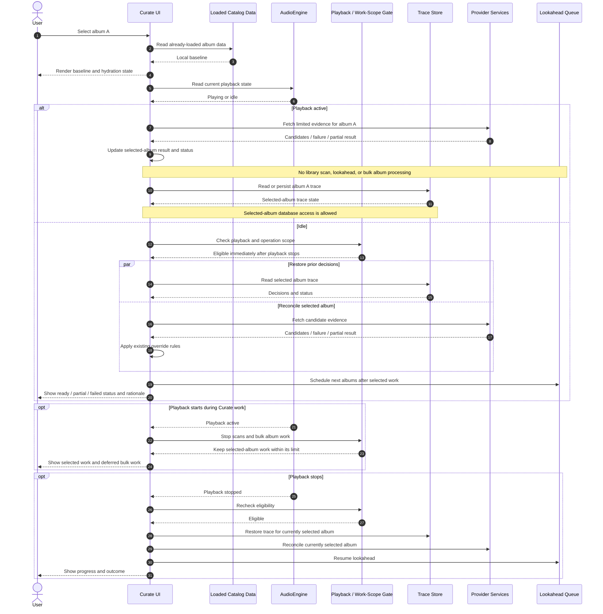

# Cadence Curate Architecture Review

## Purpose and review status

This document is the working record for reviewing the existing Curate design against the current implementation. It separates verified behavior from proposed changes so a proposal does not become an accepted requirement by appearing in a diagram.

Review status: **in progress**  
Last completed: **Phase 3 — Curate page load and lazy hydration; Raw Candidate Provenance; Decision Trace history scope; Selected Output persistence; Commit queue authority/projection; Commit replacement/cancellation semantics; Outcome reconciliation/restart behavior**
Last completed: **Phase 3 — Curate page load and lazy hydration; Raw Candidate Provenance; Decision Trace history scope; Selected Output persistence; Commit queue authority/projection; Commit replacement/cancellation semantics; Outcome reconciliation/restart behavior; Playback-policy convergence**
Current review: **Review pass complete; implementation scope remains separate**
Decision status: **All reviewed behavior and proposals accepted; queue-to-library overlay approved for implementation; no other code changes authorized by this review pass**

The **Identity, decision validity, and actionable queue contract** at the end of this document is the next phased implementation design. It records the November 2026 review direction; its phases are not claims that the current application implements the contract.

### Agreed invariants

These are review constraints and must remain true in every accepted design:

1. **Coherent, transparent user experience.** Curate should show what it is doing, what information it received, what it decided and why, what remains pending, and what happens next. Decisions and failures must not be silent or unexplained.
2. **Audio hygiene has priority, with focused single-album work allowed.** While `AudioEngine` is `Playing`, Curate must not run library scans or bulk processing across albums (including lookahead prefetch). Work focused on the currently selected album is allowed, including a small number of relevant API calls. Work that is not necessary for that album should wait until playback stops.

This refines the earlier strict-quiescence interpretation. Selected-album trace/database access is allowed during playback. Curate does not require a 30-second post-playback cooldown; eligible work may resume as soon as playback stops. This review does not imply that every implementation path already follows the policy.

### Decision register

| Decision | Status | Notes |
| --- | --- | --- |
| Transparent curation journey | Accepted invariant | User must understand state, evidence, rationale, and next action. |
| Playback isolation (no scans or bulk album work; selected-album work allowed) | Accepted invariant | Relevant API calls and trace/database access for the selected album are allowed during playback. |
| Post-playback cooldown | Rejected | No 30-second wait; eligible Curate work can resume when playback stops. |
| Phase 3 selection and hydration policy | Accepted | Selected-album work may continue during playback, limited to at most four provider calls for that album; bulk album work waits until playback stops. |
| Raw candidate provenance | Accepted — implementation layout delegated | Separate permanent evidence history, candidate fields, full response bodies, failure records, timestamps, and the UI presentation below are accepted alongside the current per-album trace. SQL layout is delegated to the implementation design. |
| Decision trace history scope | Accepted — implementation layout delegated | Keep one current album trace and retain each evidence set's release- and track-level decision snapshot with it. |
| Selected Output persistence | Accepted | Persist the uncommitted Selected Output, including unstaged user edits, across navigation and app restart, separately from provider evidence and committed tags. |
| Commit queue authority and UI projection | Approved for implementation — layout delegated | Once the user confirms commit, the durable queue is authoritative across restarts, writes when playback permits, and its payload overrides the album's older on-disk tags shown to the user until the file reflects it. Pending, in-flight, and failed intents remain visible; cancellation removes an intent from the effective projection. |
| Commit replacement and cancellation semantics | Accepted | A newer edit replaces same-track work that has not started; if prior work is in flight, it remains immutable and the newer edit queues behind it. Cancellation stops work not yet started; in-flight work is not claimed cancelled unless safely stopped. Failed intent remains visible/retryable until replaced or explicitly cancelled. |
| Commit outcome reconciliation | Accepted | Confirmed commit freezes a durable revision immediately; physical completion is tracked per file. Partial outcomes remain explicit, successful items stay successful, failed intents remain retryable/authoritative, and restart restores queue/draft/effective values. Keep completed queue payload effective until the loaded catalog baseline reflects it. |
| Playback-policy convergence | Accepted | No library scans or bulk/lookahead album work during playback. Focused selected-album retrieval/refresh is allowed, with duplicate automatic paths sharing a maximum of four provider calls per operation. Remove post-playback cooldown; resume eligible work immediately when playback stops. Commit intent remains queued while writes wait for playback to stop. |

## Phase 3 — Curate page load and lazy hydration

### What the current code does

The following reflects the inspected code paths, not the intended architecture. Paths are repository-relative.

| Responsibility | Current behavior | Evidence |
| --- | --- | --- |
| Local baseline | `UnifiedCurateCockpit` constructs the curation queue from the `tracks` and `releases` props, then derives the selected album from in-memory queue items. | `src/components/Curate/UnifiedCurateCockpit.tsx` |
| Trace restoration | On selected album ID changes, `useCurationTrace` calls `curationGetTrace`; the Rust command reads the RAM trace buffer first and then queries SQLite on a miss. This database access is allowed for the selected album during playback under the agreed policy. | `src/hooks/useCurationTrace.ts`; `src-tauri/src/commands/curation.rs`; `src-tauri/src/curation/storage.rs` |
| Automatic consensus | On selection, `UnifiedCurateCockpit` starts `resolve2of3ReleaseConsensus` for the selected album. That resolver starts Apple Music and MusicBrainz lookups and has no playback guard at its entry point. | `src/components/Curate/UnifiedCurateCockpit.tsx`; `src/services/federatedResolvers.ts` |
| Reconciliation-stage candidate fetch | `CurationReconciliationStage.fetchCandidates` checks playback unless explicitly called with `forceEvenIfPlaying=true`. Some UI actions use that force option. This is consistent with the selected-album allowance, though the provider-call scope still needs a limit. | `src/components/Curate/CurationReconciliationStage.tsx` |
| Lookahead | `LookaheadQueuePrefetcher.prefetchLookahead` checks playback and a 30-second cooldown before scheduling the next two album lookups. The cooldown conflicts with the accepted no-cooldown policy; lookahead also remains bulk album work and must wait until playback stops. | `src/services/curationQueueService.ts` |
| Playback starts during work | `useCurationTrace` listens for playback changes and aborts its own trace fetch, but this does not cover the separate automatic-consensus request. The reconciliation fetch uses an abort controller for navigation cleanup; its playback check is performed at fetch start. | `src/hooks/useCurationTrace.ts`; `src/components/Curate/CurationReconciliationStage.tsx`; `src/components/Curate/UnifiedCurateCockpit.tsx` |
| User-visible deferred status | The reconciliation stage has a playback quietness notice. The automatic-consensus path catches and logs errors, but the inspected effect does not expose a consistent Phase 3 status for deferred hydration. | `src/components/Curate/CurationReconciliationStage.tsx`; `src/components/Curate/UnifiedCurateCockpit.tsx` |

**Finding:** selected-album consensus and trace restoration during playback are allowed by the accepted policy. Lookahead processes other albums, so it must remain blocked during playback. Its current 30-second post-playback cooldown conflicts with the accepted policy and should be removed when implementation work is authorized.

### Accepted Phase 3 behavior

When the user selects an album:

1. Render the selected album immediately from already-loaded catalog data.
2. Never run a library scan during playback.
3. While playback is active, allow focused work for the currently selected album, including provider calls for Apple Music, MusicBrainz, and AI. The total must remain fewer than five provider calls (at most four) for that album.
4. Do not process other albums in bulk or run lookahead prefetch during playback.
5. When playback is idle, restore trace state and run selected-album reconciliation. Schedule lookahead only when the bulk-work policy permits it.
6. Keep the user informed about what is running for the selected album, what is deferred, and any partial result or failure.
7. If playback changes while work is running, ensure no library scan or bulk task starts; selected-album work may continue within the agreed scope.

This policy permits single-album reconciliation and trace/database access during playback, while deferring bulk work such as lookahead until playback stops. No post-playback cooldown applies. Provider-call limits are scoped to the same album; at most four calls are allowed for that album during playback.

### Proposed Phase 3 sequence



### Phase 3 review outcome

**Complete.** The playback policy, selected-album database access, cooldown behavior, and provider-call bound are agreed. The next review phase can address retrieval details such as retries, deduplication, cancellation, and whether the under-five-call limit is per album-selection session or cumulative while that album remains selected.

## Next review — Raw Candidate Provenance

### Current behavior

- Provider adapters return parsed and normalized `ProviderResult` objects. The original HTTP response body and a stable reference to it are not retained by the Curate decision flow (`src/services/federatedResolvers.ts`).
- The decision trace stores field decisions plus `CandidateTelemetry`: provider, release ID, track count, latency, HTTP status, confidence, and rejection reason (`src/core/types.ts`; `src-tauri/src/curation/models.rs`).
- The telemetry created by `resolve2of3ReleaseConsensus` currently uses fixed latency and status values for Apple and MusicBrainz rather than measuring the actual request (`src/services/federatedResolvers.ts`). It does not preserve the extracted candidate fields that led to each decision.
- The trace is persisted in SQLite by local album ID (`src-tauri/src/curation/storage.rs`). There is no dedicated Raw Candidate Store in the inspected implementation.

### Comparison with the existing schema and approved trace design

The repository already has a useful decision-trace foundation; the proposal should extend it rather than replace it:

| Existing structure | What it already provides | Provenance gap |
| --- | --- | --- |
| `curation_decision_traces` (`album_id` primary key) | One current trace row per album, with summary, decision fields, telemetry, engine version, and update time. | It is not a history of provider retrievals. |
| `field_traces_json` | Field decisions are merged with earlier decisions when new traces are saved. | The decision does not durably identify all provider field values that were evaluated. |
| `candidate_telemetry_json` | A per-trace telemetry array with provider, release ID, track count, latency, status, confidence, and rejection reason. | The save upsert replaces this array with the latest trace's array; candidate snapshots and prior fetch telemetry are not retained. Some current latency/status values are placeholders. |
| `ReleaseConsensusResult` / `TrackCandidateState` | In-memory release- and track-level candidate values are available during arbitration. | These candidate values are not stored as permanent retrieval evidence by the current trace schema. |

The approved [`CURATION_DECISION_TRACE_AND_FETCH_FEEDBACK.md`](CURATION_DECISION_TRACE_AND_FETCH_FEEDBACK.md) explicitly limits the decision trace to one record per album and says unbounded historical curation passes are out of scope. Permanent raw candidate history would conflict if it were added by turning that row into an ever-growing trace ledger. **Accepted:** keep the existing row as the current decision projection and store immutable retrieval evidence in a separate, append-only history.

The existing `updated_at` timestamp marks the latest trace-row update only; the album-keyed upsert replaces it on subsequent saves. It does not preserve the time of each Curate fetch/refresh. The accepted evidence history will record an initiation timestamp per action and timing per provider attempt.

No library rescan or reimport is needed for this proposal. Evidence is captured from provider results when a user fetches or refreshes the selected album. Existing local tags and track identities already loaded by Cadence are the input context; a library scan is a separate operation and remains prohibited during playback.

### Narrow proposal for review

Add an append-only evidence record per selected-album retrieval (or refresh), linked to the existing album trace by `album_id` and a retrieval/run ID. Store candidate-level compact snapshots, including the release- and track-level provider values actually considered, plus source identifiers, request outcome/timing, and parser version. The current trace continues to hold the latest decisions and telemetry; it references the retrieval that produced those decisions. A refresh appends a new evidence set, then updates the current trace and Selected Output using the fresh result while preserving manual overrides.

This adds persistence at the point of retrieval. It does not rebuild the library catalog, re-read every audio file, or rerun import. It also avoids changing the existing one-current-trace-per-album contract. A schema migration would add the evidence history structure and linkage; existing trace rows remain usable without backfilling historical candidate data that was never saved.

### Proposed evidence fields for review

These fields build on the existing `ProviderResult`, `ReleaseConsensusResult`, `TrackCandidateState`, and `CandidateTelemetry` types. They describe what to persist, not an approved SQL layout.

| Record | Proposed fields | Why retain them |
| --- | --- | --- |
| Retrieval/evidence set | `retrieval_id`, `album_id`, trigger (`initial` or `user_refresh`), action timestamp (`requested_at`), started/completed timestamps, and the local album/track snapshot used for matching. | Groups all provider attempts for one fetch/refresh, records when the user initiated the Curate action, and preserves the exact target context. Snapshot only relevant metadata and local track IDs/numbers/title/artist/duration; exclude file paths and audio contents. |
| Provider attempt | Provider, request identity/query, outcome (`success`, `empty`, `http_error`, `timeout`, `cancelled`, `parse_error`), HTTP status when received, request start/completion timestamps and measured duration, error details, parser/normalizer version, full response body when received, and body hash. | Makes failures and partial refreshes auditable as well as successful responses; identifies when each request ran and how its response was interpreted. |
| Normalized candidate | External release ID, album title, artist credit, composer, year, genre, label, catalog number, barcode, artwork reference, and other fields actually consumed by arbitration. | Preserves the extracted candidate values in a useful form without requiring the raw body to be reparsed for ordinary inspection. |
| Candidate tracks | Provider track number, title, artist, composer if present, plus local track ID/number mapping and match confidence/offset when computed. | Makes track-level selection and mismatch decisions explainable against the exact local track inventory. |
| Current evidence pointer | `current_evidence_set_id` on the existing per-album decision trace. | Lets the UI show which permanent evidence set produced the current decisions while older sets remain available. |

Full response bodies and normalized candidates belong to the same provider-attempt record. A provider attempt that fails before returning a body still gets an outcome/error record, with the body absent. Failed and empty attempts do not create fabricated candidate values.

### UI changes to review

**Current UI:** Curate already has Fetch & Anchor, editable Selected Output fields, and a Curation Rationale drawer. The drawer shows the latest saved outcome, field explanations, a compact candidate telemetry table, and the trace row's latest `updated_at`. It does not show prior retrievals, full provider responses, or a per-provider failure/empty-result history.

**Accepted UI:**

1. Add an explicit **Refresh Evidence** action for the selected album. Show progress and the action's initiation/completion time. On completion, rerun Cadence's decision logic and update Selected Output while preserving manual overrides. Highlight changed fields and show the reason/source next to them. Do not write audio tags until the user commits.
2. In the Rationale drawer, show the latest evidence set as **Current**, with its timestamp and a compact status row per provider (success, empty, failed, timed out, or cancelled; include duration/status where available).
3. Add a **Previous evidence** history list, ordered by action timestamp. Selecting an older set opens it for inspection and comparison; it does not roll Selected Output back or change the current decision.
4. Within a provider attempt, show normalized release/track candidates and matching outcomes first. Put the complete response body behind an explicit **View raw response** disclosure so routine review stays readable while the preserved data remains accessible.
5. Keep the existing plain-language rationale and diagnostic telemetry, connecting each current field decision to the evidence set/provider values that informed it.

This reuses the existing Selected Output and rationale drawer rather than introducing a separate Curate screen. **Accepted:** this display, including historical-set inspection and raw-response disclosure.

### What to review next

1. **History boundary — accepted:** Keep one current decision trace per album and add a separate permanent evidence history. This aligns with the approved trace design.
2. **Evidence granularity — accepted:** Retain the proposed release, track, and local matching-context fields above, preferring values actually consumed by arbitration over duplicating every provider response field. Record the action initiation timestamp and provider request timing.
3. **Retrieval linkage — accepted:** Group each provider response, empty result, or error under one user refresh/run ID so partial failures and successes are distinguishable.
4. **Raw payloads and failures — accepted:** Permanently retain full response bodies and failure/partial-result records, with the compact normalized snapshot linked to the same retrieval. Verify provider-specific retention constraints during implementation.
5. **Current-set presentation — accepted:** Current marker, timestamp, provider outcomes, previous-evidence inspection, and collapsed raw-response view. Refresh updates decisions and Selected Output as already agreed.

The main benefit is auditability of refreshes and decisions without forcing a library reimport. The main cost is a small additive schema and capture path, plus permanent evidence growth. A full schema redesign or import replay is not justified by the gap identified so far.

### Proposed change (partially accepted)

Keep an auditable, immutable evidence record for each provider response used in an album decision. Store a compact normalized candidate snapshot and retrieval metadata, linked from the decision trace by an evidence ID. Include the source/provider and external release ID where available, retrieval time, actual request outcome and measured latency, parser/normalizer version, payload hash, and the field-level values used by arbitration.

Retain stored candidate evidence permanently, with no time-based expiry or automatic cleanup. Preserve the compact candidate snapshot, complete provider response body, and payload hash for audit. Record provider failures and partial outcomes alongside successful responses. When a request fails before receiving a body, retain the provider, request/run identity, timestamp, status if available, and error/timeout outcome; do not fabricate a response body. Any provider-specific retention constraints must be checked during implementation.

Evidence can become stale as provider catalogs change. Let the user explicitly refresh candidate evidence for the selected album. Refresh creates a new immutable evidence set with a new retrieval timestamp and keeps the previous set for comparison and audit; it does not overwrite or erase historical evidence. The current evidence set should be clearly identified so the UI can distinguish the latest retrieval from older records.

Refresh also reruns Cadence's decision logic against the fresh evidence and updates **Selected Output**. Selected Output is Cadence's current intelligent proposal: the user may edit it or commit it with one click. Existing user overrides remain protected by the agreed override-preservation rule. The UI should make changed fields and the evidence/reason behind each change visible, so refreshed intelligence does not become a black-box mutation.

This proposal keeps the Phase 3 limit intact: selected-album retrieval during playback remains scoped to that album and at most four provider calls. Capturing provenance must not trigger additional fetches.

### Why consider it

It would let a user or future QA tooling trace an incorrect value back through arbitration to the exact candidate fields and parser version, instead of seeing only the final decision and a coarse telemetry row. It would also make provider/parser regressions easier to compare over time.

### Trade-offs and impact

- Adds a durable evidence record and schema/lifecycle work; permanent retention means database usage grows over time and requires backup/migration consideration, but no automatic expiry policy.
- User refresh creates additional permanent records, so repeated refreshes increase storage usage; this is an accepted cost, with refresh remaining an explicit user action.
- Recalculates Selected Output using fresh provider data and existing decision rules; provider data remains evidence rather than an automatic authority.
- Can change proposed metadata after an explicit user refresh, so changed fields and their rationale must be visible. Physical audio-file changes still require the existing explicit commit action.
- Improves auditability, but a payload hash alone cannot reconstruct the provider response; the compact snapshot must contain enough fields to explain the decision.
- Actual measured request outcomes replace the current placeholder telemetry values, which may change diagnostics but not the metadata arbitration policy.

### Recommendation

Adopt immutable candidate evidence linked to decisions and retain it permanently, including compact normalized snapshots, full response bodies, and provider failure/partial-result records. Allow the user to refresh evidence explicitly; each refresh creates a new version while preserving prior evidence, reruns Cadence's decision logic, and updates Selected Output. Preserve manual overrides and show changed fields with their evidence and rationale. The user can edit the refreshed proposal or commit it with one click. Before implementation, agree the schema and how the UI identifies the current evidence set.

### Review decision

Status: **accepted for implementation.** A separate, append-only evidence history is accepted alongside the existing current trace row. The release/track candidate and local matching-context fields are accepted. Permanently retain candidate snapshots, full response bodies, and failure/partial-result records. Record each Curate fetch/refresh initiation timestamp and provider request timing. Explicit refresh preserves prior evidence, creates a new current set, reruns decisions, and updates Selected Output while preserving user overrides. The user can edit or one-click commit the proposal. The SQL layout is delegated to implementation design.

## Next review — Decision Trace schema

### Implementation checkpoint — Retrieval history foundation

The active cockpit appends initial retrievals and explicit **Refresh Evidence** actions to SQLite, with requested and completed times, local matching context, and Cadence’s album and track decision snapshot. Apple and MusicBrainz proxy lookups record measured adapter duration and HTTP status, including empty, failed, and cancelled attempts. The current trace advances with the newest completed decision in the same transaction. The Rationale drawer loads history for the selected album and lets the user inspect an older run without applying it.

The history payload excludes raw bodies and promotional artwork references. [Apple’s iTunes Search API documentation](https://developer.apple.com/library/archive/documentation/AudioVideo/Conceptual/iTuneSearchAPI/) restricts promotional content, [Google’s Gemini terms](https://ai.google.dev/gemini-api/terms) restrict Search-grounded results, and [MusicBrainz’s license](https://musicbrainz.org/doc/About/Data_License) distinguishes core CC0 data from supplementary data. Upstream raw-body capture requires review by endpoint. Direct-link and Gemini request instrumentation, refreshed-field highlights, and live desktop verification remain open.

An upgraded catalog can retain required columns from the original trace schema. The trace save now populates those columns when present, so a refresh can append its evidence and update the current trace on both legacy and fresh catalogs. The regression reproduced the legacy `timestamp` constraint and now verifies inserts and updates. The cockpit distinguishes an evidence save failure from an evaluation failure.

### Current behavior

- `curation_decision_traces` keeps one current record per album. Its `field_traces_json` stores a map keyed by field name, with action, chosen/local value, consensus source text, rationale, and confidence (`src/core/types.ts`; `src-tauri/src/curation/models.rs`).
- Rust merges incoming field decisions into that map, so untouched album fields survive later saves. The same upsert replaces the summary and candidate telemetry; it does not preserve prior decision versions (`src-tauri/src/curation/storage.rs`).
- `ReleaseConsensusResult` contains `trackStates` with provider-specific track values and matching information, but `CurationDecisionTrace` has no track decision collection. Track candidates are therefore not stored as per-track Applied/Retained/Rejected decisions with field rationale.

### Accepted decision-history scope

Keep the existing one-current-trace-per-album record as the current decision projection. For each retrieval/evidence set, also retain the decision snapshot produced by that run, so a historical evidence set can show both the candidates and what Cadence decided from them at that time. Include release-level decisions and track-level decisions keyed by local `track_id` and field, with action, selected value, evidence/source reference, confidence, and user-readable rationale. Record the arbitration policy/engine version used.

This would let the accepted Previous Evidence UI explain old decisions after a refresh changes the current Selected Output. It would also make track-level outcomes auditable. It adds small decision snapshots to the permanent evidence history; it does not require a library rescan or a replacement for the existing current trace row.

This is a meaningful extension of the older approved trace document's “no unbounded historical curation passes” non-goal. The new user-approved permanent evidence history already changes that boundary; the question is whether each evidence set should preserve its corresponding decision result too, or whether history should contain provider evidence alone and only the latest decision stays available.

### Review decision

**Accepted.** Keep the existing one-current-trace-per-album record as the current decision projection. Preserve each retrieval's release- and track-level decision snapshot with its evidence set, including the decisions' rationale, values, evidence references, and policy/engine version. The SQL layout and exact entity/field representation are delegated to implementation design.

## Next review — Selected Output persistence

### Current behavior

- `UnifiedCurateCockpit` keeps each album's `AlbumWorkItem` in a component-local `Map`. It seeds the item from the loaded local release/track data and preserves it across library-prop refreshes only while that component remains mounted. It is not itself durable storage (`src/components/Curate/UnifiedCurateCockpit.tsx`).
- The reconciliation stage keeps editable Selected Output fields, per-track title/artist edits, override flags, selected tracks, and artwork choice in component-local React state. When the selected album changes, an effect initializes those fields from local tags and the current album item. The reconciliation-stage state is not separately saved as a draft (`src/components/Curate/CurationReconciliationStage.tsx`).
- Provider consensus can populate the editable fields. Refresh/re-fetch behavior can therefore change the proposal in the current mounted stage; a user's direct edits are represented in local state and override flags, not a standalone durable draft.
- **Stage** translates the chosen output into `track.pendingSidecarEdits` through `graphEngine.updateTrackSidecar`; it does not write music tags. The Curate workbench then calls `onRefreshLibrary`, which reloads from SQLite. The library persistence layer knows how to serialize pending sidecar edits, but the inspected Curate staging path does not first call `persistLibraryToDb`; therefore staging is not a reliable durable-draft guarantee and may be discarded by that reload/restart path (`src/components/Curate/CurationWorkbench.tsx`; `src/App.tsx`; `src/services/sqliteLibraryService.ts`).
- The album-level **Stage** action in `UnifiedCurateCockpit` similarly updates in-memory sidecars and advances. **Commit** is the operation that flushes staged sidecars to files and refreshes the library; playback blocks that disk-write path. A commit queue/transaction journal is not the same thing as an uncommitted Selected Output draft.

### Proposed behavior for review

Treat Selected Output as Cadence's current proposal, not as a synonym for either provider evidence or committed file tags. On album selection, reconstruct the proposal from the latest evidence-set decision snapshot plus the current local baseline and any explicit user edits. Persist user edits/overrides as an album-scoped draft, including track-level edits and the evidence-set/revision they were based on. A later refresh should update Cadence-generated fields from fresh evidence while preserving explicit user edits, and visibly mark fields whose proposal changed. Staging may create the normal pending sidecar projection, but should not write audio tags. One-click commit or further editing remains available.

On return to Curate or app restart, restore the latest uncommitted proposal/draft. If underlying local tags or evidence have changed since the draft was made, show that it is based on an older baseline and require a clear resolution rather than silently overwriting either version. After successful commit, mark the draft resolved/committed; do not treat an attempted or failed commit as success. Historical evidence and decision snapshots remain inspect-only, as already accepted.

The draft is distinct from the permanent evidence history: evidence records what providers returned and what Cadence decided at that time; the draft records the user's currently editable, potentially overridden proposal. SQL entity/layout remains delegated as previously agreed.

### Benefits and costs

- Prevents loss of an edited proposal when navigating away, remounting Curate, refreshing the library, or restarting the app.
- Makes the accepted edit/one-click-commit workflow coherent with the separately accepted permanent evidence and decision history.
- Adds draft lifecycle and conflict/rebase rules. It also requires care to keep proposal persistence separate from physical file writes and from the current per-album decision projection.
- Reusing only `pendingSidecarEdits` is smaller but insufficient for un-staged Selected Output edits, override intent, provenance to the evidence snapshot, and safe conflict handling. The current Curate refresh path also does not establish that staged sidecars are persisted before it reloads the library.

### Recommendation

Persist the latest Selected Output as a recoverable album-scoped draft, separately from evidence/decision history and from committed tags. Include explicit user overrides and track-level edits; associate the draft with the evidence snapshot and local baseline used to form it. Refresh recomputes Cadence-owned values while preserving manual overrides. Keep one-click commit as the explicit physical-write boundary.

### Review decision

**Accepted.** An uncommitted Selected Output, including user edits that have not yet been staged, must survive leaving Curate and restarting Cadence. Persist it as an album-scoped draft distinct from permanent provider evidence and committed tags. Restore it on return; refresh updates Cadence-generated values while preserving explicit user edits. SQL layout remains delegated.

### Implementation checkpoint — Selected Output drafts

The active Unified Curate cockpit loads the selected album's draft from SQLite before showing editable output. An additive `curation_drafts` table stores one timestamped draft per album. It stores selected values and explicit choices separately from provider responses. The migration runs when the existing database opens.

- Manual edits and provider choices persist before staging. Stage & Next waits for the draft save before advancing. On reopening, the cockpit restores the draft and prompts for review if the local metadata it was based on has changed.
- Fetch & Anchor updates generated values and retains explicit album-field and per-track choices. The Local column continues to reflect the catalog baseline during a steered fetch.
- The Phase 2 desktop restart and commit checks remain open for the new build. This checkpoint covers draft persistence in Curate. Commit queue linkage, the library overlay, outcome reconciliation, and evidence history are follow-up implementation work.

TDD evidence from the Selected Output persistence and refresh decisions above:

| Check | Result |
| --- | --- |
| `node_modules/.bin/tsx.cmd --test src/test/testCurateDraft.ts` before implementation | Failed on the missing draft module. |
| `node --import tsx --experimental-test-coverage --test-coverage-include=src/core/curateDraft.ts --test src/test/testCurateDraft.ts` | Five passing tests. Draft core coverage was 100% lines and functions, 96.15% branches. |
| `cargo test --manifest-path src-tauri/Cargo.toml --lib` | 15 passing tests, including SQLite reopen, album isolation, draft replacement, and preservation of a pre-existing record. |
| `npm run build`, `npm run test:commit`, and `npm run test:trace` | Passed. |

## Next review — Commit recovery

### Implementation checkpoint — Single-album commit queue

Commit Album freezes the selected album and track tags in SQLite and reports the queue handoff. Listen overlays the latest confirmed values from the queue on its loaded catalog. Curate restores the saved proposal and shows the last write status. The worker claims each item transactionally and updates the track and release caches after the write. Failed rows stay visible and can be retried without requeuing completed tracks. The worker waits during playback and resumes on stop.

The regression tests exercise payload isolation, queue projection, cancelled intents, and startup recovery when a newer confirmation follows an interrupted write. Live Tauri playback, restart, and tag-write verification are pending. Artwork-file persistence and the separate Tier 1 batch action still need verification and implementation work.

### Implementation checkpoint — Reconcile completed drafts

When Curate loads a draft, it checks that every track's latest queue record completed, SQLite reflects the written tags, and the saved selection still matches the confirmed payload. A matching draft adopts the written tags as its baseline and leaves the pending review list. A failed, partial, or superseded confirmation leaves the draft open. New edits remain available from the current detail and return the draft to review. Artwork overrides stay open for separate artwork persistence work.

Draft reconciliation follows selected-album hydration. After restarting, a completed album can appear in the review list until its draft is opened and checked. The regression suite covers matching completion, failed or diverged results, and later edits. Live desktop verification remains pending.

### Verification checkpoint — Playback gate, restart, and physical WAV write

The native regression `curate_confirmation_survives_worker_restart_and_writes_wav_after_playback` uses a generated WAV and a temporary SQLite catalog. It starts the actual commit worker with a controlled playback flag, stops the worker, and reopens the database. The pending item survives, and the WAV stays byte-for-byte unchanged while playback is marked active. Clearing the flag lets the worker finish within the five-second test deadline. The test reopens the WAV and reads back `Tamil Soundtrack`, and checks the same genre in the track and release rows.

The live desktop check reached **En Bommukutti Amavuku** and found an existing draft with a different title and cover artwork. Curate displayed the baseline-change warning. The draft was left in place. The desktop Commit Album click and the Listen view across a full app restart remain to be verified.

**Manual verification pending.** The isolated `Cadence Curate QA` catalog has one synthetic silent WAV. During playback, commit the fixture draft and verify the queued title in Listen and Curate while the file hash stays unchanged. Restart with the item still pending, let the worker finish, then read the WAV tags and check that Curate reconciles the completed draft. On the real catalog, the separate **Refresh Evidence** retest passed for **Kaalamellam Kadhal Vaazhga**. Rationale showed the new completed run as Current, and SQLite retained the earlier run.

### Implementation checkpoint — Tier 1 batch handoff

Tier 1 Commit All prepares an idle-only batch from the current selections, including saved drafts for unopened albums. It skips albums with stale drafts, unresolved queue items, completed matching selections, or explicit artwork changes that still require separate handling. Playback interrupts preparation, and the native enqueue command checks playback again before accepting the batch.

SQLite saves the new drafts and queue items together and preserves existing drafts. If a track acquires an unresolved intent before enqueue, the transaction rejects the batch. The native worker owns the file writes and the UI reports queue handoff separately from completion. The production build and regression suites passed. Live Tier 1 verification on an isolated catalog is pending.

### Implementation checkpoint — Queued front covers

An eligible changed cover is included in the confirmed queue payload. The worker accepts JPEG and PNG over HTTP(S) or as image data, with download size, time, and decoded dimension limits. It embeds a normalized JPEG as the front cover in the staged audio file, preserves other picture types, and reads back the new cover before replacing the original file. Failed downloads, invalid images, and formats that cannot retain the cover fail the item and leave it retryable.

The catalog stores a thumbnail and links a verified artwork result to each completed track. Subsequent tracks in the same batch can reuse the prepared image after restart. Listen shows the queued preview and then the saved thumbnail. Curate reconciles the artwork selection only when the result is present and the selected draft still matches. The temporary WAV test verified embedded artwork and catalog thumbnail readback. Live desktop cover rendering, additional audio formats, and artwork undo remain open.

### Current behavior

- Curate's direct **Commit Album** path stages edits in `graphEngine`, awaits `commitStagedSidecars`, but the bridge catches and only logs native invocation failures. The caller then marks the album `committed`, refreshes, and shows a success toast regardless of whether the flush succeeded (`src/components/Curate/UnifiedCurateCockpit.tsx`; `src/services/tauriBridge.ts`).
- The shared Two-Phase Commit flow has a stronger user-facing preflight and exposes failed tracks/retry. However, its Tauri path hands a batch to a persistent SQLite commit queue; the worker records per-item `pending`, `in_flight`, `completed`, `failed`, and `cancelled` states. UI “success” at enqueue time is not necessarily proof that every background write has completed (`src/components/Modals/TwoPhaseCommitModal.tsx`; `src/core/transactionEngine.ts`; `src-tauri/src/db/schema.rs`; `src-tauri/src/maintenance/commit_worker.rs`).
- The transaction engine optimistically clears pending sidecar edits and records a committed history snapshot after queue handoff, before the background worker's final outcomes are known. The database queue has durable item outcomes, but the Selected Output draft does not yet exist to correlate with those outcomes.
- Playback, offline mounts, read-only mounts, checksum failures, and write failures can prevent or interrupt completion. Existing queue retry/status facilities help at track level; Curate's album work-item status is only `staged`, `committing`, or `committed` in component memory and is not a durable per-album commit state.

### Accepted intent and current-code comparison

**Accepted:** once the user confirms commit, the selected payload enters the durable commit queue and represents the user's committed intent. The queue survives app restarts and retries/interruption recovery. Its queued metadata is authoritative for the user's library view and must overlay the album's older on-disk tags while queued or being written. The worker's responsibility is to write that payload when playback policy permits; the UI must not revert to stale on-disk metadata just because a write is pending. After successful writes, the file/library baseline catches up to the queued values. A later edit/commit creates a newer queued intent without mutating a payload already being processed.

**Verified current behavior is partial, not full:**

- The queue is stored in SQLite with each item's file path, payload, backup, status, retry count, and timestamps. The worker runs startup recovery that resets `in_flight` items to `pending`, so queued work is designed to survive app restart (`src-tauri/src/db/schema.rs`; `src-tauri/src/db/operations.rs`; `src-tauri/src/maintenance/commit_worker.rs`).
- The worker pauses while playback is active, but the current code also imposes a 30-second cooldown after playback and treats both playing and paused as active. It also has a force-override path when Purity Mode is off. These differ from the reviewed policy of no cooldown and selected behavior scoped to playback state (`src-tauri/src/maintenance/commit_worker.rs`).
- The queue exposes queued track IDs, but the frontend bridge method is not used by the inspected app code. Library loading overlays `sidecarEditsJson` from the library track table; queue insertion stores its payload in separate queue tables and does not update that library projection. Thus queued metadata is not currently guaranteed to override the album/track tags shown after navigation or restart (`src/services/tauriBridge.ts`; `src/services/sqliteLibraryService.ts`; `src-tauri/src/commands/maintenance.rs`).
- The generic two-phase commit flow submits a durable batch, but the transaction engine optimistically clears in-memory pending edits after queue handoff rather than waiting for worker completion. The Curate direct-commit path marks its album committed after a bridge call whose errors are caught and swallowed. Neither path currently establishes the accepted queue-as-authoritative display contract (`src/core/transactionEngine.ts`; `src/components/Curate/UnifiedCurateCockpit.tsx`; `src/services/tauriBridge.ts`).

The implementation review should determine how to project the latest queue payload over loaded library values, what happens to that overlay after partial completion/failure/cancellation, and how successful completion reconciles it with fresh on-disk tags. It should preserve queued payload immutability and use durable queue status rather than the modal's enqueue result as the source of truth.

### Narrow projection proposal

Expose a durable effective-metadata projection for each track from the newest unresolved commit intent. The projection should retain the original catalog/tag baseline separately and overlay the queued payload only for display and subsequent Curate decisions; it must not mutate audio files or pretend the physical write already finished. Album-level fields should be composed consistently from the per-track payloads for the album.

Treat `pending`, `in_flight`, and `failed` queue items as unresolved intent; failed work remains authoritative and visibly retryable until the user explicitly cancels/replaces it. Exclude cancelled items. For a completed item, continue showing its queued values until the loaded library baseline is known to reflect that write; then the regular catalog values become the same effective values and the overlay can be retired from the active projection while the queue record remains available as history. If another commit is queued for the same track, the newest confirmed intent is the displayed value; do not alter an older in-flight payload.

The UI should label values as **Queued**, **Writing**, or **Write failed / retry needed** as appropriate. A playback pause is not a rejection of commit intent: it leaves the queue payload and effective display unchanged while the worker waits. Refresh/restart must restore both the effective values and their queue status before showing a stale catalog projection as current.

**Accepted.** Use the newest unresolved queue payload as the effective metadata shown for that track/album. Keep pending, in-flight, and failed intent visible and authoritative; label queue state. Exclude explicitly cancelled intent. When writes complete, retain the queue record as history and stop overlaying it once the loaded local baseline reflects the written values. Do not mutate payloads already in flight. The queue remains durable across restarts. Exact SQL/API/UI representation remains delegated to implementation design.

## Commit replacement and cancellation semantics

### Current behavior

- Enqueuing a second edit for a track updates an existing `pending` item in place, replacing its payload and moving it to the newer batch. It does not replace an `in_flight` or `failed` item; those can coexist with a new pending item for the same track (`src-tauri/src/db/operations.rs`).
- Batch cancellation changes only `pending` items to `cancelled`. It cannot stop an `in_flight` file write. It may mark the batch `cancelled` once no pending/in-flight items remain even if failed items remain in that batch (`src-tauri/src/db/operations.rs`).
- The queued-track-ID query returns only `pending` and `in_flight`; it omits failed items, even though the agreed display policy says failed intent remains authoritative until cancellation or replacement (`src-tauri/src/db/operations.rs`).

### Accepted rule

Treat each confirmed commit as an immutable intent once a worker has marked an item `in_flight`. A newer commit can replace a still-pending item; when the older item is already in flight, keep it immutable and queue the newer payload behind it. For display, the newest unresolved intent wins, including failed work. Explicit cancellation removes pending intent from the effective projection; in-flight work cannot be called cancelled unless the write path can guarantee it stopped before changing the file. A newer confirmed commit supersedes a failed intent in the effective projection, while the failed attempt remains in queue history for diagnosis.

**Accepted.** A newer confirmed edit replaces same-track queued work that has not started. If an older write is already in flight, keep its payload immutable and queue the newer intent behind it; show the newest unresolved intent as effective metadata. Cancellation stops pending work only and must not claim to cancel a write already underway. Failed intent stays authoritative and retryable until the user explicitly cancels or replaces it. The UI and queue status must make these transitions visible.

For a multi-track batch, cancellation may stop not-yet-started items while already completed items stay completed and in-flight items finish. The batch must report the resulting mixed state rather than imply an all-or-nothing rollback.

## Next review — Commit queue implementation gaps / next phase proposals

### Verified implementation gaps

| Accepted behavior | Current implementation gap | Evidence |
| --- | --- | --- |
| No 30-second cooldown; focused selected-album work stays under four provider calls during playback | Frontend lookahead and native commit worker still apply a 30-second cooldown. Playback checks often classify paused as active. Consensus can be triggered from both `UnifiedCurateCockpit` and `CurationReconciliationStage`; no shared per-album call counter/budget is evident. | `src/services/curationQueueService.ts`; `src-tauri/src/maintenance/commit_worker.rs`; Curate component effects |
| Permanent evidence and per-evidence release/track decisions | Current trace remains one current row per album; no evidence-set history or provider-body capture was found in the schema/services. | `src-tauri/src/db/schema.rs`; `src-tauri/src/curation/storage.rs`; `src/services/federatedResolvers.ts` |
| Uncommitted Selected Output survives navigation and restart | Album and reconciliation choices are component-local state. No album-scoped draft persistence is present. The library DB can serialize pending sidecar edits, but that is not a saved un-staged Selected Output draft. | `src/components/Curate/UnifiedCurateCockpit.tsx`; `src/components/Curate/CurationReconciliationStage.tsx`; `src/services/sqliteLibraryService.ts` |
| Confirmed Curate commit intent enters the persistent queue | The generic Two-Phase Commit path inserts SQLite queue batches. The direct Curate path calls `commit_staged_sidecars`; repository search found no matching native command implementation/registration, and the bridge catches the invocation error. This path does not demonstrably enqueue the Selected Output payload. | `src/core/transactionEngine.ts`; `src/components/Curate/UnifiedCurateCockpit.tsx`; `src/services/tauriBridge.ts`; `src-tauri/src` |
| Newest unresolved queue payload overrides older tags in the UI | Queue lookup exposes only pending/in-flight track IDs (not payloads/status), is unused by the frontend, and omits failed items. Library hydration applies `sidecarEditsJson` from the track table, not queue payloads. | `src-tauri/src/db/operations.rs`; `src/services/tauriBridge.ts`; `src/services/sqliteLibraryService.ts` |
| Replace pending; preserve immutable in-flight work; cancel only not-started work; keep failures visible | Existing queue behavior partly aligns: pending items can be upserted, in-flight items coexist, and cancellation affects pending only. But failed items are omitted from the effective-ID query, batch cancellation can leave failed item rows, and startup recovery needs to be checked for same-track pending plus in-flight uniqueness conflicts. | `src-tauri/src/db/operations.rs`; `src-tauri/src/db/schema.rs`; `src-tauri/src/maintenance/commit_worker.rs` |
| UI state reflects actual per-track write outcome | The transaction engine optimistically clears graph pending edits after queue handoff; Curate's direct path marks an album committed after the bridge call even though errors are swallowed. Neither is tied to all durable queue-item outcomes. | `src/core/transactionEngine.ts`; `src/components/Curate/UnifiedCurateCockpit.tsx`; `src/services/tauriBridge.ts` |

### Proposed implementation order (for review, not authorization to code)

1. **Durable curation state:** add the accepted append-only evidence/decision history and album-scoped Selected Output draft. Keep evidence, user-editable draft, and physical tags as distinct records. A refresh adds evidence and recomputes Cadence-owned values while preserving explicit user edits.
2. **Commit intent and queue projection:** make the Curate commit action create a durable batch from a frozen Selected Output revision. Add a queue projection API that returns effective payload, track, batch, and item status. Hydrate this projection before the library is presented, overlay it without mutating the raw tag baseline, and expose queued/writing/failed status. Pending replacement, immutable in-flight items, failed retry/replacement, and pending-only cancellation follow the accepted rules.
3. **Outcome reconciliation and restart behavior:** derive draft/album status from durable per-item queue outcomes; keep partial batches explicit, preserve newer drafts separately from in-flight payloads, recover in-flight items on restart, and retire the effective overlay only when the loaded baseline reflects a completed write.
4. **Playback-policy convergence:** remove the commit/lookahead cooldown, ensure the worker waits only while playback is active per the agreed definition, prevent bulk lookahead during playback, deduplicate selected-album provider work across Curate components, and enforce the at-most-four-call album budget. Update stale architecture invariants in `DEVELOPER.md` and subdirectory guidance when behavior is implemented.

This order establishes data truth before polishing UI state. It avoids another library import: the evidence is captured from provider responses and already-loaded local album context, and queue projection reads the existing commit queue. No code changes are part of this review step.

### Review decision

Status: **partially approved for implementation**. The queue-to-library overlay and effective-value display are approved for fixing. The remaining implementation breakdown and order are still proposals; outcome reconciliation and playback-policy convergence remain to review.

## Outcome reconciliation and restart behavior

### Implementation checkpoint — Per-track write outcomes

The selected album now has an expandable **Track write outcomes** panel beside its last-commit status. It counts and lists complete, waiting, writing, and failed tracks, with each failed track's own error. It uses the existing queue projection, preserves the failed-only retry action, and distinguishes confirmed writes from later draft edits. Tracks missing from the projection are labeled **No current commit**; this is not proof of cancellation. Cancelled-item history and resumed-after-restart indicators still require richer queue data.

Verification: `npx tsx --tsconfig tsconfig.app.json --test src/test/testCurateCommitOutcomes.ts src/test/testCurateCommit.ts` passed all 10 tests, including rendered mixed outcomes, escaped failure messages, album isolation, and latest-record selection. `npm run build` passed with existing bundle warnings. Native desktop layout and interaction verification remain pending.

The approved overlay makes queued values visible. This review should settle how the album/draft status tracks per-item completion, failure, cancellation, retry, and restart recovery—especially when only some tracks in a multi-track album have finished writing.

### Current behavior

- Queue items already have durable per-track `pending`, `in_flight`, `completed`, `failed`, and `cancelled` states, retry counts, error text, and timestamps. On app startup, the worker attempts to return `in_flight` items to `pending` (`src-tauri/src/db/schema.rs`; `src-tauri/src/maintenance/commit_worker.rs`; `src-tauri/src/db/operations.rs`).
- The commit summary aggregates item counts, and worker telemetry reports writing/paused/failure states. The database therefore contains most of the facts needed for recovery, but the Curate album work item and Selected Output draft are not linked to a durable batch/revision.
- The transaction engine clears pending graph edits optimistically after the batch enqueue call and labels its local transaction snapshot committed at handoff. The modal then closes on enqueue success; the asynchronous worker may still have pending or failed items. That UI state can misrepresent completion (`src/core/transactionEngine.ts`; `src/components/Modals/TwoPhaseCommitModal.tsx`).
- Library rows are not updated from the worker's successful queue payload in the paths inspected. Thus even after a file write completes, the catalog database may still hold the old tag baseline; removing the queue overlay solely because item status became `completed` could show stale values.

### Accepted behavior

Use explicit stages to distinguish user intent from physical completion: **Draft → Queued → Writing → Complete**, with **Partially complete / Needs attention** for mixed outcomes and **Cancelled** only for work that was actually stopped before writing. Confirming commit makes the frozen revision a durable queue intent immediately; it is not called a completed file write until every included item reaches `completed`.

For a multi-track album, derive album status from its per-track queue items. Show completed, waiting, writing, failed, and cancelled tracks separately; do not roll back successful tracks because another track failed. Failed items remain in the effective metadata projection and retry uses the same intended payload unless the user creates a newer revision. On restart, restore the draft revision, queue/batch relationship, per-track state, and effective metadata before presenting the album as settled. An in-flight item recovered to pending remains the same intent and should show that it resumed.

Retain the effective queue payload after worker completion until the app's loaded catalog baseline is confirmed to reflect those values. This avoids a new library import and prevents the display from reverting merely because the worker completed. Completion history stays linked to the evidence set and draft revision. Edits made after queueing create a distinct newer draft and do not mutate the frozen batch payload.

**Accepted.** Confirming commit freezes a durable revision and queue intent immediately; it does not claim the file write has completed. Derive album state from per-track outcomes and show partial completion explicitly. Completed tracks remain complete when others fail; failed items remain retryable and authoritative. Restore the draft/revision, batch linkage, per-track outcomes, and effective metadata after restart. Keep a completed queue value in the effective projection until the loaded catalog baseline reflects it. Post-queue edits become a separate revision and never mutate the frozen batch payload.

## Next review — Playback-policy convergence

### Implementation checkpoint — Scan and lookahead gates

The native scanner rejects new scans before probing their paths while playback is loading, playing, or paused. A scan already underway shares an I/O gate with Cadence playback starts. Playback waits for the current scan operation, and the scanner suspends before further discovery, extraction, or SQLite work. It resumes when playback stops. Import and Activity Center show this policy and no longer offer playback overrides.

Curate lookahead checks transport before dispatch, cancels in-flight lookahead when Cadence starts or detects playback, and can resume without a cooldown. Live scanner and lookahead checks are pending.

### Implementation checkpoint — Selected-album provider calls

The mounted Curate cockpit permits focused retrieval during playback and cancels stale frontend work on album change. Automatic selection allocates two Apple calls (album search and track lookup), one MusicBrainz call, and one compilation inference when needed. Explicit Refresh Evidence starts its own operation. Grounded refresh allocates one Apple call, two MusicBrainz calls, and one Gemini or Wikipedia call. A direct Apple lookup uses the Apple allocation. An ungrounded refresh can use two Apple calls and two MusicBrainz calls.

The Vite provider handlers enforce the Apple and MusicBrainz limits at upstream dispatch. Bounded Gemini requests in Vite and Tauri use one model attempt. A one-call Apple search can return album metadata without the full tracklist, so automatic selected-album retrieval now reserves two Apple calls. Mocked upstream tests cover a four-call grounded lookup under provider misses and Gemini rate limiting. Live desktop verification is pending.

### Implementation checkpoint — Selected Output change preview

The Selected Output header counts changed album fields and affected tracks against the displayed local metadata. Changed cells show their previous value or indicate an addition. Artwork uses a short change label. Empty proposals do not appear as deletions. The comparison updates with the current selection and has no effect on staging or file writes.

Review the remaining mismatch between accepted playback rules and current gates: no library scans or bulk album work during playback; focused selected-album work is allowed with at most four total provider calls for that album; no 30-second cooldown after playback stops. Confirm that worker/lookahead behavior and duplicate selected-album fetch paths should be brought under that single policy.

### Current behavior

- The native scanner command accepts scan requests without a playback-active rejection/defer gate. Its default `Purist` mode lets a scan start and suspends per-file scanning I/O while `AudioEngine::is_playing()` is true; the `Paced` and `Unthrottled` modes continue scanning during playback. This is weaker than the accepted rule that library scans do not run during playback (`src-tauri/src/commands/library.rs`; `src-tauri/src/scanner/engine.rs`).
- The Curate lookahead prefetcher is restricted to quiet transport, so it does not process the next two albums during active playback. However, its quiet check also blocks while paused and for 30 seconds after stop (`src/services/curationQueueService.ts`).
- Selected-album reconciliation is not governed by one shared request coordinator. `UnifiedCurateCockpit` automatically starts consensus on selection with no playback guard; `CurationReconciliationStage` has a separate fetch path that blocks unless forced. Each consensus call can request Apple Music and MusicBrainz in parallel, and another candidate-resolution path may make additional provider calls. No shared per-album counter enforces the accepted maximum of four provider calls.
- The native commit worker waits during playing or paused playback and then applies a 30-second cooldown. It has a force-override exception when Purity Mode is off. Therefore queued writes may not resume immediately after playback ends, contrary to the accepted no-cooldown rule (`src-tauri/src/maintenance/commit_worker.rs`).

### Proposed behavior for review

Use one playback/work-scope policy across scanner start, Curate provider work, lookahead, and commit worker. During playback, reject or defer library scan jobs before they perform scan/database work; do not rely on scan pausing or I/O throttling as equivalent to “no scan.” Block all cross-album lookahead/bulk Curate work. Allow only the selected album's trace/database access and explicitly focused provider retrieval, with a shared per-operation budget of at most four provider requests across Apple Music, MusicBrainz, and AI. Deduplicate concurrent selection/fetch paths so they share the same in-flight result and cannot each spend a separate budget. Once playback is no longer active, resume eligible work immediately, without a 30-second cooldown. Commit intent remains queued while playback prevents its file writes.

The implementation should make deferred work visible and should re-check playback at dispatch time, not only when a component first mounts. A playback transition during an operation must not allow a scan or bulk request to begin afterward. Explicit user refresh is a new selected-album operation, not lookahead; it uses the same bounded provider budget.

**Accepted.** The provider-call limit is per selected-album retrieval/explicit refresh operation, with concurrent automatic paths sharing one budget of at most four calls. No library scans or bulk/lookahead work during playback; selected-album trace/database and focused provider work are allowed. Remove the 30-second cooldown and resume eligible work immediately when playback stops.

## Review pass outcome

The reviewed behavioral contract is complete. The queue-to-library effective-metadata overlay is approved for implementation. Other accepted requirements are recorded for implementation planning but were not implemented or separately authorized as code changes in this review pass.

## Phase 1 — Domain State & Service Layer: formal verification

### Verification results

| Phase 1 deliverable/checkpoint | Result | Evidence / notes |
| --- | --- | --- |
| Curate scope resolution has no arbitrary `tracks[0]` fallback and returns `null` when no target is in scope | **Pass, with stale comment** | `resolveCurateTargetTrack` returns `null`; `App` uses queue initialization. Its function comment still lists a global `tracks[0]` fallback, which is no longer accurate (`src/core/scopeUtils.ts`; `src/App.tsx`). |
| Domain queue discovery and deterministic initial album selection | **Pass** | `computeCurationQueue` and `resolveCurateInitialAlbum` exist and are used by `CurationWorkbench`; the queue is built from the loaded track/release graph without eager soundtrack clustering (`src/services/curationQueueService.ts`; `src/components/Curate/CurationWorkbench.tsx`). |
| Active-item provider resolution and compilation canonicalization | **Pass with accepted-policy update and layering variation** | `resolveActiveItemCandidate` exists with abort/error results and a playback guard. Compilation canonicalization is called from Curate orchestration (`UnifiedCurateCockpit`) rather than integrated inside `federatedResolvers` as the old plan described. The old rule to defer every provider lookup during playback is superseded: selected-album work is now allowed within the shared four-call budget. One existing lifecycle test still asserts the superseded behavior and must be updated with playback-policy implementation (`src/services/federatedResolvers.ts`; `src/components/Curate/UnifiedCurateCockpit.tsx`; `src/test/testCurationLifecycle.ts`). |
| Shared staged-change counts | **Pass** | `useStagedChanges` derives staged albums/tracks/tag/artwork and triage counts from the current `tracks`/`releases` inputs; `App` consumes the shared hook (`src/hooks/useStagedChanges.ts`; `src/App.tsx`). |
| Phase 1 checkpoint: production build | **Pass** | `npm run build` completed successfully, including PWA build, TypeScript project build, and Vite production build. Vite emitted existing non-blocking chunk/dynamic-import warnings. |

**Phase 1 outcome: verified complete against its functional scope and stated build checkpoint.** The two documentation/test mismatches above are recorded for cleanup during later implementation; they do not reopen the domain-state design. No code changes were made during verification.

## Phase 2 — Master-Detail Curation Workbench UI: verification

### Static verification findings

| Phase 2 area | Result | Evidence / notes |
| --- | --- | --- |
| Curate route and workbench | **Diverges from plan; needs product/design disposition** | `App.tsx` renders `UnifiedCurateCockpit` for `topMode === 'curate'`. `CurationWorkbench` is imported but has no render/use site in the app. The planned `CurationQueueRail` and `CurationReconciliationStage` are only composed by that unused workbench. The live cockpit provides an album rail and reconciliation UI, but it is a different implementation. |
| Navigation rail | **Partial** | `App.tsx` passes `isIconOnly={topMode === 'curate'}`; `LeftRail` uses 64px in Curate and fixed 260px otherwise. There is no observed user-adjustable width to preserve/restore, so the plan's “restore prior manual width” behavior is not present. |
| Queue content and filters | **Partial / planned filters absent in live route** | Live `UnifiedCurateCockpit` presents Tier 1 and Tier 2 album lists, album identity, artwork, track count, staged/action-required badges, and click selection. It does not expose the planned All/Soundtracks/Artwork/Staged filter pills or the defect-severity/affected-track queue-card model. The unused `CurationQueueRail` implements those filters and a 280px width, but is not the UI users reach from App. Its live counterpart in Unified is `w-72` (288px). Broken-image handling in Unified hides the `` rather than rendering the planned icon fallback. |
| Reconciliation layout and editing | **Present in live cockpit; runtime appearance unverified** | The active `UnifiedCurateCockpit` contains the provider reconciliation table, artwork selection, inline track editing, compilation-provenance handling, and separate Tier 1/Tier 2 flows. Case/layout behavior is implemented in this cockpit, not the planned `CurationReconciliationStage` path. Static inspection cannot confirm viewport fit, visual hierarchy, or interaction quality. |
| Stage & Next and commit projection | **Session navigation pass; durable projection fail** | In the native app, a manual Selected Output genre change for `En Bommukutti Amavuku` from `Tamil Film Soundtrack` to `Tamil Soundtrack` was saved, staged, and remained visible after navigating to another album and back while Curate stayed mounted. Commit wrote `Tamil Soundtrack` into the local-file/catalog baseline, but after leaving Curate and returning—and again after an app restart—the Selected Output reverted to `Tamil Film Soundtrack`, the album reappeared in Tier 2, and Commit Album was offered again. The durable post-commit projection therefore does not treat the committed value as authoritative. |
| Empty, scope, and keyboard navigation | **Mostly present by inspection** | Unified has an empty-catalog state, initial album selection, keyboard previous/next handlers, and a queue-selection prompt. Runtime cold-start, filter/scope edge cases, and actual shortcut behavior were not exercised. |
| Build checkpoint | **Pass** | `npm run build` passed during Phase 1 verification; it includes TypeScript build and production Vite bundling. This verifies compilation, not Phase 2 user interactions. |
| Browser/UI verification | **Partial runtime pass** | The browser asset-server check rendered the empty Curate route, tier switching, and route-navigation round trip without console errors. A subsequent native populated-library check exercised album selection, manual editing, staging, commit, navigation, and restart; its persistence failure is recorded below. Responsive layout remains **inconclusive** because 375px and 768px captures were questionable/clipped. No network-status audit, axe scan, or visual baseline comparison was performed. |

### Phase 2 outcome

**Formally failed pending correction.** Runtime verification confirms that the live Curate route renders and that manual Selected Output editing plus Stage & Next work across album navigation within the same Curate mount. The durable commit contract fails: after Commit Album, the physical/local baseline contains the committed genre, but leaving Curate or restarting restores a stale AI-selected genre as Selected Output, returns the album to Tier 2, and permits another commit. This is incompatible with the accepted rule that committed or queued intent is the authoritative UI projection until it has been reconciled into the baseline. The designated `CurationWorkbench` also remains unused, planned queue filters are absent from the live route, and responsive behavior is inconclusive. No application code was changed during verification.

### Native desktop render verification — 2026-11-05

Computer Use successfully inspected the installed Cadence Core window (`%LOCALAPPDATA%/Cadence Core/cadence-core.exe`, `http://tauri.localhost/`). This is the installed build; equivalence to the current workspace build was not established. The native library showed 1,904 tracks and 280 albums. The earlier browser-only empty library is not evidence of a native database failure.

- **Verified:** library artwork renders; Curate opens the populated Unified cockpit; navigation collapses to icons; Tier 1/Tier 2 show counts and album cards; selecting a different album updates its query, metadata and Selected Output after settling; the independently scrolling detail pane renders track titles, performers, filenames and provider/Selected Output columns.
- **Verified manual edit and stage behavior:** on `En Bommukutti Amavuku`, Selected Output genre was manually changed from `Tamil Film Soundtrack` to `Tamil Soundtrack` and saved. Stage & Next advanced to another album, added the staged indicator, and the edited value remained when navigating back during the same Curate session.
- **Observed commit behavior:** Commit Album immediately advanced away from the album and reduced Tier 2 from 257 to 256. No confirmation dialog was visible. The subsequent local-file value proves that the commit wrote `Tamil Soundtrack` to the album metadata.
- **Critical persistence/projection defect:** after navigating to Listen and back, `En Bommukutti Amavuku CD RIP` reappeared in Tier 2. Its Local File Tag genre was `Tamil Soundtrack`, while Selected Output had reverted to `Tamil Film Soundtrack`; Commit Album was available again. The same state remained after restarting the app (Tier 1/Tier 2 counts 24/256). The committed write is durable, but the user's authoritative Selected Output/commit state is not: stale reconciliation evidence overrides the newly committed baseline and the album is re-queued.
- **Observed defect:** selecting `En Bommukutti Amavuku` settled with broken-image placeholders in both Local Art and Selected Art instead of a usable fallback. The local year showed `0` while Selected Output retained `1988`; this difference needs provenance review rather than assuming a wrong selected value.
- **Observed behavior needing review:** switching tiers retained the previous detail pane and scroll position. Selecting `Aan Paavam` in Tier 1 changed the counts from 24/256 to 23/257 and removed the album from that list, while its detail table remained displayed under the active Tier 1 tab. No Stage or Commit button was used. Automatic reconciliation appears to reclassify the selected album without keeping the visible queue and detail selection aligned.
- **Still unverified:** pending-commit behavior while playback blocks physical writes, provider response correctness, keyboard album navigation, and minimum-window-size layout. No import or explicit provider refresh was invoked.

**Disposition:** the populated native workflow and restart test are complete. Phase 2 does not pass: screenshots demonstrate that the committed filesystem value survives, but the durable Selected Output projection and post-commit queue reconciliation do not.

### Headless verification of the completed-album fix — 2026-11-06

The current fix passes the service-level completion checks. A seven-track album stays actionable if one write fails. Seven completed rows from the same review retire the matching saved draft and exclude the album from the queue, even when those rows no longer apply to the catalog. The exclusion survives serialized review-state reload. Explicit reopening makes the album actionable and preserves the old rows as proof that the stale draft was written. A mix of old and new rows cannot complete the reopened review.

Native tests reopened temporary SQLite databases, checked persisted draft and evidence history, and verified pending-intent recovery after restarting the commit worker. With a synthetic playback gate set, the WAV stayed byte-for-byte unchanged. After the gate cleared, the worker wrote the expected tags and artwork, updated SQLite, and marked the item complete. The seven-track fixture uses in-memory queue rows. The native file-write test uses one WAV. The installed desktop route, including the wiring that restores archived Apple evidence into the cockpit, remains unverified.

#### Headless service interfaces

Use these entry points from the test runner with a synthetic album, recorded provider responses, and fresh test stores. The existing Curate QA agent uses CDP. The headless checks run via Node and Rust and inspect the data directly.

| Operation | Callable interface | What to inspect |
| --- | --- | --- |
| Open or reopen a review | `curationGetDraft`, `isReconciledCurateDraft`, `restoreCurateDraft`, `reconcileCurateReviewState`, `computeCurationQueue` | Saved draft JSON, Selected Output by local track ID, persisted review state, actionable album IDs. Keep historical completion rows available for draft reconciliation when reopening excludes those rows from the active review. |
| Edit or refresh | `captureCurateDraft`, `curationSaveDraft`, `FederatedResolversService.resolve2of3ReleaseConsensus`, `mergeCurateProposal`, `curationSaveEvidence`, `curationListEvidence`, `curationGetEvidence` | Stub provider HTTP responses and record attempts. Inspect candidate IDs, track counts, decisions, the current evidence pointer, and the saved draft separately. Native tests call `CurationStorage` directly against temporary SQLite. |
| Confirm and inspect outcomes | `makeCurateCommitItems`, `commitEnqueueBatch`, `commitGetCurateProjection`, `projectCurateCommits` | Native tests use `DbOperations` and the worker's injected playback gate to check queue rows, frozen payloads, catalog baseline, and test-file tags. TypeScript tests assert the effective projection from returned-row shapes in memory. |
| Restart | Reopen `AppDb`, reload saved draft, queue projection and serialized review state, then re-run projection | Compare the local catalog, confirmed effective values, editable draft, and queue classification independently. |

#### Fixture definitions

All three fixtures use **Harbor Lights**, a synthetic local edition with seven tracks and stable local IDs.

| Fixture | Seed and actions | Assertions and scope |
| --- | --- | --- |
| Stale draft after completion | Persist the exact pre-write draft for genre A. Mark six of seven items complete and one failed, then complete all seven under one review ID. Reload review state with a changed catalog genre. Explicitly reopen with the old item IDs superseded, then supply a fresh review. | A partial write leaves work actionable. A full write suppresses the old draft and queue entry. Reopening can use old rows to recognize the obsolete draft, while only a full fresh review closes the new entry. A later draft with a different genre remains distinguishable from the written draft. |
| Seven local versus eight provider tracks | Return a successful Apple album response with zero tracks and a same-title MusicBrainz edition with eight tracks, including a bonus at position 8. Use placeholder local titles to exercise position fallback. | The resolver keeps both provider inventories and the proposed title and artist values, marks the positional mapping for review, and retains the local title and singer in Selected Output. A manually reviewed singer survives refresh and draft restoration by local track ID. A separately confirmed bonus-edition mapping remains an acceptance fixture. |
| Edit → confirm → refresh → edit | Edit genre A and freeze it. Refresh with a competing genre and a new generated title. Edit genre B, serialize the draft, and reload it while A is pending, in flight, or failed. | The generated title can change, the manual genre survives refresh, A stays effective until B is confirmed, the local genre stays separate, and A's completion cannot reconcile draft B. This verifies the service primitives. The full revision acceptance case must also run B confirmation before and after A enters flight, check pending replacement or immutable in-flight A, complete A after confirming B, and reopen the database with B still effective. Exercise a delayed refresh returning after edit B, plus cancellation and partial-write variants. |

The focused fixtures passed as part of 30 TypeScript checks. All 21 native library tests and `npm run build` passed. Run the focused fixture suite with `npx tsx --tsconfig tsconfig.app.json --test src/test/testCurateHeadless.ts`. Run the native tests with `cargo test --manifest-path src-tauri/Cargo.toml --lib`.

## Later phases

Phases 2, 4, and 5 are intentionally not restated as approved target architecture in this review record. Their current behavior and proposed changes should be documented only when that phase is under review, using the same distinction between observed code, proposal, and accepted decision.

## Identity, decision validity, and actionable queue contract

**Status: Milestone A is implemented and user-verified on 2026-11-06. Milestones B–E remain design contracts.** This section addresses the observed case where a 7-track local edition received singer and title proposals from an 8-track MusicBrainz candidate while Apple supplied no tracklist. It also addresses completed albums returning to Curate through stale drafts or queue classification. Existing compilation identification, disc grouping, version grouping, and original-album inference remain candidate generators. They do not by themselves establish a confirmed identity or authorize a tag change.

### Identity hierarchy and revisions

The structural hierarchy is **Release Edition → Disc → Local Track**. A multi-CD release can have several discs within one edition. Several editions may belong to the same display/master family but retain separate identity and commit history. **Source Album Groups** (films, original albums, or works represented on a compilation) are separate associations from local tracks; they are not children of a disc and may cross disc boundaries.

Persist stable lineage IDs and independently increasing revisions:

| Revision | Changes when | Does not change for |
| --- | --- | --- |
| `editionRev(editionId)` | Edition membership, split/merge, edition designation, or disc membership changes | Spelling, genre, composer, or provider response changes |
| `discRev(discId)` | Local track membership or disc identity changes | A tag or display order change alone |
| `trackOrderRev(discId)` | Positions/order change | Track identity or membership remains unchanged |
| `sourceGroupRev(groupId)` | A local track joins/leaves a source album group, or that group's confirmed identity changes | A candidate source title spelling changes |
| `mappingRev(localTrackId, provider)` | The provider release/edition or provider track association changes, including mapped → unmapped | A provider corrects a field on the same identified track |
| `metadataRev(entityId, field)` | A local tag or explicit user selection changes | Identity or mapping changes alone |

Revisions are assigned by the authoritative store in an ordered transaction. IDs must not be derived solely from title, track number, or path. If a rescan replaces local IDs, establish explicit old-to-new lineage or mark the association unresolved. A provider track mapping records provider, release ID, track ID where available, matching method, positional dependence, and status (`inferred`, `user_confirmed`, `unmapped`, or `conflicted`). Source-group assignments carry the same confirmation distinction. Equal track slicing is only an inference candidate; it never confirms source identity.

Each evidence set records the identity and mapping revisions against which it was evaluated. Each generated **field decision** records the exact dependencies it used: local entity and field revision, provider release and track IDs, mapping revision, source-group revision where relevant, and `trackOrderRev` only if matching used position. Preserve the original decision and reason in history when applicability changes.

### Decision revalidation and selection policy

On a revision change, evaluate only decisions whose dependency set intersects the changed revisions. A decision becomes `valid`, `revalidated` (same evidence still applies under new revisions), `needs_review` (applicability or credit meaning uncertain), or `invalid` (wrong/missing target). `needs_review` and `invalid` generated values cannot silently remain as active Selected Output. Keep the local value selected and display the prior proposal and reason. User edits remain attached to their stable local track or edition; if that target cannot be traced, hold the edit for review rather than moving it by track number.

| Change | Required response |
| --- | --- |
| Edition regroup/split/merge | Revalidate release evidence and mappings for affected editions; preserve decisions on unaffected tracks with still-valid dependencies. |
| Track moves between discs or source groups | Update both old and new memberships. Revalidate dependent provider mapping and original-album/year decisions; retain a manual edit on the same local track. |
| Track order changes | Revalidate mappings that depended on position; preserve ID-grounded mappings and unrelated fields. |
| Provider track mapping changes | Revalidate title, performer, composer, and other generated fields that cite the old mapping. |
| Metadata-only change | Revalidate decisions depending on that field; do not revise structural identity. |
| Evidence refresh | Append evidence, reevaluate affected decisions, and preserve explicit user choices with their target and conflict notice. |
| Completed commit | Keep the frozen payload and per-track write outcomes historical. A later identity change may create new review work but cannot make the old completed write pending again. |

**Refresh recommendation — needs implementation.** After revalidation, recommend the existing **Refresh Evidence** action when a corrected release/edition identity leaves relevant evidence absent, tied to the old identity, or insufficient to resolve a provider mapping. Explain which evidence is affected and why; do not treat an HTTP success or an old release link as current proof. A metadata-only title or composer correction does not by itself require a refresh if the evidence still applies. Refresh is initiated by the user, adds a new evidence set, and reevaluates affected decisions without discarding the old history or manual edits. Until the gap is resolved, affected generated values remain out of active Selected Output and the queue shows the applicable review/attention reason. Focused refresh remains subject to the selected-album provider budget and playback policy.

An album-level match or provider HTTP success never authorizes a track credit. A track-count mismatch is a **structural mismatch requiring resolution**, not automatic candidate rejection: bonus tracks and editions may differ. Compare mapped track identities and coverage within the relevant edition or source group. A fuzzy title/position match can display a candidate but cannot alone replace a non-placeholder local title or singer. Preserve distinct credit roles (release artist, track artist, composer, vocalist); a provider's generic `artistName` is not automatically a vocalist. Confidence for album identity, track mapping, and each proposed field must be separate and based on recorded evidence, not a fixed single-provider percentage.

### Persisted queue classification and priority

One authoritative service classifies each edition from catalog defects, identity/mapping validity, draft, evidence, and commit outcomes. Classification and prioritization are separate functions. Persist a compact projection row with `editionId`, classification, reason codes, relevant revision vector, draft/evidence/commit references, projection schema version, source event sequence, and update time. The UI loads indexed projection rows; it does not hydrate every album or infer queue eligibility from catalog existence.

| Precedence | Condition | Classification |
| --- | --- | --- |
| 1 | Failed/partial write requiring intervention, identity conflict, orphaned user edit, or invalid decision with unresolved effects | **Needs Attention** |
| 2 | Saved draft requiring action, or pending/in-flight commit without a higher-precedence conflict | **In Progress** |
| 3 | Unresolved catalog defect, structural mismatch, or generated proposal requiring review | **Needs Review** |
| 4 | Recorded Curate review/commit completed and no outstanding issue | **Completed** |
| 5 | No known issue and no completed Curate workflow | **No Action Required** |

Keep secondary facts visible: a pending commit with an identity conflict is `Needs Attention` and still reports its pending write. A completed commit with a newly detected defect remains completed in history while the current classification becomes actionable. Merely viewing an album creates no work. A clean album is `No Action Required`, not `Completed`. The actionable queue contains the first three classifications; a separate priority function orders them by severity, blocked action, and age without changing classification.

Update the projection for the **complete affected set** in one transaction: moving a track from A to B changes both edition revisions, dependent decisions, and both queue rows atomically. Events that cross stores need an ordered outbox/event sequence and detectable stale marker; a stale or unknown projection must never be guessed to be `Completed`.

**Queue transition rules still needing implementation detail before a stability guarantee:** define exactly when a saved draft is actionable versus merely persisted; the event that records a review as completed when no tag write is needed; the per-file boundary between pending, partially written, completed, and reconciled catalog state; and when a stale draft/evidence projection is retired after a successful commit. Specify idempotent, ordered projection updates across restart and cross-store delivery. Reentry after completion must cite a new defect, identity change, conflict, or failed write with its event/revision; opening an album or replaying an old event cannot create new work. A queue change must update the visible selection and explain why the album moved. These transitions and their restart/race cases require tests before claiming completed albums will stay out of actionable queues.

**Pending-write edit/refresh authority — needs implementation.** Treat the physical tag/catalog baseline, newest confirmed commit intent, and newer unconfirmed Curate draft as three distinct, revision-linked values per field. The library's effective value is the newest confirmed, non-cancelled intent (including pending, in-flight, or failed work), falling back to the reconciled baseline only when no such intent applies. Curate's editable Selected Output is the latest draft; a post-confirmation edit creates a new draft revision and does not change the effective library value until the user confirms it. Refresh appends evidence and may recompute only Cadence-owned draft fields against the draft's recorded identity and effective confirmed baseline; it preserves explicit user edits, never mutates a frozen commit, and shows any changed proposal with its evidence. A later confirmation replaces same-track work that has not started or queues behind immutable in-flight work; the latest confirmed intent becomes the effective value even if an older physical write finishes first. Show the draft value, effective confirmed value, physical/catalog value, and per-file write status with distinct labels whenever they differ. Reconcile by revision and item outcome, not by value equality alone, so an older completion or late refresh cannot erase a newer edit or reinstate stale evidence.

Before coding this contract, specify the per-field read/merge order for refresh versus concurrent edits, the atomic transaction boundary for draft confirmation and queue replacement, and how cancellation, failure, and partial batches affect each layer. Test edit A → confirm A → refresh → edit B, both before and after A enters flight; then confirm B, complete A out of order, restart, and verify that B remains the effective intent while its draft and write status remain accurate.

### Performance and audio hygiene

Startup reads only the compact indexed projection. Do not synchronously reopen every draft, recompute every evidence set, scan the music library, or dispatch provider calls. Maintain rows incrementally from draft, mapping, catalog, audit, and commit events. Repair missing or old-schema rows in bounded idle work; show `Needs Attention`/projection-stale state until repaired. During playback, do not run library scans, music-drive I/O, bulk reconciliation, or lookahead. Focused selected-album evidence and app-data reads remain subject to the agreed playback policy and provider-call budget. Revision/projection logic runs outside the streaming thread and does not touch pinned audio buffers.

### Identity and queue implementation milestones and acceptance gates

Milestones **A–E** below are future work for this identity/queue contract. They are separate from the earlier numbered Phase 1–3 review and verification sections; in particular, completed **Phase 1 — Domain State & Service Layer** does not imply that **Milestone A — Identity foundation** is implemented.

| Milestone | Scope | Exit test |
| --- | --- | --- |
| A. Identity foundation | Persist edition, disc, track lineage, source-group association, mapping status, and independent revisions. Adapt existing grouping/inference outputs without treating them as confirmations. | Multi-CD one edition, two editions of one album, and compilation tracks across discs retain distinct stable identities across restart/rescan. |
| B. Decision dependencies | Persist evidence-to-field dependencies and revalidation outcomes. Gate generated Selected Output on validity and credit role. | Regrouping, order change, edition mismatch, and provider remap invalidate only dependent proposals; manual overrides remain attached to the same local track. |
| C. Queue projection | Centralize classification, persist compact rows, separate priority, and update all affected rows atomically. | Restart and Curate reopen yield the same actionable queue without per-album hydration; clean albums are `No Action Required`; A → B move updates both rows together. |
| D. Commit and migration integration | Tie frozen commit revisions and outcomes to identity lineage; implement separate baseline, confirmed intent, and newer draft projections; migrate old drafts/evidence conservatively as unverified where dependencies are missing. | Completed writes stay completed; failed/partial writes remain visible; legacy proposals cannot silently become valid; no duplicate write is offered solely because an old draft was restored; edit → confirm → refresh → edit/confirm survives replacement, out-of-order completion, and restart with the correct effective value. |
| E. Native QA and performance | Exercise real and synthetic editions, compilations, playback transitions, restart, and provider mismatch. | No full-catalog startup reconciliation or playback music-drive I/O; bounded UI load and provider calls; every invalidation has a visible reason. |

#### Milestone A implementation checkpoint

The app database stores UUIDs for editions, discs, and inferred source groups. The local catalog track ID anchors lineage. Catalog ingestion updates identity in the track upsert transaction and preserves the stored track ID on same-path rescans. A removed track retains an unresolved lineage record. A replacement ID starts without the old associations.

The initial edition candidates join explicitly numbered sibling disc directories within one mount and format. Other directories use the catalog release ID and format. A numbered disc directory takes precedence over a tag. For flat folders, the disc tag distinguishes discs. Source candidates are scoped to the edition and may include tracks from several discs. Legacy catalog rows are populated on import, a scan that writes the catalog row, or focused Curate identity access. A flat-folder rescan that assigns a different catalog release ID is a regroup under this initial policy.

Selected-album evidence snapshots edition, disc, order, and source-group revisions before retrieval. Current, structurally applicable evidence can record inferred, unmapped, or conflicted track mappings. A late response can still be archived when those revisions have changed. Local tag changes and explicit draft selections increment separate field revisions. Field-decision revalidation and the user confirmation workflow belong to Milestone B and later work.

The first native fixture reproduced the missing identity table before implementation. Run both the SQLite fixture and the existing headless provider fixture to check restart, same-path rescan, replacement IDs, independent revisions, and the seven-local/eight-provider mismatch:

```powershell
cargo test --manifest-path src-tauri/Cargo.toml --lib --test curate_identity
npx tsx --tsconfig tsconfig.app.json --test src/test/testCurateHeadless.ts
```

Do not promote a milestone merely because its build passes. Review its recorded cases and user-visible behavior before beginning the next milestone. The 7-local/8-provider track case, bonus-track edition, track regroup A → B, position-only remap, cross-disc source group, user override, and completed seven-track commit are mandatory regression fixtures.

#### Milestone B implementation checkpoint — track selection

Track titles and singer credits are evaluated separately. A generated title can be selected for an exact normalized match with a stable provider track ID, matching edition track count, and an unambiguous association. Position and fuzzy matches remain proposals for review. A generic provider track artist credit requires singer review. The evidence snapshot records each proposal's mapping and initial decision, and the saved draft retains the reason next to the local value.

The first headless run failed when the resolver selected `Overture` instead of local `Track 1` in the seven-local/eight-provider fixture. The same test now passes and checks the retained evidence and a manual singer edit across refresh and draft restoration. The positive case selects an exact title correction and keeps the local singer. The Curate suite passed 31 checks, the native library and identity suites passed 24 checks, and `npm run build` passed. Node reported 67.23% line coverage across files loaded by the focused headless suite. The desktop QA agent requires a live CDP target, so this checkpoint uses the synthetic headless fixture.

The remaining milestone work includes persisting the exact field revision dependencies, revalidating stored decisions after catalog or mapping changes, covering release and source-group fields, and verifying the regroup and bonus-edition cases.

#### Explicit evidence refresh request budget

Explicit Refresh Evidence can spend up to 12 provider calls on the selected album before quota retries, tripling the earlier four-call allowance. Automatic selected-album retrieval retains its four-call budget. A fresh Apple album search reserves the track lookup after a match. When the steering inputs are unchanged and accepted evidence already identifies the Apple release, refresh looks up that ID directly. An explicit Apple link also goes straight to lookup.

An Apple rate-limit response defers and retries the same request using `Retry-After` when available. Cancel refresh or leave the album to stop the wait and record the attempt as cancelled. An Apple album match followed by a failed track lookup produces a failed refresh with a reason. Other Cadence features, including background artwork and batch metadata, have independent Apple callers.

The middleware fixture first reproduced zero tracks after a successful one-call search. It now verifies the required lookup, retry after HTTP 429, cancellation during the wait, and an explicit failure if the lookup fails. The evidence fixture verifies a direct lookup with stable track IDs. A live lookup for Dharmapathini returned all five tracks with credits. The 32 Curate checks and frontend build passed. Desktop interaction remains pending verification.
