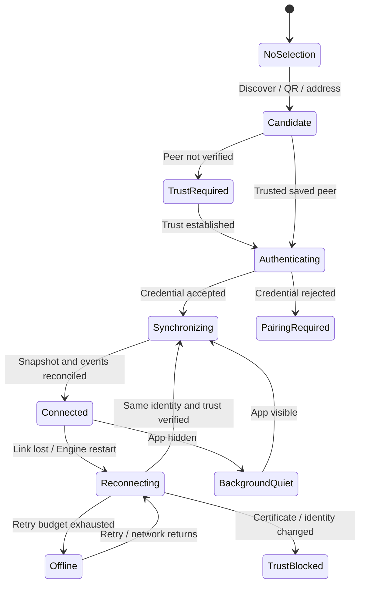

# Cadence Mobile Remote — User Journey and Interaction Contract

**Status:** Proposed for review; not implementation approval. **Revision:** 1. **Date:** 2026-11-16.

**Goal:** From a phone, connect to an independent Windows or Linux Playback Engine, enjoy the existing rich library experience, and control its listening session without unintended effects on another Engine, controller, or renderer.

This document defines observable behavior before implementation. The [standalone Engine architecture](STANDALONE_PLAYBACK_ENGINE.md) is accepted. The independent-controller, conflict and ownership principles in [Optional Linux Core](OPTIONAL_LINUX_CORE.md) remain applicable; its embedded Windows playback model is superseded. The [source audit](../../reports/mobile-remote-engine-architecture-audit.md) records the migration gaps. `DEVELOPER.md` remains the repository implementation reference; its older ownership descriptions need updating during implementation.

## Scope and review assumptions

In scope: Engine-hosted browser PWA and installed Android remote, pairing/trust, saved profiles, rich library/playlist browsing, queue/transport/output control, shared sessions, native lock-screen control, failure recovery, and resource discipline. The Windows UI is an optional peer controller. No desktop proxy, controller database, playback transfer, handset audio streaming, mobile Storage manager or mobile Curate is introduced.

User-supplied constraints are normative:

- Engine selection is independent per controller. Closing, disconnecting, forgetting or switching a controller never sends Stop.
- Switching never transfers tracks, queues, playback position or renderer ownership. Joining an existing Engine never replaces its session.
- Every action receives a pending indication and a confirmed, rejected or uncertain outcome; no silent failure.
- No automatic takeover, offline mutation queue or replay of stale commands.
- Output, volume and bit-perfect claims come from Engine telemetry; unknown stays unknown.
- Preserve rich mobile browsing. No unnecessary library-file I/O during playback and no permanent polling in place of events.

Proposed product defaults for review: playlists support browse/play/queue and explicit create/rename/edit/delete when authorized; Android background control is opt-in; previous library view/search/filter/scroll are restored per Engine; browser offline catalog is not promised. These are proposals, not claims about existing behavior.

All journey acceptance criteria below are **Required** unless a capability is explicitly unavailable. An unavailable capability must satisfy Journey 8, not masquerade as success. Browser and native limitations must be declared in the support matrix before release.

## Information architecture and common feedback

The primary job is listening: preserve the mobile album grid, search, language and format facets, editions, album details and track actions. Keep Library and Queue navigation, a persistent mini-player, and expanded Now Playing. Playlists are a Library section. Engine picker and connection diagnostics sit behind the named Engine control; output picker is a separate control in Now Playing. No connection details or implementation terminology belong in normal library flows.

Always show the selected Engine name. Show `Connecting`, `Connected`, `Reconnecting`, or `Offline` in text as well as visual treatment. Output has its own label and freshness. Empty library, no search results, loading, partial catalog, unavailable Engine and denied access are distinct states. An empty Engine says: “This Engine has no music yet. Add music from Cadence Desktop.” A failed load says “Couldn't load the library” with Retry, never “No albums.”

Buttons acknowledge activation immediately, before network completion. Pending is not success. Success appears only after Engine acknowledgment; errors remain near the originating action or in a persistent banner when context is lost. Accessible status announcements, focus restoration, 48px touch targets, text scaling and reduced motion apply throughout. Routine queue edits use feedback/Undo instead of confirmation dialogs; takeover and destructive playlist deletion require explicit confirmation. Undo is a new checked command, not a blind replay.

## State model

### Separate authorities

| State domain | Owner and fields | Controller obligations |
| --- | --- | --- |
| Profile and selection | Controller: endpoint, trusted peer binding, Engine/library identity, granted scopes, selected profile, activation epoch | Never synchronize selection between controllers; persist no queue authority |
| Connection | Controller: discovery, trust, authentication, readiness, sync and stream health | Stage candidate separately from active view; never display connected before validated snapshot/subscription handoff |
| Session | Engine: boot/session epoch, monotonic revision, queue entries/current entry, transport and position anchor, repeat/shuffle, output | One authority serializes mutations and natural advancement; clients interpolate progress only |
| Catalog and playlists | Engine: library identity, revision, stable track/release/edition/playlist IDs, paging state | Disposable caches keyed by identity and revision; never confuse incomplete pages with a complete empty result |
| Renderer ownership | Engine/renderer arbitration: renderer ID, owner, ownership generation and availability | Selecting Engine/output does not claim renderer; play/takeover is separately authorized |
| Command | Engine receipt plus controller intent: ID, target identity/epoch, expected revision, outcome | Track pending/confirmed/rejected/uncertain; never resubmit an uncertain command as a new ID automatically |
| Lifecycle | Controller: foreground, background quiet, native control available, detached | Closing/suspending subscriptions cannot change Engine transport |

### Connection transitions

Every transient stage has Cancel/Back. Failure preserves the active selection and last verified view marked stale. `TrustBlocked`, `PairingRequired`, unsupported protocol and not-ready require distinct recovery. During switching, the active connection and a separate candidate coexist; cancel/failure disposes the candidate. Selecting the same identity again is a refresh, not a second session. An explicit Disconnect disables automatic reconnect until the user reconnects.

Command transitions are `idle -> pending -> confirmed | rejected | uncertain`. A transport timeout after submission is **uncertain**, because the Engine may have acted. The UI says “Couldn't confirm this action. Refreshing the session.” Read receipt/state; never announce “Not applied” without evidence. No mutating control is sent while offline or trust-blocked. A staged takeover confirmation is not an executable command until confirmed.

### Snapshot/event consistency

Proposed contract: establish an authenticated event subscription with a sequence watermark and fetch/reconcile a snapshot against it. Buffer only bounded events during initial hydration; gaps/overflow trigger resync. Session revisions are monotonic within an Engine boot/session epoch; a restart changes the epoch, so old revisions cannot authorize new commands. Catalog revision is separate. Events identify Engine, library, epoch and sequence. Duplicate/out-of-order events cannot roll state backward. All async completions check the controller activation epoch, including errors, artwork, discovery, command results and native notifications.

## Journey 1 — First launch, discovery and pairing

**Intent/entry:** Open a newly installed Android app, open the Engine's PWA link, scan a pairing QR, or choose Add Engine. Primary goal: establish a trusted connection to the intended Engine without starting playback.

**UI/transitions:** Show “Connect to a Playback Engine” with Scan QR, Find Engines and Enter address. Request camera/local-network permission only when its action needs it. Installed Android performs one bounded discovery attempt on Find Engines; browser shows QR/address paths and does not pretend native discovery is available. List discovered names and addresses; duplicates with the same verified identity collapse. Discovery alone does not activate or authenticate.

QR/address opens a candidate card: Engine name, location/address, trust state and “Connect.” Progress reads “Checking Engine,” “Verify this Engine,” “Pairing,” then “Loading session.” Successful connection opens Library with the current Engine session intact. QR may complete the Connect step when the user explicitly invoked pairing and the trusted payload/handshake match; it never implies Play.

**Authority/protocol:** Serve the PWA shell/assets directly from each Engine. Native discovery uses `_cadence-core._tcp`; advertisement is a hint. Read health, verify TLS peer binding, then `core.hello`, negotiate version/capabilities, authenticate and `session.snapshot` plus event handoff. Pairing enrollment/exchange is a **new contract**, not an existing operation. QR carries schema version, LAN endpoint, Engine/library identities, label, fingerprint and a short-lived single-use enrollment secret. An authorized Engine administration surface can issue it; the optional desktop controller may display it but never hosts the connection. A default localhost desktop connection must resolve an Engine-advertised LAN endpoint without changing that controller's selection.

**Failure/recovery/messages:** No discovery results: “No Engines found” with Search again and Enter address. Permission denied retains manual pairing. Unreachable: “Couldn't reach this Engine. Check that your phone and Engine are on the same network.” LAN disabled: “Remote access is off on this Engine.” Invalid/expired enrollment: “Pairing code expired” with Get a new code. Authentication rejected: “Pairing was not accepted.” Not ready: “Engine is starting” with Retry. Cancel returns without changing a previous Engine.

**Security/trust:** No permanent bearer token in QR URLs, referrers, logs or analytics. Prefer fragment-based bootstrap data, consume it once and remove it from browser history immediately. Redact secrets from diagnostics. Exchange only after peer verification. Native QR pins the intended TLS peer; manual pairing requires fingerprint comparison against an independently trusted Engine administration surface. mDNS and a fingerprint returned by an untrusted endpoint are not trust proofs. Browser HTTPS must already be trusted by the browser/OS: offer explicit certificate setup guidance or deployment with a trusted certificate. Browser JavaScript cannot bypass this. Never silently downgrade to HTTP or accept all certificates. Manual address entry validates URL/scheme; no arbitrary URL supplied by a catalog item becomes an authenticated destination. Pairing issues a revocable per-controller credential with mobile scopes; hiding Storage/Curate in UI is not authorization.

**Audiophile impact:** Bounded on-demand discovery; no continuing scans. Shell, hello and snapshot use Engine system assets/RAM projections. No library scanning, cover extraction or playback admission on pair. Static assets are bounded/concurrency-capped.

**AC-001 — Automated:** With synthetic Windows/Linux Engines, round-trip QR and manual profiles; assert correct adapter, identities and certificate binding; no Play/Stop/queue/renderer mutation. Test expired/reused enrollment, duplicate discovery, IPv4/IPv6 loopback rejection, bad protocol, denied permissions and mismatched cert/identity. Assert no secrets in URL after consumption or diagnostics. Integration-load HTML/JS/manifest from each Engine with no desktop running.

**AC-002 — Real devices:** Fresh Android APK, Android Chrome PWA and iPhone Safari; complete QR and manual journeys with desktop closed, then denial/cancel/expired-code paths. Verify browser certificate setup and launch/install where supported. Check focus, large text and screen-reader announcements. Gate unsupported browser trust configurations explicitly rather than calling them passed.

## Journey 2 — Return and adopt an existing session

**Intent/entry:** Reopen the app or wake it to continue controlling the last selected Engine, possibly already playing under another controller.

**UI/transitions:** Show “Reconnecting to {Engine}” and a read-only last verified view. Validate the saved peer/credential, then atomically adopt current queue, track, position, output and capabilities. Say “Connected to {Engine}” without implying playback was started. Open the previous view; a changed current track is reflected even if the phone was asleep. No saved profile returns to Journey 1.

**Authority/protocol:** Read saved controller preferences only; `core.hello`, fresh `session.snapshot`, catalog revision reconciliation and event handoff. Initial reconnect schedule proposal: immediate, then 1/2/4/8/15 seconds with jitter, at most six automatic attempts per foreground recovery episode. After that show offline/Retry; a network-restored or foreground event may start one new bounded episode. Do not perform LAN discovery continuously. Preserve manual Disconnect across wakes.

**Failure/recovery:** Same identity at a new discovered address can be proposed/revalidated using existing trust binding; never switch to a merely similar name. Invalid credential enters Pair again. Changed certificate/identity enters Journey 6. No ready Engine: retain profile, “Engine unavailable. Playback may still be continuing,” Retry/Choose Engine. Never substitute another Engine automatically.

**Security/trust:** Revalidate saved identity and pin; persist credentials in platform-protected storage where available. Browser storage must be treated as accessible to the app origin; minimize scopes, exclude secrets from caches, apply CSP and revoke on Forget. Service workers must not cache enrollment/authorization responses.

**Audiophile impact:** One coherent snapshot and only changed catalog pages; no full reload for every wake. Reconnect timers stop when hidden/manual-disconnected and never touch audio delivery. No Play/Stop or disk scan to “restore” controller state.

**AC-003 — Automated:** Given another controller changed track/queue/output while this one was closed, reopening adopts Engine state and emits zero mutations. Exercise unchanged/changed catalog revision, revoked credential, restart epoch and bounded retry counts with a fake clock. No local queue uploaded; no automatic alternate Engine.

**AC-004 — Real devices:** Close/reopen and sleep/wake on all three clients while desktop controls playback; confirm current session adoption and uninterrupted renderer playback. Reopen after manual Disconnect and verify it stays disconnected.

## Journey 3 — Switch Engines without transfer or interruption

**Intent/entry:** Tap Engine name -> Choose Engine -> select another saved/discovered Engine.

**UI/transitions:** Candidate preview says “Switch control to {B}? Music on {A} will keep playing. Music is not moved.” Show B's current session/output or “Idle.” Actions: Switch control, Cancel. Validate B while A remains the active displayed context; once ready commit B's catalog/session/output together. If B is playing, adopt it. A and B may both continue playing. If the user wants A stopped, provide a separate explicit Stop on A before switching; do not bundle Stop into the default switch.

**Authority/protocol:** Candidate hello/snapshot/events, then controller-local selection commit and activation-epoch increment. No playback/queue/output mutation to either Engine. Dispose A's controller subscription/native notification binding after commit; Engine A session remains owned by A. Forget removes credentials/cache only and explains “Music will keep playing.”

**Failure/recovery:** Failed trust/auth/readiness on B keeps A and says “Couldn't connect to {B}. Still controlling {A}.” Cancel cannot cause stop. Pending command on A: settle it or mark its outcome uncertain and reconcile separately; never relabel it as a B action. Late A completions cannot update B's view or notification.

**Security/trust:** Stage B's verified identity and native pin separately. Credentials never cross hosts. A QR opened while connected is a candidate, not an immediate destructive selection change.

**Audiophile impact:** At most active and candidate control channels during preparation; no duplicate catalog prefetch beyond the required view, no audio transfer/admission. Cache eviction remains bounded.

**AC-005 — Automated:** A playing, B playing/idle/unreachable/untrusted; switch/cancel/fail and verify zero transport/queue/ownership mutations. Delay every A/B response across switch and assert the active view/native binding cannot regress. Test two profiles at one address with changed identity and duplicate QR imports.

**AC-006 — Real devices:** Switch between Windows and Linux while both play; verify neither interrupts and the phone controls only the newly selected Engine. A second phone and desktop retain their selections. Quit each controller; playback continues.

## Journey 4 — Rich Library, playlists and queue

**Intent/entry:** Library, search/facet controls, album/edition details, Playlists, track menu, or Queue. Primary goal: find a recording and choose exactly how it joins the session.

**UI/transitions:** Preserve artwork grid, title/artist search, language and existing format/hi-res/DSD/compilation filters, sort, release grouping and track detail. Search/filter state and scroll survive tab changes and are scoped per Engine. Editions have separate labels/IDs; do not merge duplicate names or compilation artists incorrectly. Search and counts cover the entire library, not only loaded pages. Partial loading says “Loading more albums”; failures retain loaded content with Retry. No-results offers Clear filters.

| Action | Observable session behavior |
| --- | --- |
| Play album/edition/playlist | Explicitly replace queue with its ordered playable tracks and start first track in one Engine transaction; if a different session is active, show a clear “Replace queue and play” action before submitting |
| Play from here | Queue the selected release's ordered tracks and start the chosen track; label distinguishes this from Play track |
| Play track | Replace queue with that one track and start it; expose the consequence before activation |
| Play next | Insert after current entry, preserving selected order; idle/no current entry inserts at the beginning without starting |
| Add to queue | Append in order; never start playback |
| Jump to queue entry | Play the chosen stable entry, including duplicate track occurrences |
| Remove non-current entry / reorder | Preserve current entry and playback position; target stable entry IDs, never UI indices |
| Remove current entry | Advance to the next surviving entry at the same logical position, preserving playing/paused intent; empty queue stops. Explain this consequence in the current-entry action |
| Clear queue | Offer “Clear upcoming” preserving current, and explicit “Clear queue and stop” for all entries; no ambiguous Clear action |
| Repeat/shuffle | Engine owns modes and advancement; shuffle preserves current entry and reports authoritative upcoming order |

Playlist browsing and playback are required. Proposed editing scope: create/rename, add/remove/reorder tracks and explicit Delete playlist with confirmation; deleting a playlist does not remove library tracks or mutate a queue already created from it. Empty playlists show “No tracks yet” with enabled actions appropriate to grants. Missing/unplayable entries remain visible with reason; a play request requiring skips receives an explicit summary/confirmation before execution rather than silently dropping tracks.

**Authority/protocol:** `catalog.page`, v2 catalog metadata, `playlists.list/get/create/update/delete/setTracks`, `queue.control`, `queue.replace` and `playback.control` exist in some form. Required **new semantic contracts**: complete release/edition/search/facet projection (or a complete RAM catalog with equivalent results), atomic play-selection, enqueue/edit operations, playlist concurrency revisions, and safe current-entry removal. Operation names in the next section are proposals. Artwork uses release identity and authenticated bounded fetch/ETag, not legacy track-path URLs. Replacing a queue and then separately playing is not an acceptable atomic-play implementation.

**Failure/recovery:** Pending row/menu feedback -> Engine acknowledgment -> authoritative queue. Rejection: “Couldn't add to queue: {reason}.” On conflict use Journey 6. Play not admitted leaves the prior session intact where possible; if a physical renderer transition fails after acceptance, show actual resulting state and “Playback couldn't start,” never invent rollback success. No offline edits or automatic retries of old mutations. Undo checks fresh revision; if superseded, “Queue changed. Undo isn't available.”

**Security/trust:** Opaque scoped IDs only; no filesystem paths. Read-only/mobile scopes enforced server-side. Recheck IDs after Engine change. Images use authorized fetch/Blob URLs; any platform artwork URL grant is short-lived, image-only and cannot authorize control. Cache keys include Engine/library/revision; release Blob URLs on eviction/switch.

**Audiophile impact:** RAM catalog/search and cached artwork during playback; cache misses display placeholders with “Artwork available when playback is idle” where needed. No repeated file extraction or database full scans to render facets. Lazy visible-image fetching, at most two artwork requests/decodes, bounded page requests and virtualized long lists. No decorative continuous animations. Playlist writes are user-requested, isolated control-store work; if store location/locking violates playback hygiene, return deferred with explicit status rather than writing to library drives.

**AC-007 — Automated:** Large multi-page catalog including duplicate titles, distinct editions, compilations, languages, PCM/DSD and no artwork; verify search/facet counts across unloaded pages, ordering, state restoration, accessible empty/error/partial states and cache isolation. Exceed the current 100-page cap and change revision mid-pagination; no silent truncation.

**AC-008 — Automated:** Test every table action with playing/paused/idle/empty queue, duplicate tracks, missing entries, stale revisions and another controller editing. Assert one atomic transaction for play-selection, stable current-entry identity, explicit destructive labels and no false success. Test playlist conflicts, deletion semantics and unsupported edit grants.

**AC-009 — Real devices:** Compare recovered library journeys against the existing rich mobile album UI using a representative Windows/Linux catalog. Search/filter, inspect alternate editions, play/queue albums/playlists, reorder/remove and Undo on phone touch controls. Verify DSD labels and preserved transport while covers are unavailable; screen reader and large-text review included.

## Journey 5 — Shared control and renderer takeover

**Intent/entry:** Desktop and phones control the same Engine, or a play/output action encounters a renderer being used by another Engine/controller.

**UI/transitions:** Same-Engine peers are collaborative controllers, not competing owners. Their acknowledged actions update all connected views via events. Engine advances tracks once. Current renderer ownership is shown separately: Available, This Engine, Another source, or Unknown. Selecting a renderer inspects/configures intent without sending Play or stealing it. Changing an output during active playback requires explicit disclosure and an acknowledged Engine transition; if unsupported, disable with reason.

For an externally owned renderer show: “{Renderer} is playing from another source. Take over and play?” Actions: Cancel, Take over and play. Explain that current music on that renderer will stop. Confirmation binds to renderer identity, ownership generation and the exact play intent. If ownership changes before execution, invalidate confirmation and ask again. Merely reconnecting, browsing or selecting an Engine never takes over. Unknown ownership says “Couldn't verify who is using this output” and requires renewed explicit verification/confirmation before an attempted claim.

**Authority/protocol:** Engine session authority serializes commands and emits session/queue/output/ownership changes. `takeover_required` and explicit `forceTakeover` exist at client protocol level; renderer ownership generation and validated takeover intent are new requirements. Cross-Engine/UPnP ownership coordination must be best-effort only when the renderer cannot provide atomic leases: recheck immediately before control, report failures and never claim race-free ownership. Same-Engine controller count does not imply exclusive ownership.

**Failure/recovery:** If renderer disappears: “Output unavailable” with Choose output/Retry. Do not silently switch to system speakers. Engine reports actual transport and any partial failure. If another source retakes renderer, show “Output taken by another source”; never fight it in an automatic reclaim loop.

**Security/trust:** Takeover requires playback/output grants and an authenticated explicit intent. No force flag inherited across actions, reconnects or Engines. Do not expose external source URIs or credentials in mobile diagnostics.

**Audiophile impact:** Event-driven peer updates and bounded essential renderer queries; no controller auto-advance, frequent discovery or ownership polling. Keep arbitration off the pacing thread and preserve audio transport tuning.

**AC-010 — Automated:** Two phones plus desktop issue concurrent commands; assert serialized results, one natural advance, deduplication and event convergence. External owner -> Cancel yields zero control calls; confirm yields only the specified takeover; changed ownership invalidates confirmation. Renderer failure never auto-falls back or repeatedly claims.

**AC-011 — Real devices:** Windows/Linux Engines with the physical RS130 and another UPnP controller; verify cancel, confirmed takeover, retake, unplugged renderer and same-Engine shared edits using release PCM/DSD playback. Record unavoidable renderer arbitration limits.

## Journey 6 — Loss, restart, stale responses and conflicts

**Intent/entry:** Wi-Fi loss, event-stream termination, Engine restart, revoked pairing, changed certificate, missed event or command revision rejection.

**UI/transitions:** Mark stale immediately when loss is detected: “Connection lost. Playback may still be continuing.” Disable mutation controls, retain Library/Queue as read-only, freeze progress after the declared freshness window and label last-known state. Reconnect uses Journey 2's bounded schedule. Manual Retry remains available; no Stop is inferred from silence. Reconnected state replaces stale state atomically.

**Failure classes:**

| Condition | Message and recovery | Prohibited behavior |
| --- | --- | --- |
| Same trusted identity, new boot epoch | “Engine restarted. Refreshing session”; fetch actual state | Restore cached queue or resume automatically |
| Revision conflict | “Queue changed on another controller. Your change wasn't applied”; refresh and offer the user to review/try a new action | Automatically rebase/replay the old mutation |
| Submitted action lost acknowledgment | “Couldn't confirm this action”; query receipt/state | Declare failure or retry with a new ID blindly |
| Certificate changed | “This Engine's certificate changed. Verify it before reconnecting” | Replace pin automatically |
| Engine/library identity changed at same address | “A different Engine or library is at this address”; review/add as new | Reuse old caches, grants or pending commands |
| Pairing revoked | “Pairing expired or was revoked. Pair again” | Repeated unauthorized background retries |
| Event gap/overflow | “Refreshing session”; resync snapshot and sequence | Apply later events onto an inconsistent base |
| Protocol unsupported | “This Engine needs a compatible Cadence Remote”; show supported version guidance | Route silently through legacy desktop APIs |

**Authority/protocol:** Typed errors include operation outcome, request/command ID, current epoch/revision and bounded authoritative state where safe. A new read-only command-receipt query resolves uncertain outcomes within a documented retention window. Receipt unavailable after restart/expiry means “Outcome unknown”; show current state and require a new deliberate user action. Server may deduplicate received IDs; the controller never replays stale commands as its recovery strategy. Reject old epoch/revision before any effect. Conflict responses preserve a complete revision-matched catalog cache or rehydrate it; a first-page snapshot must not erase later-page metadata.

**Security/trust:** Trust/auth faults stop retries and close native bindings. Address rediscovery must match pinned identity. Diagnostic export is explicit, bounded and redacted. Network return is not authorization to trust a new peer.

**Audiophile impact:** Backoff, coalesced resync and bounded event buffers; no reconnect storm, full catalog fetch per heartbeat or background wake loop. UI progress stops claiming freshness rather than increasing request rate.

**AC-012 — Automated:** Inject loss before submit, after apply/before ack, duplicate/out-of-order events, gap, restart, receipt expiry, certificate/identity change and concurrent revision conflicts. Assert no replay, no false success, no cross-epoch mutation and no old-scope UI update. Fake clocks verify retry/heartbeat bounds and quiet background behavior.

**AC-013 — Real devices:** Airplane mode/Wi-Fi roaming, Engine process restart and network return during playback and queue edits; verify actual audio behavior separately from UI. Repeat with changed/revoked credentials in a test deployment. No production credential changes or live destructive tests are part of this specification work.

## Journey 7 — Android lock screen and background lifecycle

**Intent/entry:** Enable “Lock-screen controls” in context, lock the phone, press notification/headset controls, return to the app or dismiss it.

**UI/transitions:** Explain before enabling: “Control {Engine} from your lock screen. Music continues if this app closes.” Request notification/background permissions only when needed. Enable only after a validated Engine session. Native media service owns the selected Engine binding independently of WebView JavaScript; no legacy socket dependency. Metadata includes Engine/output identity and a last-updated timestamp. After state becomes stale, show “Refresh to control” rather than a confidently wrong play/pause state. A notification Refresh performs a bounded snapshot request. A stale mutation tap first refreshes and then either performs the still-valid exact intent or asks the user to tap again if the action/track context changed; a stale “Next” must not skip an unexpected later track.

On background: suspend catalog/artwork work and event subscription, cancel nonessential timers/retries; retain only bounded native state and the enabled control surface. No permanent background polling or keepalive substitute. Consequently external changes while asleep may leave metadata stale; this limitation is explicit. On foreground: fresh snapshot/event handoff before controls become live. Disable controls/dismiss notification closes the service, not playback. Force-stop, OS eviction and reboot cannot guarantee notification availability; reopening adopts Engine session. Browser lock-screen controls are qualified separately and are not promised to match Android native background reliability.

**Authority/protocol:** Native service uses the same verified identity, per-controller credential, command envelope, receipt handling and authoritative snapshots as foreground. Explicit actions use pause/resume/next/previous only when advertised. Native generation changes on Engine switch/forget; pending callbacks cannot send to the new Engine or leave an old actionable notification. No client auto-advance or native use of `/api/remote/*`.

**Failure/recovery:** Network unavailable: “Engine unreachable. Open Cadence to reconnect” and no deferred command. Session changed: “Playback changed. Refresh controls.” Revoked trust disables the notification action with Pair again/Open app. No repeated background reconnect after a failed tap.

**Security/trust:** Credentials remain in native protected storage; intents are restricted to the app's selected binding. No secrets in notification/deep links. Revoke/forget removes actionable binding. Never reuse the previous desktop's pinned HTTP client.

**Audiophile impact:** Zero steady background snapshot polling and no persistent event heartbeat in background-quiet mode. Only explicit control/refresh causes bounded network work; return to foreground performs one resync. No silent handset audio loop for native controls.

**AC-014 — Automated:** Service-level fake Engine tests for exact command target/IDs/revision, stale metadata, action refresh, timeouts, revoked credential, switch during a pending command, dismiss and service destruction. Assert zero timers/network requests during a quiet background interval and zero Stop on closure. Foreground/native mutation handling shares contract fixtures.

**AC-015 — Real devices:** At least one physical Android device plus an additional vendor/device power-management configuration; test screen lock, Doze, headset controls, notification permission denied, task swipe, force-stop, OS eviction, Wi-Fi loss and Engine switch. Verify no unintended track skip and no continuous background traffic using capture. Check Android Chrome/iOS MediaSession separately and document actual support.

## Journey 8 — Capabilities and truthful output reporting

**Intent/entry:** Open Now Playing/output picker, inspect signal path, adjust volume/purity, or use a feature the selected Engine cannot provide.

**UI/transitions:** Output picker lists stable identities and availability; selection and renderer claim are distinct. Show actual route (for example Engine-reported WASAPI Exclusive or UPnP), source format and output format as separate facts. Bit-perfect badge has Verified / Not bit-perfect / Unknown / Stale states with an explanatory detail view. An Engine assertion must specify what it verifies; UPnP delivery of original bytes alone does not prove the downstream DAC signal path. Unknown volume is “Volume unavailable,” not 100%. Unsupported control is hidden if irrelevant or disabled with a reason if expected; read-only state remains visible.

Examples: “Volume is controlled on this output,” “Software volume is locked in Purity Mode,” “This Engine doesn't support seeking for this track,” “Output status unavailable.” A purity toggle shows requested/pending/actual result; it cannot imply signal-path verification. Capability changes on reconnect/output change update controls. A feature cannot silently degrade to a different output, protocol or audio path.

**Authority/protocol:** Negotiate and retain actual protocol version/capabilities. `outputs.list`, `output.select`, `player.volume`, `player.purity` currently exist in Windows-specific handling; a shared contract must normalize transport values and enumerate per-output restrictions. Proposed telemetry: measured/reported volume with scale/control type, purity requested/effective, bit-perfect evidence/status/scope, source/output rates, timestamp, epoch/revision, ownership and reason when unknown. Linux advertises only its real supported routes. Server enforces purity/volume restrictions regardless of client UI.

**Failure/recovery:** Capability missing: explain before action. Rejected operation: show Engine reason and authoritative state. Output disappears: mark unavailable, preserve selection and offer Choose output. Missing telemetry: Unknown, not cached success. Telemetry past its freshness bound: Stale. Never apply a volume gesture locally while sending a different effective value.

**Security/trust:** Authenticated telemetry only; advertising a capability does not grant permission. Mobile enrollment grants are separately checked for every operation. Sensitive diagnostics remain behind explicit disclosure.

**Audiophile impact:** Event-driven telemetry on actual state/output changes, not a status polling loop. Rate-limit slider submissions to user intent with final-value acknowledgment; prevent attenuation when bit-perfect policy forbids it. No audio-thread diagnostics or extra parsing of source files for badges.

**AC-016 — Automated:** Capability/permission matrix for Windows/Linux, unknown/stale telemetry, output removal, transport enum variations, unsupported seek, denied volume and purity changes. Assert no fabricated unity gain/bit-perfect claims and server-side rejection even from a crafted unauthorized request. Missing capabilities cannot route to old endpoints.

**AC-017 — Real devices:** Verify displayed route and effective controls against Windows DAC output and Linux RS130 telemetry with representative PCM/DSD. Where end-to-end bit-perfect cannot be measured, UI must state the narrower verified scope or Unknown. Validate disabled-control explanations with touch and screen reader.

## Protocol interaction contracts and architecture gaps

Operation names marked **Proposed** below describe required semantics; implementation must version/validate them. They are not a claim that the current Engine supports them. No arbitrary Tauri command forwarding.

| Contract | Required shape/behavior | Existing gap and repair boundary |
| --- | --- | --- |
| Engine hosting | Same Engine serves shell/assets/manifest; protected APIs separate; advertised reachable HTTPS endpoint | Shared listener lacks PWA hosting; move assets out of desktop-only module/build ownership |
| Pair enrollment — Proposed | Single-use expiry-bound grant, pinned identity, per-controller revocable scoped credential; bounded attempts and enrollment rate limits | Current QR shares broad token and omits profile fields; new Engine enrollment and browser/native trust flow needed |
| Hello/activation | Actual negotiated version, identity, readiness, capabilities/grants; staged snapshot/event sync | Client forces v1 and returns v1 after accepting v2; share pure validated protocol contracts |
| Catalog | `catalog.page` plus complete release/edition/search/facet projection or equivalent complete in-memory results; revision-stable pagination | Flat Core UI bypasses rich catalog; legacy fetches, silent pagination cap, cache-scope gaps |
| Playlists | Existing v2 `playlists.*` plus expected playlist revision and stable membership IDs | Mobile has no playlist surface; concurrency and event invalidation semantics need completion |
| Queue edits — Proposed | `queue.edit` with typed append/insert/remove/move/clear-upcoming, entry IDs and atomic expected revision | Dispatcher drops actions; `play_next` ignored; replace alone does not define safe edit semantics |
| Play selection — Proposed | `session.playSelection` binds ordered selection, start entry, explicit replacement policy, admission and ownership check | Two-step replace/play can leave partial state; all checks/admission before committing intent where possible |
| Mutation envelope | Engine/library/session epoch, command ID, expected revision, typed body; bounded deduplication; authoritative acknowledgment/rejection | Add restart protection, complete error mapping and visible outcomes; do not assume physical renderer calls are transactionally reversible |
| Command receipt — Proposed | Read by command ID/epoch; applied/rejected/unknown with documented retention | Timeout currently resembles disconnection; implement reconciliation without automatic command replay |
| Events | Proposed choice: extend authenticated `/v1/events` SSE to session/queue/output/ownership/catalog/playlist invalidations; sequences, resume/gap contract and >=5s keepalive | Existing SSE primarily drains library events; mobile polls. Browser fetch-stream and native pinned streaming needed; reconcile design documents' WSS wording |
| Output/ownership | Shared output IDs/enums/capabilities plus telemetry and takeover generation | Windows-specific handlers and hard-coded client status; normalized Engine authority required |
| Artwork | Authenticated release-ID fetch, ETag, bounded bytes/concurrency, idle-gated extraction; separately scoped platform URL only if necessary | Legacy URLs, wrong identity and query-token assumptions; browser/native artwork adapter needed |
| Controller isolation | Active/candidate epoch checks on every completion; native service binding follows committed selection | Passive refresh guards alone do not protect commands, errors and late native callbacks |
| Mobile authorization | Read/control/playlist grants; no Storage/Curate grants by default; Engine enforcement | UI exclusion alone is insufficient with a broad bearer token |

Events may carry minimal state deltas or invalidations, but position ticks must not require full snapshots. Coalesce multiple invalidations into one relevant fetch. Foreground keepalive default proposal: 10 seconds; three missed keepalives mark stale and reconnect, while explicit socket/network errors act immediately. Local progress interpolation updates only the visible progress component; no application-wide 60Hz render. Background mode is Journey 7's quiet policy.

Risk boundaries: enrollment and credential persistence need security review; playlist edits need conflict protection; Engine session/output changes need audio qualification; renderer atomic ownership may be unavailable and must not be overstated. No database migration is assumed for controllers. Any Engine schema change uses backup/rollback and must not re-enable a legacy local DB.

## [AUDIOPHILE IMPACT ASSESSMENT]

This is a proposed plan only. No runtime benchmark, new worker or code change has been executed.

| Resource/invariant | Planned boundary | Required evidence before release |
| --- | --- | --- |
| Disk I/O in Playing/Paused/Loading and 30s cooldown | Serve catalog/session from RAM; system assets/cached covers from explicitly allowed Engine storage or RAM; no reads/writes on music library drives. Cover cache miss defers extraction. No scan/enrichment on pair/wake | Instrumented filesystem trace while traversing Library, search, artwork misses and reconnect; zero non-audio library-drive I/O. Identify DB/cache locations; defer work if they share protected drives |
| Network/NIC | On-demand bounded discovery; event-driven foreground updates, 10s proposed heartbeat; background quiet; bounded static/page/image delivery, <=2 artwork decodes/requests; no rapid loading polling | Capture foreground idle, browsing, reconnect and background for both Engines; heartbeat >=5s, zero steady background requests, no full catalog per position update, no controller audio stream |
| Thread/CPU scheduling | No control, artwork, logging or DB work on synchronous audio/pacing path; preserve MMCSS Pro Audio, timer cleanup, isolated affinity away from cores 0/1; new non-audio workers require platform background policy | Scheduling/CPU trace; bounded control locking and no audio-thread waits; compare optimized build with approved baseline |
| Memory/VirtualLock | Audio locked-memory arenas and zero-allocation paced loops unchanged; bounded controller/Engine page/event/artwork caches; dispose candidate/old profile state | Existing zero-allocation checks plus memory profiles during long browsing/reconnect; explicit cache limits selected and recorded before implementation merges |
| Signal/container integrity | No attenuation or conversion through controller actions in protected mode; source metadata uses Engine ground truth; no handset decoding or metadata file probes | Server volume/purity rejection tests and route telemetry verification; release PCM/DSD transitions on Windows DAC and RS130 for audio-impacting changes |
| UI/GPU | No decorative continuous animation; progress isolated and suspended when invisible; no broad React updates per timer tick | Render/CPU measurements during steady playback, screen off and large catalog interactions |

Tier 1: specification-linked static/unit checks for every change. Tier 2: control/event/catalog/native lifecycle changes require targeted regressions and measured resource evidence. Tier 3: renderer/session/output/audio delivery changes require optimized release PCM/DSD, track transitions, delivery stability and signal-path checks. If any playback regression appears, escalate to Tier 3. Hardware checks that cannot run remain pending, never recorded as passed. Numeric CPU/memory regression limits must be derived from and approved against a captured baseline, not invented in this document.

## Phased implementation plan and gates

| Phase | Deliverable and dependencies | Exit evidence | Rollback boundary |
| --- | --- | --- | --- |
| 0 — Review contract | Approve journeys, switching/queue semantics, trust/enrollment, quiet-background policy, SSE decision and resource plan | Recorded review of revision 1; no application code before this gate | Revise document only |
| 1 — Connect independently | Engine PWA hosting, LAN metadata, enrollment/scopes, discovery, native pin setup, hello/activation epochs | AC-001–006; browser/APK connect to both Engines with desktop absent; security review | Versioned Engine/client artifacts; disable new enrollment without stopping existing playback; never restore desktop proxy |
| 2 — Session authority and events | Mutation envelope/receipts, event handoff, normalized output state, ownership, conflict/restart rules | AC-010–013 and baseline resource captures; two-controller convergence; no poll substitute | Disable unsupported mutations explicitly; mixed versions reject clearly; preserve Engine session authority |
| 3 — Rich Library and controls | Reuse album UI; complete projections, artwork, playlists, every queue action and truthful capabilities | AC-007–009,016–017; all visible callbacks covered and real phone parity walkthrough | Revert client/Engine pair using compatible protocol; never replace rich UI with a flat list as completion |
| 4 — Native background control | Engine-aware service, notification binding, exact-intent handling, lifecycle | AC-014–015; physical Android/power-management evidence, quiet traffic | Turn off lock-screen controls with explicit explanation; playback continues |
| 5 — Release qualification | Full journey matrix, accessibility, Windows/Linux packaging, trust support matrix, updated architecture guidance | All required ACs and applicable Tier 2/3 evidence; user verification; installer gate for Windows release | Keep previous independent Engine release; documented Engine-data backup if schema changed |

Phase 2 precedes rich control activation so new UI never ships on incomplete authority/error contracts. Phases may use shared fixtures, but passing API mocks does not replace real-device exits. Per-phase work should remain reviewable and scoped; no automatic merge, release or live playback tests are authorized by this document.

## Verification record and review checklist

Current evidence is the preceding source audit, including its earlier 6/6 PWA Core test result; those tests do not establish the new experience. **AC-001–017 are all Pending.** No tests or live network/device actions were run for this document-only revision. Future automation uses synthetic credentials, isolated Engine data and simulated renderers; physical playback tests require the user's approved test window and device setup.

Before implementation, review these concrete proposed decisions:

1. Non-interrupting Switch control; Stop remains a separate action. No transfer or source redirection.
2. Explicit queue replacement, Play from here, current-entry removal and Clear upcoming versus Clear queue and stop semantics.
3. Per-controller scoped enrollment, native pin verification and browser-trusted HTTPS deployment/support path.
4. Authenticated SSE with complete Engine invalidations, sequence recovery and no permanent polling.
5. Background-quiet Android service with explicitly stale metadata and action-triggered refresh, accepting that external changes are not continuously reflected while asleep.
6. Playlist editing scope and truthful telemetry/unknown-state design.
7. Audiophile boundaries, measured baseline procedure and phase/device exit gates.

Approval of this specification does not authorize silently weakening a criterion. Any platform limitation that changes safety or observable behavior must be recorded as a revised criterion and brought back for review. The user explicitly requested review before implementation; `.agents/rules/audiophile.md` additionally requires an impact assessment and explicit approval for these resource-sensitive changes.

## Specification self-review

Using agent-self-evaluation: Accuracy 4/5 — existing/proposed operations separated; browser/native/renderer qualification still pending. Completeness 4/5 — eight journeys include all seven requested dimensions and ACs, but supported OS/browser versions require actual device inventory. Clarity 4/5 — common model and per-journey messages reduce ambiguity; this is a detailed reference rather than a short briefing. Actionability 5/5 — criterion IDs, phase dependencies and exit evidence define a reviewable handoff. Conciseness 4/5 — shared concerns recur only where platform behavior differs. Overall **4.2/5**.

Priority improvements after review: validate browser trust/enrollment and native quiet-background feasibility first; record exact device/version matrix and cache/resource budgets from baseline measurements. Self-check: the proposed contract matches the requested scope, while unverified implementation/device behavior remains explicitly pending. Verdict: ready for experience review, not implementation or release.
