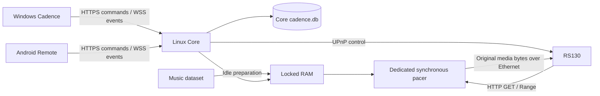

# Optional Linux Cadence Core

Status: approved direction; phased implementation started. Updated: 2026-11-15.

This document consolidates the agreed Linux Core, controller UX, database ownership,
and Curate design. It describes target behavior; only the phase ledger records what
has actually been implemented. DEVELOPER.md remains canonical for current architecture.

## Product contract

Cadence remains a full standalone Windows application. Linux Core is an optional
engine for users with an appropriate Linux host, memory and CPU capacity. Existing
Windows outputs, catalog, Curate and Android-to-Windows control remain supported.
Existing installations default to **This PC** without additional onboarding.

The first Linux audio backend is paced UPnP, qualified against HiFi ROSE RS130.
This restriction applies to the Linux package, not Windows. USB/ALSA output,
multiroom synchronization and Android Curate UI are outside the initial scope.

Goal: remove the controller PC from audio delivery. TrueNAS and RS130 must have a
fully wired route to remove Wi-Fi from that route. Reduced dropouts and improved
delivery consistency require measurement; improved sound or DAC clock jitter is
not an assumed consequence of application pacing.

## Architecture and ownership



| Concern | This PC | Core mode |
| --- | --- | --- |
| Catalog authority | Windows backend | Selected Core backend |
| Database | Existing Windows cadence.db | Persistent Core cadence.db |
| Playback/queue authority | Local backend | Core backend |
| Curate evidence, drafts and approved jobs | Windows database | Core database |
| File mutation | Windows approved commit worker | Core approved commit worker |
| Controller preferences | Local device | Local device |

Never open a common SQLite file from Windows and Linux. Controllers use APIs, not
SQL or NAS access. Core caches on controllers are disposable and scoped by Core and
library identity. Selecting an engine never synchronizes two databases implicitly.
The current local catalog label uses reserved identity `local`; remote adapters
must namespace/validate identities rather than trusting user-controlled labels.

Backend extraction should introduce reusable playback/queue, UPnP, platform and
API boundaries with thin Tauri and headless adapters. Linux must build without
Tauri, WebView, WASAPI, ASIO or unnecessary local-output dependencies. The pacer
remains a dedicated synchronous thread; async execution serves the control plane.

## UX contract

Apply `.agents/rules/ux-design-guideline.md`: prioritize listening, disclose advanced
settings progressively, make consequences visible and retain reversible choices.

1. **Standalone:** install/open Cadence, use its library and outputs, play. Core is
   discoverable in Settings, not a mandatory first-launch decision.
2. **Add Core:** Settings > Playback engine > Connect to Cadence Core. Discover on
   demand or enter an address; pair; check trust/API/library/output/readiness.
3. **Prepare:** configure Core-visible music roots if empty. Pairing and discovery
   do not activate Core, scan automatically or interrupt local playback.
4. **Activate:** show engine name, library and output, then **Use this Core**.
   Cancellation/failure retains the previous session. Commit catalog, queue and
   output view together only after the target snapshot has been validated.
5. **Listen:** show `Playback engine: Music Room Core` and `Audio output: RS130` as
   separate choices. Keep transport/browsing familiar. Advanced resource controls
   stay in Settings/diagnostics. Never claim universal hardware readiness.
6. **Switch:** playing/paused/loading local playback requires **Stop this PC and
   use Core** or **Keep listening here**. A stop must be acknowledged before
   activation. Joining an already-playing Core preserves its queue and session.
7. **Leave Core:** explicitly offer **Keep Core playing and switch** or **Stop
   Core playback and switch**. Restore local context without automatically playing.
8. **Disconnect:** retain selected context and display “Connection lost. Playback
   may still be continuing.” Offer Reconnect/Choose engine. Never auto-fallback or
   replay stale mutations. Reconnect fetches an authoritative snapshot.

Selections are per controller. A Windows switch does not redirect Android. Android
connects directly to either host using existing profiles/discovery/pairing; Windows
does not proxy its connection. Native certificate pinning and browser PWA trust need
separate supported setup paths. Reuse platform controls, keyboard focus and accessible
connection announcements; status must not depend on colour or continuous animation.

Before a local engine claims an RS130 controlled by Core, explicitly coordinate
release/takeover. Merely opening or selecting an engine must not seize a renderer.

## Session and API contract

Core serializes queue/playback mutations. Desktop and mobile must not independently
auto-advance. Use stable queue-entry identities, monotonic revisions and command IDs
with bounded deduplication. Reject stale revisions with a fresh snapshot.

Negotiate protocol version, stable engine/library identities and capabilities before
activation. Use explicit typed operations, not arbitrary Tauri command forwarding.
Track IDs cross the network; server-side resolution supplies platform-specific paths.
Reject traversal, unknown identities, unauthorized operations and oversized payloads.

Separate request generations from the active socket generation so late activation
responses cannot overwrite a newer choice, while source connection events remain
observable during preparation. UI adapters must stage snapshots and respect those
generations; a pure selection model alone cannot enforce network trust or atomic UI
hydration. Activation never implies Play, queue replacement, file access or DB migration.

## Database onboarding and migration

Offer **Start a new library** or **Import existing Cadence library**. Import a
consistent snapshot, not an unsafely copied live WAL database. Preview root mapping
(for example `\\NAS\Music` to `/music`) and missing/ambiguous tracks. Preserve Linux
case semantics and supported identities, playlists and user-authored editorial data.
Retain unsupported historical records without activating jobs. Never replay imported
pending tag writes. Leave the source database untouched and provide a rollback copy.

After import, catalogs are independent. No implicit bidirectional synchronization.
Back up Core state consistently before schema upgrades; block incompatible versions
and restore the matching data snapshot when rolling back an incompatible migration.

## Curate

The Windows workbench remains available for a Core-managed library. Its existing
TypeScript reconciliation/provider workflow can operate through service adapters;
native file-dependent operations must execute at the library owner. Headless provider
orchestration is not required initially. Credentials remain explicitly configured;
database import must not silently copy secrets or enable paid provider activity.

Target workflow:

`Review evidence -> Edit -> Save/stage draft -> Core dry-run -> Human approval ->
Durable approved job -> Idle execution -> Verify -> Publish catalog revision`

Core owns evidence, drafts, approvals, jobs and results. Validate draft revisions,
file identity and current contents server-side; approval is bound to an immutable
change set. An externally changed file or stale draft requires renewed review.
Do not treat frontend checksum flags or simulated preflight results as verification.
Use real backend validation, recovery records and post-write checks.

During playback display cached evidence and permit lightweight manual review;
defer provider enrichment, extraction, fingerprinting and nonessential queries.
Distinguish **Waiting to save** (buffered, not durable), **Draft saved** (durable),
**Approved / Waiting for playback to stop**, **Cooling down**, **Applying**, **Verified**
and failure states. Never label a RAM-only draft saved. Closing a controller does
not lose acknowledged durable jobs. Unfinished desktop provider requests do not
silently become completed Core jobs.

Playback-only deployment mounts music read-only. Curate commits require explicitly
configured writable roots; a read-only library can retain review/drafts and explain
why Apply is unavailable. Core is the designated Cadence writer for registered roots.
Standalone workers must not concurrently edit those locations. Registration/leases
and conflict checks require implementation; old clients and external taggers cannot
be assumed to honor them. Independent databases do not solve shared-file races.

A playback-only preview is an intermediate milestone, not complete Curate parity.
Remote Curate must land before describing Core as equivalent to the full workflow.

## Linux delivery, storage and TrueNAS

Dragonfish 24.04 Apps use Kubernetes. Publish a versioned OCI linux/amd64 image and
a version-specific Custom App recipe; Compose alone is not its deployment solution.
Use one replica and replacement upgrades, persistent application storage, explicit
UID/GID/ACLs, read-only music by default and bounded temporary memory. Avoid host OS
modifications. Proposed host networking simplifies multicast/callback reachability;
verify available settings and capabilities on the actual Dragonfish installation.

Make LAN interface, advertised reachable address and ports explicit. Initial ports:
HTTPS/WSS 4040 and media HTTP 18890. Do not advertise pod/VPN/loopback addresses.
SSDP uses UDP 1900; controller discovery uses mDNS where supported. Fixed listeners
must fail readiness clearly on conflict rather than silently publishing a wrong URL.

Core discovers RS130, persists UDN, inspects service/capability descriptions, sends
SetAVTransportURI/Play and serves RS130-initiated HTTP requests. Qualify actual MIME,
DSF/DFF/PCM support against its firmware and output chain, not generic format claims.
Preserve original bytes, HEAD/Range semantics, metadata probes, seek/retry behavior
and sequential continuation without repeated pre-roll. Use immutable opaque session
URLs and bounded concurrency; late requests must never receive another track.
Media URLs are separate capabilities from controller credentials and expose no paths.

Prefer renderer events for transport state and bounded position reconciliation
with local interpolation. TCP ACKs/HTTP EOF do not establish audible completion.
SetNextAVTransportURI/gapless behavior require device validation. External takeover
must be reported rather than fought by repeated Play commands. On renderer loss,
bound retries and stop delivery. After Core restart reconcile before explicit resume.

Implement Linux pre-fault + mlock with RAII cleanup; account for actual cgroup memory
limits/usage, lock limits, retained buffers and headroom. Fail strict admission if
locking is unavailable. Use monotonic absolute deadlines, affinity and platform TCP
telemetry. Normalize Linux TCP units/availability and SO_SNDBUF accounting rather
than copying Windows values. Keep elevated scheduling opt-in and measured; affinity
alone does not isolate NAS interrupts or services. Avoid global kernel/NIC tuning.

Strict preparation admits a bounded album/queue into locked RAM while eligible idle,
before Loading. No silent windowed-read fallback. Uncached requests stop, await
cooldown and prepare anew unless a separate bounded-I/O policy exception is approved.
Reject over-budget requests with actionable smaller-selection feedback. Core silence
only covers its own operations; scrubs, replication and other NAS clients can still
access physical drives. Prefer separate SSD-backed app data where available.

Existing code differs from written policy: windowed reads and 1 MiB pre-roll exist,
while rules require silence and a 512 KiB maximum. Resolve explicitly in transport
phases; do not silently alter Windows constants during extraction.

## [AUDIOPHILE IMPACT ASSESSMENT]

The user approved the direction and starting phased development on 2026-11-15.
Approval does not authorize library migration, real tag writes or production deployment.

| Area | Requirement and validation |
| --- | --- |
| Disk I/O | Owner-enforced guards during Playing/Paused/Loading/cooldown; pre-admit media; defer Curate; trace file activity with synthetic data before hardware tests. |
| Network/NIC | Wired media route, bounded pre-roll/concurrency; event-driven control and >=5-second heartbeat; packet capture verifies actual wire behavior. |
| Thread/CPU | Synchronous pacer; disjoint background affinity; bounded work; verify release scheduling under NAS load without starving storage. |
| Memory | Pre-fault/lock and reject insufficient admission; no allocations/blocking logs in active delivery; measure page faults and buffer lifecycle. |
| Signal path | Untouched payloads and ground-truth container parsing; no resampling or software attenuation. |

Phase 1 is a pure, unconnected model: no timers, network, disk, worker, React or
audio-path changes. Tier 1 applies. Controller integration requires Tier 2; transport
changes require Tier 3 release-build PCM/DSD validation. Hardware results stay pending
until measured. Renew impact assessment if later implementation changes these policies.

## Independently testable phases

Each phase has its own acceptance fixture and rollback boundary. Use synthetic files,
temporary databases, fake providers/renderers and local test endpoints first. No paid
queries, production migration or real tag writes are needed for automated gates.
Preserve Windows tests throughout. Do not report a phase complete because a later
phase might prove it; simulator success never substitutes for RS130 qualification.

| Phase | Deliverable and dependency | Independent exit evidence | Rollback |
| --- | --- | --- | --- |
| 0 | Consolidated design and acceptance ledger | Review default Windows, Core, database and Curate journeys | Documentation only |
| 1 | Pure engine-selection model; depends on 0 | Unit tests: local default, guarded switches, explicit leave-playing, failed/stale activation, no disconnect fallback, identity isolation | Remove unused module/tests; no runtime dependency |
| 2 | Versioned Core contracts and local/remote service adapters; depends on 1 | In-process/local fake API: capability/version/trust rejection, typed errors, no remote SQL/paths, snapshot staging and stale response rejection; standalone adapter regression | Local adapter remains default |
| 3 | Backend-authoritative queue and playback coordination; depends on 2 | Fake renderer: concurrent/repeated commands, duplicate tracks, repeat/shuffle, stale revision and exactly-one advancement with no controller | Retain existing runtime until parity gate passes |
| 4 | Tauri-independent headless executable and Linux platform support; depends on 2/3 | Windows regression plus Linux compile/tests; temp DB startup/shutdown; cgroup/lock-limit admission and failure fixtures; no GUI/audio-output dependencies | Desktop package remains separate |
| 5 | Linux paced UPnP and RS130 session serving; depends on 4 | Renderer simulator: exact bodies/ranges, HEAD, probes, disconnects, late requests, seek and cancellation; release timing/allocation tests; RS130 PCM/DSD results separately recorded | Experimental Core backend remains opt-in |
| 6 | Dragonfish packaging; depends on 5 | Clean test install, advertised-address reachability, mounts/ACLs, restart, persisted identity/cert/database, port/memory failures and rollback | Versioned image plus matching state backup |
| 7 | Windows/Android controller UX; depends on 2/3 and testable with fake Core | Live UI QA: add/cancel/fail/connect/switch/reconnect, keyboard status, no auto-local audio, closing both controllers leaves session running; default standalone journey | This PC remains available |
| 8 | Remote Curate, read-only review then approved writing; depends on 2/4/7 | Temp libraries: draft durability/conflicts, immutable approval, duplicate commit, external file change, playback/cooldown gates, restart recovery, payload preservation and root writer exclusion | Disable Core write capability; retain drafts |
| 9 | Snapshot import and catalog mapping; depends on 4/8 | Temp databases: live-WAL-consistent snapshot, case-sensitive mappings, missing roots, identity/playlist/draft retention, no imported job replay, source unchanged, rollback | Keep source DB and restore import backup |
| 10 | Release qualification; depends on 5-9 | Full applicable regression, Windows installer, Android QA and Dragonfish+RS130 release PCM/DSD sessions under load with controller Wi-Fi loss and measured pacing/I/O | Publish only verified combinations; retain prior release |

Phases 6/7 can advance independently after their prerequisites. Phase 8 includes the
shared-root write protocol; it must not be skipped simply because both catalogs open.

## Phase ledger and verification

| Phase | Status | Evidence |
| --- | --- | --- |
| 0 | Recorded | This document; direction approved in chat |
| 1 | Implementation ready for user verification | `src/core/engineSession.ts`; test-first fixtures in `src/test/testEngineSession.ts`; runtime integration intentionally pending |
| 2-10 | Planned | No Linux executable, remote adapters or deployment claimed yet |

Phase 1 command:

```powershell
node --import tsx --test --experimental-test-coverage --test-coverage-include=src/core/engineSession.ts src/test/testEngineSession.ts
```

RED: missing module failed; additional behavioral fixtures then exposed leave-playing
and source connection generation failures. GREEN: 17 tests passed, with 100% line,
branch and function coverage for this module. This is not whole-application coverage.

Run `npm run build`, targeted endpoint/queue regression and lint for the foundation.
Native changes in later phases require `cargo test --manifest-path src-tauri/Cargo.toml`.
Before release/merge use the repository's installer and explicit user verification gates.
Visual QA starts when a UI is integrated; phase 1 has no user-facing control to click.

### Phase 1 verification record (2026-11-15)

- PASS: 17 engine-session tests; module coverage 100% lines/branches/functions.
- PASS: existing endpoint routing regression and all eight remote queue scenarios.
- PASS: `npx tsc -b`; isolated module/test typecheck using TypeScript 6 `--ignoreConfig`.
- PASS: targeted oxlint for the new module and tests; scoped diff whitespace check.
- PASS: desktop Vite production build and PWA `tsc -b`/Vite build. Outputs redirected
  to unique temporary folders to preserve pre-existing embedded PWA changes. Desktop
  build reported chunk-size and mixed static/dynamic import warnings.
- NOT RUN: native tests/installer, UI QA, Linux/Dragonfish/RS130 validation. No native
  or UI integration was changed; those checks belong to the later phase exits.
- Existing uncommitted WASAPI, desktop, Android and media assets were left in place;
  only this phase's named files belong to its checkpoint commits.

### Self-review

Overall 4.0/5; deliver phase 1 for user verification, not as a working Linux engine.

| Axis | Score | Evidence and next improvement |
| --- | --- | --- |
| Accuracy | 4/5 | Tests/typechecks/builds pass; target hardware claims remain explicitly unverified. Validate on Linux in phase 4. |
| Completeness | 4/5 | All agreed topics and phase exits recorded; runtime adapters are deliberately phase 2 work. |
| Clarity | 4/5 | Implementation ledger distinguishes target design from existing behavior; long design benefits from phase-by-phase review. |
| Actionability | 4/5 | Reproducible phase 1 command and independent phase gates provided; later exact commands depend on fixtures not yet built. |
| Conciseness | 4/5 | One consolidated design replaces fragmented chat; deployment details will need version-specific refinement. |

Priority improvements: implement adapter integration tests, then verify Linux memory
and timing behavior. Would the user agree? Expected yes if judged as the requested
start of phased development; end-to-end Core capability is not yet delivered.

## Platform references

- [Dragonfish Custom Apps](https://www.truenas.com/docs/scale/24.04/scaletutorials/apps/usingcustomapp/)
- [RS130 manufacturer specifications](https://www.hifiroseusa.com/products/rs130-network-transport)
- [UPnP AVTransport](https://upnp.org/specs/av/UPnP-av-AVTransport-v1-Service.pdf)
- [Linux socket accounting](https://man7.org/linux/man-pages/man7/socket.7.html)
- [Linux TCP information](https://man7.org/linux/man-pages/man7/tcp.7.html)
- [Linux memory locking](https://man7.org/linux/man-pages/man2/mlock.2.html)
- [Linux absolute sleeps](https://man7.org/linux/man-pages/man2/clock_nanosleep.2.html)

Reverify version-specific deployment/runtime details when implementing their phase.
