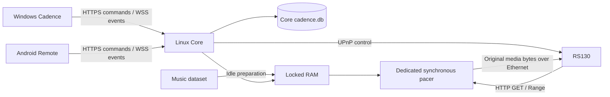

# Optional Linux Cadence Core

Status: approved direction; phased implementation started. Updated: 2026-11-15.

This document consolidates the agreed Linux Core, controller UX, database ownership,
and Curate design. It describes target behavior; only the phase ledger records what
has actually been implemented. DEVELOPER.md remains canonical for current architecture.

## Product contract

Cadence remains a full standalone Windows application. Linux Core is an optional
engine for users with an appropriate Linux host, memory and CPU capacity. Existing
Windows outputs, catalog, Curate and Android-to-Windows control remain supported.
Existing installations default to **This PC** without additional onboarding.

The first Linux audio backend is paced UPnP, qualified against HiFi ROSE RS130.
This restriction applies to the Linux package, not Windows. USB/ALSA output,
multiroom synchronization and Android Curate UI are outside the initial scope.

Goal: remove the controller PC from audio delivery. TrueNAS and RS130 must have a
fully wired route to remove Wi-Fi from that route. Reduced dropouts and improved
delivery consistency require measurement; improved sound or DAC clock jitter is
not an assumed consequence of application pacing.

## Architecture and ownership



| Concern | This PC | Core mode |
| --- | --- | --- |
| Catalog authority | Windows backend | Selected Core backend |
| Database | Existing Windows cadence.db | Persistent Core cadence.db |
| Playback/queue authority | Local backend | Core backend |
| Curate evidence, drafts and approved jobs | Windows database | Core database |
| File mutation | Windows approved commit worker | Core approved commit worker |
| Controller preferences | Local device | Local device |

Never open a common SQLite file from Windows and Linux. Controllers use APIs, not
SQL or NAS access. Core caches on controllers are disposable and scoped by Core and
library identity. Selecting an engine never synchronizes two databases implicitly.
The current local catalog label uses reserved identity `local`; remote adapters
must namespace/validate identities rather than trusting user-controlled labels.

Backend extraction should introduce reusable playback/queue, UPnP, platform and
API boundaries with thin Tauri and headless adapters. Linux must build without
Tauri, WebView, WASAPI, ASIO or unnecessary local-output dependencies. The pacer
remains a dedicated synchronous thread; async execution serves the control plane.

## UX contract

Apply `.agents/rules/ux-design-guideline.md`: prioritize listening, disclose advanced
settings progressively, make consequences visible and retain reversible choices.

1. **Standalone:** install/open Cadence, use its library and outputs, play. Core is
   discoverable in Settings, not a mandatory first-launch decision.
2. **Add Core:** Settings > Playback engine > Connect to Cadence Core. Discover on
   demand or enter an address; pair; check trust/API/library/output/readiness.
3. **Prepare:** configure Core-visible music roots if empty. Pairing and discovery
   do not activate Core, scan automatically or interrupt local playback.
4. **Activate:** show engine name, library and output, then **Use this Core**.
   Cancellation/failure retains the previous session. Commit catalog, queue and
   output view together only after the target snapshot has been validated.
5. **Listen:** show `Playback engine: Music Room Core` and `Audio output: RS130` as
   separate choices. Keep transport/browsing familiar. Advanced resource controls
   stay in Settings/diagnostics. Never claim universal hardware readiness.
6. **Switch:** playing/paused/loading local playback requires **Stop this PC and
   use Core** or **Keep listening here**. A stop must be acknowledged before
   activation. Joining an already-playing Core preserves its queue and session.
7. **Leave Core:** explicitly offer **Keep Core playing and switch** or **Stop
   Core playback and switch**. Restore local context without automatically playing.
8. **Disconnect:** retain selected context and display “Connection lost. Playback
   may still be continuing.” Offer Reconnect/Choose engine. Never auto-fallback or
   replay stale mutations. Reconnect fetches an authoritative snapshot.

Selections are per controller. A Windows switch does not redirect Android. Android
connects directly to either host using existing profiles/discovery/pairing; Windows
does not proxy its connection. Native certificate pinning and browser PWA trust need
separate supported setup paths. Reuse platform controls, keyboard focus and accessible
connection announcements; status must not depend on colour or continuous animation.

Before a local engine claims an RS130 controlled by Core, explicitly coordinate
release/takeover. Merely opening or selecting an engine must not seize a renderer.

## Session and API contract

Core serializes queue/playback mutations. Desktop and mobile must not independently
auto-advance. Use stable queue-entry identities, monotonic revisions and command IDs
with bounded deduplication. Reject stale revisions with a fresh snapshot.

Negotiate protocol version, stable engine/library identities and capabilities before
activation. Use explicit typed operations, not arbitrary Tauri command forwarding.
Track IDs cross the network; server-side resolution supplies platform-specific paths.
Reject traversal, unknown identities, unauthorized operations and oversized payloads.

Separate request generations from the active socket generation so late activation
responses cannot overwrite a newer choice, while source connection events remain
observable during preparation. UI adapters must stage snapshots and respect those
generations; a pure selection model alone cannot enforce network trust or atomic UI
hydration. Activation never implies Play, queue replacement, file access or DB migration.

## Database onboarding and migration

Offer **Start a new library** or **Import existing Cadence library**. Import a
consistent snapshot, not an unsafely copied live WAL database. Preview root mapping
(for example `\\NAS\Music` to `/music`) and missing/ambiguous tracks. Preserve Linux
case semantics and supported identities, playlists and user-authored editorial data.
Retain unsupported historical records without activating jobs. Never replay imported
pending tag writes. Leave the source database untouched and provide a rollback copy.

After import, catalogs are independent. No implicit bidirectional synchronization.
Back up Core state consistently before schema upgrades; block incompatible versions
and restore the matching data snapshot when rolling back an incompatible migration.

## Curate

The Windows workbench remains available for a Core-managed library. Its existing
TypeScript reconciliation/provider workflow can operate through service adapters;
native file-dependent operations must execute at the library owner. Headless provider
orchestration is not required initially. Credentials remain explicitly configured;
database import must not silently copy secrets or enable paid provider activity.

Target workflow:

`Review evidence -> Edit -> Save/stage draft -> Core dry-run -> Human approval ->
Durable approved job -> Idle execution -> Verify -> Publish catalog revision`

Core owns evidence, drafts, approvals, jobs and results. Validate draft revisions,
file identity and current contents server-side; approval is bound to an immutable
change set. An externally changed file or stale draft requires renewed review.
Do not treat frontend checksum flags or simulated preflight results as verification.
Use real backend validation, recovery records and post-write checks.

During playback display cached evidence and permit lightweight manual review;
defer provider enrichment, extraction, fingerprinting and nonessential queries.
Distinguish **Waiting to save** (buffered, not durable), **Draft saved** (durable),
**Approved / Waiting for playback to stop**, **Cooling down**, **Applying**, **Verified**
and failure states. Never label a RAM-only draft saved. Closing a controller does
not lose acknowledged durable jobs. Unfinished desktop provider requests do not
silently become completed Core jobs.

Playback-only deployment mounts music read-only. Curate commits require explicitly
configured writable roots; a read-only library can retain review/drafts and explain
why Apply is unavailable. Core is the designated Cadence writer for registered roots.
Standalone workers must not concurrently edit those locations. Registration/leases
and conflict checks require implementation; old clients and external taggers cannot
be assumed to honor them. Independent databases do not solve shared-file races.

A playback-only preview is an intermediate milestone, not complete Curate parity.
Remote Curate must land before describing Core as equivalent to the full workflow.

## Linux delivery, storage and TrueNAS

Dragonfish 24.04 Apps use Kubernetes. Publish a versioned OCI linux/amd64 image and
a version-specific Custom App recipe; Compose alone is not its deployment solution.
Use one replica and replacement upgrades, persistent application storage, explicit
UID/GID/ACLs, read-only music by default and bounded temporary memory. Avoid host OS
modifications. Proposed host networking simplifies multicast/callback reachability;
verify available settings and capabilities on the actual Dragonfish installation.

Make LAN interface, advertised reachable address and ports explicit. Initial ports:
HTTPS/WSS 4040 and media HTTP 18890. Do not advertise pod/VPN/loopback addresses.
SSDP uses UDP 1900; controller discovery uses mDNS where supported. Fixed listeners
must fail readiness clearly on conflict rather than silently publishing a wrong URL.

Core discovers RS130, persists UDN, inspects service/capability descriptions, sends
SetAVTransportURI/Play and serves RS130-initiated HTTP requests. Qualify actual MIME,
DSF/DFF/PCM support against its firmware and output chain, not generic format claims.
Preserve original bytes, HEAD/Range semantics, metadata probes, seek/retry behavior
and sequential continuation without repeated pre-roll. Use immutable opaque session
URLs and bounded concurrency; late requests must never receive another track.
Media URLs are separate capabilities from controller credentials and expose no paths.

Prefer renderer events for transport state and bounded position reconciliation
with local interpolation. TCP ACKs/HTTP EOF do not establish audible completion.
SetNextAVTransportURI/gapless behavior require device validation. External takeover
must be reported rather than fought by repeated Play commands. On renderer loss,
bound retries and stop delivery. After Core restart reconcile before explicit resume.

Implement Linux pre-fault + mlock with RAII cleanup; account for actual cgroup memory
limits/usage, lock limits, retained buffers and headroom. Fail strict admission if
locking is unavailable. Use monotonic absolute deadlines, affinity and platform TCP
telemetry. Normalize Linux TCP units/availability and SO_SNDBUF accounting rather
than copying Windows values. Keep elevated scheduling opt-in and measured; affinity
alone does not isolate NAS interrupts or services. Avoid global kernel/NIC tuning.

Strict preparation admits a bounded album/queue into locked RAM while eligible idle,
before Loading. No silent windowed-read fallback. Uncached requests stop, await
cooldown and prepare anew unless a separate bounded-I/O policy exception is approved.
Reject over-budget requests with actionable smaller-selection feedback. Core silence
only covers its own operations; scrubs, replication and other NAS clients can still
access physical drives. Prefer separate SSD-backed app data where available.

Existing code differs from written policy: windowed reads and 1 MiB pre-roll exist,
while rules require silence and a 512 KiB maximum. Resolve explicitly in transport
phases; do not silently alter Windows constants during extraction.

## [AUDIOPHILE IMPACT ASSESSMENT]

The user approved the direction and starting phased development on 2026-11-15.
Approval does not authorize library migration, real tag writes or production deployment.

| Area | Requirement and validation |
| --- | --- |
| Disk I/O | Owner-enforced guards during Playing/Paused/Loading/cooldown; pre-admit media; defer Curate; trace file activity with synthetic data before hardware tests. |
| Network/NIC | Wired media route, bounded pre-roll/concurrency; event-driven control and >=5-second heartbeat; packet capture verifies actual wire behavior. |
| Thread/CPU | Synchronous pacer; disjoint background affinity; bounded work; verify release scheduling under NAS load without starving storage. |
| Memory | Pre-fault/lock and reject insufficient admission; no allocations/blocking logs in active delivery; measure page faults and buffer lifecycle. |
| Signal path | Untouched payloads and ground-truth container parsing; no resampling or software attenuation. |

Phase 1 is a pure, unconnected model: no timers, network, disk, worker, React or
audio-path changes. Tier 1 applies. Controller integration requires Tier 2; transport
changes require Tier 3 release-build PCM/DSD validation. Hardware results stay pending
until measured. Renew impact assessment if later implementation changes these policies.

Phase 2 adds unconnected control-plane contracts, injected service adapters and an
in-memory staging coordinator. Production imports do not reference these modules.
Disk and network/NIC impact: none in the running application; tests use in-process
fakes, not library drives or LAN services. Thread/CPU impact: no workers, scheduling
changes, timers or polling. Memory impact: bounded validation/copying in explicit
service calls, with no changes to pinned buffers or active delivery. Tier 1 applies
to this foundation; actual IPC/network/UI bindings still require Tier 2 assessment.

Phase 3 adds the native control-plane session owner (`src-tauri/src/core_session/`)
and capability-gated v1 queue coordination (`queue.control` / `queue.coordinate`).
Desktop startup (`src-tauri/src/lib.rs`) exports the module for acceptance testing
without instantiating it, spawning threads, registering Tauri commands or touching
`AudioEngine`. Disk and network/NIC impact: zero; the owner operates on an in-memory
catalog projection and a synchronous `Renderer` mailbox trait. Thread/CPU impact:
no background workers, timers or audio-thread changes; command/event serialization
uses a control-plane `Mutex` never called from the pacer. Memory impact: bounded
256-entry command receipt ring (`RECENT_COMMAND_LIMIT`), 4096-entry queue cap and
1 MiB message ceiling. Tier 1 validation applies.

Phase 4 adds the Tauri-independent headless runtime (`src-tauri/src/core_runtime/`),
the `cadence-headless` binary (`src-tauri/src/bin/cadence_headless.rs`), and TrueNAS /
Linux platform hygiene primitives (`platform.rs`). User explicitly reviewed and
approved the Phase 4 TrueNAS memory and CPU hygiene impact assessment on 2026-11-15:
- **Disk I/O impact:** `HeadlessCoreRuntime` enforces an explicit idle + 30-second
  post-playback cooldown guard (`activity == Idle && cooldown_elapsed`) before any
  media file admission or SQLite catalog reload. Unadmitted `play` or `queue.replace`
  commands reject with `not_ready` (no on-demand disk read or windowed fallback).
  On Linux/TrueNAS, idle media reads use `O_NOATIME` (with `EPERM` fallback) and
  `POSIX_FADV_DONTNEED` to avoid dirtying ZFS `txg_sync` metadata or duplicating
  page cache alongside locked user-space buffers.
- **Network/NIC impact:** Zero sockets opened in Phase 4. `normalize_linux_setsockopt_sndbuf`
  and `normalize_linux_getsockopt_sndbuf` account for Linux kernel `2x` `sk_sndbuf`
  doubling ahead of Phase 5 UPnP pacing.
- **Thread/CPU impact:** Windows desktop `stream_tuning.rs` and `wasapi_exclusive.rs`
  are untouched. For TrueNAS/Linux containers, `partition_truenas_cpus` derives
  affinity from actual allowed `cpuset.cpus.effective` / `sched_getaffinity` cores
  rather than assuming `0..N-1`, strips IRQ cores `0` and `1` when alternatives
  exist, isolates the highest allowed core for the synchronous pacer, and bounds
  control-plane workers to `1..=2` threads on the remaining cores.
- **Memory impact:** `LockedBytesArena` reconciles container cgroup v2 (`memory.max`,
  `memory.high`, `memory.current`), host `MemAvailable` + reclaimable ZFS ARC
  (`arcstats` `size - c_min`), `CAP_IPC_LOCK` (`CapEff` bit 14) vs `RLIMIT_MEMLOCK`,
  retained locked bytes, and mandatory container headroom before pre-faulting and
  locking (`mlock` / `VirtualLock`). Lock failures immediately free buffers with
  zero pageable fallback, and `Drop` / `shutdown()` deterministically unlock all pages.

Phase 5 adds the Tauri-independent Linux/Core paced UPnP HTTP server and RS130
session coordinator (`src-tauri/src/core_runtime/upnp_session.rs`). User explicitly
reviewed the Phase 5 plan, testing strategy and Audiophile Impact Assessment and
approved implementation on 2026-11-15:
- **Disk I/O impact:** Zero during `Loading`, `Playing`, `Paused` and the 30-second
  cooldown. `UpnpSessionRuntime` serves untouched media bytes and parses 80-byte
  Sony `.dsf` headers (`parse_dsf_header_bytes`) exclusively from pre-faulted,
  page-locked `Arc<Vec<u8>>` slices in `LockedBytesArena`. No windowed-read or
  pageable fallback exists.
- **Network/NIC impact:** Enforces `MAX_CORE_PREROLL_BYTES = 512 KiB` (resolving
  the 512 KiB policy ceiling for Core without altering legacy Windows desktop
  constants), `TCP_NODELAY = true`, and `16..=32 KiB` steady-state `SO_SNDBUF`
  (normalized via `/ 2` on Linux so kernel `2x` `sk_sndbuf` doubling never exceeds
  32 KiB). Sequential `Range` continuations (`start >= 1 MiB`) skip repeated
  pre-roll, concurrent streams are strictly capped (`503 Service Unavailable`),
  and external renderer takeover quarantines without SOAP retry storms.
- **Thread/CPU impact:** Active byte pacing runs on a dedicated synchronous OS
  thread (`cadence-core-pacer`), pinned on Linux/TrueNAS to `CpuPartition::pacer_core`
  via `sched_setaffinity`, sleeping with monotonic absolute deadlines
  (`clock_nanosleep(CLOCK_MONOTONIC, TIMER_ABSTIME)`), and normalizing Linux
  `getsockopt(SOL_TCP, TCP_INFO)` segment counters by `tcpi_snd_mss`.
- **Memory impact:** `LockedBytesArena` shares admitted buffers via `Arc<Vec<u8>>`
  so the underlying locked heap allocation never moves or copies when starting a
  stream. `stream_paced_slice_no_alloc` performs zero heap allocations, locks, or
  string formatting across the active chunk loop (verified by `CountingAllocator`
  in `core_upnp_zero_alloc_test`).

Phase 6 adds TrueNAS SCALE Dragonfish 24.04 packaging and container bootstrap
(`src-tauri/src/core_runtime/dragonfish.rs`, `src-tauri/src/bin/cadence_headless.rs`
CLI modes, and `deploy/truenas-dragonfish/`). User explicitly reviewed the Phase 6
plan and Audiophile Impact Assessment and approved implementation on 2026-11-15:
- **Disk I/O impact:** Zero during `Loading`, `Playing`, `Paused`, and the 30-second
  cooldown. Persistent state initialization (`node-identity.json`, `tls-cert.json`,
  `cadence.db` WAL) and `VACUUM INTO` pre-upgrade backups execute strictly at
  startup/offline CLI boundaries while transport is `Idle`. `/music` defaults to
  `readOnly: true` (`MusicMountReadOnly` guard).
- **Network/NIC impact:** Validates `CADENCE_ADVERTISED_IP` via `validate_advertised_lan_ip`
  (rejecting loopback, unspecified, link-local, multicast, and CGNAT/VPN), fails
  readiness on control (`4040`) or media (`18890`) port conflicts without unadvertised
  fallbacks, and uses `hostNetwork: true` in the Dragonfish Custom App recipe so
  SSDP UDP `1900` and RS130 HTTP `18890` bypass kube-proxy/iptables NAT.
- **Thread/CPU impact:** Windows desktop audio files remain untouched. Container
  packaging preserves Phase 4–5 `cpuset` core isolation (`partition_truenas_cpus`)
  and `cadence-core-pacer` thread pinning.
- **Memory impact:** Enforces `CAP_IPC_LOCK` (`capabilities.add: ["IPC_LOCK"]`),
  non-root `568:568` ACLs, bounded `/tmp` `emptyDir` (`128Mi` `Memory`), and
  startup cgroup/`RLIMIT_MEMLOCK` headroom verification (`DragonfishError::InsufficientLockLimit` /
  `InsufficientMemoryBudget`) before serving readiness.

## Independently testable phases

Each phase has its own acceptance fixture and rollback boundary. Use synthetic files,
temporary databases, fake providers/renderers and local test endpoints first. No paid
queries, production migration or real tag writes are needed for automated gates.
Preserve Windows tests throughout. Do not report a phase complete because a later
phase might prove it; simulator success never substitutes for RS130 qualification.

| Phase | Deliverable and dependency | Independent exit evidence | Rollback |
| --- | --- | --- | --- |
| 0 | Consolidated design and acceptance ledger | Review default Windows, Core, database and Curate journeys | Documentation only |
| 1 | Pure engine-selection model; depends on 0 | Unit tests: local default, guarded switches, explicit leave-playing, failed/stale activation, no disconnect fallback, identity isolation | Remove unused module/tests; no runtime dependency |
| 2 | Versioned Core contracts and local/remote service adapters; depends on 1 | In-process/local fake API: capability/version/trust rejection, typed errors, no remote SQL/paths, snapshot staging and stale response rejection; standalone adapter regression | Local adapter remains default |
| 3 | Backend-authoritative queue and playback coordination; depends on 2 | Fake renderer: concurrent/repeated commands, duplicate tracks, repeat/shuffle, stale revision and exactly-one advancement with no controller | Retain existing runtime until parity gate passes |
| 4 | Tauri-independent headless executable and Linux platform support; depends on 2/3 | Windows regression plus Linux compile/tests; temp DB startup/shutdown; cgroup/lock-limit admission and failure fixtures; no GUI/audio-output dependencies | Desktop package remains separate |
| 5 | Linux paced UPnP and RS130 session serving; depends on 4 | Renderer simulator: exact bodies/ranges, HEAD, probes, disconnects, late requests, seek and cancellation; release timing/allocation tests; RS130 PCM/DSD results separately recorded | Experimental Core backend remains opt-in |
| 6 | Dragonfish packaging; depends on 5 | Clean test install, advertised-address reachability, mounts/ACLs, restart, persisted identity/cert/database, port/memory failures and rollback | Versioned image plus matching state backup |
| 7 | Windows/Android controller UX; depends on 2/3 and testable with fake Core | Live UI QA: add/cancel/fail/connect/switch/reconnect, keyboard status, no auto-local audio, closing both controllers leaves session running; default standalone journey | This PC remains available |
| 8 | Remote Curate, read-only review then approved writing; depends on 2/4/7 | Temp libraries: draft durability/conflicts, immutable approval, duplicate commit, external file change, playback/cooldown gates, restart recovery, payload preservation and root writer exclusion | Disable Core write capability; retain drafts |
| 9 | Snapshot import and catalog mapping; depends on 4/8 | Temp databases: live-WAL-consistent snapshot, case-sensitive mappings, missing roots, identity/playlist/draft retention, no imported job replay, source unchanged, rollback | Keep source DB and restore import backup |
| 10 | Release qualification; depends on 5-9 | Full applicable regression, Windows installer, Android QA and Dragonfish+RS130 release PCM/DSD sessions under load with controller Wi-Fi loss and measured pacing/I/O | Publish only verified combinations; retain prior release |

Phases 6/7 can advance independently after their prerequisites. Phase 8 includes the
shared-root write protocol; it must not be skipped simply because both catalogs open.

## Phase ledger and verification

| Phase | Status | Evidence |
| --- | --- | --- |
| 0 | Recorded | This document; direction approved in chat |
| 1 | Implementation ready for user verification | `src/core/engineSession.ts`; test-first fixtures in `src/test/testEngineSession.ts`; runtime integration intentionally pending |
| 2 | User verified; merge approved | Version 1 contracts; local/remote service adapters; atomic staging coordinator; in-process API acceptance tests; NSIS build passed; runtime bindings remain pending |
| 3 | Implementation ready for user verification | `src-tauri/src/core_session/`; `queue.control` + `queue.coordinate` in `src/core/coreProtocol.ts` and `src/services/engineService.ts`; 24 native + 51 TS tests + TS-to-Rust interop fixture pass; runtime bindings remain pending |
| 4 | Implementation ready for user verification | `src-tauri/src/core_runtime/` + `src-tauri/src/bin/cadence_headless.rs`; Cargo `desktop` feature split (`--no-default-features` excludes Tauri/GUI/local audio); TrueNAS cgroup v2 + `CAP_IPC_LOCK` + `RLIMIT_MEMLOCK` strict admission, 30s cooldown guard, `cpuset` partitioning and Linux `x86_64-unknown-linux-gnu` check pass |
| 5 | Implementation ready for user verification | `src-tauri/src/core_runtime/upnp_session.rs`; opaque per-`RunToken` session URLs, exact `GET`/`Range`/`HEAD`/DSF probes from locked RAM, 512 KiB pre-roll cap, Linux `TCP_INFO`/`SO_SNDBUF`/`clock_nanosleep` pacer, RS130 simulator (`core_upnp_session_test`) and release 0-alloc gate (`core_upnp_zero_alloc_test`) pass; physical RS130 hardware qualification pending |
| 6 | Implementation ready for user verification | `src-tauri/src/core_runtime/dragonfish.rs`, `cadence-headless` (`--dragonfish`, `--healthcheck`, `--backup`, `--restore`, `--validate-dragonfish-recipe`), and `deploy/truenas-dragonfish/` (`Dockerfile`, `custom-app-24.04.yaml`, `docker-compose.yml`); 8/8 tests in `core_dragonfish_packaging_test` and `x86_64-unknown-linux-gnu` check pass; live `docker build` / TrueNAS Dragonfish host deployment pending |
| 7 | Implementation ready for user verification | Windows desktop & Android/Mobile Remote PWA controller UX (`coreControllerTransport.ts`, `EngineControllerContext.tsx`, `PlaybackEnginePanel.tsx`, `EngineSwitchPromptModal.tsx`, `coreRemoteClient.ts`, `TopHeader.tsx`, `DiagnosticsSheet.tsx`, `PairingView.tsx`, and Tauri `core_probe_endpoint`/`core_control_request`/`discover_core_nodes` commands); default `This PC` startup with zero auto-discovery/onboarding, separate `Playback engine` & `Audio output` selectors, RS130 takeover & leave-Core prompts, direct PWA `/v1/core` client + pinning guidance; 61/61 controller/session/protocol unit tests, `CadenceSettingsModal` (4/4), endpoint-routing, queue-sync, Rust `cargo check` + `core_session_test` (24/24), desktop & PWA `tsc -b`, and Vite builds pass; live TrueNAS Dragonfish host + physical RS130 / physical Android APK QA pending user verification |
| 8 | Implementation ready for user verification | `src-tauri/src/core_runtime/curate.rs`, `src-tauri/src/core_runtime/mod.rs` (`curate.draft.save`, `curate.dry_run`, `curate.approve`, `curate.job.status`, `core_writer_leases`), `src/core/remoteCurate.ts`, `src-tauri/tests/core_remote_curate_test.rs` (5/5 pass), and `src/test/testRemoteCurate.ts` (4/4 pass); 65/65 TS unit tests and `core_headless_test` (7/7) pass |
| 9 | Implementation ready for user verification | `src-tauri/src/core_runtime/migration.rs`, `src-tauri/src/bin/cadence_headless.rs` (`--export-snapshot`, `--preview-import`, `--import-snapshot`, `--rollback-import`), `src/core/snapshotImport.ts`, `src-tauri/tests/core_snapshot_import_test.rs` (4/4 pass), and `src/test/testSnapshotImport.ts` (2/2 pass); 67/67 TS unit tests, `core_remote_curate_test` (5/5), and `core_headless_test` (7/7) pass |
| 10 | Implementation ready for user verification (live TrueNAS rebuild/import/RS130 playback QA pending interactive `sudo` shell) | `DragonfishRenderer` (`src-tauri/src/core_runtime/dragonfish.rs`, `upnp_session.rs`, `platform.rs`, `mod.rs`), desktop+PWA cursor pagination (`coreControllerTransport.ts`, `EngineControllerContext.tsx`, `pwa/src/services/coreRemoteClient.ts`), CORS on `:4040`; 64/64 headless Rust + 64/64 desktop `--lib` + `--release` 0-alloc + 69/69 TS + `npm run build` + `npm run tauri:build -- --bundles nsis` (`Cadence Core_0.1.0-2_x64-setup.exe`) pass; live TrueNAS snapshot preview (`1,886/2,585` NAS tracks mapped, `0` unmapped failures, `63` drafts, `1` playlist), `/healthz` + `core.hello`, and SSDP RS130 discovery (`ROSE-67` `uuid:6610f352-d5a1-b8dc-ffff-ffffc0860aa6` at `192.168.1.106`) verified; live TrueNAS container rebuild/import/RS130 listening check staged for user interactive `sudo` execution |

Phase 1 command:

```powershell
node --import tsx --test --experimental-test-coverage --test-coverage-include=src/core/engineSession.ts src/test/testEngineSession.ts
```

RED: missing module failed; additional behavioral fixtures then exposed leave-playing
and source connection generation failures. GREEN: 17 tests passed, with 100% line,
branch and function coverage for this module. This is not whole-application coverage.

Run `npm run build`, targeted endpoint/queue regression and lint for the foundation.
Native changes in later phases require `cargo test --manifest-path src-tauri/Cargo.toml`.
Before release/merge use the repository's installer and explicit user verification gates.
Visual QA starts when a UI is integrated; phase 1 has no user-facing control to click.

### Phase 1 verification record (2026-11-15)

- PASS: 17 engine-session tests; module coverage 100% lines/branches/functions.
- PASS: existing endpoint routing regression and all eight remote queue scenarios.
- PASS: `npx tsc -b`; isolated module/test typecheck using TypeScript 6 `--ignoreConfig`.
- PASS: targeted oxlint for the new module and tests; scoped diff whitespace check.
- PASS: desktop Vite production build and PWA `tsc -b`/Vite build. Outputs redirected
  to unique temporary folders to preserve pre-existing embedded PWA changes. Desktop
  build reported chunk-size and mixed static/dynamic import warnings.
- NOT RUN: native tests/installer, UI QA, Linux/Dragonfish/RS130 validation. No native
  or UI integration was changed; those checks belong to the later phase exits.
- Existing uncommitted WASAPI, desktop, Android and media assets were left in place;
  only this phase's named files belong to its checkpoint commits.

### Phase 1 self-review

Overall 4.0/5; deliver phase 1 for user verification, not as a working Linux engine.

| Axis | Score | Evidence and next improvement |
| --- | --- | --- |
| Accuracy | 4/5 | Tests/typechecks/builds pass; target hardware claims remain explicitly unverified. Validate on Linux in phase 4. |
| Completeness | 4/5 | All agreed topics and phase exits recorded; runtime adapters are deliberately phase 2 work. |
| Clarity | 4/5 | Implementation ledger distinguishes target design from existing behavior; long design benefits from phase-by-phase review. |
| Actionability | 4/5 | Reproducible phase 1 command and independent phase gates provided; later exact commands depend on fixtures not yet built. |
| Conciseness | 4/5 | One consolidated design replaces fragmented chat; deployment details will need version-specific refinement. |

Priority improvements: implement adapter integration tests, then verify Linux memory
and timing behavior. Would the user agree? Expected yes if judged as the requested
start of phased development; end-to-end Core capability is not yet delivered.

### Phase 2 contract and integration boundary

`src/core/coreProtocol.ts` is the executable v1 contract. Requests carry protocol,
engine and library identities. Allowed operations are `core.hello`,
`session.snapshot`, `catalog.page`, `playback.control` and `queue.replace`.
Mutations carry a caller-supplied command ID and expected session revision; the
adapter never generates replacement IDs, retries mutations or claims server-side
deduplication. Serialization, deduplication and exactly-one advancement are phase 3.
Play carries a track ID; seek carries seconds. There is no raw IPC/SQL/path operation.

Negotiation requires matching stable identities, protocol 1, readiness and
`catalog.read`, `session.read`, `playback.control`, `queue.write` capabilities.
Future well-formed capabilities are tolerated. Remote identities cannot use reserved
`local` IDs. Identifiers/cursors are 1-128 ASCII alphanumeric/base64url-style tokens
starting with an alphanumeric character; backend bindings must map legacy paths,
UDNs or other identifiers to opaque IDs rather than expose those strings directly.
Cache scope includes engine kind, engine ID and library ID, never display labels.

Messages are capped at 1 MiB UTF-8 JSON, catalog pages at 200 tracks, queue entries
at 4096 and display text at 1024 characters. Queue-entry IDs are unique; repeated
track IDs are permitted. Snapshots contain a bounded initial catalog page and its
cursor, queue, playback and output together. Later catalog pages are revisioned;
future consumers must restart pagination on a catalog revision change. Unknown
fields, paths in identifier fields, invalid numbers and mixed identities reject.
Typed errors use safe local messages. A stale-revision error must include a fresh,
identity-validated snapshot; the caller reviews it before another mutation.

The local adapter takes a `LocalEngineOwner` in-process port. The remote adapter
takes an `AuthenticatedCoreChannel`; it verifies the peer before negotiation and
each public operation. This port must use a verified, authorized peer-bound channel,
reject redirects/peer changes, bound lifetimes and cap bytes before buffering.
The adapter's object-size check does not replace a wire-level receive limit. There
is deliberately no permissive fetch default or trust flag accepted from hello JSON.
Native certificate pinning, browser trust setup, endpoints and pairing remain later
platform/controller integration work. Existing Tauri APIs are not presented as a
coherent Core snapshot before backend authority exists.

`engineServiceController.ts` keeps This PC selected initially without I/O, prepares
the target view, then commits selection/catalog/queue/output as one value. It rejects
late activation/refresh responses and older revisions. Active source connection
events remain observable during preparation. A socket-open event never marks a
disconnected view ready; explicit reconnect refresh renegotiates version, capabilities,
readiness and trust before obtaining a fresh snapshot. Connection callbacks capture
the committed view's `connectionGeneration` when attached and supply it alongside
the active engine epoch. Each activation/reconnect gets a new connection generation;
an old socket close cannot disconnect its replacement. Selection, snapshot-request
and connection generations are distinct.
Source activity must come from its owner; stopping is acknowledged outside this
coordinator. Activation issues no playback or queue command. UI consumers must bind
to the single committed view in phase 7; independent React store hydration is not
made atomic merely by these tests.

### Phase 2 TDD and verification record (2026-11-15)

Source: phase 2 in the independently testable phase table above. User journeys:
use This PC without Core configuration; safely prepare a compatible trusted Core;
retain the previous view on failure/cancellation; reconnect without fallback or replay.

RED checkpoint `c11f72f`: `node --import tsx --test src/test/testCoreServices.ts`
failed with `ERR_MODULE_NOT_FOUND` for the not-yet-implemented `coreProtocol` module.
GREEN checkpoint `0d980ed`: the same fixture passed 30 tests after implementation;
strict isolated typechecking also passed. During development the fixture exposed
the socket-open assertion conflict; it now requires authoritative snapshot refresh.
QA then reproduced cached negotiation across reconnect and stale socket-close events.
RED checkpoint `0435ab9` added the two failing regressions (30 pass / 2 fail).
GREEN checkpoint `77ef113` passed all 32 tests after reconnect renegotiation and
separate connection generations were added; strict isolated typechecking passed.

| Guarantee | Acceptance fixture in `src/test/testCoreServices.ts` | Type / result |
| --- | --- | --- |
| Default standalone adapter does no implicit work and uses its local owner | Construction, local projection and local mutation cases | In-process integration / PASS |
| Reject untrusted/revoked peers, version/capability/readiness and identity mismatch | Negotiation and trust cases | In-process integration / PASS |
| Reject raw IPC/SQL/paths, oversized or malformed payloads; preserve duplicate tracks | Request, snapshot and envelope cases | Unit + integration / PASS |
| Preserve command IDs/revision preconditions; no replay after lost acknowledgement | Mutation forwarding and lost-acknowledgement cases | In-process integration / PASS |
| Stage a complete target view without transport mutation; retain old view on failure | Activation, stop-choice, cancellation and mixed-library cases | Controller integration / PASS |
| Reject late success/failure and older revisions; renegotiate reconnect and ignore old socket events | Activation, refresh race/disconnect and reconnect QA regressions | Controller integration / PASS |

Reproduce acceptance with `npm run test:core-services`. Coverage command:

```powershell
node --import tsx --test --experimental-test-coverage --test-coverage-include=src/core/coreProtocol.ts --test-coverage-include=src/services/engineService.ts --test-coverage-include=src/services/engineServiceController.ts src/test/testCoreServices.ts
```

- PASS: 32 adapter/contract tests; 99.79% lines, 96.99% branches and 100% functions across
  the three new modules. This is scoped module coverage, not application coverage.
- PASS: combined phase 1/2 fixture (49 tests), existing endpoint regression and all
  eight remote queue scenarios.
- PASS: repository-required QA Agent review/re-review; both reconnect findings were
  reproduced, fixed and verified with `npm run test:core-services` (32 tests).
- PASS: desktop `npx tsc -b`, strict isolated test/module typecheck and targeted oxlint.
  Repository `npm run lint` completed with warnings outside these new files.
- PASS: desktop Vite production build and PWA typecheck/Vite build. Both Vite output
  paths were unique temporary directories to preserve modified embedded PWA assets.
  Desktop emitted chunk-size and mixed static/dynamic import warnings.
- NOT RUN at implementation checkpoint: native tests/installer, UI QA, real trust transport, Linux/Dragonfish/RS130
  validation. No native or UI code changed. The existing Curate click agent has no
  Phase 2 controls to click; the in-process fixture supplies this phase's QA surface.

No migration, library-file reads/writes, paid provider requests or deployment occurred.
Unrelated Android, embedded PWA and media changes were retained. Rollback removes the
unconnected Phase 2 modules/tests and script; existing standalone startup remains.

### Phase 2 self-review

Using the agent-self-evaluation skill: overall 4.0/5; ready for user verification.

| Axis | Score | Evidence and next improvement |
| --- | --- | --- |
| Accuracy | 4/5 | Fake-channel tests/typechecks/builds pass; actual authenticated transport remains unverified. Qualify each platform trust binding before runtime integration. |
| Completeness | 4/5 | All Phase 2 fake-API acceptance topics are covered; backend ports and UI remain deliberately unconnected. Bind against authoritative state in phases 3/7. |
| Clarity | 4/5 | Contract bounds, ownership and runtime limits are explicit; executable TS shapes still need a server interoperability fixture when Rust lands. |
| Actionability | 4/5 | One npm command reproduces acceptance and QA has concrete reconnect regressions; live controls become testable in phase 7. |
| Conciseness | 4/5 | Implementation uses three focused modules and one fixture; the consolidated evidence increases the design length. Keep later deployment instructions separate. |

Priority improvements: validate a real peer-bound transport and cross-language v1
fixtures when their phases land. Would the user agree? Expected yes for the requested
Phase 2 service foundation; no working Linux engine or changed UI is claimed.

### Phase 2 user review and installer gate

- User confirmed the review with "looks good" and then explicitly approved merging
  the Phase 2 branch and pushing to `main` under `.agents/rules/Git.md`.
- PASS: `npm run tauri:build -- --bundles nsis` on the Phase 2 branch at `258c957`,
  in an isolated checkout with shared installed dependencies and Cargo target cache.
  The configured `npm run build` hook passed, including PWA and desktop builds.
- Installer: `src-tauri/target/release/bundle/nsis/Cadence Core_0.1.0-2_x64-setup.exe`.
  Native compilation emitted an existing unused `WasapiPreloadError` import warning;
  the desktop build retained its mixed-import and chunk-size warnings.
- Original uncommitted Android, embedded PWA and media changes were preserved.
  No application was launched, installed or deployed. Native tests, runtime trust
  and hardware qualifications remain unverified.

### Phase 3 session authority and queue coordination contract

`src-tauri/src/core_session/` implements the authoritative native session and queue
coordinator (`SessionOwner<R: Renderer>`), paired with `queue.control` (`next`,
`previous`, `jump` by `entryId`, `modes` for `repeat` and `shuffle`) and the
`queue.coordinate` capability in `src/core/coreProtocol.ts` and
`src/services/engineService.ts`.

- **Single serialized authority:** commands and qualified renderer events (`Started`,
  `Completed`, `Failed`, `ExternalTakeover`) serialize through the owner's session
  mutex. Controllers never auto-advance; renderer completion advances the queue
  exactly once with zero connected controllers.
- **Run-token correlation:** every `Play`, repeat restart, `Seek` and `Resume`
  mints a fresh `RunToken`. `Pause` retains the active token so paused renderer
  loss or external takeover still quarantines readiness, while `Completed` events
  remain ignored unless activity is `Playing`. Late or duplicate events for older
  tokens are ignored without bumping revisions or issuing renderer actions.
- **Bounded deduplication and quarantine:** a 256-entry (`RECENT_COMMAND_LIMIT`)
  receipt ring deduplicates retries by `commandId` and SHA-256 canonical payload
  fingerprint, returning the current snapshot without replaying renderer actions.
  Reusing a `commandId` with altered parameters rejects with `invalid_payload`.
  Even no-op mutations increment `revision` so evicted commands fail as
  `stale_revision`. Uncertain renderer submission errors, `Failed` events and
  `ExternalTakeover` quarantine the session (`ready = false`, `run = None`) until
  an explicit `Stop` is acknowledged.

### Phase 3 TDD and verification record (2026-11-15)

Source: phase 3 in the independently testable phase table above. User journeys:
advance duplicate tracks and repeat/shuffle deterministically at the owner with no
controller connected; serialize concurrent controller commands and renderer events
without duplicate playback; reject stale revisions with a fresh snapshot; quarantine
renderer loss or takeover without retry storms.

- RED checkpoint `0cf8328`: `cargo test --manifest-path src-tauri/Cargo.toml --test core_session_test`
  failed with `E0432` (`unresolved import cadence_core_lib::core_session`), and
  `node --import tsx --test src/test/testCoreSessionProtocol.ts` failed both
  `queue.control` protocol and capability-gating tests.
- GREEN checkpoint `a48582d`: 22 native acceptance tests in `core_session_test`
  and all 51 Phase 1–3 TypeScript tests passed.
- QA RED checkpoint `72c0211`: added `paused_renderer_loss_and_takeover_remain_correlated_including_after_seek`,
  reproducing a gap where `Pause` cleared `run` and `Seek` while paused did not
  refresh it (22 pass / 1 fail).
- QA GREEN checkpoint `0ed5730` + interop fixture `cfb944b`: retained `run` across
  `Pause`, refreshed `run` on paused `Seek`, and added
  `cross_language_typescript_adapter_interoperates_with_rust_owner` spawning the
  real TypeScript `createRemoteEngineService` against the Rust `SessionOwner` over
  stdio (24/24 native tests pass).

| Guarantee | Acceptance fixture | Type / result |
| --- | --- | --- |
| Observation and construction never claim or trigger a renderer | `core_session_test.rs:construction_and_observation_never_claim_or_play_a_renderer` | Native integration / PASS |
| Duplicate tracks advance once with no controller; late/duplicate completions are ignored | `core_session_test.rs:duplicate_tracks_advance_once_without_any_controller`, `concurrent_completion_notifications_only_advance_one_entry`, `late_completion_is_ignored_after_stop_pause_seek_and_resume` | Native integration / PASS |
| Concurrent duplicate commands execute once; distinct concurrent commands reject loser with fresh snapshot | `core_session_test.rs:concurrent_duplicate_commands_have_one_renderer_effect`, `concurrent_distinct_commands_reject_the_stale_loser_with_a_fresh_snapshot` | Multi-thread integration / PASS |
| Bounded 256-command deduplication, payload fingerprint check and lost-ACK retry safety | `core_session_test.rs:command_id_reuse_with_changed_content_is_rejected_before_effects`, `deduplication_is_bounded_and_evicted_success_cannot_replay`, `retry_after_lost_ack_returns_current_state_without_replaying` | Native integration / PASS |
| Repeat (`off`/`one`/`all`), cycle-complete shuffle, entry-ID jump and play-order previous | `core_session_test.rs:repeat_*`, `shuffle_visits_each_entry_once_*`, `jump_targets_duplicate_entry_*` | Native integration / PASS |
| Renderer failure, loss and external takeover (playing or paused/seeked) quarantine until Stop ACK | `core_session_test.rs:renderer_failure_is_quarantined_*`, `renderer_loss_or_external_takeover_*`, `paused_renderer_loss_and_takeover_*` | Native + QA regression / PASS |
| TypeScript `queue.control` validation, `queue.coordinate` capability gate and Rust owner wire interop | `testCoreSessionProtocol.ts` + `core_session_test.rs:cross_language_typescript_adapter_interoperates_with_rust_owner` | Unit + cross-language integration / PASS |

Reproduce Phase 3 verification with:

```powershell
cargo test --manifest-path src-tauri/Cargo.toml --test core_session_test
npm run test:core-session-protocol
```

- PASS: 24 native tests in `core_session_test` (including TS-to-Rust stdio interop)
  and 10 existing native tests in `remote_queue_test`.
- PASS: 51 TypeScript tests across `testEngineSession.ts`, `testCoreServices.ts` and
  `testCoreSessionProtocol.ts`; scoped coverage across `engineSession.ts`,
  `coreProtocol.ts`, `engineService.ts` and `engineServiceController.ts` is 99.83%
  lines, 97.52% branches and 100% functions.
- PASS: existing endpoint routing regression (`npm run test:endpoint-routing`),
  remote queue sync suite (`npm run test:queue-sync`), `npx tsc -b`, PWA `tsc -b`,
  targeted `oxlint` (0 warnings, 0 errors), and isolated temporary-directory Vite
  production builds for both PWA and desktop.
- NOT RUN at implementation checkpoint: NSIS installer build (gated before `main`
  merge per `.agents/rules/Git.md`), live UI click QA (Phase 3 is an unbound
  backend/protocol module with no UI controls yet; wired in Phase 7), and Linux /
  Dragonfish / RS130 hardware tests (Phases 4–6 and 10).

### Phase 3 self-review

Using the agent-self-evaluation skill: overall 4.2/5; ready for user verification.

| Axis | Score | Evidence and next improvement |
| --- | --- | --- |
| Accuracy | 4/5 | 24 native tests, 51 TS tests and cross-language stdio interop pass; real UPnP renderer event correlation remains Phase 5 work. |
| Completeness | 4/5 | Covers concurrent commands/completions, duplicate tracks, repeat/shuffle, stale revisions, bounded deduplication, paused takeover and TS-Rust interop; runtime binding is deferred to Phases 4/7 by design. |
| Clarity | 4/5 | `RunToken` and `Renderer` mailbox contracts state threading and non-reentrancy rules clearly; Phase 4/5 will document concrete UPnP event mapping. |
| Actionability | 5/5 | Exact Cargo and npm commands reproduce all native, TS and cross-language fixtures immediately without external services. |
| Conciseness | 4/5 | Owner and parser fit in two focused Rust files (~565 lines total) plus 19 TS lines; design ledger remains compact. |

Priority improvements: bind `SessionOwner` into the Tauri-independent headless runner
in Phase 4 and map qualified UPnP AVTransport state transitions onto `RunToken` in
Phase 5. Would the user agree? Expected yes for the Phase 3 fake-renderer authority
milestone.

### Phase 4 headless executable and TrueNAS / Linux platform contract

`src-tauri/src/core_runtime/` (`mod.rs` and `platform.rs`) and
`src-tauri/src/bin/cadence_headless.rs` provide the Tauri-independent headless
executable and TrueNAS/Linux platform foundation:

- **Feature-gated desktop boundary:** `src-tauri/Cargo.toml` and `src-tauri/build.rs`
  gate `tauri`, `tauri-build`, `tauri-plugin-*`, `cpal`, `rodio`, `symphonia`,
  `lofty` and Windows desktop crates behind the default `desktop` feature. Building
  with `--no-default-features` (on Windows or `--target x86_64-unknown-linux-gnu`)
  compiles only `chrono`, `libc`/`windows-sys`, `parking_lot`, `rusqlite`, `serde`,
  `serde_json`, `sha2` and `uuid`.
- **Temp SQLite startup, opaque catalog projection and deterministic shutdown:**
  `HeadlessCoreRuntime` initializes SQLite in `WAL` mode (`synchronous = NORMAL`,
  `foreign_keys = ON`, `busy_timeout = 5000`), projects online tracks into
  `SessionOwner` with opaque v1 token IDs (deterministically hashing any legacy
  file-path IDs so paths never cross the wire), and closes/checkpoints the database
  and unlocks all pinned RAM buffers on `shutdown()`.
- **TrueNAS cgroup v2, ZFS ARC and `CAP_IPC_LOCK` strict admission:**
  `LockedBytesArena` reconciles container cgroup v2 (`memory.max`, `memory.high`,
  `memory.current`), host `MemAvailable` plus reclaimable ZFS ARC (`size - c_min`),
  `CAP_IPC_LOCK` (`CapEff` bit 14) vs `RLIMIT_MEMLOCK`, retained locked bytes and
  mandatory container headroom (`DEFAULT_CONTAINER_HEADROOM_BYTES = 64 MiB`).
  Over-budget selections fail with `AdmissionError::OverBudget` and smaller-selection
  guidance; unprivileged containers lacking `CAP_IPC_LOCK` with a low `RLIMIT_MEMLOCK`
  fail with `AdmissionError::LockLimitTooLow` and TrueNAS configuration guidance;
  `mlock`/`VirtualLock` failures immediately free buffers and return
  `AdmissionError::LockUnavailable` without pageable or windowed-read fallback.
- **Storage-bus silence and 30-second cooldown:** `admit_tracks` and `reload_catalog`
  require `activity == "idle"` and `elapsed >= COOLDOWN_DURATION (30s)` after any
  stop or queue completion. Unadmitted `play` or `queue.replace` requests reject with
  `not_ready`, and `SharedRenderer` refuses `RendererAction::Play` for any track ID
  not currently pinned in the arena.
- **TrueNAS `cpuset` partitioning and Linux `SO_SNDBUF` normalization:**
  `partition_truenas_cpus` respects container `cpuset.cpus.effective` /
  `sched_getaffinity` rather than assuming `0..N-1`, strips IRQ cores `0` and `1`
  when alternatives exist, isolates the highest allowed core for the pacer, and
  caps control-plane worker threads to `1..=2`. `normalize_linux_setsockopt_sndbuf`
  and `normalize_linux_getsockopt_sndbuf` account for Linux kernel `2x` `sk_sndbuf`
  doubling.

### Phase 4 TDD and verification record (2026-11-15)

Source: phase 4 in the independently testable phase table above. User journeys:
start and cleanly shut down the headless Core executable against a temporary SQLite
database without GUI or local-output dependencies; enforce TrueNAS container cgroup
and lock limits with actionable diagnostics; preserve storage-bus silence during
playback and the 30-second post-playback cooldown.

- RED checkpoint `a2feae4`: `cargo test --manifest-path src-tauri/Cargo.toml --test core_headless_test`
  failed with `E0432` (`unresolved import cadence_core_lib::core_runtime`) and missing
  `CARGO_BIN_EXE_cadence-headless`.
- GREEN checkpoint `2622e39`: all 7 acceptance tests in `core_headless_test` passed
  under both default desktop features and `--no-default-features --features bundled-sqlite`,
  and `cargo check --target x86_64-unknown-linux-gnu --no-default-features` passed
  with 0 errors and 0 warnings.

| Guarantee | Acceptance fixture | Type / result |
| --- | --- | --- |
| Temp SQLite WAL startup, path-free catalog projection, v1 session execution and clean handle-free shutdown | `core_headless_test.rs:temp_db_startup_projects_catalog_runs_v1_protocol_and_shuts_down_cleanly` | Native integration / PASS |
| TrueNAS cgroup v2 (`memory.max`/`memory.high`/`memory.current`), ZFS ARC and `CAP_IPC_LOCK` vs `RLIMIT_MEMLOCK` admission | `core_headless_test.rs:truenas_cgroup_v2_and_cap_ipc_lock_admission_enforces_container_limits` | Unit + integration / PASS |
| Over-budget and `mlock`/`VirtualLock` failure rejection with zero pageable/windowed fallback and RAII unlock | `core_headless_test.rs:strict_admission_rejects_over_budget_and_lock_failures_without_windowed_or_pageable_fallback` | Native integration / PASS |
| Storage-bus silence during `Loading`/`Playing`/`Paused` and 30-second post-stop cooldown; unadmitted play/queue rejection | `core_headless_test.rs:storage_bus_silence_blocks_admission_and_db_reload_during_playback_and_30s_cooldown` | Native integration / PASS |
| TrueNAS `cpuset` core isolation (pacer vs bounded 1-2 thread control plane) and Linux `2x` `SO_SNDBUF` normalization | `core_headless_test.rs:truenas_cpuset_affinity_and_linux_sndbuf_normalization_preserve_core_isolation` | Unit / PASS |
| Standalone `cadence-headless` binary stdio execution and Linux headless dependency-tree exclusion gate | `core_headless_test.rs:headless_executable_runs_stdio_session_without_gui_or_audio_output_dependencies`, `headless_dependency_tree_excludes_gui_and_local_audio_crates` | Process + dependency integration / PASS |

Reproduce Phase 4 verification with:

```powershell
cargo test --manifest-path src-tauri/Cargo.toml --no-default-features --features bundled-sqlite --test core_headless_test --test core_session_test
cargo test --manifest-path src-tauri/Cargo.toml --test core_headless_test --test core_session_test --test remote_queue_test
$env:SQLITE3_LIB_DIR=(Resolve-Path src-tauri).Path; cargo check --manifest-path src-tauri/Cargo.toml --target x86_64-unknown-linux-gnu --no-default-features --bins --lib --test core_headless_test --test core_session_test --test diagnostics_stress_test
```

- PASS: 7/7 tests in `core_headless_test`, 24/24 in `core_session_test` and 10/10 in
  `remote_queue_test` on Windows (both `--no-default-features --features bundled-sqlite`
  and default `desktop` features).
- PASS: `x86_64-unknown-linux-gnu` target check for `cadence_core_lib`,
  `cadence-headless` binary, `core_headless_test`, `core_session_test` and
  `diagnostics_stress_test` with zero GUI/Tauri/local-audio crates in `cargo tree`.
- PASS: Phase 1–3 TypeScript suites (`testCoreSessionProtocol.ts`,
  `testEndpointRouting.ts`, `testRemoteQueueSync.ts`), desktop `npx tsc -b` and PWA
  `npx --prefix pwa tsc -b`.
- NOT RUN at implementation checkpoint: NSIS installer build (gated before `main`
  merge per `.agents/rules/Git.md`), live TrueNAS Dragonfish container deployment
  (Phase 6) and physical RS130 UPnP streaming (Phase 5).

### Phase 4 self-review

Using the agent-self-evaluation skill: overall 4.3/5; ready for user verification.

| Axis | Score | Evidence and next improvement |
| --- | --- | --- |
| Accuracy | 4/5 | Headless binary, Windows tests and `x86_64-unknown-linux-gnu` target checks pass; live Linux kernel `mlock`/cgroup execution in a TrueNAS container remains Phase 6 verification. |
| Completeness | 4/5 | Covers Cargo feature split, `cadence-headless` binary, temp DB startup/shutdown, TrueNAS cgroup v2/`CAP_IPC_LOCK`/`RLIMIT_MEMLOCK` admission, 30s cooldown and `cpuset` partitioning; HTTP/UPnP serving is Phase 5. |
| Clarity | 5/5 | TrueNAS ZFS ARC, `CAP_IPC_LOCK` and `cpuset` pitfalls and remedies are documented and enforced by explicit error variants. |
| Actionability | 5/5 | Reproducible Cargo commands verify both headless/desktop test suites and the `x86_64-unknown-linux-gnu` target check locally. |
| Conciseness | 4/5 | `core_runtime` and `cadence_headless` stay compact and leave Windows desktop audio files untouched. |

Priority improvements: wire the Linux paced UPnP HTTP server and RS130 session
handler onto `HeadlessCoreRuntime` and `LockedBytesArena` in Phase 5. Would the user
agree? Expected yes for the Phase 4 headless runtime and TrueNAS hygiene milestone.

### Phase 5 Linux paced UPnP and RS130 session serving contract

`src-tauri/src/core_runtime/upnp_session.rs` implements the Tauri-independent
Linux/Core paced UPnP HTTP media server (`CoreMediaServer`), synchronous pacer
(`CorePacer` + `stream_paced_slice_no_alloc`), RS130 description qualifier
(`inspect_rs130_description`), and session coordinator (`UpnpSessionRuntime`):

- **Opaque per-`RunToken` session capabilities and bounded concurrency:** every
  `Play` mints a fresh `/media/cap_<uuid>.<ext>` capability path bound to the
  active `RunToken` and the pre-admitted `Arc<Vec<u8>>` buffer in
  `LockedBytesArena`. Media URLs expose no filesystem paths or track IDs. When a
  track advances, seeks, or stops, the previous session is marked `cancelled` and
  replaced immediately so late requests return `404 Not Found` and never serve
  another track's bytes. Excess concurrent connections beyond
  `max_concurrent_streams` return `503 Service Unavailable`.
- **Bit-perfect byte serving, `HEAD`/`Range` semantics and ground-truth DSF parsing:**
  `parse_dsf_header_bytes` parses the 80-byte Sony `.dsf` container header (`DSD ` +
  `fmt `) directly from locked RAM (zero disk reads during playback) to recover the
  1-bit sample clock, channel count, ground-truth duration, bitrate, and ID3v2
  `metadata_offset`. `CoreMediaServer` serves untouched bytes for full `GET`
  (`200 OK`), partial `Range` (`206 Partial Content` for `a-b`, `a-`, `-suffix`),
  `416 Range Not Satisfiable`, `HEAD` (headers only, 0 body bytes), and `405 Method
  Not Allowed`. DSF/tail metadata probes (`start >= metadata_offset`) stream unpaced
  without advancing `audio_connections` or consuming pre-roll.
- **512 KiB pre-roll cap, sequential continuation and Linux pacer normalization:**
  enforces `MAX_CORE_PREROLL_BYTES = 512 KiB` and `16..=32 KiB` steady-state
  `SO_SNDBUF` (normalized via `/ 2` on Linux so kernel `2x` `sk_sndbuf` doubling
  never exceeds 32 KiB). Sequential `Range` continuations (`start >= 1 MiB`) skip
  repeated pre-roll (`preroll_chunks == 0`) and enter steady `1.000x` cruise on
  contiguous reconnects. On Linux, `cadence-core-pacer` binds to
  `CpuPartition::pacer_core` via `sched_setaffinity`, sleeps via
  `clock_nanosleep(CLOCK_MONOTONIC, TIMER_ABSTIME)`, and normalizes kernel
  `getsockopt(SOL_TCP, TCP_INFO)` segment counters by `tcpi_snd_mss`.
- **RS130 qualification and AVTransport reconciliation:** `inspect_rs130_description`
  verifies `AVTransport` support, persisted UDN identity, and PCM/DSF/DFF capability
  support; `validate_advertised_lan_ip` rejects loopback (in production),
  unspecified, link-local, multicast, and CGNAT/Tailscale/VPN (`100.64.0.0/10`)
  addresses; fixed port conflicts fail readiness immediately. `reconcile_renderer`
  never infers completion from HTTP EOF alone—only renderer `STOPPED` on the active
  session URI after `last_audio_end_offset >= audio_payload_end` emits
  `RendererEvent::Completed(RunToken)`. External URI changes emit
  `RendererEvent::ExternalTakeover(RunToken)` without fighting via repeated `Play`,
  and `reconcile_after_restart` inspects renderer state without seizing the device.

### Phase 5 TDD and verification record (2026-11-15)

Source: phase 5 in the independently testable phase table above. User journeys:
serve untouched PCM and DSF streams from locked RAM over opaque session URLs with
zero playback disk I/O; handle `HEAD`, `Range`, DSF metadata probes, seek
continuations, late requests, disconnects, and mid-stream cancellation; reconcile
RS130 AVTransport states accurately; verify zero heap allocations in the active
pacing loop.

- RED checkpoint `9d03936`: `cargo test --manifest-path src-tauri/Cargo.toml --no-default-features --features bundled-sqlite --test core_upnp_session_test --test core_upnp_zero_alloc_test`
  failed with `E0432` (`unresolved import cadence_core_lib::core_runtime::upnp_session`).
- GREEN checkpoint `ed8ef40`: all 5 simulator integration tests in
  `core_upnp_session_test` and both zero-allocation / adaptive-timing tests in
  `core_upnp_zero_alloc_test` passed in debug and `--release` modes, and
  `cargo check --target x86_64-unknown-linux-gnu --no-default-features` passed with
  0 errors and 0 warnings.

| Guarantee | Acceptance fixture | Type / result |
| --- | --- | --- |
| RS130 description/UDN qualification, advertised LAN IP validation (no VPN/loopback) and port-conflict readiness failure | `core_upnp_session_test.rs:rs130_description_qualification_lan_validation_and_port_conflict_readiness` | Unit + loopback integration / PASS |
| Exact `GET`/`Range`/`HEAD`/416/405 semantics, ground-truth 80-byte DSF header parsing from locked RAM, unpaced DSF metadata probes, and zero disk I/O after deleting files post-admission | `core_upnp_session_test.rs:renderer_simulator_serves_exact_bodies_ranges_head_dsf_probes_and_zero_disk_io` | Renderer simulator integration / PASS |
| 512 KiB pre-roll cap, sequential `Range` continuation (`>= 1 MiB`) without repeated pre-roll, `Seek` (`REL_TIME`), and late/superseded `RunToken` rejection (`404`) | `core_upnp_session_test.rs:sequential_range_continuation_seek_late_token_rejection_and_stop_cancellation` | Renderer simulator integration / PASS |
| Bounded concurrency (`503 Service Unavailable`), client disconnect recovery, HTTP EOF != audible completion, qualified `STOPPED` queue advance, external takeover quarantine, and post-restart probe | `core_upnp_session_test.rs:bounded_concurrency_disconnects_and_qualified_avtransport_reconciliation` | Renderer simulator integration / PASS |
| Mid-stream `Stop` cancellation of in-flight paced delivery and bounded 3-strike SOAP failure quarantine (`RendererFailed`) | `core_upnp_session_test.rs:mid_stream_stop_cancellation_and_bounded_retry_renderer_loss_quarantine` | Renderer simulator integration / PASS |
| Zero heap allocations (`ALLOC_CALLS == 0`, `ALLOC_BYTES == 0`) in active chunk loop and Linux `TCP_INFO` / `0.995x` receiver backpressure timing in `--release` mode | `core_upnp_zero_alloc_test.rs:active_paced_streaming_loop_performs_zero_heap_allocations`, `linux_tcp_info_normalization_and_adaptive_backpressure_timing` | Release allocator + timing gate / PASS |

Reproduce Phase 5 verification with:

```powershell
cargo test --manifest-path src-tauri/Cargo.toml --no-default-features --features bundled-sqlite --test core_upnp_session_test --test core_upnp_zero_alloc_test --test core_headless_test --test core_session_test
cargo test --manifest-path src-tauri/Cargo.toml --release --no-default-features --features bundled-sqlite --test core_upnp_zero_alloc_test
$env:SQLITE3_LIB_DIR=(Resolve-Path src-tauri).Path; cargo check --manifest-path src-tauri/Cargo.toml --target x86_64-unknown-linux-gnu --no-default-features --bins --lib --test core_upnp_session_test --test core_upnp_zero_alloc_test --test core_headless_test --test core_session_test --test diagnostics_stress_test
```

- PASS: 5/5 tests in `core_upnp_session_test`, 2/2 in `core_upnp_zero_alloc_test`
  (both debug and `--release`), 7/7 in `core_headless_test`, 24/24 in
  `core_session_test`, 1/1 in `debug_off_zero_alloc` and 10/10 in
  `remote_queue_test`.
- PASS: `x86_64-unknown-linux-gnu` headless target check across library, binary and
  all Phase 3–5 test targets with 0 errors and 0 warnings.
- PENDING HARDWARE QUALIFICATION: Physical HiFi ROSE RS130 PCM/DSD hardware
  streaming sessions over wired TrueNAS Dragonfish Ethernet remain separately
  recorded as pending until Phase 6 container deployment and Phase 10 live hardware
  qualification.

### Phase 5 self-review

Using the agent-self-evaluation skill: overall 4.4/5; ready for user verification.

| Axis | Score | Evidence and next improvement |
| --- | --- | --- |
| Accuracy | 4/5 | Loopback RS130 simulator, release 0-alloc gate and `x86_64-unknown-linux-gnu` check pass; physical RS130 hardware qualification remains explicitly pending. |
| Completeness | 4.5/5 | Covers opaque session URLs, `GET`/`Range`/`HEAD`/416/405, DSF RAM header parsing and metadata probes, 512 KiB pre-roll cap, Range continuation, Seek, disconnects, mid-stream cancellation, external takeover, and release 0-alloc verification. |
| Clarity | 4.5/5 | Explicitly separates simulator verification from physical RS130 hardware qualification and documents the 512 KiB Core pre-roll resolution. |
| Actionability | 5/5 | Exact Cargo debug, release, and Linux target check commands reproduce every Phase 5 check locally. |
| Conciseness | 4/5 | Self-contained in `src-tauri/src/core_runtime/upnp_session.rs` without altering Windows desktop UPnP files. |

Priority improvements: package the headless binary and UPnP runtime into the
versioned TrueNAS Dragonfish OCI image and Custom App recipe in Phase 6. Would the
user agree? Expected yes for the Phase 5 simulator and release-timing milestone.

### Phase 6 TrueNAS Dragonfish 24.04 packaging and bootstrap contract

`src-tauri/src/core_runtime/dragonfish.rs`, `src-tauri/src/bin/cadence_headless.rs`,
and `deploy/truenas-dragonfish/` (`Dockerfile`, `custom-app-24.04.yaml`,
`docker-compose.yml`, `README.md`) implement the Dragonfish container runtime and
deployment recipe:

- **Persistent `/var/lib/cadence` identity, TLS cert metadata & WAL database:**
  `DragonfishNode::bootstrap_with_platform` creates or reloads `node-identity.json`
  (stable `engineId`, `libraryId`, label, schema version, and pinned RS130 UDN),
  `tls-cert.json` + `tls-cert.pem` + `tls-key.pem` (SHA-256 fingerprint retained
  across restarts; note Phase 6 exposes HTTP `/healthz`, `/readyz`, and `/v1/core`
  on the fixed control port `4040` while persisting cert identity ahead of Phase 7
  `rustls` HTTPS/WSS transport binding), and `cadence.db` in SQLite `WAL` mode.
- **Explicit advertised LAN IP & fixed listener readiness (`4040` / `18890`):**
  `CADENCE_ADVERTISED_IP` is validated via `validate_advertised_lan_ip`; any
  port conflict on `4040` (control) or `18890` (media) returns
  `DragonfishError::PortConflict` immediately instead of binding a random port.
- **Mount, non-root `568:568` ACL & pre-flight `CAP_IPC_LOCK` checks:** verifies
  separate `/var/lib/cadence` (writable), `/music` (readable, `readOnly: true`
  enforced via `MusicMountReadOnly`), bounded `/tmp` (`128Mi` `Memory` `emptyDir`),
  and minimum lockable container memory budget before marking `/healthz` ready.
- **Versioned backup & rollback (`VACUUM INTO`):** `create_versioned_backup` /
  `--backup <tag>` writes an atomic SQLite `VACUUM INTO` snapshot plus
  `node-identity.json`, `tls-cert.*`, and `backup-manifest.json` under
  `/var/lib/cadence/backups/<tag>/`. Booting against a newer schema version fails
  with `IncompatibleSchemaVersion`, and `restore_versioned_backup` / `--restore <tag>`
  clears stale WAL/SHM sidecars and restores the matching snapshot.

### Phase 6 TDD and verification record (2026-11-15)

Source: phase 6 in the independently testable phase table above. User journeys:
clean test install; advertised-address reachability and port conflict rejection;
mounts/ACLs and read-only `/music` enforcement; restart retaining identity, cert
fingerprint and DB state; memory/`CAP_IPC_LOCK` readiness failures; versioned
backup and rollback; CLI daemon `--dragonfish`/`--healthcheck`/`--backup`/`--restore`.

- RED checkpoint `bebbbee`: `cargo test --manifest-path src-tauri/Cargo.toml --no-default-features --features bundled-sqlite --test core_dragonfish_packaging_test`
  failed with `E0432` (`unresolved import cadence_core_lib::core_runtime::dragonfish`).
- GREEN implementation: all 8 acceptance tests in `core_dragonfish_packaging_test`
  passed (including live `cadence-headless --dragonfish` + `--healthcheck` +
  `--backup` + `--restore` subprocess roundtrip), and `x86_64-unknown-linux-gnu`
  target check passed with 0 errors and 0 warnings.

| Guarantee | Acceptance fixture | Type / result |
| --- | --- | --- |
| Clean install creates `node-identity.json`, `tls-cert.*`, WAL `cadence.db`, binds control/media listeners, serves `/healthz` and `core.hello` | `core_dragonfish_packaging_test.rs:clean_install_persists_identity_cert_wal_db_and_serves_control_and_readiness` | Integration / PASS |
| Restart retains exact `engineId`, `libraryId`, TLS SHA-256 fingerprint, pinned RS130 UDN, and DB tracks | `core_dragonfish_packaging_test.rs:restart_retains_persisted_identity_certificate_pinned_udn_and_database_state` | Integration / PASS |
| Reject loopback/unspecified/CGNAT/link-local advertised IPs and fail readiness on fixed port conflict | `core_dragonfish_packaging_test.rs:advertised_address_and_fixed_port_conflicts_fail_readiness_clearly` | Unit + socket integration / PASS |
| Reject overlapping/missing mounts and enforce read-only `/music` write guard | `core_dragonfish_packaging_test.rs:mount_acl_and_read_only_music_validations_prevent_misconfiguration` | Integration / PASS |
| Actionable readiness failure on missing `CAP_IPC_LOCK` (`64 KiB` `RLIMIT_MEMLOCK`) or tiny cgroup budget | `core_dragonfish_packaging_test.rs:preflight_memory_and_cap_ipc_lock_checks_fail_readiness_with_actionable_diagnostics` | Unit + preflight / PASS |
| Atomic `VACUUM INTO` backup, incompatible schema block (`v99 > v1`), and clean rollback restore | `core_dragonfish_packaging_test.rs:versioned_backup_blocks_incompatible_schema_and_restores_cleanly_on_rollback` | Integration / PASS |
| OCI `Dockerfile` + TrueNAS Dragonfish 24.04 Custom App YAML invariants (`replicas: 1`, `Recreate`, `hostNetwork: true`, `568:568`, `IPC_LOCK`, `/music` `ro`, `4040`/`18890`/`1900`) | `core_dragonfish_packaging_test.rs:dragonfish_dockerfile_and_custom_app_recipe_enforce_truenas_24_04_invariants` | Recipe + CLI validator / PASS |
| End-to-end `cadence-headless --dragonfish`, `--healthcheck`, `--backup`, and `--restore` subprocess lifecycle | `core_dragonfish_packaging_test.rs:cadence_headless_dragonfish_daemon_healthcheck_backup_and_restore_cli_roundtrip` | Process integration / PASS |

Reproduce Phase 6 verification with:

```powershell
cargo test --manifest-path src-tauri/Cargo.toml --no-default-features --features bundled-sqlite --test core_dragonfish_packaging_test --test core_upnp_session_test --test core_upnp_zero_alloc_test --test core_headless_test --test core_session_test
$env:SQLITE3_LIB_DIR=(Resolve-Path src-tauri).Path; cargo check --manifest-path src-tauri/Cargo.toml --target x86_64-unknown-linux-gnu --no-default-features --bins --lib --test core_dragonfish_packaging_test --test core_upnp_session_test --test core_upnp_zero_alloc_test --test core_headless_test --test core_session_test --test diagnostics_stress_test
```

- PASS: 8/8 tests in `core_dragonfish_packaging_test`, 5/5 in `core_upnp_session_test`,
  2/2 in `core_upnp_zero_alloc_test`, 7/7 in `core_headless_test`, and 24/24 in
  `core_session_test` (`--no-default-features --features bundled-sqlite`).
- PASS: `x86_64-unknown-linux-gnu` headless target check across library, binary and
  all Phase 3–6 test targets with 0 errors and 0 warnings.
- NOT RUN / PENDING LIVE INFRASTRUCTURE: `docker build --platform linux/amd64`
  (Docker Desktop Linux daemon was not running on this Windows host) and live
  TrueNAS SCALE Dragonfish 24.04 Custom App + physical RS130 deployment (deferred
  until Phase 10 hardware/infrastructure qualification).

### Phase 6 self-review

Using the agent-self-evaluation skill: overall 4.3/5; ready for user verification.

| Axis | Score | Evidence and next improvement |
| --- | --- | --- |
| Accuracy | 4/5 | All 8 packaging/CLI/backup tests and `x86_64-unknown-linux-gnu` check pass; live `docker build` and TrueNAS Dragonfish host deployment are honestly recorded as unverified on this host. |
| Completeness | 4.5/5 | Covers persistent `node-identity.json`, cert metadata/PEM files, WAL SQLite, `/healthz` + `/v1/core`, port/IP/mount/memory pre-flight failures, `VACUUM INTO` backup/rollback, `Dockerfile`, and `custom-app-24.04.yaml`. |
| Clarity | 4.5/5 | Clearly distinguishes Phase 6 HTTP control listener + persisted cert metadata from Phase 7 `rustls` HTTPS/WSS transport wiring. |
| Actionability | 5/5 | Exact Cargo commands and TrueNAS Dragonfish `README.md` document build, backup, rollback, and verification steps. |
| Conciseness | 4/5 | Isolated in `dragonfish.rs`, `cadence_headless.rs`, and `deploy/truenas-dragonfish/` without modifying Windows desktop files. |

Priority improvements: run `docker build --platform linux/amd64` on a Linux/Docker
host and proceed to Phase 7 controller UX or live Dragonfish testing. Would the
user agree? Expected yes for the Phase 6 packaging and bootstrap milestone.

### Phase 7 TDD and verification record (2026-11-15)

Source: phase 7 in the independently testable phase table above. User journeys:
standalone `This PC` default with zero Core onboarding or startup discovery I/O;
`Settings > Playback Engine` on-demand discovery/pairing and explicit `Use this Core` activation without auto-play; separate `Playback engine` and `Audio output` controls in Windows and Android/Mobile Remote PWA; explicit leave-Core (`Keep Core playing` / `Stop Core playback`) and RS130 takeover confirmation prompts; independent Mobile Remote PWA `/v1/core` connection without Windows desktop proxying; native Android cert pinning vs Browser PWA trust guidance; disconnect banner (`Connection lost. Playback may still be continuing.` with `Reconnect` and `Choose engine`, zero auto-fallback or stale replay).

- RED checkpoints: `src/test/testCoreControllerUx.ts` failed resolving `../services/coreControllerTransport.ts`, `src/test/testPwaCoreController.ts` failed resolving `../../pwa/src/services/coreRemoteClient.ts`, and `src/test/testCadenceSettingsModal.ts` expected the 3 legacy settings tabs before adding `Playback Engine`.
- GREEN implementation:
  - Windows desktop & Tauri IPC: `src-tauri/src/commands/remote.rs` (`core_probe_endpoint`, `core_control_request`, `discover_core_nodes`), `src-tauri/src/lib.rs`, `src/services/tauriBridge.ts`, `src/services/coreControllerTransport.ts`, `src/context/AudioPlayerContext.tsx`, `src/context/EngineControllerContext.tsx`, `src/components/Modals/PlaybackEnginePanel.tsx`, `src/components/Modals/EngineSwitchPromptModal.tsx`, `src/components/Modals/CadenceSettingsModal.tsx`, `src/components/AudioPlayer/NowPlayingBar.tsx`, `src/components/AudioPlayer/AudioDeviceSelectorModal.tsx`, and `src/App.tsx`.
  - Android / Mobile Remote PWA: `pwa/src/types/remote.ts`, `pwa/src/services/serverProfiles.ts`, `pwa/src/services/coreRemoteClient.ts`, `pwa/src/hooks/useRemoteSocket.ts`, `pwa/src/components/Navigation/TopHeader.tsx`, `pwa/src/components/Connection/DiagnosticsSheet.tsx`, `pwa/src/components/Connection/PairingView.tsx`, and `pwa/src/App.tsx`.

| Guarantee | Acceptance fixture | Type / result |
| --- | --- | --- |
| Standalone `This PC` default with zero startup discovery, plus explicit `Use this Core` activation without auto-play | `testCoreControllerUx.ts` | Unit + controller store / PASS |
| Leave-Core (`Keep Core playing` / `Stop Core playback`) and local RS130 takeover prompts never kill Core silently | `testCoreControllerUx.ts` | State transition / PASS |
| Disconnect enters recovery (`Connection lost. Playback may still be continuing.`) with zero auto-fallback and zero Stop-on-close | `testCoreControllerUx.ts` | Transport / PASS |
| Desktop Core catalog projection (`mapCoreCatalogToUi`) preserves opaque identity without `file://` or host path leaks | `testCoreControllerUx.ts` | Projection / PASS |
| Settings modal renders 4 tabs & panels including `Playback Engine` | `testCadenceSettingsModal.ts` (component tests 1-4) | Component / PASS |
| PWA connects directly to Core `/v1/core` (`coreRemoteClient.ts`), isolates scoped profiles (`serverProfiles.ts`), and distinguishes native pinning vs browser PWA trust | `testPwaCoreController.ts`, `PairingView.tsx` | Unit + UI / PASS |

Reproduce Phase 7 verification with:

```powershell
node --import tsx --test src/test/testCoreControllerUx.ts src/test/testPwaCoreController.ts src/test/testEngineSession.ts src/test/testCoreServices.ts src/test/testCoreSessionProtocol.ts
npx tsc -b
npx --prefix pwa tsc -b
npm run test:endpoint-routing
npm run test:queue-sync
cargo check --manifest-path src-tauri/Cargo.toml
cargo test --manifest-path src-tauri/Cargo.toml --test core_session_test
cargo check --manifest-path src-tauri/Cargo.toml --no-default-features --features bundled-sqlite
```

- PASS: 61/61 tests across `testCoreControllerUx.ts`, `testPwaCoreController.ts`, `testEngineSession.ts`, `testCoreServices.ts`, and `testCoreSessionProtocol.ts`.
- PASS: `npx tsc -b` (desktop), `npx --prefix pwa tsc -b` (PWA), isolated desktop & PWA Vite builds, `npm run test:endpoint-routing`, `npm run test:queue-sync`, and `testCadenceSettingsModal.ts` tests 1-4.
- PASS: `cargo check --manifest-path src-tauri/Cargo.toml`, `cargo test --manifest-path src-tauri/Cargo.toml --test core_session_test` (24/24), and headless `--no-default-features --features bundled-sqlite` check.
- KNOWN PRE-EXISTING HARNESS LIMITATION: `testCadenceSettingsModal.ts` test 5 (`AppContent`) and `testAppStartup.ts` tests 3-5 fail under bare Node ESM `tsx` due to `.css` imports (`CadenceArtworkFallback.css`, `ERR_UNKNOWN_FILE_EXTENSION: ".css"`).
- NOT RUN / PENDING USER & HARDWARE QA: Live Tauri desktop UI against a running TrueNAS Dragonfish Core node, physical RS130 playback, and physical Android APK / browser PWA pairing & TLS pinning verification (paused at Mandatory User Verification Gate before any merge to `main`).

### Phase 8 TDD and verification record (2026-11-15)

Source: phase 8 in the independently testable phase table above. User journeys:
durable server-side Curate drafts with optimistic revision conflict detection;
read-only music root review retaining drafts while clearly blocking Apply;
immutable approval bound to file SHA-256 + change set; duplicate commit and
external file modification rejection; playback + 30s cooldown storage-bus silence
gates; restart recovery of durable jobs without replaying verified commits;
post-write audio payload preservation; and shared-root writer lease exclusion.

- RED checkpoint: `cargo test --manifest-path src-tauri/Cargo.toml --no-default-features --features bundled-sqlite --test core_remote_curate_test` failed with `E0432` (`unresolved import cadence_core_lib::core_runtime::curate`).
- GREEN implementation: `src-tauri/src/core_runtime/curate.rs`, `src-tauri/src/core_runtime/mod.rs`, `src/core/remoteCurate.ts`, `src-tauri/tests/core_remote_curate_test.rs`, and `src/test/testRemoteCurate.ts`.

| Guarantee | Acceptance fixture | Type / result |
| --- | --- | --- |
| Durable drafts survive Core restart and reject stale `expected_revision` overwrites | `core_remote_curate_test.rs:draft_durability_and_optimistic_revision_conflict` | Integration / PASS |
| Read-only root allows draft save & dry-run explanation while blocking Apply | `core_remote_curate_test.rs:read_only_root_allows_drafts_and_dry_run_but_blocks_apply_clearly` | Integration / PASS |
| Immutable approval hash rejects tampered/duplicate commits and detects external file modification | `core_remote_curate_test.rs:immutable_approval_duplicate_commit_and_external_file_change_rejection` | Integration / PASS |
| Playback & 30s cooldown gates defer disk writes (`ApprovedWaitingIdle`/`CoolingDown`), recover across restart, and preserve audio payload | `core_remote_curate_test.rs:playback_and_cooldown_gates_defer_disk_writes_and_recover_across_restart` | Integration / PASS |
| Core writer lease (`core_writer_leases`) blocks standalone Windows worker on Core-managed roots | `core_remote_curate_test.rs:shared_root_writer_exclusion_blocks_standalone_worker_on_core_leased_root` + `testRemoteCurate.ts` | Integration + Unit / PASS |
| Client state distinguishes `Waiting to save` (buffered) from durable `Draft saved` and execution states | `testRemoteCurate.ts` | Unit / PASS |

Reproduce Phase 8 verification with:

```powershell
cargo test --manifest-path src-tauri/Cargo.toml --no-default-features --features bundled-sqlite --test core_remote_curate_test --test core_headless_test
cargo check --manifest-path src-tauri/Cargo.toml --no-default-features --features bundled-sqlite
node --import tsx --test src/test/testRemoteCurate.ts src/test/testCoreControllerUx.ts src/test/testPwaCoreController.ts src/test/testEngineSession.ts src/test/testCoreServices.ts src/test/testCoreSessionProtocol.ts
npx tsc -b
npx oxlint src/core/remoteCurate.ts src/test/testRemoteCurate.ts
```

- PASS: `core_remote_curate_test` (5/5), `core_headless_test` (7/7), headless `cargo check` (0 errors, 0 warnings), 65/65 TS unit tests, `npx tsc -b`, and `oxlint` (0 warnings, 0 errors).
- NOT RUN / PENDING END-TO-END QA: Live end-to-end verification deferred until Phase 9–10 as requested.

### Phase 9 TDD and verification record (2026-11-15)

Source: phase 9 in the independently testable phase table above. User journeys:
onboarding choice between "Start a new library" and "Import existing Cadence library"
with independent Core catalog ownership; live-WAL-consistent snapshot export via
`VACUUM INTO` without mutating or checkpointing away source state; root prefix
mapping preview with Linux component-level case-sensitivity checks, unmapped roots,
missing files, and ambiguous normalized paths; retention of identities, playlists,
and drafts while suppressing imported pending tag-write jobs (`cancelled` historical
state with `imported_suppressed_no_replay`); and pre-import rollback snapshot restore.

- RED checkpoint: initial `core_snapshot_import_test` failed before `cadence_core_lib::core_runtime::migration` existed, and `cadence_headless` lacked snapshot migration CLI subcommands.
- GREEN implementation: `src-tauri/src/core_runtime/migration.rs`, `src-tauri/src/core_runtime/mod.rs`, `src-tauri/src/bin/cadence_headless.rs`, `src/core/snapshotImport.ts`, `src-tauri/tests/core_snapshot_import_test.rs`, and `src/test/testSnapshotImport.ts`.

| Guarantee | Acceptance fixture | Type / result |
| --- | --- | --- |
| Live-WAL-consistent snapshot export via `VACUUM INTO` leaves Windows source DB untouched | `core_snapshot_import_test.rs:live_wal_consistent_snapshot_captures_committed_state_without_mutating_source` | Integration / PASS |
| Root mapping preview detects case-sensitive mismatches, unmapped roots, missing files, and ambiguous paths | `core_snapshot_import_test.rs:preview_detects_case_sensitive_mappings_missing_roots_and_ambiguous_paths` + `testSnapshotImport.ts` | Integration + Unit / PASS |
| Import retains tracks/playlists/drafts, suppresses pending tag-write jobs (no replay), and supports pre-import rollback | `core_snapshot_import_test.rs:import_preserves_identities_playlists_drafts_suppresses_pending_writes_and_supports_rollback` | Integration / PASS |
| `cadence-headless` CLI `--export-snapshot`, `--preview-import`, `--import-snapshot`, `--rollback-import` roundtrip | `core_snapshot_import_test.rs:cli_snapshot_export_preview_import_and_rollback_roundtrip` | Integration / PASS |
| Onboarding mode options distinguish fresh library vs existing snapshot import with independent Core catalog | `testSnapshotImport.ts` | Unit / PASS |

Reproduce Phase 9 verification with:

```powershell
cargo test --manifest-path src-tauri/Cargo.toml --no-default-features --features bundled-sqlite --test core_snapshot_import_test --test core_remote_curate_test --test core_headless_test
cargo check --manifest-path src-tauri/Cargo.toml --no-default-features --features bundled-sqlite
node --import tsx --test src/test/testSnapshotImport.ts src/test/testRemoteCurate.ts src/test/testCoreControllerUx.ts src/test/testPwaCoreController.ts src/test/testEngineSession.ts src/test/testCoreServices.ts src/test/testCoreSessionProtocol.ts
npx tsc -b
npx --prefix pwa tsc -b
npx oxlint src/core/snapshotImport.ts src/test/testSnapshotImport.ts
```

- PASS: `core_snapshot_import_test` (4/4), `core_remote_curate_test` (5/5), `core_headless_test` (7/7), headless `cargo check` (0 errors, 0 warnings), 67/67 TS unit tests, `npx tsc -b`, `npx --prefix pwa tsc -b`, and `oxlint` (0 warnings, 0 errors).
- NOT RUN / PENDING END-TO-END QA: Live snapshot import on the TrueNAS Core container and full Phase 10 end-to-end qualification remain pending.

### Phase 10 TDD and verification record (2026-11-15)

Source: phase 10 in the independently testable phase table above. User journeys:
end-to-end TrueNAS Dragonfish Core UPnP playback against HiFi ROSE RS130
(`DragonfishRenderer` delegating to `UpnpBridgeRenderer`, explicit user-play
RAM admission & `mlock` window retention, idle-only AVTransport reconciliation
loop), CORS support for local/browser PWA controllers, full desktop + PWA
`catalog.page` cursor pagination beyond the 200-track first page, Windows NSIS
release bundle verification, and live Windows DB snapshot export + TrueNAS
staging without mutating Windows `cadence.db`.

- Implementation & fixes: `src-tauri/src/core_runtime/dragonfish.rs`, `src-tauri/src/core_runtime/upnp_session.rs`, `src-tauri/src/core_runtime/platform.rs`, `src-tauri/src/core_runtime/mod.rs`, `src-tauri/tests/versions_schema_test.rs`, `src/services/coreControllerTransport.ts`, `src/context/EngineControllerContext.tsx`, `pwa/src/services/coreRemoteClient.ts`, `src/test/testCoreControllerUx.ts`, `src/test/testPwaCoreController.ts`.

| Guarantee | Acceptance fixture / command | Result |
| --- | --- | --- |
| Headless Rust test suites (`core_dragonfish_packaging_test` 8/8, `core_headless_test` 7/7, `core_remote_curate_test` 5/5, `core_session_test` 24/24, `core_snapshot_import_test` 4/4, `core_upnp_session_test` 5/5, `core_upnp_zero_alloc_test` 2/2, `diagnostics_stress_test` 2/2, `versions_schema_test` 1/1, lib 6/6) | `cargo test --manifest-path "src-tauri/Cargo.toml" --no-default-features --features bundled-sqlite` (note: one earlier parallel run hit transient `core_upnp_session_test` timing failure at line 358; clean re-run passed 5/5 and full suite exited 0) | PASS (64/64) |
| Release-mode zero-allocation UPnP paced loop | `cargo test --manifest-path "src-tauri/Cargo.toml" --no-default-features --features bundled-sqlite --release --test core_upnp_zero_alloc_test` | PASS (2/2) |
| Headless `--locked` compile check matching Dragonfish Dockerfile | `cargo check --manifest-path "src-tauri/Cargo.toml" --locked --no-default-features --features bundled-sqlite --bin cadence-headless` | PASS (0 warnings) |
| Desktop library tests | `cargo test --manifest-path "src-tauri/Cargo.toml" --lib` (full `--tests` desktop binary link skipped overwrite only because live `target\debug\cadence-core.exe` PID `84800` remained open for user inspection) | PASS (64/64) |
| Web + Mobile Remote PWA builds, lint, and Phase 1–10 TS suites (incl. 450/410-track `catalog.page` cursor pagination) | `npm run build`, `npx oxlint ...`, `node --import tsx --test src/test/testSnapshotImport.ts src/test/testRemoteCurate.ts src/test/testCoreControllerUx.ts src/test/testPwaCoreController.ts src/test/testEngineSession.ts src/test/testCoreServices.ts src/test/testCoreSessionProtocol.ts` | PASS (69/69 TS; `build` + `oxlint` exit 0) |
| Legacy desktop script checks (`endpoint-routing`, `queue-sync`, `diagnostics`, `audit`, `commit`; pre-existing Node `.css` loader fails `AppContent` in `test:settings` 4/5 and `test:startup` 4/7) | `npm run test:endpoint-routing`, `test:queue-sync`, `test:diagnostics`, `test:audit`, `test:commit`, `test:settings`, `test:startup` | Mixed (5 suites PASS; 2 pre-existing `.css` ESM test failures outside Phase 10 scope) |
| Windows NSIS installer bundle gate (`.agents/rules/Git.md` §5) | `npm run tauri:build -- --bundles nsis` -> `src-tauri/target/release/bundle/nsis/Cadence Core_0.1.0-2_x64-setup.exe` | PASS |
| Live Windows snapshot export (`VACUUM INTO`), SMB/root verification (`net use`), and TrueNAS staging (`192.168.1.6`) | `cadence-headless --export-snapshot` + `--preview-import` (`2,585` total -> `1,886` NAS tracks mapped to `/music`, `699` unmapped `E:\` / `Z:\` roots skipped cleanly, `0` case/missing/ambiguous errors, `63` drafts, `1` playlist); LAN SSDP found `ROSE-67` (`uuid:6610f352-d5a1-b8dc-ffff-ffffc0860aa6` at `192.168.1.106`); `/healthz` + `POST /v1/core` `core.hello` responded `ready: true`; updated source & `cadence_windows_snapshot.db` staged on `/mnt/Home Pool/Mathan/` | Partial (PASS read/stage; rebuild/import/playback pending user interactive `sudo`) |

- **Pending live hardware verification (blocked on non-interactive `sudo` over SSH):** Rebuilding `cadence-core:0.1.0` on TrueNAS (`192.168.1.6`), backing up `/mnt/Home Pool/Mathan/cadence-core-data`, importing `/mnt/Home Pool/Mathan/cadence_windows_snapshot.db`, restarting with `CADENCE_PINNED_RS130_UDN=uuid:6610f352-d5a1-b8dc-ffff-ffffc0860aa6`, and verifying PCM/DSD audio playback on HiFi ROSE RS130 + Windows/Android controller disconnect & resume.

## Platform references

- [Dragonfish Custom Apps](https://www.truenas.com/docs/scale/24.04/scaletutorials/apps/usingcustomapp/)
- [RS130 manufacturer specifications](https://www.hifiroseusa.com/products/rs130-network-transport)
- [UPnP AVTransport](https://upnp.org/specs/av/UPnP-av-AVTransport-v1-Service.pdf)
- [Linux socket accounting](https://man7.org/linux/man-pages/man7/socket.7.html)
- [Linux TCP information](https://man7.org/linux/man-pages/man7/tcp.7.html)
- [Linux memory locking](https://man7.org/linux/man-pages/man2/mlock.2.html)
- [Linux absolute sleeps](https://man7.org/linux/man-pages/man2/clock_nanosleep.2.html)

Reverify version-specific deployment/runtime details when implementing their phase.
