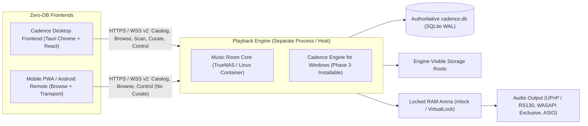

# Standalone Playback Engine & Engine-First Frontend Architecture

**Status:** Implemented (Phases 1–3 Complete; supersedes the dual-DB *This PC + Optional Core* model in [OPTIONAL_LINUX_CORE.md](./OPTIONAL_LINUX_CORE.md))  
**Branch:** `feat/windows-playback-engine` (merged to `main`)  
**Updated:** 2026-11-17

---

## 1. Executive Summary & Architectural Shift

Previously, Cadence Windows Desktop operated as a monolithic desktop app with its own `%APPDATA%/cadence.db`, startup SQLite scan, Windows-local folder picker, and tag-commit worker — while treating Linux/TrueNAS Core (`Music Room Core`) as an optional remote viewer. That created a two-database split-brain (`Add Music` and `Storage & Folders` modified This PC's SQLite DB while browsing `Music Room Core`).

This specification establishes an **Engine-First, Zero-DB Frontend** architecture:

* **Cadence Playback Engine (`cadence-engine`):** The sole owner of `cadence.db`, storage roots (`watched_folders`), filesystem browsing (`Browse`), audio scanning/fingerprinting, cover artwork extraction/serving, metadata tag commits (`Curate`), and bit-perfect audio playback (`WASAPI Exclusive` / `ASIO` on Windows, `Paced UPnP` on Linux & Windows).
* **Cadence Frontend (Desktop App + Browser/Mobile PWA):** A pure remote, browse, and curate client with **no `cadence.db`** and **no startup disk scan**. On launch, its first job is discovering and connecting to the active Playback Engine. Without a connected Playback Engine, Cadence presents the Engine Connection gate — never an empty local mock catalog.
* **Role Separation across Clients:**
  * **Desktop Frontend:** Browse, Search/Filter, Playlists, Transport/Outputs, Engine Folder Management (**Browse -> Add Folder**), and **Curate Studio**.
  * **Mobile PWA Remote:** Browse, Search/Filter, Playlists, and Transport/Outputs (continues to exclude Curate & Storage management).

---

## 2. Responsibility & Ownership Matrix

| Concern | Current Behavior (`fix/41`) | Target Architecture (`Standalone Engine`) |
| :--- | :--- | :--- |
| **Desktop Startup** | Migrates IndexedDB, opens `%APPDATA%/cadence.db`, loads local tracks (`src/App.tsx`). | Probes saved/mDNS Playback Engines; connects or shows **Connect to Playback Engine** gate. Zero local SQLite. |
| **Catalog Authority** | Windows SQLite OR Core HTTP snapshot (incomplete `CatalogTrack`). | **100% Playback Engine** (`/v1/core` paginated catalog + `GET /v1/artwork/...`). |
| **Add Folder / Storage** | Windows Explorer dialog -> writes to Windows SQLite only. | Embedded Engine **Browse** view (`fs.browse` + `folders.*`) operating on the active Engine's filesystem. |
| **Artwork Delivery** | Desktop `asset://` local cache (`resolveMediaUrl`); missing on Core. | Engine-served concurrency-capped HTTP endpoint (`GET /v1/artwork/:releaseId`), valid on Desktop & Mobile. |
| **Curate & Tag Writes** | Desktop-only `curation/` + `commands/curation.rs`; Core stub marker in `core_runtime/curate.rs`. | Engine executes real `lofty` tag writes (`ID3v2`, `Vorbis`, `MP4`, `DSF`) via idle/cooldown-gated `curate.*` jobs. |
| **Local PC USB DAC Audio** | Embedded inside Tauri `desktop` binary (`src-tauri/src/audio/`). | Separate **Windows Playback Engine** installable service (`Phase 3`) exposing the identical Engine API on `127.0.0.1`. |
| **Mobile PWA** | Connects to Desktop remote or Core. | Connects directly to active Engine API (`Browse` + `Playback`, Curate excluded). |

---

## 3. UX & User Journey Contract (Apple HIG Aligned)

Evaluated against [.agents/rules/ux-design-guideline.md](../../.agents/rules/ux-design-guideline.md):

1. **Startup Gate — *No Engine, Clear Purpose* (`Purpose`, `Agency`):**
   * On launch, Cadence checks the last active Engine profile and runs on-demand LAN discovery (`_cadence-core._tcp`).
   * **Connected:** Opens directly into the Engine's Library.
   * **Unavailable / First Launch:** Displays an explicit **Select or Pair Playback Engine** stage (*"Connect to a Cadence Playback Engine on your NAS or PC to browse and play music"*), with **Retry**, **Discover on LAN**, and **Add Engine by IP/Address** — zero fake catalogs or dead-end modal traps.
2. **Engine-Native **Browse** & Folder Management (`Familiarity`, `Internal Consistency`):**
   * Inspired by Music Assistant's **Browse**, **`Add Music ⌘O`** and **`Storage & Folders`** always operate on the **connected Playback Engine**.
   * Clicking **Add Folder** opens an embedded hierarchical directory browser backed by the Engine's filesystem:
     * On Linux/TrueNAS Engine: shows mounted container roots (e.g., `/music`, `/music/rajafans/Master/Tamil`) and current scan/watch mode.
     * On Windows Engine (Phase 3): shows local drives (`E:\`, `Z:\`) and Engine-accessible SMB shares (`\\192.168.1.6\rajafans`).
   * Multi-root management supports **Add Root**, **Remove Root**, **Quick Rescan**, and **Full Rescan**, showing real-time Engine scan status without leaking container flags or CLI commands.
3. **Curate Directly Against Engine State (`Feedback Loops`, `Forgiveness`):**
   * Desktop **Curate** drafts, Federated provider resolutions (MusicBrainz, Apple Music, Gemini), and dry-run diffs persist on the Engine (`curate.draft.save`, `curate.dry_run`).
   * If the Engine's media mount is configured read-only (`musicReadOnly: true`, e.g., hardened TrueNAS read-only share), **Curate** clearly communicates upfront (`"Read-Only Media Root — Tag writes disabled on this Engine"`, offering DB-only metadata overrides or instructions to grant write mount access rather than silently failing on approve).

---

## 4. Target Core Protocol v2 Extensions

Building cleanly on existing [src-tauri/src/core_session/protocol.rs](../../src-tauri/src/core_session/protocol.rs) and [src-tauri/src/core_runtime/dragonfish.rs](../../src-tauri/src/core_runtime/dragonfish.rs):

### 4.1 Richer Catalog & Playlist Contracts
* Expand `CatalogTrack` (backward-compatible optional fields) with `composerName`, `genreTags`, `folderName`, `language`, `dynamicRange`, `hasCoverArt`, `provenanceStatus`, `lyrics`, and `fingerprintStatus` (`UNSUPPORTED_DSD`, `INDEXED`, `PENDING`).
* Add `POST /v1/core` playlist & projection operations:
  * `playlists.list`, `playlists.get`, `playlists.create`, `playlists.update`, `playlists.delete`, `playlists.setTracks`
  * `releases.split.list`, `releases.split.toggle`

### 4.2 Engine Filesystem Browse & Library Roots
* `fs.browse { path?: string }` — returns directory entries (`name`, `path`, `isDir`, `readable`, `isWatched`) **strictly constrained** to configured browseable roots / container mounts on Linux (`CADENCE_BROWSE_ROOTS`, default `CADENCE_MUSIC_DIR`) or local drives / mounted shares on Windows; rejects `..` traversal and symlinks escaping allowed roots; requires pairing token (`x-cadence-token`).
* `folders.list` — lists all configured library roots, online status, track counts, scan mode, and last-scanned timestamp.
* `folders.add { path, displayName?, scanMode }` / `folders.remove { folderId }`
* `folders.scan { folderId?, forceFull }` / `folders.scan.status` — queued/run **only when Engine playback is idle and cooldown elapsed** (`last_stopped_at + 30s`).

### 4.3 Engine Artwork Endpoint
* `GET /v1/artwork/:releaseId` (authenticated via token/query or LAN origin): serves cached compressed JPEG/WebP album cover or extracts on-demand when Engine is idle, governed by bounded concurrency (`<= 2` concurrent decodes/reads) and `Cache-Control` ETag headers.

### 4.4 Curate Workbench Integration
* Wire [src/core/remoteCurate.ts](../../src/core/remoteCurate.ts) into `UnifiedCurateCockpit.tsx` and expand Engine Curate ops:
  * `curate.draft.list`, `curate.draft.save`, `curate.dry_run`, `curate.approve`, `curate.job.status`
  * Replace the marker stub in [core_runtime/curate.rs](../../src-tauri/src/core_runtime/curate.rs#L546-L560) with real `lofty` atomic tag commits from `src-tauri/src/curation/` (`ID3v2`, `FLAC Vorbis`, `MP4`, `DSF`).

---

## 5. Phased Implementation Roadmap

### Phase 1 — Engine Capability Parity (`cadence-engine` Linux / Headless Core First)
**Goal:** Make TrueNAS `Music Room Core` (`192.168.1.6:4040`) completely self-sufficient — able to browse multi-folder trees (including your 25 DSD albums), scan natively, serve covers, manage playlists, and execute real Curate tag commits.

1. **Decouple `scanner` & `curation` from Tauri Desktop:**
   * Replace `tauri::AppHandle` event emissions in [src-tauri/src/scanner/engine.rs](../../src-tauri/src/scanner/engine.rs) and `src-tauri/src/curation/` with a pure Rust `EngineProgressSink` trait (Desktop Tauri and `cadence-headless` provide thin adapters).
   * Enable `lofty`, `symphonia`, `walkdir`, `image`, `rusty-chromaprint` in `src-tauri/Cargo.toml` for non-desktop builds (`cadence-headless`), keeping `tauri`, `rodio`, `cpal`, `windows` desktop/audio-only.
   * Keep our native DSD probe ([src-tauri/src/scanner/dsd.rs](../../src-tauri/src/scanner/dsd.rs)) as the authoritative `.dsf`/`.dff` parser in headless scans and early-skip DSD fingerprinting (`UNSUPPORTED_DSD`).
2. **Protocol v2 & Headless HTTP Routes (`dragonfish.rs` + `core_runtime/mod.rs`):**
   * Implement `fs.browse`, `folders.list/add/remove/scan/status`, `playlists.*`, enriched `CatalogTrack` fields, and concurrency-capped `GET /v1/artwork/:releaseId`.
   * Enforce mandatory idle + 30s cooldown guards inside `folders.scan` and `curate.approve` execution.
   * Replace stub marker writes in `core_runtime/curate.rs` with real `lofty` tag writing (preserving bit-perfect audio payload offsets on PCM and ID3v2-trailing DSF chunks).
3. **TrueNAS Redeploy Config:**
   * Update [custom-app-24.04.yaml](../../deploy/truenas-dragonfish/custom-app-24.04.yaml) / [docker-compose.yml](../../deploy/truenas-dragonfish/docker-compose.yml) examples to document multi-folder submounts under `/music` (e.g., `/music/master`, `/music/rajafans`) and optional read-write toggle (`CADENCE_MUSIC_READ_ONLY`) when remote Curate tag commits are desired.

**Phase 1 Exit Criteria:**
* Headless Core compiles & passes `cargo test` without `desktop` feature.
* Against live `Music Room Core`, scanning a folder containing `.dsf`/`.dff` albums indexes accurate DSD rates (`DSD64`/`128`/`256`), artwork serves over HTTP, and `curate.dry_run`/`curate.approve` updates real tags when mounted writable.

---

### Phase 2 — Engine-Required, Zero-DB Thin Frontend (`Cadence Desktop` + `PWA`)
**Goal:** Remove `cadence.db` ownership and local startup SQLite loading from the Windows Frontend so all Browse, Folder Management, Playlists, and Curate run exclusively through the active Playback Engine API.

1. **Startup Engine Connection Gate:**
   * Remove startup `sqliteLibraryService.checkAndMigrateFromIndexedDB()` and `loadLibraryFromDb()` from [src/App.tsx](../../src/App.tsx#L693-L760).
   * Add Engine discovery/reconnect bootstrap (`EngineConnectionGate` view when no Engine is connected) that blocks catalog entry until connected to a healthy Engine.
   * Keep non-library UI preferences (`theme`, saved Engine endpoints, column widths) in lightweight client preferences (`localStorage` / Tauri config store), never `cadence.db`.
2. **Unified `EngineClient` Service Layer:**
   * Replace direct `sqliteLibraryService.*` and `tauriBridge.db*` / `commit*` / `startLibraryScan` callers across ~12 frontend files (`App.tsx`, `AlbumCoverGrid.tsx`, `ArtistsView.tsx`, `DataCanvas.tsx`, `PlaylistDetailView.tsx`, `UnifiedRightSidebar.tsx`, playlist modals, `AudioPlayerContext.tsx`) with one `EngineClient` interface backed by Core HTTP/WSS (`coreControllerTransport.ts`).
   * Keep `graphEngine.ts`, `taxonomyUtils.ts`, and `albumGroupingService.ts` pure in-memory projections fed strictly by the Engine's catalog.
3. **Embedded **Browse -> Add Folder** & Storage Manager:**
   * Replace OS `openDirectoryDialog` in [StorageManagerModal.tsx](../../src/components/Modals/StorageManagerModal.tsx) and `ImportModal` (`Add Music ⌘O`) with an embedded **Engine Folder Browser** modal powered by `fs.browse` + `folders.add` / `folders.scan` (mirroring Music Assistant's **Browse** flow).
4. **Curate Workbench on Engine:**
   * Connect `UnifiedCurateCockpit.tsx` + `CurationReconciliationStage.tsx` to `remoteCurate.ts` (`curate.draft.save`, `curate.dry_run`, `curate.approve`, `curate.job.status`), surfacing read-only root locks clearly before user approval.
   * Federated metadata lookups (MusicBrainz / Apple Music / Gemini) can remain frontend-initiated or Engine-hosted, writing staged drafts exclusively to the Engine DB.
5. **Thin Tauri Shell Cleanup:**
   * Strip `commands/library.rs`, `commands/scanner.rs`, `commands/curation.rs`, and SQLite initialization from the Frontend Desktop binary (retain only OS window chrome, tray, mDNS browse helper, HTTP client TLS/self-signed pinning bridge, and deep-link handling).
   * Confirm **Mobile PWA (`pwa/`)** continues to expose Browse + Search + Playlists + Transport cleanly against Engine API v2 without Curate or folder mutations.

**Phase 2 Exit Criteria:**
* Frontend launches with zero local `cadence.db`, connects to TrueNAS `Music Room Core`, browses Engine folders, adds `Master/Tamil`, displays all 25 DSD albums with cover art, and curates tracks via Core.
* Headless Chrome CDP E2E + `tsc -b` + `npm run tauri:build` succeed.

---

### Phase 3 — Separate Windows Installable Playback Engine (`Cadence Engine for Windows`)
**Goal:** Restore full standalone Windows USB DAC (`WASAPI Exclusive` / `ASIO`) and Windows UPnP playback via a dedicated installable **Windows Playback Engine** that speaks the exact same Engine API v2 as Linux Core.

1. **Cross-Platform Playback Backend Extraction:**
   * Move [src-tauri/src/audio/](../../src-tauri/src/audio/) (`AudioEngine`, `wasapi_exclusive.rs`, `upnp.rs`, `upnp_pacer.rs`, `stream_tuning.rs`) into a shared Tauri-free `cadence-engine` binary target alongside `core_runtime`.
   * Implement a unified `EngineRenderer` adapter over Windows `WASAPI Exclusive` / `ASIO` (`AudioEngine`) and `UPnP` alongside existing Linux `upnp_session.rs`.
   * Preserve every Windows audiophile guarantee (`VirtualLock` working-set sizing, `SetProcessWorkingSetSizeEx`, MMCSS `"Pro Audio"`, `timeBeginPeriod(1)`, Core 0/1 CPU exclusion, and background thread `THREAD_MODE_BACKGROUND_BEGIN`).
2. **Windows Service / Tray Host & Drive Enumeration:**
   * Package `cadence-engine.exe` as an independent lightweight tray / Windows service (NSIS installable, auto-start optional, binds `127.0.0.1:4040` or LAN IP for Mobile PWA remote).
   * Extend `fs.browse` on Windows hosts to list fixed drives (`C:\`, `E:\`, `Z:\`) and accessible SMB UNC roots (`\\Server\Share`) alongside existing `watched_folders`.
   * Support smooth auto-discovery of `This PC (Windows Engine)` right alongside `Music Room Core (TrueNAS)` in the Frontend Engine Picker.
3. **One-Time Local Migration Utility:**
   * Provide a first-run import option in the Windows Engine installer (or CLI `cadence-engine --migrate-legacy-db`) to adopt an existing `%APPDATA%/cadence.db` cleanly without losing playlists, fingerprints, or curated metadata.

**Phase 3 Exit Criteria:**
* Separate Windows Engine installer (`cadence-engine-setup.exe`) + Thin Desktop Frontend installer (`cadence-desktop-setup.exe`) can be installed independently or together on one PC.
* Full bit-perfect WASAPI Exclusive / ASIO + UPnP DSD256 playback verified on Windows against Tier 3 benchmarks.

---

## 6. `[AUDIOPHILE IMPACT ASSESSMENT]` (Mandatory Gate per `.agents/rules/audiophile.md`)

Because Phases 1–3 restructure disk scanning, artwork serving, background tag commits, and Windows/Linux audio transport ownership, every invariant in [audiophile.md](../../.agents/rules/audiophile.md) applies:

* **Disk I/O Impact (Invariant 1):**
  Moving scanning, folder browsing (`fs.browse`), artwork extraction, and Curate writes exclusively onto the Playback Engine centralizes enforcement in one place: **zero background disk scans, artwork writes, or Curate commits may execute while `PlaybackState` is `Playing`, `Paused`, `Loading`, or within the 30s post-stop cooldown**. User-triggered `fs.browse` directory listing during playback must avoid recursive stat walks (single-level `read_dir` only, zero file-header opens) and cache folder summaries.
* **Network / NIC Burst Impact (Invariant 4):**
  Frontend UI (`Desktop` + `PWA`) communicates over WebSocket events + bounded HTTP fetches (`catalog.page` max 200 tracks/page, concurrency-capped `GET /v1/artwork/:releaseId`, slow >= 5s heartbeat). No high-frequency polling loops are permitted for scan progress or playback position (use push WS events + 1 Hz local interpolation clock). Audio HTTP/UPnP media pacing (`upnp_session.rs` / `upnp_pacer.rs`) stays physically isolated on its own socket/listener port (`18890`) with `TCP_NODELAY` and clamped `SO_SNDBUF`.
* **Thread & CPU Scheduling Impact (Invariant 2):**
  Separating the Windows WebView2/React Frontend from `cadence-engine.exe` *reduces* UI/GPU scheduling interference on audio playback. Inside `cadence-engine`, the synchronous streaming loop (`cadence-paced-stream`) keeps MMCSS `"Pro Audio"` / isolated CPU affinity (away from Core 0/1 DPC/NDIS cores on Windows), while scanner, fingerprint, and artwork threads run with `THREAD_PRIORITY_BELOW_NORMAL` + `THREAD_MODE_BACKGROUND_BEGIN` (Windows) / `SCHED_BATCH` + low nice priority (Linux).
* **Memory Allocation & Locked Memory Impact (Invariant 3):**
  Active track RAM buffers continue to use pre-faulted `VirtualLock` (`SetProcessWorkingSetSizeEx` headroom on Windows) and `mlock` / `LockedBytesArena` (Linux cgroup v2) inside `cadence-engine`, completely outside the React/Tauri frontend process. Steady-state packet loops remain zero-allocation.
* **Bit-Perfect & Container Ground-Truth Integrity (Invariants 5 & 6):**
  Pure container header probing (`scanner/dsd.rs` for `.dsf`/`.dff` + native `lofty` PCM inspection) becomes the single shared implementation in `cadence-engine`. Real `lofty` Curate commits must never shift DSD audio payload headers or rewrite while streaming buffers reference the file.

### Validation Tiers by Phase
* **Phase 1 (Engine Parity):** Tier 2 + Tier 3 on Linux/Docker (`cargo test`, DSD scan parity test, idle-guard scan/curate contention tests, Wireshark/RS130 playback verification).
* **Phase 2 (Thin Frontend):** Tier 1 + Tier 2 (`tsc -b`, unit tests, live Chrome CDP E2E against Core, WebView2 idle/playback CPU check).
* **Phase 3 (Windows Engine Installable):** Mandatory **Tier 3 Full Audiophile Validation** (release build WASAPI Exclusive + ASIO + UPnP DSD256 latency/dropout/DPC measurements before merging).

---

## 7. Open Decisions Before Coding Begins

1. **Auth Model on LAN (`x-cadence-token`):** Should LAN `fs.browse` and `GET /v1/artwork/:releaseId` require the Engine pairing token everywhere, with automatic pairing during Windows localhost engine setup? *(Recommended: Yes — always enforce token, auto-pair localhost Engine via local secret file or loopback handshake.)*
2. **TrueNAS Share Permissions:** Do you want to keep `/music` read-only on TrueNAS (browse + DSD playback only) or mount your dataset read-write in Dragonfish so **Curate** tag commits execute directly from Desktop onto NAS files?
3. **Transition Packaging for Windows Users:** During Phase 2 → Phase 3 development, should Desktop temporarily hide `This PC` completely on `feat/standalone-playback-engine`, or keep a dev flag until Phase 3's Windows Engine binary builds cleanly?
