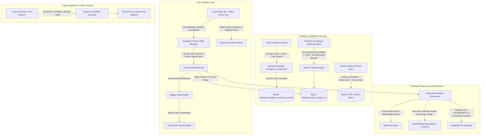

# Unified Metadata Management & Catalog Coherence Architecture

*   **Author:** Mathan
*   **Status:** Draft
*   **Date:** 2026-10-29

--------------------------------------------------------------------------------

## Overview

Cadence is an uncompromising, bit-perfect audiophile music player and catalog curation engine for Windows Desktop. High-fidelity catalog curation requires accurate, consistent metadata that respects diverse musical repertoires without forcing users into fragmented editing workflows or exposing misleading audio metrics.

This project delivers a unified metadata architecture across five core pillars:
1. **Single Unified Surface in Curate (⌘2)**: Retires competing editing popups (`CustomizeAlbumModal`, standalone `Identify Soundtracks` modal) and cleanses the playback sidecar (`UnifiedRightSidebar`), routing all album-level and track-level metadata operations into the dedicated **Curate (⌘2)** workbench.
2. **Soundtrack & South Asian Credit Authority Taxonomy**: Implements a multi-signal confidence scoring engine that assigns the **Composer / Music Director** as the canonical primary release entity (`ALBUMARTIST`) for film soundtracks, while preserving the **Performer** as the primary release artist for classical, ghazal, and devotional recordings. User overrides are persisted permanently in SQLite so future automated scans never silently revert them.
3. **Resilient Fuzzy Version Stacking**: Pre-sanitizes digital rip tags from both album titles and artist credits, applies bounded string similarity (Jaro-Winkler $\ge 0.88$) with strict track count ($\pm 1$) and playback duration ($\pm 5\%$) validation to cluster variant pressings (e.g., catching *Captain* vs *Captian* typos), and provides an explicit manual stacking workbench in Curate.
4. **Federated Source-Specific Authority**: Synchronizes full-album metadata packages using Apple Music for commercial presentation titles and artwork, MusicBrainz for structured release-group relationships and granular credits, and Gemini AI strictly as an auxiliary fallback for transliteration and multi-movie combo disambiguation.
5. **Complete Dynamic Range (DR) Bypass**: Disables unverified peak/RMS estimations entirely during file ingestion and hides all DR telemetry, badges, and filters behind a global feature flag (`FEATURE_DYNAMIC_RANGE = false`) until an authentic offline bit-perfect TT DR meter engine is implemented.

--------------------------------------------------------------------------------

## The Problem

1. **Fractured User Journeys Across Competing Surfaces**: 
   - When browsing in **Listen (⌘1)**, clicking an album opens its drilldown view. From there, clicking "Edit Metadata" opens `CustomizeAlbumModal` (a modal focused on rip flags and manual text boxes), while "Identify Soundtracks (AI)" opens `CompilationProvenanceModal`.
   - Simultaneously, clicking a track opens the "Details" inspector inside `UnifiedRightSidebar`, displaying "Smart Match Studio" directly next to Queue and Playlists.
   - When the user navigates back to the main Albums grid, the "Details" inspector remains stuck open in the right drawer, displaying track-level diffs for a previous song while the user is trying to view the library. 
   - Having four competing metadata tools (`CustomizeAlbumModal`, `CompilationProvenanceModal`, sidecar `Smart Match Studio`, and `Curate`) creates extreme cognitive overhead and state fragmentation.

2. **Performer vs. Composer Credit Inversion in Soundtracks**:
   - In film soundtracks and Indian cinema catalogs, the Composer / Music Director (e.g., Ilaiyaraaja, A. R. Rahman, Harris Jayaraj) is the singular release-level creative authority.
   - Local audio tags often set track 1's vocalists (e.g., `"Yesudas , Chitra"`) into the `ARTIST` tag and omit `ALBUMARTIST`. During library scanning, Cadence pulls track 1's performer into `release.artistCredit`.
   - When users edit the Composer in `CustomizeAlbumModal`, the modal continues displaying "Performer / Artist Credit" as `"Yesudas , Chitra"`, and the album card continues showing the singers as the album subtitle, breaking artist browsing and catalog coherence.

3. **Brittle Version Stacking on Pressing Variants**:
   - In `albumGroupingService.ts`, grouping keys require exact normalized string equality on both artist and title (`group:${normArtist}::${normTitle}`).
   - If one pressing of an album is tagged with folder name artifacts (`artistCredit: "Captain Prabhakaran CD RIP"`, `title: "Captain Prabhakaran CD RIP"`), while another pressing has `artistCredit: "Ilayaraja"` and a minor typographical error (`title: "Captian Prabhakaran"`), the grouping keys diverge completely.
   - The engine fails to group them, scattering duplicate cards across the album grid with no manual mechanism for users to merge or unmerge them.

4. **Fragmented Automation ("Poovilangu Syndrome")**:
   - Background jobs currently fetch high-resolution cover artwork from Apple Music or MusicBrainz CAA without updating the album title, album artist, or track singer tags.
   - In albums like *Poovilangu*, the album displays pristine cover art while retaining the raw folder rip title `"Poovilangu CD RIP"`. Automation must resolve the full release package—sanitized title, composer, album artist, tracklist singers, and artwork—together rather than running disconnected micro-jobs.

5. **Misleading Dynamic Range (DR) Metrics**:
   - DR numbers currently displayed on album cards, track tables, and the Left Rail filter (`High Dynamic Range DR12+`) are calculated using crude peak/RMS differences or fallback defaults (DR12/DR13).
   - They do not represent standardized TT Dynamic Range Meter calculations, presenting false audiophile telemetry and wasting CPU and disk I/O during file scanning.

--------------------------------------------------------------------------------

## Goals

*   **G1: Single-Workflow Navigation**: Eliminate `CustomizeAlbumModal` and remove the "Details" inspector tab from `UnifiedRightSidebar`. Route all album-level metadata editing and soundtrack identification into **Curate (⌘2)**, preserving return navigation state to **Listen (⌘1)** via a `← Back to Album in Listen` breadcrumb.
*   **G2: Multi-Signal Credit Inference**: Implement an automatic confidence-scoring engine that evaluates release type, genre, and track-credit uniformity to assign `Composer = Album Artist` for soundtracks and `Performer = Album Artist` for classical, ghazal, and devotional music.
*   **G3: Immutable User Authority Overrides**: Persist user-selected authority decisions (`metadata_authority_override`) in SQLite and sidecar files so automated rescans never silently overwrite confirmed credits.
*   **G4: Unified Search Indexing**: Index `releases.composer`, `releases.artist_credit`, and `tracks.artist` concurrently so searching for playback singers or composers immediately surfaces the parent soundtrack.
*   **G5: Resilient Automated & Manual Version Stacking**: Pre-sanitize rip noise from titles and artists, cluster variant pressings using bounded Jaro-Winkler similarity ($\ge 0.88$, track count $\pm 1$, duration $\pm 5\%$), and provide an explicit "Stack with another Album..." picker and "Unstack" action in Curate.
*   **G6: Federated Source-Specific Authority**: Bind Apple Music to commercial presentation titles and cover art, MusicBrainz to structured credits and release relationships, and Gemini AI strictly to fallback transliteration and conflict resolution.
*   **G7: Complete DR Ingestion Bypass & UI Suppression**: Completely skip peak/RMS calculations during file scanning, and toggle off all DR badges, filters, and telemetry via `FEATURE_DYNAMIC_RANGE = false`.

--------------------------------------------------------------------------------

## Non-Goals

*   **NG1: Custom Native TT-DR Analyzer Implementation in this Phase**: Building an accurate, offline bit-perfect TT Dynamic Range meter in native Rust WASAPI/FFmpeg is deferred to a future performance-focused milestone.
*   **NG2: Direct Disk Writes Without Two-Phase Review**: Zero uncommitted metadata writes directly to audio files. All edits must stage in `pendingSidecarEdits` and require explicit user approval in the Two-Phase Commit modal.
*   **NG3: Unconstrained Fuzzy Auto-Merging**: Albums with diverging track counts ($> 1$ track difference) or non-matching durations ($> 5\%$) will never auto-stack without explicit manual user action.
*   **NG4: Dropping Existing Database Columns**: Schema tables in SQLite will retain underlying credit and telemetry columns to prevent destructive schema migrations; fields are simply unpopulated or bypassed.

--------------------------------------------------------------------------------

## Open Questions

*   **Question 1**: When navigating from Listen to Curate via "Edit Metadata", should Curate automatically initiate external provider lookups (Apple Music and MusicBrainz) for that album immediately, or wait for the user to click "Enrich Release"? *(Recommended: Automatically trigger lookup if no staged candidate exists).*
*   **Question 2**: For releases with two distinct pressings already tagged with different cover arts, when stacked into a master release card, should the user be able to cycle and select which pressing's cover art represents the master card?

--------------------------------------------------------------------------------

## Critical User Journeys (CUJs)

### CUJ 1: Editing Album Metadata Without Leaving Context
*   **Given**: A user is browsing the Albums grid in **Listen (⌘1)** and clicks on *Agni Natchathiram*.
*   **When**: The user clicks the "Edit Metadata" button on the album hero header.
*   **Then**: The application records the return anchor (`previousView = 'listen'`, `releaseId = 'agni-natchathiram'`, scroll position) and transitions to **Curate (⌘2)** with *Agni Natchathiram* pre-selected in the reconciliation workbench. A prominent `← Return to Album in Listen` breadcrumb appears in the top navigation bar. Any uncommitted edits staged in Curate persist in `pendingSidecarEdits`; if the user clicks the return breadcrumb, an amber "Staged" badge remains visible on the album card in Listen until committed via the Two-Phase Commit modal or explicitly cleared.

### CUJ 2: Reconciling a Soundtrack with Playback Singer Confusion
*   **Given**: An album folder tagged with title `"Agni Natchathiram"`, composer `"Ilaiyaraaja"`, and track 1 artist `"Yesudas, Chitra"`.
*   **When**: The album is loaded in Curate.
*   **Then**: The multi-signal inference engine identifies genre `Soundtrack` and detects consistent composer tagging across tracks, assigning `Composer Authority` with high confidence. The staged output automatically sets `ALBUMARTIST = "Ilaiyaraaja"` and retains `"Yesudas, Chitra"` strictly in track 1's `ARTIST` field. The album card in Listen displays *Agni Natchathiram* with subtitle *Ilaiyaraaja*.

### CUJ 3: Resolving Misspelled or Dirty Pressing Variants
*   **Given**: Two folders in the user library: `"Captain Prabhakaran CD RIP"` (tagged with dirty title and artist `"Captain Prabhakaran CD RIP"`) and `"Captian Prabhakaran"` (tagged with artist `"Ilayaraja"`).
*   **When**: The library is scanned or Curate processes the catalog.
*   **Then**: The grouping engine pre-sanitizes `"CD RIP"`, detects Jaro-Winkler string similarity $> 0.88$ on base titles (*Captain* vs *Captian*), matches track counts (both 6 tracks) and total durations ($\pm 2\%$), and automatically stacks them under a single master release card with 2 editions.

### CUJ 4: Disabling Inaccurate DR Display
*   **Given**: The application launches with `FEATURE_DYNAMIC_RANGE = false`.
*   **When**: The user browses the Left Rail filters, views album cards in the grid, inspects album hero headers, and views track listing tables.
*   **Then**: The "High Dynamic Range (DR12+)" filter item is omitted from the Left Rail; the monospace micro-telemetry row on album cards displays only `[Year · Format · SampleRate]`; and track rows omit DR score pills. During folder rescans, file ingestion completes substantially faster because audio packet peak/RMS decoding is bypassed.

--------------------------------------------------------------------------------

## Technical Plan (Architecture)

### Architectural Overview & Data Flow



---

### Subsystem 1: Surface Consolidation & Navigation Anchor State Machine

#### 1. Surface Decommissioning
*   **Remove `CustomizeAlbumModal.tsx`**: The entire 974-line modal component is deprecated and removed from `App.tsx` and `AlbumCoverGrid.tsx`.
*   **Cleanse `UnifiedRightSidebar.tsx`**:
    - The `inspector` tab button (`<Info />` "Details") is removed from the header navigation bar.
    - The `rightSidebarTab` state type is pruned to strictly `'queue' | 'playlists'`.
    - Components `GranularCreditMatrix`, `SideBySideDiff` ("Smart Match Studio"), `ArtworkMediaTray`, and `IntegrityCard` are detached from the right drawer.
    - The sidebar width is permanently fixed to a single compact width (`360px`), eliminating layout shifts and GPU repaint churn during playback.
    - The orphaned `⌘I` keyboard shortcut and `handleInspectRelease` handler in `App.tsx` are rewired to dispatch `navigateToCurate(activeReleaseId, anchor)` instead of opening the retired sidebar tab.

#### 2. Navigation Anchor Protocol
When a user clicks "Edit Metadata" or "Identify Soundtracks (AI)" from anywhere in Listen mode, the application preserves navigation continuity:
```typescript
interface NavigationAnchor {
  returnView: 'listen' | 'library' | 'album_detail';
  selectedAlbumId: string;
  scrollPosition: number;
  filterState?: Record<string, any>;
}
```
*   **Trigger**: Clicking "Edit Metadata" on an album card or album detail header dispatches:
    `navigateToCurate(releaseId: string, anchor: NavigationAnchor)`.
*   **Curate Workbench Mounting**:
    - Switches active view mode to `'curate'` (`⌘2`).
    - Focuses the target release in `CurationReconciliationStage`.
    - Renders a prominent breadcrumb in the top toolbar:
      ```tsx
      <button onClick={() => returnToListen(anchor)} className="flex items-center gap-2 text-cyan-400 hover:text-white">
        <ArrowLeft className="w-4 h-4" />
        <span>Return to Album in Listen</span>
      </button>
      ```
    - Clicking the breadcrumb restores the user's exact scroll position, selected album, and filter state in **Listen (⌘1)**.
    - **Persistence of Staged Edits**: Uncommitted staged metadata edits remain persisted in `pendingSidecarEdits` across view changes. Returning to Listen preserves the amber "Staged" badge on the album card, ensuring zero work is lost if the user inspects other albums before triggering the Two-Phase Commit modal.

#### 3. Embedding Quick Tag / Folder Cleaners into Curate
The quick-sync actions from `CustomizeAlbumModal` (e.g., stripping "CD RIP" from folder names, syncing folder name to album title, or syncing album title to folder name) are re-homed into Curate's top tool strip as one-click action buttons operating directly on `track.pendingSidecarEdits`.

---

### Subsystem 2: Soundtrack & Credit Authority Taxonomy Engine

#### 1. The Credit Inference Service (`src/services/creditInferenceService.ts`)
Cadence enforces a multi-signal scoring model to resolve release authority:
```typescript
export interface AuthorityEvaluation {
  authority: 'composer' | 'performer';
  confidence: number; // 0 to 100
  rationale: string;
}

export function inferReleaseAuthority(
  release: Release,
  tracks: Track[]
): AuthorityEvaluation {
  // Check for explicit user override in SQLite first
  if (release.metadataAuthorityOverride) {
    return {
      authority: release.metadataAuthorityOverride,
      confidence: 100,
      rationale: 'User explicit override stored in database'
    };
  }

  let composerScore = 0;
  let performerScore = 0;

  // Signal 1: Genre Tag Evaluation (+40 points)
  const genreStr = (release.genre || tracks[0]?.genre || '').toLowerCase();
  if (/(soundtrack|film|score|ost|original score|motion picture)/i.test(genreStr)) {
    composerScore += 40;
  } else if (/(classical|carnatic|hindustani|ghazal|devotional|bhajan|opera)/i.test(genreStr)) {
    performerScore += 40;
  }

  // Signal 2: Release Title & Folder Keywords (+30 points)
  const titleAndFolder = `${release.title} ${release.folderName || ''}`.toLowerCase();
  if (/(soundtrack|o\.s\.t|motion picture|from the movie|movie songs)/i.test(titleAndFolder)) {
    composerScore += 30;
  }

  // Signal 3: Track Composer Uniformity (+30 points)
  const tracksWithComposer = tracks.filter(t => t.composerName && t.composerName.trim() !== '');
  const tracksWithPerformer = tracks.filter(t => t.artistCredit && t.artistCredit.trim() !== '');
  
  if (tracks.length > 0 && tracksWithComposer.length / tracks.length >= 0.80) {
    // Normalize composer names (stripping punctuation/spacing differences like "Ilaiyaraaja" vs "Ilayaraja")
    const uniqueComposers = new Set(
      tracksWithComposer.map(t => normalizeArtistForGrouping(t.composerName || ''))
    );
    const uniquePerformers = new Set(
      tracksWithPerformer.map(t => normalizeArtistForGrouping(t.artistCredit || ''))
    );
    
    // Single normalized composer across >=80% of tracks with rotating performers = Soundtrack pattern
    if (uniqueComposers.size === 1 && uniquePerformers.size > 1) {
      composerScore += 30;
    }
  }

  if (composerScore >= 50) {
    return {
      authority: 'composer',
      confidence: Math.min(100, composerScore),
      rationale: `Identified as Soundtrack/Film release (Score: ${composerScore})`
    };
  }

  return {
    authority: 'performer',
    confidence: Math.min(100, performerScore > 0 ? performerScore : 60),
    rationale: `Identified as Performer-led release (Score: ${performerScore})`
  };
}
```

#### 2. SQLite Schema & Persistence
*   **Column Addition**: `metadata_authority_override TEXT` added to the `releases` table in `sqliteLibraryService.ts`.
*   **Persistence**: When a user clicks the `[Soundtrack (Composer Credit)]` or `[Album Artist (Performer Credit)]` toggle in Curate, `sqliteLibraryService.updateReleaseAuthority(releaseId, 'composer' | 'performer')` persists the decision.
*   **Invariant**: Library scans and automated enrichment workers check `metadata_authority_override`; if present, automated inference is skipped and the user's choice is respected.

#### 3. Display Binding in `AlbumCoverGrid.tsx`
*   Replace direct calls to `album.artistCredit` on lines 691–703 and 842 with:
    ```typescript
    const displayArtist = album.authority === 'composer' && album.composerName
      ? album.composerName
      : album.artistCredit || 'Various Artists';
    ```
*   For *Agni Natchathiram*, the card subtitle in the grid displays **Ilaiyaraaja**, while the tracklist rows display the specific vocalists (**Vaa Vaa Anbe** – *Yesudas, Chitra*).

#### 4. Catalog Search Integration (`AlbumCoverGrid.tsx` & `sqliteLibraryService.ts`)
*   **In-Memory Search (`AlbumCoverGrid.tsx`)**: The in-memory grid search loop (lines 326–335) expands from matching `album.title` and `album.artistCredit` to also match `album.composerName` and all individual track performers:
    ```typescript
    const matchesPerformer = album.tracks?.some(t => 
      t.artistCredit?.toLowerCase().includes(q)
    );
    ```
*   **Database Search (`sqliteLibraryService.ts`)**: `searchCatalog(query)` is expanded to search across `releases.composer`, `releases.artist_credit`, and `tracks.artist`.
*   **Outcome**: A query for `"Yesudas"` or `"Chitra"` matches the track credits and highlights *Agni Natchathiram* in search results, while a query for `"Ilaiyaraaja"` matches the album composer authority.

---

### Subsystem 3: Bounded Fuzzy Version Stacking & Curate Stacking Workbench

Multi-disc box sets (e.g., Disc 1 and Disc 2 of the same release) are unified via their container disc number tags into a single multi-disc release. In contrast, pressing variant stacks represent distinct physical or digital editions of the same release (e.g., CD rip, vinyl rip, digital reissue) sharing comparable track listings.

#### 1. Pre-Sanitized Bounded Clustering in `albumGroupingService.ts`
To solve the issue where `"Captain Prabhakaran CD RIP"` and `"Captian Prabhakaran"` failed to stack:
1.  **Sanitization Phase**: Both `title` and `artistCredit` are stripped of rip tags (`CD RIP`, `[FLAC]`, bitrate tags, `24-96`, brackets) to compute a clean base title.
2.  **Base Grouping Key**: `computeGroupingKey(release)` produces a normalized base key for initial bucketing.
3.  **Agglomerative Fuzzy Grouping Pass in `groupAlbumReleases`**: After the initial map grouping, a secondary pairwise clustering pass iterates over candidate release groups to cluster variants whose base titles have minor divergences:
    - **Jaro-Winkler Metric**: $\text{sim} = \text{jaroWinkler}(\text{cleanTitle}_A, \text{cleanTitle}_B) \ge 0.88$ (handles typos like *Captain* vs *Captian*, or minor punctuation variations).
    - **Track Count Bound**: $|\text{trackCount}_A - \text{trackCount}_B| \le 1$.
    - **Duration Invariant with Zero-Duration Guard**:
      ```typescript
      const maxDur = Math.max(durationA, durationB);
      const durationMatch = maxDur > 0 
        ? (Math.abs(durationA - durationB) / maxDur <= 0.05) 
        : true;
      ```
    - **Artist / Composer Token Overlap**: Sanitized artist or composer strings share at least one normalized token or both identify under the same composer authority.
4.  **Clustering**: If all four invariants hold, `groupAlbumReleases` merges the candidate releases under the canonical `masterReleaseId`, stacking them neatly into an expandable variant stack.

#### 2. Curate Manual Stacking Workbench
For releases whose titles diverge beyond the automated fuzzy threshold (e.g., disparate *Nilavae Oru Sangeetham* catalog pressings):
*   **Stack Action**: In `CurationReconciliationStage`, an action button `Stack with Release...` opens a searchable catalog modal.
*   **Database Mutation**: Selecting a target release links `releases.master_release_id = targetMasterId` in SQLite and updates in-memory releases.
*   **Unstack Action**: Stacked constituent cards display an `Unstack Edition` button, setting `releases.master_release_id = releases.id` to separate them immediately.

---

### Subsystem 4: Federated Source Authority & Review Ergonomics

#### 1. Source-Specific Responsibility Matrix
Cadence enforces strict data provenance rather than a naive democratic vote:
*   **Apple Music (`/api/itunes-album`)**:
    - **Commercial Album Title**: Strips digital store noise while preserving clean commercial title casing.
    - **High-Resolution Artwork**: Fetches 3000x3000px uncompressed front covers.
    - **Commercial Release Year**: Earliest digital store release date.
*   **MusicBrainz (`/ws/2/release`)**:
    - **Structured Credits**: Verified Composer, Lyricist, Arranger, and Producer relationships.
    - **Physical Release Metadata**: Barcodes, catalog numbers, record labels, and release group UUIDs.
    - **Master Release Group Date**: Provides historical first release date (`first-release-date`).
*   **Gemini AI (`/api/gemini-ai-synthesis`)**:
    - **Fallback Only**: Invoked strictly when 0-consensus occurs, when resolving multi-movie 2-in-1 combo split tracklists, or for South Asian phonetic transliteration assistance.
    - Gemini is strictly forbidden from guessing barcodes or UUIDs.

#### 2. Transliteration Governance for South Asian Catalogs
*   **Dual-Script Retention**: Raw Indic script is stored in dedicated tags (`TITLE_ORIGINALSCRIPT`, `ARTIST_ORIGINALSCRIPT`).
*   **Configurable Romanization Policy**:
    - Cadence provides a project-level setting: `transliterationPolicy: 'anglicized_commercial' | 'iso_15919'`.
    - `anglicized_commercial` uses Apple Music's Romanized titles (e.g., *Oru Poongavanam*).
    - `iso_15919` uses MusicBrainz's academic diacritic transliteration (e.g., *Oru Pūṅkavaṉam*).
    - The engine enforces internal consistency across all tracks in a release, never mixing styles.

#### 3. Staging & Review Ergonomics
*   In Curate, staged output is displayed in a side-by-side diff table:
    - Current local value vs Staged candidate value.
    - Single-click `Revert` button on every field.
    - `Re-run with Parameters` button allowing users to adjust the transliteration policy or switch provider preference and recalculate candidates on the fly.
    - `Stage to Two-Phase Commit`: Moves verified changes into `pendingSidecarEdits` awaiting final commit.

---

### Subsystem 5: Complete Dynamic Range (DR) Bypass & Feature Flag

#### 1. Configuration Flag (`src/config/features.ts`)
```typescript
export const FEATURES = {
  DYNAMIC_RANGE: false, // Feature-flagged off until true TT-DR offline meter is built
} as const;
```

#### 2. Ingestion & Scanner Bypass
*   **Type Invariant Updates**:
    - In `src/services/integrityScanner.ts`, update `IntegrityScanResult.drScore` to `number | null`.
    - In `src/core/types.ts`, update `Track.drScore?: number | null`.
*   **`src/services/integrityScanner.ts`**:
    - Early return in `calculateDynamicRangeScore`:
      ```typescript
      if (!FEATURES.DYNAMIC_RANGE) {
        return { drScore: null, source: 'bypassed' };
      }
      ```
    - Completely eliminates audio frame decoding and peak/RMS buffer traversals during background file scans.
*   **`src/services/libraryImporter.ts`**:
    - Bypasses DR calculation during library imports, reducing storage bus read activity and speeding up import throughput.

#### 3. UI Suppression
*   **`src/components/LeftRail/LeftRail.tsx`**: The "High Dynamic Range (DR12+)" filter button is conditionally rendered only if `FEATURES.DYNAMIC_RANGE` is true.
*   **`src/components/CenterStage/AlbumCoverGrid.tsx`**:
    - In `renderAlbumCard`: The `DR${album.avgDr}` pill in the monospace telemetry row is omitted when `!FEATURES.DYNAMIC_RANGE`.
    - In `renderAlbumDetail`: The average DR pill in the hero badges bar is hidden when `!FEATURES.DYNAMIC_RANGE`.
*   **Track Listing Tables**: The DR score badge column is hidden when `!FEATURES.DYNAMIC_RANGE`.

--------------------------------------------------------------------------------

## Alternatives Considered

### Alternative 1: Retaining `CustomizeAlbumModal` for Quick Edits
*   **Concept**: Keep `CustomizeAlbumModal` as a quick popup modal for minor title/folder tweaks and only use `Curate` for deep, multi-provider reconciliations.
*   **Pros**: Allows users to rename an album title or folder without switching the main application viewport.
*   **Cons**:
    - Preserves dual-surface fragmentation and forces maintenance of ~1,000 lines of redundant UI code in `CustomizeAlbumModal.tsx`.
    - Duplicates logic for stripping rip flags, quick composer chips, and cover art enrichment.
    - Creates state synchronization races between the modal's internal buffer and Curate's `pendingSidecarEdits`.
    - Leaves users confused about when to use "Customize Album" versus "Curate".
*   **Reason for Rejection**: Eliminating `CustomizeAlbumModal` completely fulfills the user mandate: *"Editing metadata should be one workflow, not 10."* Routing directly to Curate with a state-preserving `← Return to Album in Listen` breadcrumb provides single-surface continuity without cognitive fragmentation.

---

### Alternative 2: Universal "Composer = Album Artist" Blanket Rule
*   **Concept**: Hardcode an invariant that every Indian music release assigns the Composer as the Album Artist.
*   **Pros**: Trivial implementation requiring no scoring heuristic or evaluation rules.
*   **Cons**:
    - Catastrophically breaks Carnatic and Hindustani classical music, where the vocalist or instrumentalist (e.g., M. S. Subbulakshmi, Pandit Bhimsen Joshi, Mandolin U. Shrinivas) is the primary release entity and the composer (Tyagaraja, Purandara Dasa) is historical.
    - Inverts Ghazal (Jagjit Singh) and independent pop singles where the performing singer is the primary artist.
    - Frustrates users browsing classical recordings by transforming artist views into historical composer catalogs.
*   **Reason for Rejection**: Repertoires are heterogeneous. The multi-signal confidence engine correctly distinguishes Film Soundtracks (+40 on soundtrack genre, +30 on OST title keywords, +30 on single composer with rotating performers) from Performer-led Classical/Ghazal music, while preserving user manual overrides permanently.

---

### Alternative 3: Aggressive Unconstrained Fuzzy Title Clustering
*   **Concept**: Apply loose fuzzy string matching (e.g., Levenshtein distance threshold 0.70) without duration or track count guards to aggressively group pressing variants.
*   **Pros**: Catastrophic typos and substantially altered reissue names would automatically merge into variant stacks.
*   **Cons**:
    - Causes severe false-positive collisions on short titles (e.g., merging *Roja* with *Raja*).
    - Erroneously merges multi-part soundtrack volumes (e.g., *Baahubali 1* with *Baahubali 2* or *Ponniyin Selvan Part 1* with *Part 2*).
    - Can merge regular soundtrack releases with separate background score releases that share similar titles.
*   **Reason for Rejection**: Erroneous merges destroy library organization. Bounding fuzzy similarity ($\ge 0.88$ Jaro-Winkler) with strict track count ($\pm 1$) and duration ($\pm 5\%$) invariants prevents false positives, while Curate's manual `Stack with Release...` picker provides a deterministic escape hatch for wide outliers.

---

### Alternative 4: Democratic Majority Voting Across External Providers
*   **Concept**: Resolve release and track titles by democratic majority vote across Local, Apple Music, and MusicBrainz.
*   **Pros**: Generalizes across generic western catalogs without provider-specific logic.
*   **Cons**:
    - In South Asian catalogs, MusicBrainz often catalogs titles in academic ISO 15919 transliteration with diacritics (e.g., *Oru Pūṅkavaṉam*), whereas Apple Music uses commercial Latin transliteration (e.g., *Oru Poongavanam*).
    - Majority voting randomly picks Apple for track 1 and MusicBrainz for track 2, creating an inconsistent hybrid transliteration style across the same album.
*   **Reason for Rejection**: Source-specific authority is required: Apple Music provides commercial presentation titles and 3000x3000px artwork; MusicBrainz provides structured release-group relationships, barcodes, and work credits; Gemini AI acts strictly as an auxiliary fallback for 0-consensus multi-movie splits and transliteration assistance.

---

### Alternative 5: Retaining Heuristic DR Calculations in the Background Scanner
*   **Concept**: Keep the existing peak/RMS dynamic range estimation running in the background but simply hide the badge from the UI.
*   **Pros**: Retains populated DR numbers in SQLite if users ever want to view them in the future.
*   **Cons**:
    - Wastes substantial CPU cycles and disk I/O decoding audio frames during library imports and scans.
    - Generates ungrounded numbers that do not reflect true TT Dynamic Range Meter standards.
    - Contradicts the user's explicit request: *"Bypass DR calculations."*
*   **Reason for Rejection**: Bypassing DR calculations completely during file scanning dramatically accelerates library ingestion and reduces storage bus activity, while hiding all DR filters and badges guarantees that Cadence never displays fabricated audiophile telemetry.

--------------------------------------------------------------------------------

## Detailed Implementation Plan

This section provides an exhaustive, step-by-step implementation plan. Every impacted file is enumerated with explicit rationales, data contracts, and verification criteria.

### File Enumeration & Impact Ledger

| Action | File Path | Subsystem | Rationale |
| :--- | :--- | :--- | :--- |
| **CREATE** | [`src/config/features.ts`](file:///e:/Mathan/Code/Music%20Agent/src/config/features.ts) | Core Config | Central boolean feature flag registry; exports `FEATURES.DYNAMIC_RANGE = false` to suppress DR across UI and audio scanners. |
| **CREATE** | [`src/services/creditInferenceService.ts`](file:///e:/Mathan/Code/Music%20Agent/src/services/creditInferenceService.ts) | Intelligence | Multi-signal confidence engine determining whether a release follows `Composer Authority` (Soundtracks) or `Performer Authority` (Classical/Vocal). |
| **CREATE** | [`src/test/testMetadataCoherence.ts`](file:///e:/Mathan/Code/Music%20Agent/src/test/testMetadataCoherence.ts) | Verification | Automated test suite verifying credit authority scoring, bounded fuzzy stacking, DR scanner bypass, and navigation state transitions. |
| **DELETE** | [`src/components/Modals/CustomizeAlbumModal.tsx`](file:///e:/Mathan/Code/Music%20Agent/src/components/Modals/CustomizeAlbumModal.tsx) | UI Cleanup | Deprecates and deletes the 974-line modal; all editing functionality is re-homed into Curate. |
| **MODIFY** | [`src/components/RightPanel/UnifiedRightSidebar.tsx`](file:///e:/Mathan/Code/Music%20Agent/src/components/RightPanel/UnifiedRightSidebar.tsx) | Playback Rail | Strips the `inspector` tab ("Details") and all embedded diff/credit tools, locking the sidecar strictly to Queue and Playlists with a fixed 360px width. |
| **MODIFY** | [`src/components/CenterStage/AlbumCoverGrid.tsx`](file:///e:/Mathan/Code/Music%20Agent/src/components/CenterStage/AlbumCoverGrid.tsx) | Catalog UI | Removes `CustomizeAlbumModal` state; routes "Edit Metadata" and "Identify Soundtracks" to Curate; updates card subtitles to display Composer for soundtracks; hides DR pills; expands in-memory search loop to match track performers. |
| **MODIFY** | [`src/components/LeftRail/LeftRail.tsx`](file:///e:/Mathan/Code/Music%20Agent/src/components/LeftRail/LeftRail.tsx) | Navigation Rail | Conditionally renders the "High Dynamic Range (DR12+)" filter item only when `FEATURES.DYNAMIC_RANGE` is enabled. |
| **MODIFY** | [`src/services/integrityScanner.ts`](file:///e:/Mathan/Code/Music%20Agent/src/services/integrityScanner.ts) | Scanner | Updates `IntegrityScanResult.drScore` and `Track.drScore` to `number \| null` for strict TypeScript nullability safety; short-circuits `calculateDynamicRangeScore` to return `{ drScore: null, source: 'bypassed' }` immediately when `!FEATURES.DYNAMIC_RANGE`, skipping peak/RMS audio decoding. |
| **MODIFY** | [`src/services/libraryImporter.ts`](file:///e:/Mathan/Code/Music%20Agent/src/services/libraryImporter.ts) | Ingestion | Bypasses DR calculation during library scans and file imports, accelerating import throughput. |
| **MODIFY** | [`src/services/sqliteLibraryService.ts`](file:///e:/Mathan/Code/Music%20Agent/src/services/sqliteLibraryService.ts) | Database | Adds `metadata_authority_override` column to the `releases` table; provides manual master/variant link and unlink mutations; expands `searchCatalog` across composers and track artists. |
| **MODIFY** | [`src/services/albumGroupingService.ts`](file:///e:/Mathan/Code/Music%20Agent/src/services/albumGroupingService.ts) | Clustering | Implements bounded Jaro-Winkler string similarity ($\ge 0.88$) with track count ($\pm 1$) and duration ($\pm 5\%$, with zero-duration guard) in agglomerative `groupAlbumReleases` clustering. |
| **MODIFY** | [`src/components/Curate/CurationWorkbench.tsx`](file:///e:/Mathan/Code/Music%20Agent/src/components/Curate/CurationWorkbench.tsx) | Curate Stage | Integrates the `← Back to Album in Listen` breadcrumb, authority override toggles, and manual release stacking search picker. |
| **MODIFY** | [`src/App.tsx`](file:///e:/Mathan/Code/Music%20Agent/src/App.tsx) | Root Shell | Removes `CustomizeAlbumModal` JSX mounts and imports; rewires `⌘I` shortcut and `handleInspectRelease` to `navigateToCurate`; manages `NavigationAnchor` state transitions between Listen and Curate. |

---

### Step-by-Step Implementation Sequence

#### Step 1: Feature Flag & DR Bypass
1.  **Create `src/config/features.ts`**:
    - Export `FEATURES = { DYNAMIC_RANGE: false } as const`.
2.  **Bypass Audio Scanner & Update Types in `src/services/integrityScanner.ts` & `src/core/types.ts`**:
    - Update `IntegrityScanResult.drScore` to `number | null` and `Track.drScore?: number | null` to maintain strict TypeScript compilation.
    - Import `FEATURES`. In `calculateDynamicRangeScore`, if `!FEATURES.DYNAMIC_RANGE`, return `{ drScore: null, source: 'bypassed' }` immediately without reading file packets.
3.  **Bypass Importer in `src/services/libraryImporter.ts`**:
    - Skip calling `calculateDynamicRangeScore`.
4.  **Suppress DR in UI**:
    - In `src/components/LeftRail/LeftRail.tsx`, wrap the "High Dynamic Range (DR12+)" filter item in `{FEATURES.DYNAMIC_RANGE && ...}`.
    - In `src/components/CenterStage/AlbumCoverGrid.tsx`, wrap `album.avgDr > 0 && ...` pills on card rows and album hero badges in `{FEATURES.DYNAMIC_RANGE && ...}`.

#### Step 2: Playback Drawer Cleansing & Surface Deprecation
1.  **Cleanse `src/components/RightPanel/UnifiedRightSidebar.tsx`**:
    - Remove the `<Info />` "Details" tab trigger from the header tabs bar (lines 271–285).
    - Remove the `inspector` tab view switch block (lines 430–550).
    - Remove unused child component imports (`GranularCreditMatrix`, `SideBySideDiff`, `ArtworkMediaTray`, `IntegrityCard`).
    - Narrow `rightSidebarTab` state type to `'queue' | 'playlists'`.
    - Fix the drawer width to `360px` permanently.
2.  **Delete `src/components/Modals/CustomizeAlbumModal.tsx`**:
    - Remove file.
3.  **Update `src/App.tsx`**:
    - Remove all references to `CustomizeAlbumModal` and its open/close state handlers.
    - Prune `rightSidebarTab === 'inspector'` references and rewire `⌘I` keyboard shortcut and `handleInspectRelease` to dispatch `navigateToCurate(activeReleaseId, anchor)`.

#### Step 3: Navigation Anchor Protocol & Curate Re-Routing
1.  **Define `NavigationAnchor` in `src/core/types.ts`**:
    - Record `returnView`, `selectedAlbumId`, `scrollPosition`, and `filterState`.
2.  **Update `src/components/CenterStage/AlbumCoverGrid.tsx`**:
    - Rewire `handleEditAlbum`: instead of opening a modal, dispatches `navigateToCurate(album.release?.id || album.id, anchor)`.
    - Rewire "Identify Soundtracks (AI)": dispatches `navigateToCurate(album.release?.id || album.id, anchor, { autoTriggerAi: true })`.
3.  **Add Return Breadcrumb in `src/components/Curate/CurationWorkbench.tsx`**:
    - When `navigationAnchor` is present, display `← Back to Album in Listen` at top-left.
    - Clicking the button switches view back to `Listen (⌘1)` and restores the previous scroll position and selected album ID.
4.  **Embed Quick Sync Actions in Curate**:
    - Re-home `Strip Rip Flags`, `Folder -> Album`, and `Album -> Folder` as one-click action buttons in the Curate reconciliation header.

#### Step 4: Soundtrack Credit Authority Inference & Search Indexing
1.  **Create `src/services/creditInferenceService.ts`**:
    - Implement `inferReleaseAuthority(release, tracks)` with the 3-signal scoring rubric (+40 genre, +30 title keywords, +30 track composer uniformity).
    - In the uniformity check, normalize composer strings with `normalizeArtistForGrouping` before checking uniqueness to avoid false negatives from tag spelling variants.
    - Returns `{ authority: 'composer' | 'performer', confidence: number, rationale: string }`.
2.  **Update Database Layer in `src/services/sqliteLibraryService.ts`**:
    - Add `metadata_authority_override TEXT` column to `releases` table.
    - Implement `updateReleaseAuthorityOverride(releaseId: string, authority: 'composer' | 'performer')`.
3.  **Bind Card Subtitle in `src/components/CenterStage/AlbumCoverGrid.tsx`**:
    - When rendering album cards and drilldown headers, resolve `effectiveDisplayArtist`:
      - If authority is `'composer'` and `composerName` exists, use `composerName`.
      - Otherwise, use `artistCredit`.
4.  **Expand Catalog Search in `AlbumCoverGrid.tsx` & `sqliteLibraryService.ts`**:
    - In `src/components/CenterStage/AlbumCoverGrid.tsx` lines 326–335, expand the in-memory search loop so queries check `album.tracks?.some(t => t.artistCredit?.toLowerCase().includes(q))` alongside `album.title`, `album.artistCredit`, and `album.composerName`.
    - In `src/services/sqliteLibraryService.ts` (`searchCatalog`), expand the SQL query to search across `releases.composer`, `releases.artist_credit`, and `tracks.artist`.

#### Step 5: Bounded Fuzzy Version Stacking & Curate Stacking Controls
1.  **Upgrade Clustering in `src/services/albumGroupingService.ts`**:
    - In `computeGroupingKey(release)`, sanitize rip artifacts (`CD RIP`, `[FLAC]`, bitrate tags) from both `title` and `artistCredit` to create a normalized base grouping key.
    - In `groupAlbumReleases`, perform an agglomerative pairwise clustering pass over candidate groups:
      - Calculate Jaro-Winkler string similarity ($\ge 0.88$) between candidate sanitized titles.
      - Guard duration check against division-by-zero: `Math.max(durationA, durationB) > 0 ? (Math.abs(durationA - durationB) / Math.max(durationA, durationB) <= 0.05) : true`.
      - Validate track count bound $|\Delta \text{tracks}| \le 1$ and token overlap.
      - Merge matching groups under the canonical `masterReleaseId`.
2.  **Add Manual Stacking in `src/services/sqliteLibraryService.ts`**:
    - Implement `setMasterReleaseLink(variantId: string, masterId: string)` and `unlinkMasterRelease(variantId: string)`.
3.  **Add Stacking Workbench in `src/components/Curate/CurationWorkbench.tsx`**:
    - Add a `Stack with Release...` button opening an album search modal.
    - Add an `Unstack Edition` button to stacked variant cards.

#### Step 6: Automated Verification Suite
1.  **Implement `src/test/testMetadataCoherence.ts`**:
    - Test Case 1: Ingest *Agni Natchathiram* (soundtrack genre, composer Ilaiyaraaja, track 1 singer Yesudas/Chitra). Verify `inferReleaseAuthority` outputs `'composer'` with confidence $\ge 70$, and card displays Ilaiyaraaja.
    - Test Case 2: Ingest Carnatic album (classical genre, performer M. S. Subbulakshmi, composer Tyagaraja). Verify `inferReleaseAuthority` outputs `'performer'` and card displays M. S. Subbulakshmi.
    - Test Case 3: Fuzzy stack *Captain Prabhakaran CD RIP* (6 tracks, 1600s) and *Captian Prabhakaran* (6 tracks, 1610s). Verify they group into 1 master card with 2 editions.
    - Test Case 4: Verify DR scanner bypass returns `null` immediately and file import finishes without reading audio packets.
    - Test Case 5: Verify navigation anchor stores and restores view state between Listen and Curate.


